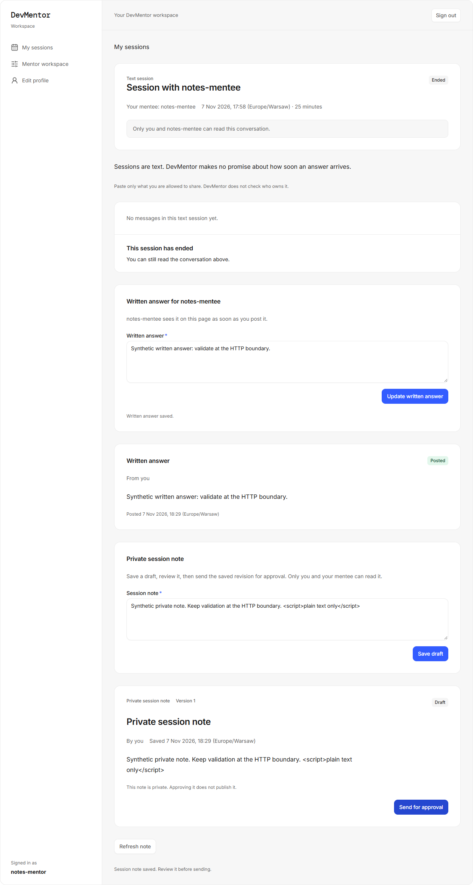
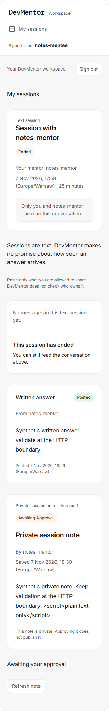
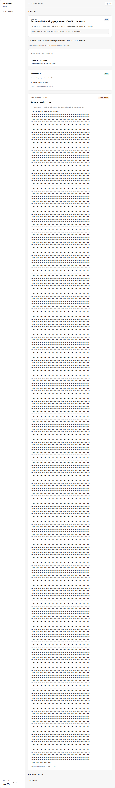
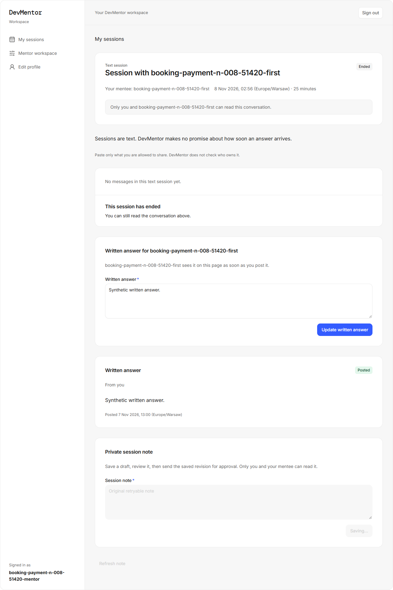
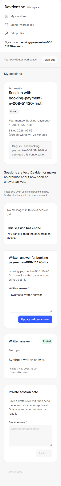
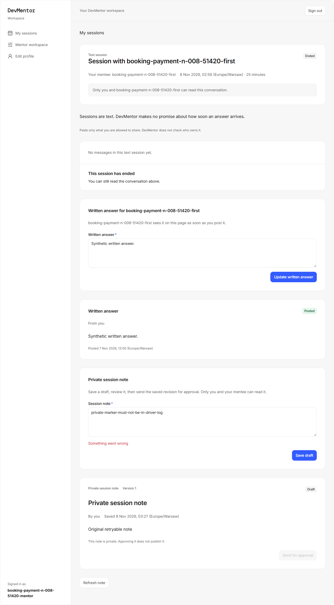
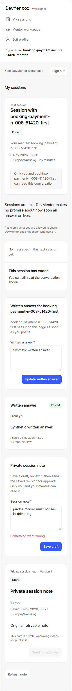

## Automated UI evidence for issue #47

Synthetic data only. The fresh full suite passed all 102 tests; desktop and 320px assertions include escaped long text, pending controls and retryable private failures. This is automated evidence, not human QA or QA sign-off.

Production source was independently reviewed at 9aff0c6; parent accepted the identical integrated source with passing gate/coverage and real-pool/migration checks. needs-qa remains required.

### mentor-draft-desktop.png

### mentee-awaiting-320.png

Fresh full-suite long-text, pending and error screenshots

Evidence report and complete scenario list are committed in .ai/qa/NOTES/ on the implementation branch. No real customer data, credentials, cookies or environment files are included.
