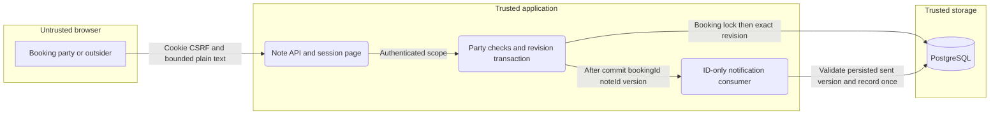

# Issue 47 session notes

## Request

Run om-auto-fix-issue for GitHub issue #47 (E04-S03), mentor-drafted private session notes awaiting mentee approval.

## Work and evidence

- Classified #47 as a feature. Read the installed om-auto-fix-issue workflow, configuration, tracker descriptor, SDLC readiness contract, lessons, issue body and comments.
- Confirmed #47 has no assignee or in-progress label and no open PR references it. GitHub CLI open PR listing returned an empty array.
- Confirmed its explicit prerequisite #46 is open, assigned to warnaa and labeled in-progress. Its latest claim comment says om-auto-write-spec started at 2026-11-07T11:25:39Z: https://github.com/warnaa/aitl-mentio/issues/46#issuecomment-6706215312.
- Current HEAD is f5408a4. Booking has no writtenAnswer/writtenAnswerAt fields; TextSessionService has no written-answer API. The existing text-session spec explicitly excludes written answers and session notes. No dedicated session-notes spec exists.

## Outcome

Blocked on prerequisite #46. Do not duplicate its written-answer implementation or assume its pending contract. No application code, tracker state, remote branches or PRs were changed. No issue lock was acquired. Tests were not run because no application changes were made.

## Files

This run record and the cockpit handoff were updated.

## Follow-up

After #46 lands, update this worktree to the approved prerequisite, resolve or author the shared #47/#48 session-notes spec through om-auto-write-spec, then implement #47 through om-auto-implement-spec. Keep approval/decline behavior (#48) outside #47's implementation scope. Recheck concurrency before resuming.

## Resumed after prerequisite merge

- 2026-11-07: fetched origin and verified #46 implementation merged at ce6c182. Merged origin/main into cez/091229c4 (preserving the cockpit's earlier run-record commit).
- Rechecked #47: open, unassigned, no claim and no open PR. No remote mutation performed.
- Drafted .ai/specs/2026-11-07-session-notes.md skeleton, then resolved defaults and completed the shared lifecycle design. Slice A is #47 only; slice B is explicitly #48, not part of this implementation run.
- Independent read-only investigation db06ec7c verified existing patterns and identified scope, data privacy, concurrency and notification-replay risks. Validated its branch diff is empty. No runtime tests apply to that read-only investigation.
- Spec describes immutable sent revisions, 404 for outsiders, no mentee editing, in-product-only send notification, manual refresh after ended sessions, and expected revisions to prevent stale saves/sends. It infers risk-high from SDLC because this changes private-data scoping and a migration.
- Existing test-env helpers exist, but there is no generated local test-environment descriptor; mockups/current screenshots are omitted under the spec workflow's documented fallback. Prototype s9/s10/s15 remain design authority. No app QA or tests claimed.
- Next: independent skeptical review of spec, address findings and prepare sanitized spec PR draft and defaults comment. Before remote publication the user's explicit remote-write guard requires approval. No source implementation or remote claim yet.

- Independent spec review a7ce2438 requested two medium fixes: reachable notification repair after send and deterministic client response ordering. Added awaiting-state Notify mentee, replay/readAt guarantees, request-generation invalidation, current dirty-state checks and delayed-response acceptance tests. Reviewer branch has no diff; no source or runtime test changes. Re-review pending.

- Independent re-review 247ff468 approved the specification, closing M1 and M2 with no new material finding. Verified its branch diff is empty; git diff --check passed. Updated the concrete spec PR draft with the verdict. Runtime tests and implementation remain unperformed, correctly outside this design-only milestone.
- Awaiting explicit approval to publish the separate design-only spec PR, its defaults/rationale comments and issue claim/release updates; no remote writes yet. The original #47 implementation objective remains unfinished. After publication, continue only slice A through om-auto-implement-spec; #48 stays deferred.

- Owner approved spec publication. Opened ready design-only PR #78, https://github.com/warnaa/aitl-mentio/pull/78, head spec/session-notes, base main. Posted defaults on #78 and #47, label rationale and summary on #78. Read back review/documentation/skip-qa/priority-low/risk-low. Released in-progress on #47, assignment handed back to warnaa. No implementation or QA approval claimed.

## Local implementation execution plan (2026-11-07)

Scope: issue #47 slice A only, based on spec/session-notes:.ai/specs/2026-11-07-session-notes.md. Spec PR #78 remains separate; its document is never committed here. All tracker/publishing phases are replaced by local artifacts; no remote writes authorized.

## Progress

- [x] P0: Skeptical staff-engineer read-only cezar review of this plan; resolve material findings before coding.
- [x] A1: Entity/discovery/export, generated reversible migration/snapshot and notification kind constraint; entity tests and migration up/down/up.
- [x] A2: Shared validators/DTOs and scoped SessionNoteService with booking-first locks, party authorization, exact revisions, immutable sent snapshot and replay event; 100% unit tests and PostgreSQL races. ? b40706c
- [x] A3: Dynamic GET/PUT/send API routes, authentication/CSRF, private no-store responses and bounded account limits; route unit tests. ? 1c295d6 / 0fa67f4
- [x] A4: In-product-only notification consumer/subscription and notification UI kind; replay repair and readAt retention tests without body disclosure or email. ? 1c295d6
- [x] A5: SessionNotePanel/SessionRoom/page integration using CrudForm/apiCall/NoteReview. Explicit generation ordering, dirty-at-application and monotonic parent-prop handling. Controlled delayed-response/state/role tests; no decision buttons. ? 0208893 / 0fa67f4 / d46b61a / 666df13
- [ ] A6: Preserve integration scenarios, sanitized desktop/320px state-matrix evidence, compatibility record and implementation PR body draft. Run typecheck/lint/test/build in order, coverage and full integration. Inspect final diff; incremental source commits and report actual outcomes/blockers, without human QA claims.

Verification strategy: each production file enters coverage.include in its implementation commit; tests exercise statements/branches/functions/lines to 100%. Real PostgreSQL tests cover first-save collisions, save/send ordering, authorization and migration reversibility. Browser exploration precedes authored semantic UI scenarios through shared environment/provider descriptors. Include mentor/mentee/outsider, ended refresh, notification recovery, dirty conflicts, long escaped text and responsive controls. Stop owned processes by PID; no secrets in artifacts.

Commit boundaries: A1 database, A2 core, A3-A4 API/notifications, A5 client, A6 verification/docs (adjust to keep each commit coherent). Parent performs fresh final implementation review and merges feature branch only after approval; this task supplies implementation and evidence, not remote reviews or merge.

- P0 approved by read-only cezar review 5076cd36; its diff is empty. npm ci passed (859 packages). Inherited spec is already tracked at fork; no implementation commit stages it.

- A1 implemented: generated Migration20261107171237_session_notes; removed unrelated generator churn. Disposable PostgreSQL migration up/down/up passed; entity/notification/migration targeted tests: 3 files, 3 tests passed. Baseline after clean npm ci: 202 files, 1743 tests passed.

- A1 source commit a50a704; checklist commit 9be1be8. A2 targeted validators/service/container tests: 3 files, 62 tests passed. Initial typecheck caught nullable entity declineComment inference; normalized absent value to null in DTO. PostgreSQL race verification stays pending A6.

- A2 source b40706c; typecheck passed and targeted new core coverage proves 100% statements/branches/functions/lines (64/45/14/56). PostgreSQL races still pending A6; do not mark A2 acceptance complete yet. A3/A4 routes and notification consumer targeted tests: 4 files, 69 tests passed.

- A3/A4 source 1c295d6. A5 client/ordering tests: 5 files, 50 tests passed. First full coverage run: all 1779 tests passed but panel duplicate-action guards untested; added same-batch duplicate-send/refresh regression, targeted panel now 100% all four metrics. Added preserved unsaved-text copy when another tab sends a dirty draft.

## Security verification scope for slice A

Applied the threat-model skill to the reviewed spec's existing security model. Scope is synthetic local browser/API/PostgreSQL only. Assets: private body, party identity, exact saved revision and notification read state. Browser cookie/CSRF boundary -> authenticated note route -> party-scoped service -> PostgreSQL; post-commit ID-only event -> system-scoped notification consumer. No AI, email or external provider is introduced.

STRIDE: spoofing/elevation are controlled by live session and per-booking party checks (401/403/404 tests); tampering by shared schema, booking-first transaction and exact expected revision (stale/race tests); repudiation by persisted revision/sentAt, with no durable event audit claimed; disclosure by explicit DTOs, escaped text and no-store (outsider/public/event/notification tests); denial of service by body bounds/account limits (422/429 tests). Existing infrastructure at-rest policy and in-process lost-event recovery remain residual risks, not new acceptance or delivery guarantees. All mitigations remain pending full integration verification until A6 evidence is recorded.

- A5 source commit 0208893. Shared QA startup initially failed Next bundled TypeScript checking on the new fieldset event-target cast (TS2352). Corrected through unknown, matching existing SessionRoom convention; shared environment rebuilding. No UI QA claimed yet.

- Final ordered gate passed on 2026-11-07: typecheck 0, lint 0 (two pre-existing warnings), test 0 (210 files/1781 tests), build 0. Full test:unit:coverage 0, per-file statements/branches/functions/lines all 100% (3824/2322/1103/3425). Real shared-env browser mentor/mentee/outsider flow, exact saved send, Ctrl+Enter save, 320px zero overflow, ended refresh, dirty conflict and Notify repair/readAt preservation passed. Desktop/320 evidence is .ai/qa/NOTES; shared app/container/browser sessions stopped. Full integration suite running; A2-A6 remain unchecked until acceptance evidence is confirmed.

- Final diff review tightened two A5 acceptance cases: a transient initial note query failure now preserves the readable session with a retryable panel; a delayed successful PUT cannot replace a newer parent revision accepted first. Added controlled regressions; targeted sessions coverage remains 100% across 52 tests. Added NOTES-008 real-browser storage-failure/Retry and driver-error privacy scenario. These source changes require a fresh ordered gate/full integration after the currently running suite settles.

- Final adversarial UI check kept Notify mentee usable even when another tab submitted while this tab had dirty text: unsaved copy remains visible, but immutable submission notification can be safely replayed. Dirty drafts still cannot Send. Targeted session suite: 52 tests, all four coverage metrics 100%. Scenario registry/link/case mapping check passed for NOTES-001..008. Final source refinement 0fa67f4 plus this small guard refinement; full ordered rerun follows integration teardown.

- A6 authored scenarios/evidence/compatibility committed, including NOTES-001..008, real PostgreSQL save/save and save/send races, subscriber failure repair, party isolation, rate limits, 19k text UI and reversible lifecycle migration. Final prefix rerun typecheck/lint/test exits 0, 210 files/1783 tests. Build/coverage/full integration final rerun waits for the first suite to finish and release its app artifacts.

- First full test:integration exited 1 after 900.93s: 48 files passed/1 failed, 98 tests passed/1 failed. NOTES-001..006 passed, including live PostgreSQL races, rate limits, notification-failure recovery and long-text real UI. NOTES-007 reached migration up/down/up but its helper JSON.parse rejected bare to_regclass text; corrected SELECT to to_json(to_regclass(...)). New NOTES-008 and latest page/ordering guards need rebuilt verification. Same-batch save/send exclusion now uses capture handlers (schema callback ref capture was rejected by React lint); targeted session tests/coverage and scoped lint pass.

- Final ordered gate at source 666df13 passed: typecheck/lint/test/build exit 0; 210 files and 1783 unit tests. Final configured test:unit:coverage exit 0, per-file all four metrics 100% (statements 3833/3833, branches 2332/2332, functions 1105/1105, lines 3430/3430). Sanitized complete command outputs and per-file changed-source coverage table saved in .ai/qa/NOTES. Targeted migration/storage recovery integration is running before final full-suite rerun.

- Focused final integration passed: NOTES-007 and NOTES-008, 2 passed/98 excluded by filter, 97.08s. Real pending controls, error text retention, initial-load retry and driver-body log masking proven in browser; screenshots preserved locally. A2-A5 acceptance verified; A6 stays pending for final full integration, report/cleanup. Final full suite started at source 666df13 with machine-readable JSON results and a 25-minute process cap.
