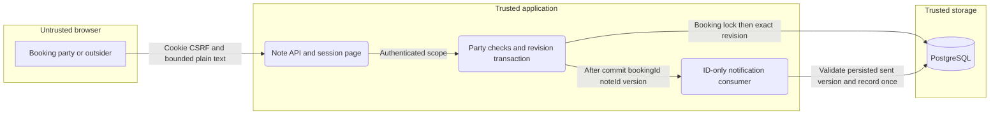

# Issue 47 session notes

## Request

Run om-auto-fix-issue for GitHub issue #47 (E04-S03), mentor-drafted private session notes awaiting mentee approval.

## Work and evidence

- Classified #47 as a feature. Read the installed om-auto-fix-issue workflow, configuration, tracker descriptor, SDLC readiness contract, lessons, issue body and comments.
- Confirmed #47 has no assignee or in-progress label and no open PR references it. GitHub CLI open PR listing returned an empty array.
- Confirmed its explicit prerequisite #46 is open, assigned to warnaa and labeled in-progress. Its latest claim comment says om-auto-write-spec started at 2026-11-07T11:25:39Z: https://github.com/warnaa/aitl-mentio/issues/46#issuecomment-6706215312.
- Current HEAD is f5408a4. Booking has no writtenAnswer/writtenAnswerAt fields; TextSessionService has no written-answer API. The existing text-session spec explicitly excludes written answers and session notes. No dedicated session-notes spec exists.

## Initial outcome (before prerequisite merge)

Blocked on prerequisite #46. Do not duplicate its written-answer implementation or assume its pending contract. No application code, tracker state, remote branches or PRs were changed. No issue lock was acquired. Tests were not run because no application changes were made.

## Files

This run record and the cockpit handoff were updated.

## Follow-up

After #46 lands, update this worktree to the approved prerequisite, resolve or author the shared #47/#48 session-notes spec through om-auto-write-spec, then implement #47 through om-auto-implement-spec. Keep approval/decline behavior (#48) outside #47's implementation scope. Recheck concurrency before resuming.

## Resumed after prerequisite merge

- 2026-11-07: fetched origin and verified #46 implementation merged at ce6c182. Merged origin/main into cez/091229c4 (preserving the cockpit's earlier run-record commit).
- Rechecked #47: open, unassigned, no claim and no open PR. No remote mutation performed.
- Drafted .ai/specs/2026-11-07-session-notes.md skeleton, then resolved defaults and completed the shared lifecycle design. Slice A is #47 only; slice B is explicitly #48, not part of this implementation run.
- Independent read-only investigation db06ec7c verified existing patterns and identified scope, data privacy, concurrency and notification-replay risks. Validated its branch diff is empty. No runtime tests apply to that read-only investigation.
- Spec describes immutable sent revisions, 404 for outsiders, no mentee editing, in-product-only send notification, manual refresh after ended sessions, and expected revisions to prevent stale saves/sends. It infers risk-high from SDLC because this changes private-data scoping and a migration.
- Existing test-env helpers exist, but there is no generated local test-environment descriptor; mockups/current screenshots are omitted under the spec workflow's documented fallback. Prototype s9/s10/s15 remain design authority. No app QA or tests claimed.
- Next: independent skeptical review of spec, address findings and prepare sanitized spec PR draft and defaults comment. Before remote publication the user's explicit remote-write guard requires approval. No source implementation or remote claim yet.

- Independent spec review a7ce2438 requested two medium fixes: reachable notification repair after send and deterministic client response ordering. Added awaiting-state Notify mentee, replay/readAt guarantees, request-generation invalidation, current dirty-state checks and delayed-response acceptance tests. Reviewer branch has no diff; no source or runtime test changes. Re-review pending.

- Independent re-review 247ff468 approved the specification, closing M1 and M2 with no new material finding. Verified its branch diff is empty; git diff --check passed. Updated the concrete spec PR draft with the verdict. Runtime tests and implementation remain unperformed, correctly outside this design-only milestone.
- Awaiting explicit approval to publish the separate design-only spec PR, its defaults/rationale comments and issue claim/release updates; no remote writes yet. The original #47 implementation objective remains unfinished. After publication, continue only slice A through om-auto-implement-spec; #48 stays deferred.

- Owner approved spec publication. Opened ready design-only PR #78, https://github.com/warnaa/aitl-mentio/pull/78, head spec/session-notes, base main. Posted defaults on #78 and #47, label rationale and summary on #78. Read back review/documentation/skip-qa/priority-low/risk-low. Released in-progress on #47, assignment handed back to warnaa. No implementation or QA approval claimed.

## Local implementation execution plan (2026-11-07)

Scope: issue #47 slice A only, based on spec/session-notes:.ai/specs/2026-11-07-session-notes.md. Spec PR #78 remains separate; its document is never committed here. All tracker/publishing phases are replaced by local artifacts; no remote writes authorized.

## Progress

- [x] P0: Skeptical staff-engineer read-only cezar review of this plan; resolve material findings before coding.
- [x] A1: Entity/discovery/export, generated reversible migration/snapshot and notification kind constraint; entity tests and migration up/down/up.
- [x] A2: Shared validators/DTOs and scoped SessionNoteService with booking-first locks, party authorization, exact revisions, immutable sent snapshot and replay event; 100% unit tests and PostgreSQL races. ? b40706c
- [x] A3: Dynamic GET/PUT/send API routes, authentication/CSRF, private no-store responses and bounded account limits; route unit tests. ? 1c295d6 / 0fa67f4
- [x] A4: In-product-only notification consumer/subscription and notification UI kind; replay repair and readAt retention tests without body disclosure or email. ? 1c295d6
- [x] A5: SessionNotePanel/SessionRoom/page integration using CrudForm/apiCall/NoteReview. Explicit generation ordering, dirty-at-application and monotonic parent-prop handling. Controlled delayed-response/state/role tests; no decision buttons. ? 0208893 / 0fa67f4 / d46b61a / 666df13
- [x] A6: Preserve integration scenarios, sanitized desktop/320px state-matrix evidence, compatibility record and implementation PR body draft. Run typecheck/lint/test/build in order, coverage and full integration. Inspect final diff; incremental source commits and report actual outcomes/blockers, without human QA claims.

Verification strategy: each production file enters coverage.include in its implementation commit; tests exercise statements/branches/functions/lines to 100%. Real PostgreSQL tests cover first-save collisions, save/send ordering, authorization and migration reversibility. Browser exploration precedes authored semantic UI scenarios through shared environment/provider descriptors. Include mentor/mentee/outsider, ended refresh, notification recovery, dirty conflicts, long escaped text and responsive controls. Stop owned processes by PID; no secrets in artifacts.

Commit boundaries: A1 database, A2 core, A3-A4 API/notifications, A5 client, A6 verification/docs (adjust to keep each commit coherent). Parent performs fresh final implementation review and merges feature branch only after approval; this task supplies implementation and evidence, not remote reviews or merge.

- P0 approved by read-only cezar review 5076cd36; its diff is empty. npm ci passed (859 packages). Inherited spec is already tracked at fork; no implementation commit stages it.

- A1 implemented: generated Migration20261107171237_session_notes; removed unrelated generator churn. Disposable PostgreSQL migration up/down/up passed; entity/notification/migration targeted tests: 3 files, 3 tests passed. Baseline after clean npm ci: 202 files, 1743 tests passed.

- A1 source commit a50a704; checklist commit 9be1be8. A2 targeted validators/service/container tests: 3 files, 62 tests passed. Initial typecheck caught nullable entity declineComment inference; normalized absent value to null in DTO. PostgreSQL race verification stays pending A6.

- A2 source b40706c; typecheck passed and targeted new core coverage proves 100% statements/branches/functions/lines (64/45/14/56). PostgreSQL races still pending A6; do not mark A2 acceptance complete yet. A3/A4 routes and notification consumer targeted tests: 4 files, 69 tests passed.

- A3/A4 source 1c295d6. A5 client/ordering tests: 5 files, 50 tests passed. First full coverage run: all 1779 tests passed but panel duplicate-action guards untested; added same-batch duplicate-send/refresh regression, targeted panel now 100% all four metrics. Added preserved unsaved-text copy when another tab sends a dirty draft.

## Security verification scope for slice A

Applied the threat-model skill to the reviewed spec's existing security model. Scope is synthetic local browser/API/PostgreSQL only. Assets: private body, party identity, exact saved revision and notification read state. Browser cookie/CSRF boundary -> authenticated note route -> party-scoped service -> PostgreSQL; post-commit ID-only event -> system-scoped notification consumer. No AI, email or external provider is introduced.

STRIDE: spoofing/elevation are controlled by live session and per-booking party checks (401/403/404 tests); tampering by shared schema, booking-first transaction and exact expected revision (stale/race tests); repudiation by persisted revision/sentAt, with no durable event audit claimed; disclosure by explicit DTOs, escaped text and no-store (outsider/public/event/notification tests); denial of service by body bounds/account limits (422/429 tests). Existing infrastructure at-rest policy and in-process lost-event recovery remain residual risks, not new acceptance or delivery guarantees. All mitigations remain pending full integration verification until A6 evidence is recorded.

- A5 source commit 0208893. Shared QA startup initially failed Next bundled TypeScript checking on the new fieldset event-target cast (TS2352). Corrected through unknown, matching existing SessionRoom convention; shared environment rebuilding. No UI QA claimed yet.

- Final ordered gate passed on 2026-11-07: typecheck 0, lint 0 (two pre-existing warnings), test 0 (210 files/1781 tests), build 0. Full test:unit:coverage 0, per-file statements/branches/functions/lines all 100% (3824/2322/1103/3425). Real shared-env browser mentor/mentee/outsider flow, exact saved send, Ctrl+Enter save, 320px zero overflow, ended refresh, dirty conflict and Notify repair/readAt preservation passed. Desktop/320 evidence is .ai/qa/NOTES; shared app/container/browser sessions stopped. Full integration suite running; A2-A6 remain unchecked until acceptance evidence is confirmed.

- Final diff review tightened two A5 acceptance cases: a transient initial note query failure now preserves the readable session with a retryable panel; a delayed successful PUT cannot replace a newer parent revision accepted first. Added controlled regressions; targeted sessions coverage remains 100% across 52 tests. Added NOTES-008 real-browser storage-failure/Retry and driver-error privacy scenario. These source changes require a fresh ordered gate/full integration after the currently running suite settles.

- Final adversarial UI check kept Notify mentee usable even when another tab submitted while this tab had dirty text: unsaved copy remains visible, but immutable submission notification can be safely replayed. Dirty drafts still cannot Send. Targeted session suite: 52 tests, all four coverage metrics 100%. Scenario registry/link/case mapping check passed for NOTES-001..008. Final source refinement 0fa67f4 plus this small guard refinement; full ordered rerun follows integration teardown.

- A6 authored scenarios/evidence/compatibility committed, including NOTES-001..008, real PostgreSQL save/save and save/send races, subscriber failure repair, party isolation, rate limits, 19k text UI and reversible lifecycle migration. Final prefix rerun typecheck/lint/test exits 0, 210 files/1783 tests. Build/coverage/full integration final rerun waits for the first suite to finish and release its app artifacts.

- First full test:integration exited 1 after 900.93s: 48 files passed/1 failed, 98 tests passed/1 failed. NOTES-001..006 passed, including live PostgreSQL races, rate limits, notification-failure recovery and long-text real UI. NOTES-007 reached migration up/down/up but its helper JSON.parse rejected bare to_regclass text; corrected SELECT to to_json(to_regclass(...)). New NOTES-008 and latest page/ordering guards need rebuilt verification. Same-batch save/send exclusion now uses capture handlers (schema callback ref capture was rejected by React lint); targeted session tests/coverage and scoped lint pass.

- Final ordered gate at source 666df13 passed: typecheck/lint/test/build exit 0; 210 files and 1783 unit tests. Final configured test:unit:coverage exit 0, per-file all four metrics 100% (statements 3833/3833, branches 2332/2332, functions 1105/1105, lines 3430/3430). Sanitized complete command outputs and per-file changed-source coverage table saved in .ai/qa/NOTES. Targeted migration/storage recovery integration is running before final full-suite rerun.

- Focused final integration passed: NOTES-007 and NOTES-008, 2 passed/98 excluded by filter, 97.08s. Real pending controls, error text retention, initial-load retry and driver-body log masking proven in browser; screenshots preserved locally. A2-A5 acceptance verified; A6 stays pending for final full integration, report/cleanup. Final full suite started at source 666df13 with machine-readable JSON results and a 25-minute process cap.

## Revised A2 verification plan: saturated connection pool

Final dependency inspection confirmed that scoped `orm.em.fork()` defaults to `useContext: false` (MikroORM EntityManager.js), so RateLimiter's injected EntityManager does not borrow SessionNoteService's forked transaction connection. Consuming the account limit inside the locked transaction can deadlock a small pool: all connections wait on the booking lock while its owner waits for another connection for the limiter. Two-request races do not reveal saturation.

Before further source changes, obtain a skeptical read-only cezar review of this focused revision. Proposed sequence: resolve/validate caller; read/populate confirmed booking and verify mentor party without a write lock; consume the account limit outside any note transaction; start the transaction, lock Booking by ID without joins, and repeat confirmed status/party/mentor checks; check answer and latest note/revision inside the transaction as before. This preserves outsider 404/mentee 403 and counts authorized attempts without holding a booking connection during the limiter query. Preauthorization is advisory only; transactional checks remain authoritative. Keep postcommit ID-only events unchanged.

Regression: hold the booking lock using a separate fixture connection, launch six concurrent create-only saves against the app's configured max-five pool, observe five real database lock waiters with bounded state polling, then release the lock. Exactly one save succeeds, the other five conflict, and one version exists. Add a unit regression proving a cancellation between preauthorization/rate-limit and lock acquisition is refused. Re-run targeted coverage, full ordered gate and full integration after the change; A2 is reopened until this passes. No spec lifecycle change or remote write is authorized. Parent still owns final independent implementation review.

- Parent confirms separate scoped RateLimiter connection and requires focused plan review before pool fix. Parent also reports independent reviewer f2f37586 observed intermittent unchanged MentorProfileEditor focus failure; do not attribute it to note source or claim every repeat green. Parent owns inherited spec-history isolation and fresh implementation review. Current pre-pool full integration is still running and reports a failure in unchanged mentor-page publishing UI; inspect final stack/artifacts before classification or next validation claim.

## Recovery continuation (2026-11-08)

- Imported unfinished cez/f343a53d at fc35d32 by fast-forward into cez/cd442146. No old worktree writes. Root forwarded focused skeptical reviewer 3b2f2a89 APPROVE at fc35d32, including the max-one-pool requirement; reviewer branch was read-only. This approves the revised execution plan, not defective prior source.
- Restored migration snapshot exactly from da85393 (identical to a50a704), removing autosaved integration schema churn while retaining intended session_notes/notification-kind changes. Native migration commands may rewrite it again; restore this reference after verification.
- Moved limiter outside the booking transaction after advisory mentor-party authorization. A fresh fork then locks Booking by ID and repeats status/party/mentor/answer/revision checks. Postcommit ID-only events unchanged. Added distinct cancelled booking snapshots for both save/send and a limiter-failure/no-transaction test; focused service unit run passed 18/18.
- Added NOTES-009 real shared max-one pool save/send/replay and NOTES-010 six HTTP create saves with five observed app lock waiters rooted at an independently pooled external holder. Initial typecheck rejected a test-only unsupported pool option; replaced with installed pg driver connectionTimeoutMillis. Focused integration now running with bounded owned process tree. A2 remains reopened and A6 pending until fresh evidence.

- Recovery commits: b07cd72 restores the exact pre-integration snapshot; 9aff0c6 corrects pool ordering and adds regressions/lesson. Focused native integration exited 0: 2 files passed, 48 skipped; 3 tests passed, 99 skipped, 99.57s (NOTES-007/009/010). Preserved output is recovery-focused.log.
- Proved regression sensitivity by temporarily restoring ONLY the old fc35d32 service, running NOTES-009, then restoring committed HEAD in finally. This intentional pre-fix run exited 1: 1 failed/101 excluded, 81.92s overall; save failed in RateLimiter.consume with DriverException timeout exceeded when trying to connect (2.59s test). Corrected HEAD restored and git diff for service empty before fresh ordered gate. Evidence: recovery-regression.log. Never count this deliberate red run as fixed-source verification.
- Independent read-only source review fb4c4657 dispatched from committed 9aff0c6; final gate/full integration and human QA remain unclaimed. Prior old full integration final JSON is absent; old mentor-page publish diagnostics contain empty error/console sections, insufficient to classify cause. Fresh full suite will reproduce or disconfirm without unrelated production repair.

- Fresh corrected-source ordered gate at 9aff0c6: npm run typecheck 0, lint 0 (same two pre-existing warnings), test 0 (210 files/1786 tests plus 4 native classifier tests), build 0, test:unit:coverage 0 (210 files/1786 tests, per-file 100% statements3835/branches2332/functions1105/lines3432). Evidence: recovery-gate.log and regenerated coverage.md. Prior unchanged MentorProfileEditor focus assertion did not fail in either fresh whole-unit run; no unrelated repair made.
- Structural snapshot comparison against ce6c182 confirms session_notes alone added, no removed tables, notifications alone changed, and other root keys identical. Restore b07cd72 after native migrations.
- Full native integration started on corrected source with default+JSON reporters and 25-minute owned-process-tree cap. Fresh worktree has no shared QA descriptor; documented native runner provisions independent disposable app/database. Desktop/320 synthetic evidence preserved. A2/A6 and final independent review remain pending; human QA unclaimed.

- Root inspection confirmed pool fix/snapshot scope and requested BOM sanitization before final publication artifacts. Removed UTF-8 BOMs from changed text artifacts; normalized trailing whitespace in completed recovery logs. Reviewer fb4c4657 finds no production defect so far and recommends hardening test blocker acquisition/rejection/draining; defer test edit until current full suite settles, then focused verification will cover the final helper. No acceptance or full integration pass claimed yet.

- Independent source reviewer fb4c4657 APPROVE ce6c182..9aff0c6, no blocker/major. Verified reviewer branch is exactly 9aff0c6 with empty source diff; our fresh five gates independently corroborate its reported commands/counts. Reviewer valid pinned installation/gates all exit0 (1786 tests; per-file100); initial ancestor-workspace runs were discarded. Minor saturation-test failure cleanup will be hardened after current full suite; removed one panel EOF blank line without behavior change. No #48 or human QA accepted. Detailed review lives in cockpit units/fb4c4657/review.md.

- Fresh FULL native integration on corrected production 9aff0c6 exited 0: all 50 files / 102 tests passed, zero skipped/failed, 940.92s. JSON success=true/counts validated; sanitized per-case summary and complete output saved as recovery-integration-summary.json/recovery-integration.log. NOTES-001..010 (including migration up/down/up, max-one shared limiter pool, five-waiter six-save race), all mentor-page publishing cases and prior unresolved focus checks pass in fresh runs. Old failures/interruption remain historical and are not retroactively called green. A2 acceptance is now complete; A6 remains pending final helper cleanup confirmation/records.
- Native full suite cleaned its disposable app/database/browser resources; docker inventory contains only the pre-existing devmentor-postgres (not touched). Restored exact b07cd72 snapshot after suite rewrote it. Preserved seven fresh synthetic desktop/320px screenshots with recovery- prefix, retaining prior state-matrix screenshots.
- Implemented reviewer's minor test-only failure cleanup: reject acquisition on blocker failure, bound fixture lock acquisition, install immediate request settlement handlers and drain blocker/requests together in finally. Five real app waiters/one200-five409/single-version assertions unchanged. No production behavior change. Fresh typecheck/lint and only the affected native pool integration file will verify this review-driven change; no redundant whole unit/coverage/full-suite rerun is needed.

- Final review-driven test cleanup ffffcd6 passed fresh typecheck0/lint0 and affected native integration file0 (1 file/2 tests,34.39s). Independent narrow review03ed4a4c APPROVE exact diff, no remaining findings; branch diff empty and merge already up to date. Main source reviewfb4c4657 and cleanup review are preserved in sanitized QA Markdown. Production behavior remains reviewed9aff0c6; all remaining source-test hygiene is BOM-only (normalized-content equality verified), panel EOF fix has no runtime effect.
- Final scenario IDs/implementation links/exact executable titles verified for NOTES001..010. Full102-test JSON success/counts validated; per-case summary and7fresh synthetic desktop/320px screenshots preserved alongside historical state-matrix evidence. Completed logs normalized UTF-8/noBOM/ANSI/trailing whitespace and screened for secret patterns. Snapshot restored to reviewedb07cd72 after native migration rewrite; only session_notes added/notifications changed relative to prerequisite.
- Final resource inventory: zero non-agent processes referencing this checkout; only pre-existing devmentor-postgres/eaca8b923987 remains in Docker, untouched. Native app/database/browser sessions and reviewer-owned processes ended. No production credentials or other worktree resources touched.
- A1-A6 local implementation/automated acceptance complete; parent owns final independent acceptance and inherited spec-history isolation before any merge/publication. Human QA/scenario review remains pending. No #48 decisions/redrafts/operator counts/answer freeze; no new spec or instruction edits; no remote writes. Sanitized local PR draft is .ai/qa/NOTES/implementation-pr-body.md. Engine: om-auto-create-pr (steps: 6, --loop: no), resumed via om-auto-implement-spec with explicit LOCAL-ONLY override of remote phases.

## Parent integration and acceptance

- 2026-11-08: read final child report and inspected source, PostgreSQL regressions, private mobile screenshots, machine-readable full integration result and both independent review reports. Review branches match their reviewed heads without edits. The accepted child tip is f70c6cd; production source review covers 9aff0c6 and cleanup review covers ffffcd6.
- Replayed the 18 implementation-only child commits onto clean feature baseline 48eb1a0 in `integrate/issue-47-session-notes`, resolving only the initial run-log overlap with the child record. Preserved all original branches and commits; no history was rewritten. Merged this clean derivative with no fast-forward into `feat/issue-47-session-notes` at e42ead0. This avoids importing the separately published spec PR's ancestry or files.
- Verified final production source, tests, configuration and compatibility records are byte-identical to the accepted child, and the only child-tree exclusions are the spec and its four publication draft records. Spec PR #78 remains open; its document is not in the implementation diff. The current main prerequisite remains ce6c182.
- Installed pinned local dependencies (861 packages). Parent ordered typecheck/lint/test/build and test:unit:coverage all exited 0: 210 files, 1,786 tests, four native classifier tests, per-file statements 3835/3835, branches 2332/2332, functions 1105/1105 and lines 3432/3432. Two pre-existing lint warnings, no errors. Summary: `.ai/qa/NOTES/root-acceptance-gate.log`.
- Parent artifact audit found no BOMs, unexpected secret-bearing file paths or credential-looking payloads in changed project records; diff whitespace check passed. The first parent integration wrapper failed to parse before executing tests because PowerShell replaced Unicode regex characters; reran with an ASCII-only wrapper. This was a wrapper failure, not a project test failure.
- Parent focused real-pool/migration acceptance passed: exit 0, 2 files and 3 tests, 54.01 seconds, covering a real shared max-one pool, five-waiter saturation with six app requests, and migration up/down/up. Summary: `.ai/qa/NOTES/root-acceptance-pool-integration.log`. Restored generated migration-test snapshot churn to the exact accepted snapshot, with no production/test changes.
- Parent accepts the local implementation. No implementation push, PR, tracker mutation, deployment or external evidence upload has occurred. A ready implementation PR with `review`, `feature`, `needs-qa`, `priority-medium`, `risk-high` is prepared for explicit owner publication approval. Human QA and human scenario review remain pending regardless of automated results; no `qa-approved` or merge is authorized.

## Approved implementation publication

- 2026-11-08: owner explicitly selected Publish implementation PR. Rechecked #47 and open PRs: same-user assignment, no active claim or implementation duplicate; base main remains ce6c182. Claimed the issue publication phase, pushed `feat/issue-47-session-notes` and opened ready PR #79: https://github.com/warnaa/aitl-mentio/pull/79. It Closes #47, Refs #48/#78, and carries the tracking plan, source document and complete status. No merge was performed.
- Read back the full label set: review, feature, needs-qa, priority-medium, risk-high. Posted one label-rationale comment and a comprehensive run summary. Local independent source/cleanup reviews approve, but no author self-approval is claimed on GitHub. GitHub forbids self-approval; repository review/human QA gates remain pending.
- Linked implementation #79 on design-only spec PR #78, preserving separate spec history. Published nine synthetic screenshots on dedicated slash-free branch `qa-evidence-pr79-session-notes` through the tracker evidence operation, and attached inline evidence comment https://github.com/warnaa/aitl-mentio/pull/79#issuecomment-6721994774. No credentials, cookies, env files or real customer data were uploaded.
- At initial head 7c1d4b1, GitHub Change scope, Lint and Unit tests passed; Build and Integration tests were still running. Publication-record-only follow-up commits can start a new run; local success is not a claim that final-head CI passed. No ongoing CI monitor is promised by this publication run, and no ci-monitoring or QA-approved label is left behind.
- Final publication records, metadata and evidence references are committed with this change; the issue publication lock is released after the final push. The final live head, labels, ready state, linkage and lock release are verified before reporting. Human QA/scenario review and any required GitHub approval still gate merge.
