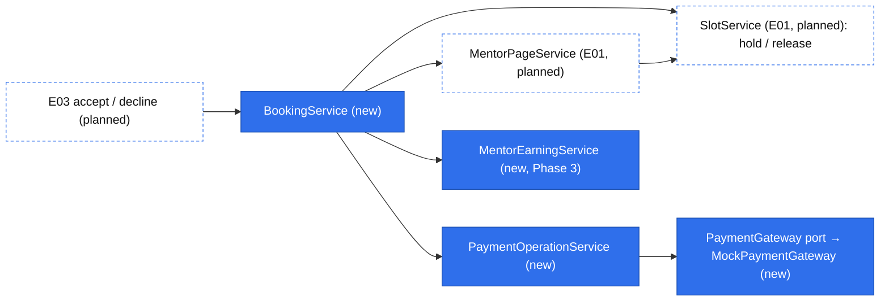
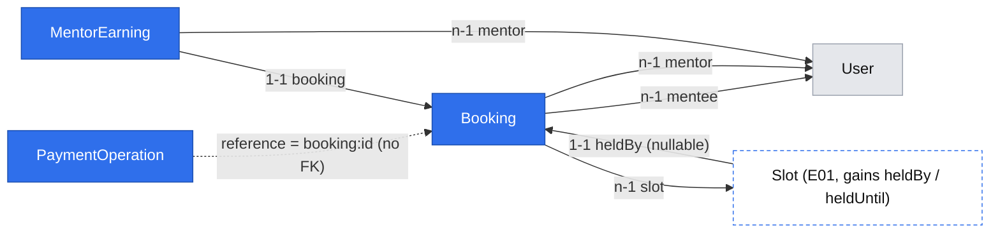

# Book and pay (E02)

Status: draft (gate answered 2026-10-29: Q1 = a, Q2 = a, Q3 = a, Q4 = a, Q5 = a; not implemented)
Decision round 2026-10-29: R20 and R21 approved and entered in the brief; the late-cancelled slot stays held; booking links open with cancellation (three phases); separate `abandoned`/`expired`; question 20–5,000 characters; no refund-failure contact; one account may hold both roles; no mock failure switch; `BOOKINGS_ENABLED` server gate
Review corrections: all eight findings in `.ai/runs/2026-10-29-book-and-pay-design-review.md` applied at the user's request. One time-aware `reconcileWithin` owns deadlines and charge application; cleanup uses one slot per transaction; recovery survives a deleted slot; `BOOKINGS_ENABLED` gates new intent until mentor handling and cancellation ship together. The always-successful mock has stable outcomes across restarts. R22 supersedes R20's unbounded started-payment hold.
Correction review completed 2026-10-30; fresh-context scope check found no remaining scope blockers. Phase 3 still requires the E03 contract review before implementation; the feature is not implemented.
Grilling decisions 2026-10-30: overlapping paid sessions are the mentee's choice; creation and duration changes use the current rate with a price-change notice; live unpaid bookings can be edited without releasing or extending the hold; question-only edits preserve price; pending payment can be cancelled with immediate release and recovery/refund of any successful charge. These decisions supersede the earlier pending-payment cancellation refusal. Run: `.ai/runs/2026-10-30-book-and-pay-grilling.md`.
Issue: #9 — stories #18 (book and pay), #25 (payments port, task of #18), #20 (cancel and refund)
Design authority: `.ai/specs/product-brief.md` (Scope → Now, Key flows 3–4; R03, R06, R08, R09, R11, R14, R15, R17, D09, D13, D14, D18, N01)
Builds on: `2026-10-29-platform-primitives.md` (ids `B*`/`F*` below), `2026-10-29-mentor-pages-and-discovery.md` (E01: `MentorPage.rate`, `Slot`, `SlotService`); requires `2026-10-30-accounts-and-sign-in.md` (#24 Phase 1) for the `mentee` role, persisted-session verification and sign-in

## 📝 TLDR

**Who needs it:** mentees with one blocker and a deadline, who must be able to book in minutes ("jak booking trwa więcej niż pięć minut to robię rollback"). **Today:** nothing can be booked or paid. E01 (designed, not built) gives a mentor a priced page with published start times, but its slots are not clickable. **Proposed (future behavior):**
- A signed-in mentee picks a published slot and a length and sees that length's price. They write the question, then pay on a simulated payment screen. The booking then waits for the mentor (flow steps 3–4).
- The price is always derived from the mentor's stored rate (R08). One booking holds a slot (D09). A mentee has at most one live unpaid booking (R17). An unpaid hold lasts 30 minutes; unconfirmed payment cannot hold past the session's start (R22). Confirmation before the start turns it into a paid reservation, which keeps the slot under the cancellation/decline rules. Deadlines are read lazily, with no timer (D13); unresolved money remains recoverable after a reservation ends.
- A mentee can cancel; the refund follows R14. Every charge and refund goes through a payments port with only a mock adapter (D13), idempotent per booking.
- Mentees may pay for overlapping sessions with different mentors. R17 still limits them to one live unpaid booking; there is no mentee calendar-conflict check.

## 📝 Problem Statement

Mentees lose hours or days waiting for community help. A Friday-evening outage was answered wrongly on Saturday, and the release slipped to Tuesday (`[INTERVIEW]` 2026-09-01). 23 of 109 Discord help threads got no human reply (`[DATA]`, an English-speaking community, so context only, D10).

Damian chose a paid text session in a booked slot (D01, D09): the price seen first and paid before the session (R03), sign-in before paying (D18), and simulated money only (D13). Whether mentees will pay a stranger (A03) cannot be tested on this build; that waits for real Stripe (D14).

This epic proves that the booking and money rules hold before real money exists: a server-side price, one booking per slot, one unpaid booking per mentee, and refunds per R14. It also lets invited mentors take bookings on the mock build (A02). The `abandoned` and `expired` outcomes are recorded separately, so D18's review trigger ("if mentees drop out between the mentor page and payment") has data.

## 📝 Proposed Solution

Three concepts, following the folder convention:
- **`payments`:** durable charge/refund intent, plus the gateway port and its mock adapter. It knows nothing about booking transitions; no generic dispatcher or provider-selection framework is added.
- **`bookings`:** the `Booking`, its statuses and transitions (B8), and the slot hold.
- **`earnings`:** one record per booking that pays the mentor. It is created first by #20's late cancellation (Q4 = a) and reused by #22, and E05 (#23) displays it.

Delivery is three PRs (the 2026-10-29 decision round consolidates the original Q1 split):
1. #25 with #18's API.
2. #18's screens, exercised by direct URL with booking enabled only in isolated local/test environments.
3. #20 together with the mentor-page booking links, after E03-S01 (#19) has merged. Enable booking on a shared deployment only after this complete phase: a paid booking has a mentor who sees it, a decline or R12 refund, and a mentee who can cancel. Direct URLs and APIs obey the server gate throughout; missing links are not a readiness control.

**The booking flow (Q2 = a):**
1. On the mentor's public page, a bookable slot links to `/rezerwacje/nowa/<slotId>`. That page is mentee-only: a visitor who is not signed in is redirected to sign-in and returns afterwards (F2, D18).
2. The mentee picks 25 or 50 minutes. The options carry their prices, and the choice sits above the question box (R03). They write the question and press *Przejdź do płatności*.
3. `POST /api/bookings`: refused while `BOOKINGS_ENABLED` is off. First close the mentee's due unpaid booking in its own transaction, without executing money calls. Then lock only the target slot in a separate transaction, close its lapsed unpaid holder if necessary, check eligibility and R17, price from the stored rate, and insert `awaiting_payment`. One `clock.now()` snapshot sets both `bookings.hold_expires_at` and `slots.held_until` to `now + 30 min` (R22). The unique index decides between concurrent creates after cleanup.
4. `/rezerwacje/<id>/platnosc` is a simulated checkout: "Płatność symulowana — nie pobieramy żadnych pieniędzy", the amount, the slot, and "Termin czeka na Ciebie do 18:32". There are two actions, *Zapłać 120 zł* and *Zrezygnuj*.
5. `POST …/pay`: the winning transaction moves the booking to `paying`, sets `slots.held_until = booking.startsAt`, snapshots the commission (Q5 = a) and records a pending charge with key `booking:<id>:charge`. After commit, recover that intent and apply the shared reconciler. A success applied before the start becomes `paid` ("Czeka na decyzję mentora") and sets `held_until = null`; a decline releases the slot. At or after the start the reservation becomes `payment_failed`, even with an unresolved charge, and any confirmed success is refunded.
6. If the mentee walks away, the hold lapses at its time: the slot shows as free again and R17 stops counting the booking. The status is written as `expired` the next time anything touches the booking or its slot. *Zrezygnuj* releases the slot immediately (`abandoned`).

**Editing and price changes (approved 2026-10-30).** Checkout includes *Edytuj pytanie lub długość*. Only a live `awaiting_payment` booking with no charge intent can be edited, through an owner-scoped `PUT /api/bookings/[id]`. Editing keeps the booking id, slot, and original `holdExpiresAt`; it never releases or extends the hold. The slot and start cannot be changed through this operation. Question-only edits preserve `priceGrosze` even if the mentor has changed their rate. An actual change between 25 and 50 minutes recomputes the price from the mentor's current stored rate, rather than the rate underlying the old booking. Saving the same length is a question-only edit, not a reprice. No editing is allowed after payment starts.

At creation, compare the authoritative price with the displayed quote sent only for notice purposes. At a duration change, compare the current rate with the rate underlying the existing booking, showing both prices for the newly chosen duration. Persist any price-change notice on the booking so navigation or refresh cannot lose it. Show "Cena zmieniła się w międzyczasie: wcześniej …, teraz …" above the payment action, for increases and decreases. Once saved, the quoted price stays fixed until another actual duration change; neither a question-only edit nor pay silently refreshes the rate. Client-supplied amounts never determine the stored or charged price.

Each successful edit increments a booking `revision`. Both edit and the first pay carry `expectedRevision`; compare it under the usual slot-first locks after due reconciliation. A stale edit or first pay returns `409 booking_changed` and refreshes the details before another confirmation; it creates no charge intent. This also prevents another tab's question/duration edit from being paid unseen. Existing-intent pay replays retain their recovery semantics and do not start a new charge. If pay wins first, edit returns `409 booking_not_editable`; if expiry wins, commit expiry and return `409 hold_expired`. Existing-booking edits remain available while the gate is off and never create payment intent.

**Cancellation (Phase 1 pending/unpaid; #20 paid R14).** Apply due-state reconciliation before classifying cancellation, using a clock snapshot taken under the locks. R12 takes precedence: unaccepted `paid` at or after the start becomes `declined` with a full-refund intent; the cancel request returns `409 cancel_not_allowed` after commit and refund execution. Before the start, cancellation covers four cases:
- Awaiting payment: `abandoned`, with nothing to refund.
- Payment pending: `abandoned`, release immediately and stop counting under R17, with no cancellation fee. Keep the immutable charge intent recoverable and ensure one full refund if it succeeds. Commit release before any gateway call; cancellation must not wait for the gateway to become available. Pending confirmation/refund remains visible on the booking. A concurrently completed charge is reconciled first; if that changes the shown outcome, return `cancel_outcome_changed` for fresh confirmation.
- Paid and not accepted, or accepted 12 h or more before the start: `cancelled`. A pending refund is recorded with key `booking:<id>:refund`, and the slot is released.
- Accepted, less than 12 h before the start: `cancelled_late`. This counts as a mentee no-show, so the mentor's earnings are recorded, nothing is refunded and the slot stays held.

The request carries the outcome the mentee was shown. If a still-allowed outcome changes meanwhile (the mentor accepted, or the 12-hour line passed), refuse with `409 cancel_outcome_changed`. If the start has passed or another operation ended the booking, refuse a new cancellation with `409 cancel_not_allowed` after applying due state. Never silently apply different cancellation terms.

**One time-aware reconciler: `reconcileWithin(tx, booking, now)`.** It owns expiry, charge application and cutoff, makes no external calls, and uses a `clock.now()` snapshot taken after the relevant locks are acquired. Apply these rules in order:
1. Lapsed `awaiting_payment` becomes `expired` and releases its own hold.
2. `paying` at or after `startsAt` becomes `payment_failed` and releases its hold **before considering charge success**. Any pending charge stays recoverable, but the booking no longer counts under R17.
3. Before the start, `paying` plus a succeeded charge becomes `paid` with `held_until = null`; a failed charge becomes `payment_failed` and releases the slot; a pending charge leaves it `paying`.
4. `payment_failed` or `abandoned` plus a succeeded charge ensures one full-refund intent exists (`booking:<id>:refund`). Pending/failed charges do not create a refund. A confirmed charge never restores either ended reservation to `paid`, including before the start after abandonment; no separate missed-start flag or status is needed.
5. E03 adds R12 here: `paid` at or after the start becomes `declined`, releases the hold and ensures the same full-refund intent. Accept must apply this due check before accepting.

**One concrete recovery routine (B9): `recoverPayments`.** Pay and settle first reconcile in a transaction, then after commit attempt an existing pending charge once, reconcile again with a fresh locked clock snapshot, attempt any pending refund once, and re-read the DTO. Completed operations are read without calling the gateway. No request loops on an unavailable gateway; concurrent requests replay the same immutable key/payload. This covers crashes before the gateway call, after its success, and after the ledger result but before the booking update.

Cancel uses the same reconciler before its outcome check, then the recovery routine after abandonment, cancellation or an R12 refund commits. This may replay an existing immutable pending charge to resolve an ambiguous result, but never creates a new charge intent; success on an abandoned booking is refunded. Any refusal that writes commits its due state and intent first, runs the applicable refund after commit, and throws outside the transaction. Settle, cancel and replay of an existing charge remain available while `BOOKINGS_ENABLED` is off; the gate only blocks new bookings and creation of new charge intent.

The screens trigger settle once per actual mount using `needsSettlement` and expose *Spróbuj ponownie* if money remains pending, including a successful HTTP response with pending operations. GET loaders project deadlines without writing. A `paying` hold stops counting at `startsAt` even without a visit; an authorized mutation records `payment_failed` before allowing another reservation. An unavailable gateway never prevents that release. Later visits recover the old charge and refund any confirmed success. No worker, generic transition engine or additional booking status is added.

**Early access is blocked on the server.** `BOOKINGS_ENABLED` (env, default off) refuses `POST /api/bookings` and the first `…/pay` before charge intent exists, with `403 bookings_disabled` ("Rezerwacje są chwilowo wyłączone"). Check session/role and, for pay, ownership before the gate; disabled requests create no booking or charge. The draft screen shows the same message instead of the form. Enable it on a shared deployment only after Phase 3 and #19 are deployed together. Phases 1–2 are exercised with the switch on only in isolated local/test environments. It remains a stop for new bookings during D14's transition, while history, cancellation and existing-intent recovery stay available.

**Alternatives considered:**
- **One-click pay (Q2 = b)** was rejected at the gate. It leaves R17 and "payment unfinished" without meaning.
- **A Stripe-Checkout-shaped port now (Q2 = c)** was rejected at the gate. A redirect and a signed mock webhook would be fake machinery built ahead of D14's spec, which will reshape the port anyway (see Risks).
- **Holding the slot through the booking table alone** (a partial unique index on `bookings.slot_id` over live statuses) was not chosen. Every new non-releasing status in E03 and E04 would have to change the index predicate, and E01's availability reads would need a join. Two columns on `slots` make the hold a slot-local predicate.
- **A mock adapter with its own table** was not chosen. B10 requires the guarantee to survive restarts and concurrent calls, and leaves storage to this spec. The ledger's unique key and immutable payload already guarantee "one key, one operation", and a deterministic mock returns the same result for the same key with no state.

### Research (from prior knowledge, not re-checked on 2026-10-29)

- **Stripe Checkout:** prior knowledge suggests a 30-minute shortest session; it informed the unpaid-hold value in R20, retained by R22. D14 must re-check provider limits and design the checkout/webhook lifecycle; preservation of current holds or statuses is not assumed. Recorded-operation idempotency remains required.
- **Cal.com:** it reserves a slot briefly while the booker fills in the form (a reservation with a release time, read lazily). Our hold is the same idea, applied at the payment step instead.
- **Medusa (payment collections and sessions):** it separates authorisation from capture across several providers. We skip that: there is one mock provider, payment is taken in full before the session (R03), and there are no partial refunds (R13 refunds the full price).
- **Preply:** free cancellation up to 12 hours before a lesson, the source of R14's value, and the lesson stays paid after that, which matches `cancelled_late`.

## 📝 Architecture

| Layer | `payments` | `bookings` | `earnings` (Phase 3) |
|---|---|---|---|
| db | `entities/payments/payment-operation.entity.ts` | `entities/bookings/booking.entity.ts`; E01's `Slot` gains `heldBy`, `heldUntil` | `entities/earnings/mentor-earning.entity.ts` |
| core rules | — | `rules/bookings.ts` (R22 deadlines, R14 12 h, question length, `effectiveStatus`, `needsSettlement`, `cancellationOutcome`) | B1 `percentOf`, `subtract` |
| core services | `payment-gateway.port.ts`, `adapters/mock-payment-gateway.ts`, `payment-operation.service.ts` | `booking.service.ts` | `mentor-earning.service.ts` |
| core validators | — | `bookings/booking-create.schema.ts`, `bookings/booking-edit.schema.ts`, `bookings/booking-pay.schema.ts`, `bookings/booking-cancel.schema.ts` | — |
| app API | — | `api/bookings/route.ts` (POST), `api/bookings/[id]/route.ts` (PUT), `…/pay`, `…/cancel`, `…/settle` | — |
| app pages | — | `(mentee)/rezerwacje/nowa/[slotId]`, `(mentee)/rezerwacje/[id]/platnosc`, `(mentee)/rezerwacje/[id]`, `(mentee)/rezerwacje` | — |
| ui | — | `components/bookings/booking-status.ts` (status → F6 tone/label) | — |



Takeaway: dependencies run one way, bookings → {mentors, availability, payments, earnings}. `PaymentOperationService` and `MentorEarningService` never depend on `BookingService`, and `SlotService` still depends on nothing (the lesson on Awilix cycles).

- **Container:** `paymentGateway: asValue(new MockPaymentGateway())` is process-wide infrastructure with no `em`. `paymentOperationService`, `bookingService` and `mentorEarningService` are `.scoped()`. `clock` comes from E01 (B3). There is no gateway switch: one adapter exists (D13), and D14 adds the switch.
- **Port (B10, #25):**
  ```ts
  export interface PaymentGateway {
    charge(input: { idempotencyKey: string; amount: Money; description: string }): Promise<GatewayResult>;
    refund(input: { idempotencyKey: string; chargeRef: string; amount: Money }): Promise<GatewayResult>;
  }
  export type GatewayResult =
    | { outcome: "succeeded"; providerRef: string }
    | { outcome: "declined"; reasonCode: string }   // definitive: never retried
    | { outcome: "unavailable" };                   // transient or ambiguous: retried with the same key
  ```
  `PaymentOperationService` treats a thrown error as `unavailable`. A charge's immutable `description` is "Mentio — sesja tekstowa 25 min" or "Mentio — sesja tekstowa 50 min", stored with its intent; it never contains the question or names.
- **Mock adapter:** stateless and always successful, with no failure switch or deployment-dependent outcome (decided 2026-10-29). `providerRef` is `mock_ch_`/`mock_re_` plus the first 24 hex digits of `sha256(idempotencyKey)`. Both the outcome and reference remain stable across restarts and concurrent replays. The ledger rejects reuse with another payload before invoking the adapter; tests replay a success not yet recorded locally using a new adapter instance. Declined, unavailable, thrown and failed-refund paths use an injected fake `PaymentGateway` in unit tests and seeded DTOs in page tests. The adapter imports no SDK and adds no second ledger.
- **`PaymentOperationService`:**
  - `createPending(tx, { kind, reference, idempotencyKey, amount, description?, chargeRef? })` records the immutable payload: charge requires `description`, refund requires `chargeRef`. Reuse with another kind, amount, currency, description or charge reference is rejected. Under the booking row lock, recovery finds and reuses a same-payload intent instead of inserting it again.
  - `execute(op)` runs after commit and outside any lock. It increments `attempts`, calls the gateway and records the result with a conditional `update … where id = ? and status = 'pending'`.
  - `pendingFor(reference)` lists a reference's pending operations.
  - On a concurrent `execute`, both calls may reach the gateway; the deterministic key gives both the same result, and one conditional write records it. Re-read the persisted operation after that write before reconciliation; never decide from a stale entity or a losing attempt's result.
- **`BookingService`** owns concrete create, start-payment, cancel and reconciliation operations. `reconcileWithin` is reused for charge application, expiry, cutoff and E03's R12 check; `recoverPayments` sequences committed intent execution. There is no generic dispatcher or separate charge-result state machine. Hold writes go through `SlotService.holdWithinLock` and one `releaseSlot` helper. Release clears only a matching `held_by_id`, so an old booking cannot release its successor's hold.
  - **Lock scope and order (E03 included):** each transaction locks at most one slot first, then existing booking rows in ascending id order. Create may reconcile that slot's former holder and insert a new booking, but never updates the mentee's booking on a different slot while holding the target. Take the rule clock snapshot after the locks. Never acquire a slot after locking a booking.
  - **Nullable slot:** begin with an owner-scoped booking read. If `slot_id` is present, try to lock that slot, then lock/re-read the booking. If the slot disappeared, lock/re-read the booking without acquiring another slot: `ON DELETE SET NULL` must now be visible. Null is valid for released bookings and lapsed unpaid bookings; expiry and money recovery use `startsAt`, price and operation snapshots. A live reservation with no slot is an invariant failure, not a missing-booking 404. Refund recovery, repeated cancellation and DTO reads require no slot. A booking-only transaction never later acquires a slot.
  - **Separate unpaid cleanup:** `closeOwnDueUnpaid(menteeId)` finds the one unpaid row and, in its own one-slot transaction, re-checks time/status and runs `reconcileWithin`. This covers both lapsed `awaiting_payment` and `paying` past its start, clears only its matching hold and commits any refund intent. It makes no external call, so an unavailable old charge cannot block a new reservation. Only after commit does create lock its target slot. If the insert hits R17, roll back, re-read the owner's unpaid row, and retry once only if it has just become due and cleanup changed it; otherwise return `409 unpaid_booking_exists`. Concurrent creates still use the unique index as arbiter. Tests cover same-slot rebooking and two mentees swapping expired holds on different slots.
  - **Holder check:** `startPayment` asserts, under the slot lock, that `slots.held_by_id = booking.id` and that the hold is live. If either fails, the hold has lapsed or been taken over: `hold_expired`. `startPayment` also refuses at or after `startsAt`.
  - **Edits:** use the same holder check, slot-first locks and due-state reconciliation; check live `awaiting_payment`, no charge intent and `expectedRevision` before updating. Do not re-run R11's initial booking window against an existing live hold. Update content, server-computed price/notice when duration changes, and revision atomically. First pay checks revision before recording its immutable charge payload. Cancellation of pending payment uses the same locks and releases before external recovery.
  - **Refusals that write:** when a refusal also records something (`hold_expired` writes `expired` and releases the slot), the transaction commits first. The service then throws the `ConflictError` outside `em.transactional`; throwing inside would roll the write back.
  - **Conditional native updates** (`… where status = ?`) set `updated_at` explicitly and refresh the entity before projecting a DTO (B8).
- **E01 changes made here** (as E01 anticipated): `SlotService.listWithinBookingWindow` and `MentorPageService.listPublic` (`nextBookableStartsAt`) exclude live holds using the slot-local free predicate `held_by_id is null or held_until <= :now`; a set holder with null deadline remains held. `SlotService.removeOwn` uses the same predicate, so removing a live hold is `409 slot_held`. A lapsed hold may be deleted before status cleanup; `ON DELETE SET NULL` preserves history and recovery. Public links land only in Phase 3 and honor `BOOKINGS_ENABLED`.

## 📝 Data Model

All money is integer grosze (B1). Every unique constraint is named (B7). Entities are registered in `entities/index.ts`.

**`PaymentOperation`** — table `payment_operations`, concept `payments` (Phase 1).

| Property / column | Type | Notes |
|---|---|---|
| `id`, `createdAt`, `updatedAt` | `baseProperties()` | |
| `kind` / `kind` | enum `charge \| refund` | |
| `reference` / `reference` | `varchar(80)`, indexed | `booking:<uuid>`; no FK, so `payments` stays independent of bookings |
| `idempotencyKey` / `idempotency_key` | `varchar(120)`, unique `payment_operations_idempotency_key_unique` | `booking:<id>:charge` / `booking:<id>:refund`. **One refund per booking**, whichever transition creates it (a mentee's cancel or E03's decline), so a cancel/decline race can never refund twice |
| `amountGrosze` / `amount_grosze` | `integer` | immutable after insert; copied from the booking's stored price |
| `currency` / `currency` | `varchar(3)` `PLN` | |
| `description` / `description` | `varchar(80)` nullable | charges only; immutable session-length description copied at creation so replay never rebuilds a different payload |
| `chargeRef` / `charge_ref` | `varchar(80)` nullable | refunds only: the charge's `providerRef`, copied at creation |
| `status` / `status` | enum `pending \| succeeded \| failed` | written only by conditional updates from `pending` |
| `providerRef` / `provider_ref` | `varchar(80)` nullable | set on success |
| `failureCode` / `failure_code` | `varchar(40)` nullable | set on `declined`; safe, never a provider message |
| `attempts` / `attempts` | `integer` default 0 | |
| `completedAt` / `completed_at` | `timestamptz` nullable | |

**`Booking`** — table `bookings`, concept `bookings` (Phase 1; statuses added in Phase 3 and by E03).

| Property / column | Type | Notes |
|---|---|---|
| `id`, `createdAt`, `updatedAt` | `baseProperties()` | |
| `mentee` / `mentee_id` | n-1 → `User`, index with `created_at` | the owner; owner-in-`where` (B5) |
| `mentor` / `mentor_id` | n-1 → `User`, index with `starts_at` | copied from the slot; E03's list key |
| `slot` / `slot_id` | n-1 → `Slot`, nullable, indexed, `ON DELETE SET NULL` | A live hold blocks removal (`409 slot_held`). After release or a deadline, deletion may precede lazy status cleanup; history and recovery survive using booking snapshots, including pending charges/refunds |
| `startsAt` / `starts_at` | `timestamptz` | snapshot of the slot's start (R14 measures from it) |
| `lengthMinutes` / `length_minutes` | `smallint` 25 \| 50 | R01 |
| `question` / `question` | `text` | 20–5,000 characters after trimming; sensitive (see below) |
| `priceGrosze` / `price_grosze` | `integer` | `multiply(currentRate, lengthMinutes / 25)` at creation and each actual unpaid duration change; question-only edits and pay preserve it; never from a client-supplied price |
| `priceNoticeFromGrosze` / `price_notice_from_grosze` | `integer` nullable | previous displayed price at creation, or previous rate applied to the new length on a duration edit; set only when different from the new price. Display-only; never used for charge/refund. Question-only edits preserve the notice; the next duration edit replaces or clears it |
| `revision` / `revision` | `integer`, default 1 | increment on successful unpaid edits; checked by edit and first pay to reject stale confirmation |
| `commissionBps` / `commission_bps` | `integer` nullable | `PLATFORM_COMMISSION_BPS` snapshotted when payment starts (Q5 = a); set for every booking that reached `paying` |
| `status` / `status` | enum, Phase 1: `awaiting_payment, paying, paid, payment_failed, expired, abandoned`; Phase 3: `+ cancelled, cancelled_late`; E03: `+ accepted, declined` | partial unique index `bookings_mentee_unpaid_unique` on `(mentee_id)` where `status in ('awaiting_payment','paying')` (R17) |
| `holdExpiresAt` / `hold_expires_at` | `timestamptz` | immutable `clock.now() + 30 min` (R22) for the unpaid phase, initially matching `slots.held_until`; paying uses the stored `startsAt` deadline; never derived from `createdAt` (B3) |
| `paidAt` / `paid_at`, `cancelledAt` / `cancelled_at` | `timestamptz` nullable | `paidAt` also anchors D07's payment-to-first-reply measure (E04) |

**`Slot` additions** (E01's `slots`, Phase 1): `heldBy` / `held_by_id` (1-1 → `Booking`, nullable, unique `slots_held_by_id_unique`) and `heldUntil` / `held_until` (`timestamptz` nullable). A hold is live when a holder is set and its deadline is null or greater than `now`. Awaiting payment uses `holdExpiresAt`; paying uses `startsAt`; confirmed paid and later non-releasing statuses use null. Each change updates hold and booking atomically. Release clears both columns only for the matching booking. A lapsed hold may remain stored until cleanup, takeover or deletion; reads treat it as free. The unique holder constraint prevents a booking holding two slots; the slot row and its lock serialize contenders for one slot.

**`MentorEarning`** — table `mentor_earnings`, concept `earnings` (Phase 3).

| Property / column | Type | Notes |
|---|---|---|
| `id`, `createdAt`, `updatedAt` | `baseProperties()` | |
| `booking` / `booking_id` | 1-1 → `Booking`, unique `mentor_earnings_booking_id_unique` | at most one per booking; the winning transition alone inserts it (B8) |
| `mentor` / `mentor_id` | n-1 → `User`, indexed | E05's list key |
| `priceGrosze`, `commissionBps`, `commissionGrosze`, `shareGrosze` | `integer` | `commission = percentOf(price, bps)` rounded half up, `share = subtract(price, commission)`; a unit test asserts `commission + share = price` for every rate from 90 to 600 zł and both lengths |
| `reason` / `reason` | enum `mentee_late_cancel` (Phase 3); E04 adds `session_held`, `mentee_no_show` | |

Stripe's fees (D11) and payouts (R16) wait for D14. No money moves (D13).

- **R17 under concurrency:** `closeOwnDueUnpaid` separately closes due `awaiting_payment` and `paying` rows before insertion, without waiting for a gateway. Live-unpaid lookups use the same clock deadlines; the static partial index requires due rows to be written before insertion. Concurrent creates map the named violation outside the transaction, with only the bounded just-became-due retry described above. MikroORM emits the partial index through an `expression` in entity `uniques`; hand-review the generated migration and snapshot.
- **Slot under concurrency (D09):** `PESSIMISTIC_WRITE` serialises every create on one slot. Separate cleanup, one slot per transaction and ordered booking locks avoid the identified cross-slot cycle; integration tests cover both same-slot contention and swapping old holds. No claim of immunity to every possible database deadlock replaces those tests.
- **Sensitive data:** `question` may contain a mentee's proprietary code or configuration. Only the mentee reads it in E02; E03 shows it to the mentor once the booking is paid (#19). `question` and `*.question` are added to `REDACTED_PATHS`, and neither the question nor the description passed to the gateway is ever logged. There is no admin access. Retention belongs to the terms (D06, D20).
- **Migrations:** Phase 1 has two, `payment_operations` and then `bookings` with the slot columns. Phase 3 has one: the two new statuses and `mentor_earnings`. Each has a hand-written `down()` and runs through E01's migration harness up → down → up. Rolling back Phase 1 deletes every booking and payment record; that is acceptable before launch and must be stated in the PR's rollback plan.



Interactive view: `.ai/data-model/2026-10-29-book-and-pay.html`. The dashed `Slot` is defined by E01 and not built yet.

## 📝 API Contracts

All routes are `force-dynamic` and use `apiHandler`, which checks CSRF first. Each handler then runs `requireSession` → `requireRole(session, "mentee")` → id and body parsing, so `401`/`403` come before `400`. Lookups put the owner in the `where` clause, so someone else's booking is `404` (B5). Only parsed output reaches services. Responses use the envelope with Polish messages and stable codes (B12). There are no GET routes: pages read through `loadPage` (F2), as in E01.

**`BookingMenteeDto`** (exact key set, B6): `id, status, mentor { displayName, slug }, startsAt, lengthMinutes, price (MoneyDto), priceNoticeFrom (MoneyDto | null), revision, question, holdExpiresAt, paidAt, cancelledAt, charge, refund, cancellation, needsSettlement`.
- `status` is effective without writes: lapsed `awaiting_payment` projects as `expired`; `paying` at/after the start projects as `payment_failed`; E03 projects due unaccepted `paid` as `declined`. Live-unpaid queries apply the same deadlines so ended reservations do not count under R17.
- `charge` and `refund` are each `"none" | "pending" | "succeeded" | "failed"`.
- `cancellation` is `{ allowed: boolean; outcome: "release" | "full_refund" | "no_refund" | null }`, computed from effective status and the same `now` snapshot (R14). Pending `paying` before the start permits `full_refund`: release now and refund any confirmed success. It is false for any reservation at/after the start; a prior successful cancellation remains idempotently replayable.
- `needsSettlement` is true when a stored unpaid status is due, a charge/refund is pending, `paying` has an unapplied terminal charge, or a succeeded charge on `payment_failed` or `abandoned` lacks its refund. E03 adds due unaccepted `paid`. This concrete booking flag lets a projected terminal status still trigger recovery; it adds no generic settlement protocol.
- It never contains the mentor's id or email, `commissionBps`, `providerRef`, `idempotencyKey` or `failureCode`.

| Method & path | Phase | Body | Success | Failures |
|---|---|---|---|---|
| `POST /api/bookings` | 1 | `{ slotId: uuid, lengthMinutes: 25 \| 50, question: string, displayedPriceGrosze: integer 0–120000 }`; displayed amount is notice-only (unknown keys such as `price` are stripped) | `201 BookingMenteeDto` (`awaiting_payment`), with a persisted notice if the current server price differs from the displayed quote | `403 bookings_disabled` (`BOOKINGS_ENABLED` off); `400 validation_error`; `404 not_found` (unknown slot); `409 unpaid_booking_exists` (R17); `409 slot_taken` (live hold, D09); `409 slot_unavailable` (page unpublished, no rate, outside R11's window, or the mentee's own slot) |
| `PUT /api/bookings/[id]` | 1 | `{ expectedRevision: positive integer, lengthMinutes: 25 \| 50, question: string }` | `200 BookingMenteeDto`; retains hold/id, increments revision; question-only keeps price, changed length uses current rate and a notice when the rate changed | `400 validation_error`; `404`; `409 booking_changed`; `409 hold_expired` (committed expiry); `409 booking_not_editable` (not live awaiting-payment, or charge intent exists) |
| `POST /api/bookings/[id]/pay` | 1 | `{ expectedRevision: positive integer }` | `200 BookingMenteeDto`: `paid`; `paying` with pending charge before the start; `payment_failed` on decline/cutoff, possibly with pending charge/refund; E03 may return due `declined` with its refund state. Replays on `paying`, `paid` or `payment_failed` with recorded charge intent recover it after the start or while disabled, creating no new charge; revision is checked only for first intent | `403 bookings_disabled` (first charge only); `400 validation_error`; `404`; `409 booking_changed`; `409 hold_expired` (commits expiry, then refuses); `409 booking_not_payable` (no replayable intent, or already abandoned, cancelled or declined before this request; use settle/cancel replay for abandoned money) |
| `POST /api/bookings/[id]/cancel` | 1: awaiting/pending payment; 3: paid R14 | `{ expectedOutcome: "release" \| "full_refund" \| "no_refund" }` | `200 BookingMenteeDto`: `abandoned` (possibly pending charge/refund) / `cancelled` with pending→succeeded refund / `cancelled_late`. Replay of the same recorded cancellation returns its result and recovers its money, even after the start or slot deletion | `404`; `409 cancel_outcome_changed` (allowed outcome changed); `409 cancel_not_allowed` (new cancellation at/after the start or on a declined, expired or failed booking; due R12 state/intent commits first) |
| `POST /api/bookings/[id]/settle` | 1 (E03 widens it to the mentor via B11 and adds R12) | — | `200 BookingMenteeDto` after `recoverPayments`, with reconciliation before external execution and after charge result; safe to repeat, including null slot or disabled new bookings | `404` |

Cancellation outcome (`cancellationOutcome`, R14, Phase 3; Phase 1 implements the awaiting-payment and pending-payment rows):

| Status (and time) | Outcome | Writes |
|---|---|---|
| `awaiting_payment` (hold live) | `release` | `abandoned`; slot released |
| `paying` with pending charge, `now < startsAt` | `full_refund` (if charged) | `abandoned`; slot released immediately; existing charge remains recoverable; success ensures one full-refund intent |
| `paid` (the mentor hasn't accepted), `now < startsAt` | `full_refund` | `cancelled`; refund `pending`; slot released |
| `accepted`, `now ≤ startsAt − 12 h` | `full_refund` | `cancelled`; refund `pending`; slot released |
| `accepted`, `startsAt − 12 h < now < startsAt` | `no_refund` | `cancelled_late`; `MentorEarning(mentee_late_cancel)`; slot stays held |
| any status at `now ≥ startsAt`; or `declined`, `expired`, `payment_failed`, `abandoned` | not allowed for a new cancellation | — |

The table governs new cancellation. Replay of a recorded `abandoned`, `cancelled` or `cancelled_late` operation is checked before new-action refusal and returns the same result; being in a destination status reached by a different operation (such as `declined`) is not proof of a successful cancellation.

An already-running pay request whose recovery races with cancellation may return `200` with `abandoned` and its actual charge/refund states. The request must not restore `paid`. A later new pay request on that abandoned booking is refused; use settle or replay the cancellation to recover money.

The slot stays held after a late cancellation: the mentor is already paid for that time (decided 2026-10-29).

**At or after the start, R12 takes precedence over new cancellation.** E03's due event uses `reconcileWithin` on pay, settle, cancel and accept. Cancel first commits an unaccepted booking's `declined` state and full-refund intent, runs the refund after commit, then refuses the new cancel with `409 cancel_not_allowed`. The client refreshes to show the decline and actual refund state; another client-side request is not required to create the refund. An accepted booking at/after the start belongs to E04. Tests cover both statuses at exactly `startsAt`, including an accepted booking's refusal and replay of an earlier successful cancellation.

Configuration (`config/env.ts`, in `.env.example`): `PLATFORM_COMMISSION_BPS` (an integer 0–10,000, default 2,000, R06) and `BOOKINGS_ENABLED` (boolean, default `false`; see Proposed Solution).

## 📝 UI/UX

All copy is Polish (R15, F1). Times are Europe/Warsaw and money is in `zł` (F7). The mentee screens use a `(mentee)` route group with `PanelShell` (F8) and shadcn components. Each page parses its `[slotId]`/`[id]` parameter as a UUID before any service call (a malformed value gives `notFound()`, F2), then loads through `loadPage({ role: "mentee", returnTo })`, so a signed-out visitor is sent to sign-in and comes back (D18). Accounts #24 requires every valid session to include `mentee`; mentors can use these screens for their own bookings with other mentors. Record ownership checks still apply, and self-booking is refused. Every booking screen carries "Sesja odbywa się wyłącznie tekstowo — bez rozmowy wideo" (N01).

- **Mentor page (E01, `(marketing)`; links in Phase 3, with cancellation):** each bookable slot becomes a link "Zarezerwuj" to `/rezerwacje/nowa/<slotId>`. Held slots are not listed from Phase 1. Unpriced slots stay plain text.
- **`/rezerwacje/nowa/[slotId]` — `NowaRezerwacjaPage`:**
  - Content in order: the mentor's name and the slot time (`formatSlotTime`), then a `CrudForm` with a `select` "Długość sesji" whose options carry the price ("25 minut — 120 zł", "50 minut — 240 zł"; F4 `select`, built here). The `textarea` "Twoje pytanie" (20–5,000 characters, with a hint to paste error messages and code) follows. Under it is one line of R14: "Możesz anulować bezpłatnie, dopóki mentor nie zaakceptuje, a potem do 12 godzin przed sesją."
  - The submit button is *Przejdź do płatności*. Success navigates to the payment screen.
  - If the slot is not bookable or not found: "Ten termin nie jest już dostępny", with a link back to the mentor page and no form.
  - If the mentee has a live unpaid booking: "Masz już nieopłaconą rezerwację", with a link to its payment screen and no form (R17). The loader checks this, so the mentee is pointed to the first booking before writing anything. A `409 unpaid_booking_exists` from a race shows the same message with a link to `/rezerwacje`.
  - `409 slot_taken`: "Ten termin został właśnie zajęty", with a link back to the mentor page.
  - When `BOOKINGS_ENABLED` is off: "Rezerwacje są chwilowo wyłączone", with no form. History and recovery pages remain available. Isolated Phase 2 tests enable the gate; shared deployment does not promise R14 before cancellation is ready.
- **`/rezerwacje/[id]/platnosc` — `PlatnoscPage`:**
  - A banner: "Płatność symulowana — nie pobieramy żadnych pieniędzy" (D13). Then the amount, the slot and length, and "Termin czeka na Ciebie do 18:32" (the hold time, shown once with no live countdown).
  - Actions: *Zapłać 120 zł* (F5 `ActionButton`; on `paid`, it navigates to the booking) and *Zrezygnuj* (F5 with a confirmation step; it returns to the mentor page).
  - A live awaiting-payment booking also offers *Edytuj pytanie lub długość*, an inline `CrudForm` populated with the saved question and length. Saving retains the slot and original deadline. Question-only changes preserve price; an actual duration change uses the current rate. Show the persisted price notice above the current payment amount/action, including after navigation or refresh. Send the loaded revision with edit/first pay; on `booking_changed`, refresh, preserve unsaved question input, and require a fresh confirmation. Once payment starts, remove editing controls.
  - While payment is pending, keep *Zrezygnuj* available before the start. Confirmation says "Zwolnimy termin od razu. Jeśli płatność zostanie potwierdzona, otrzymasz pełny zwrot" and sends `expectedOutcome: "full_refund"`. After abandonment with money pending, stay on the booking details with confirmation/refund status and retry rather than navigating away and implying that settlement is complete. Plain unpaid abandonment can still return to the mentor page.
  - `paying` before the start: "Płatność w toku…" with the reservation deadline at `startsAt` and settle on mount. `payment_failed` with a failed charge: "Płatność odrzucona — termin został zwolniony". With a pending or succeeded charge after cutoff: "Płatność nie została potwierdzona przed sesją — rezerwacja zakończona", followed by the actual charge/refund state and retry. Never describe an unresolved or refunded successful charge as declined. `expired`: "Czas na płatność minął". Ended states link back to the mentor page; `paid` redirects to the booking.
- **`/rezerwacje/[id]` — `RezerwacjaPage`:** the status (F6 `StatusBadge`), the mentor, time, length, price, the full question (`whitespace-pre-wrap`, monospace for pasted code), and the payment or refund state.
  - Labels: "Czeka na płatność", "Płatność w toku", "Czeka na decyzję mentora", "Płatność odrzucona", "Wygasła", "Zrezygnowano", "Anulowana — zwrot w toku" / "Anulowana — zwrócono", "Anulowana po terminie — bez zwrotu". The map lives in `ui/src/components/bookings/booking-status.ts`, keyed on status strings declared there (`ui` must not import `core`).
  - From Phase 3, a cancel `ActionButton` names the outcome before confirming: "Otrzymasz pełny zwrot 120 zł" or "Do sesji zostało mniej niż 12 godzin — anulowanie nie daje zwrotu, a mentor otrzyma wynagrodzenie". It sends that outcome as `expectedOutcome`. On `409 cancel_outcome_changed`, refresh and show the new terms; on `409 cancel_not_allowed`, refresh and show the due/closed state. At/after the start, new cancellation is disabled and due R12 settlement still runs.
  - A refund is shown as *started* until the operation succeeds; a pending refund is never shown as completed (B9). A `failed` refund reads "Zwrot nie powiódł się", with no contact shown (decided 2026-10-29): the failure is found in the logs. The terms (D20) may add a contact later.
  - `abandoned` with an unresolved charge reads "Zrezygnowano — oczekiwanie na potwierdzenie płatności"; with a pending/successful refund, show "Zrezygnowano — zwrot w toku" / "Zrezygnowano — zwrócono". No-charge or failed-charge abandonment must not imply a refund is due. Settlement/retry remains available after slot deletion and while booking is disabled. Pending-payment cancellation is available from Phase 2; paid R14 cancellation is added in Phase 3.
- **`/rezerwacje` — `RezerwacjePage`:** a `DataTable` of the mentee's bookings, newest first, with time, mentor, status badge and a link. An unpaid booking is listed first. Empty state: "Nie masz jeszcze rezerwacji".
- **Settle on mount:** one client component in `app/src/components/bookings/settle-on-mount.tsx`, shared by the payment and booking pages. If `needsSettlement`, attempt one POST through F3 on actual mount, then `router.refresh()`. Preserve the attempt guard through refresh; no automatic retry loop. HTTP failure or a `200` DTO with charge/refund still pending shows *Spróbuj ponownie*, which permits one fresh attempt. Reset for a different booking or a later actual mount. The projected `payment_failed`/`declined` state must not suppress due reconciliation. GET loaders, prefetch and metadata never write (B9).
- **Accessibility:** the action failures and the "slot taken" message use `role="alert"`. The price lives in the option label, so screen readers hear it when choosing the length. The hold time is plain text, not a timer.
- **Prototype:** none accepted. Screens follow `/admin`'s shadcn look; the mentor page keeps E01's plain Tailwind.

## 📝 Edge Cases & Failure Scenarios

- **Two mentees book the same slot at once:** the slot row lock serialises them. One gets `201`; the other gets `409 slot_taken` before reaching payment (D09; concurrency integration test).
- **The same mentee in two tabs, or two different slots at once:** the R17 check runs first, under the partial unique index. The second request gets `409 unpaid_booking_exists`, pointing to the first (concurrency integration test).
- **A hold lapses with no timer:** awaiting payment becomes effectively expired at `holdExpiresAt`; paying becomes effectively failed at `startsAt`. The slot reads free and live-unpaid lookups stop counting it. The next authorized mutation writes the due status before inserting another booking. A late first pay gets `409 hold_expired`; replay of recorded charge intent uses recovery and never reopens the slot.
- **Price tampering and rate changes:** a `price` or `amount` in the body is stripped by the schema. `displayedPriceGrosze` is validated display-only input for a notice; it never sets the stored/charged price. Creation and actual unpaid duration changes use `multiply(currentRate, length / 25)` (R08). Later rate changes leave the snapshot fixed for question-only edits and pay. Test increases/decreases, question-only/same-length saves, duration changes, and tampered displayed amounts.
- **Overlapping paid sessions:** a mentee may pay for sessions with different mentors at overlapping times; this is their responsibility. R17 still refuses a second live unpaid booking, and D09 still permits only one booking per slot. Test paying one booking and then booking/paying an overlapping session with another mentor.
- **Edit/pay races and expired editing:** two stale tabs cannot overwrite each other's saved content or pay a revised booking unseen. Test both edit/pay winners and two edits with the same revision. Editing never extends a hold; expiry commits before refusal and unsaved question text is retained for reuse in a fresh booking.
- **Cancellation during pending payment:** release and abandonment commit before gateway execution, even when it remains unavailable. A concurrent or later success creates the single full refund and never returns the booking to paid. If a successor holds the slot, old recovery cannot release it. Test pending/failed/succeeded results, pay/settle/cancel races, cancellation replay after the start, and null-slot recovery.
- **The gateway is unavailable:** charge intent stays pending. Before the start the booking remains paying; at/after the start reconciliation commits `payment_failed` and releases the hold before another gateway attempt. The screen offers retry even when the API returned `200` with a pending operation. Every retry uses the same stored key/payload; a later success is refunded.
- **A crash after commit but before the gateway call, or after the gateway's success but before recording it:** the next settle or pay repeats the call with the same key. The mock returns the same `providerRef`, and the result is recorded once.
- **A crash after recording the charge but before applying it:** reconciliation uses the persisted operation and a fresh clock snapshot under the locks. A success becomes paid only before the start; recovery at/after the start ends the reservation and ensures its refund. Test both crash points and time edges.
- **A mentee who never returns to paying:** the stored status may remain paying, but the hold and live-unpaid query lapse at the start. The next create closes that old reservation in a separate transaction without waiting for its gateway; the old pending operation remains visible in history. Money confirmation/refund waits for an actual recovery visit under D16. No unattended settlement guarantee is made, and D14 must design its own webhook behavior.
- **A gateway response crossing the start** (pay begun before, answer after): the shared reconciler sees the locked `now ≥ startsAt`, releases the reservation and refunds success. Concurrent pay/settle cannot resurrect it. Test before, exactly at and after the start, including a terminal ledger result not yet applied locally.
- **The mentor deletes a released slot while a refund is pending:** `slot_id` becomes null; the next settle completes the refund from the booking and its operation alone (test).
- **The slot disappears between initial booking read and lock acquisition:** re-read under the booking-only lock, accept the FK's null for released/lapsed state, and continue recovery without acquiring another slot. Test deletion during that read/lock window and a cutoff-failed booking's late-charge refund after deletion.
- **A declined charge:** the operation is `failed` with a safe `failureCode`, the booking is `payment_failed` and the slot is released. It is never retried; the mentee books again.
- **A double click on *Zapłać* or cancel:** F5 deduplicates on the client. On the server, the booking row lock and status check make the second request return the first result, and the unique key makes a second charge or refund impossible.
- **A cancel and E03's decline at the same moment:** both lock the booking. Whichever commits first wins, and the other gets a `409`. Both would use `booking:<id>:refund`, so even a missed status check could not refund twice.
- **The mentor accepts, or the 12-hour line passes, while the cancel dialog is open:** `409 cancel_outcome_changed`; the screen refreshes and shows the new outcome. The mentee is never refunded less than the screen promised.
- **The mentor removes a held slot:** `409 slot_held`. A slot whose bookings are all finished can be removed; `bookings.slot_id` becomes null and the booking history stays (integration test). Unpublishing or a rate change does not invalidate the held booking. Question-only edits/pay preserve its price; a duration change uses the current rate with a notice as specified above (E03 handles the mentor's side).
- **Booking one's own slot:** one account may hold both roles (decided 2026-10-29, for the accounts spec), so a mentor acting as a mentee can reach their own slot. `create` refuses it with `409 slot_unavailable` (unit and integration tests).
- **A refund fails definitively (`refund_failed`):** the operation is `failed` and logged at `error` level with the booking id only. The mentee sees "Zwrot nie powiódł się". Correcting it is manual, from the logs, and out of scope; there is no admin screen.
- **Someone else's booking id or a malformed id:** `404` for another owner's record; malformed IDs give `notFound()` on pages and `400` on routes. A mentor account also has `mentee` and may use mentee routes under the same ownership rules. A token missing `mentee` is invalid under accounts #24 and gives `401`, not an authenticated wrong-role `403`.
- **Prefetch of `/rezerwacje/...` links, or metadata rendering:** these are read-only, so no expiry write, settlement or charge happens (test).
- **The database is unreachable:** the Polish error page; the app still builds and boots.

## 📝 Risks & Impact Review

- **`risk-high` for every phase** (money, slot holds under concurrency, schema migrations, data scoping). Each PR carries what `SDLC.md` requires:
  - tests for the failure, retry and idempotency paths;
  - concurrency tests for the slot and for R17;
  - an isolation test showing one mentee cannot read or act on another's booking;
  - a migration up/down test and a rollback plan;
  - a second reviewer, and `needs-qa` with no self-QA. The mock always succeeds, so QA checks the success paths in the browser; the failure screens' evidence is their page tests on seeded DTOs plus the fake-gateway unit tests.
- **The port will change with D14.** Real Stripe Checkout needs redirect and webhook confirmation. Its spec owns checkout expiry, webhook ordering, status changes and migration from stored mock operations; exact preservation of the current port, statuses, hold lifecycle or cost is not promised. Keep durable immutable intent and idempotency guarantees, and defer concrete provider machinery until that consumer exists. The rewrite direction was accepted at Q2.
- **`BOOKINGS_ENABLED` is an operational step:** booking stays off until someone turns it on in the shared deployment after Phase 3. Forgetting it leaves booking closed (it fails closed), and turning it off later leaves existing bookings settling and refundable.
- **Partial unique index:** MikroORM's `expression` indexes are raw DDL, so the schema diff can churn. The migration and snapshot are reviewed by hand, and the harness asserts the index exists after `up` and is gone after `down`.
- **Denormalised hold columns:** a releasing transition that forgets to clear them would make a slot look taken forever. All releases go through one helper with a test per transition, and E03 must use it for `declined`.
- **Earnings created ahead of E05 (Q4 = a):** E05 (#23) displays rows that #20 and #22 write. If E05 needs another field, it adds it with a migration. Existing rows are pre-launch mock data.
- **Phase 3 rests on an unwritten contract:** E03's spec may define `accepted` differently (for example, acceptance after the start). Phase 3 is therefore provisional and re-reviewed against E03's spec before it starts.
- **Rule correction:** R20/R21 were approved on 2026-10-29. The user's instruction to apply every review correction authorizes R22, recorded as the superseding row for R20's unbounded started-payment hold. R21 remains unchanged. See Decisions in play.
- **Product direction:** an unpaid hold makes a slot unavailable for up to 30 minutes. That is the cost of the chosen abandonable payment step, bounded by R17 and R22. Unconfirmed money does not extend a reservation past its start.

## 📝 Decisions in play

- **Relies on:**
  - R01 (25/50), R03 (price first, pay before), R06 (commission taken from the price), R08 (rate × length).
  - R11 (2 h–14 d, checked at booking), R14 (cancellation), R15 (Polish), R17 (one unpaid booking).
  - D09 (booked slots), D13 (mock only, no timers), D16 (settle on the next visit), D18 (sign in before paying), D19 (in-app only: nothing is emailed), D21 (`mentee`), N01 (text only, stated on every booking screen).
- **New rules, approved and entered in the brief on 2026-10-29** (Business rules, owner Damian):
  - **R22 (Phase 1; supersedes R20, correction authorized by the user):** retain the 30-minute unpaid hold and bound unconfirmed payment by the session's start. Confirmation before the start becomes a paid reservation under the existing hold/release rules. At the deadline an unconfirmed reservation stops counting under R17; an authorized mutation records release independently of the gateway. Recover its old charge later and fully refund success; never revive it.
  - **R21 (Phase 1, Q5 = a):** a booking's commission is the R06 rate in force when its payment starts, stored on the booking. A later change to the rate does not alter existing bookings.
- **Product choices settled 2026-10-29 (no brief row needed):**
  - a late-cancelled slot stays held rather than reopening;
  - an unpaid cancellation is recorded as `abandoned`, separately from `expired`, for D18's review trigger;
  - the question is 20–5,000 characters;
  - a failed refund shows no contact;
  - the mock gateway has no failure switch;
  - one account may hold both roles (for the accounts spec);
  - the mentor-page links open together with cancellation.
  - `BOOKINGS_ENABLED` defaults off and blocks new bookings and new charge intent until the complete Phase 3 and #19 are deployed; recovery/cancellation of existing intent remains available when off.
- **Product choices settled in the 2026-10-30 interview (owner Damian):**
  - Overlapping paid sessions with different mentors are allowed; scheduling is the mentee's choice. R17 and per-slot exclusivity still apply.
  - If the rate changes while the initial question is being written, use the current server rate and explicitly show the changed price before payment.
  - Allow question/length edits on a live awaiting-payment booking without releasing its slot or extending its deadline.
  - A duration change uses the current mentor rate, with an explicit notice if that rate changed; the proposed alternative of preserving the old rate was rejected.
  - Question-only edits preserve the existing price.
  - Allow cancellation during pending payment, with immediate slot release and a full refund of any confirmed charge. Supersedes the earlier refusal for `paying`; R14 for paid/accepted bookings and the start cutoff remain in place.
  - Design consequences in this draft: persisted price notice, revision-checked edit/first pay, `abandoned` with recoverable money, and pending-payment cancellation in Phase 1. These are implementation choices supporting the answers, rather than additional interview answers.
- **How this spec meets the primitives' safety invariants** (`2026-10-29-platform-primitives.md`; after the 2026-10-29 grilling round, B8–B11 leave the concrete design to their consumers):
  - B8: named transitions, conditional writes under the slot-first lock order, and payment intent or earnings created only by the winner, in the same transaction.
  - B9: `POST …/settle` is the protected mutation. Screens trigger it on mount and on retry; GET, loaders, prefetch and metadata never write. Its first consumer is #18 (pending charges, `paying` reconciliation, the start cutoff), and #19 adds R12's due event.
  - B10: the app ledger (unique key, immutable payload) plus a stateless, deterministic mock adapter.
  - B11: E02 routes are mentee-only with the owner in the `where` clause; E03 defines the participant helper from its callers.
- **Primitives assignments already recorded:** B9 starts with #18 as well as #19, and `percentOf`/`subtract` move from #23 to #20 (Q4 = a). F4 `select` and F6 stay with #18. The platform spec's own Phase 4 is separate from E02's three-phase delivery; no new shared settlement framework is needed.
- **Contract with E03 (#19), to be accepted in its spec:**
  - It adds `accepted` (with `acceptedAt`) and `declined`. A decline releases the slot through `releaseSlot` and refunds through `booking:<id>:refund`.
  - It widens `settle` to the mentor (B11) and adds R12 to `reconcileWithin`, effective-status projection and `needsSettlement`. Pay, settle, cancel and accept apply the same due check; accept refuses at/after the start, while cancel commits the due decline/refund before refusing a new cancellation.
  - It shows the mentor only `paid` and later bookings (#19 AC 4).
  - It uses this spec's lock order (slot first, then booking) in accept and decline.
  - Phase 3 here lands after it.
- **Depends on core accounts (#24 Phase 1):** `mentee` (D21), sign-in with `returnTo`, persisted-session verification and **one account holding both roles**. Every valid session includes `mentee`; mentors may book other mentors, while E02 refuses self-booking. Fixtures seed persisted users/sessions and sign matching `roles`/`jti`/`sv`/`exp`; token-only fixtures are invalid. Test revoked/current-session logout and reset/role-removal denial before booking validation, alongside ordinary ownership/self-booking cases. Protected auth DB failures fail closed; work authorized before revocation may finish. Accounts updates claims and `(student)/` → `(mentee)/`; this spec adds the group's first pages. Self-service mentor enrollment (#24 Phase 2) is not a prerequisite.

## 📋 Phasing

0. **Prerequisites:** core accounts (#24 Phase 1), which includes platform Phase 2 (`loadPage`); E01 #15 (rate, B1) and #16 (slots, B3/B4, `SlotService`). R21 and the R22 superseding row are recorded in the brief.
1. **#25 + #18 API — payments port, ledger, bookings and holds.** A mergeable foundation with integration tests. Shared deployment keeps `BOOKINGS_ENABLED=false`; isolated tests may enable it. #25 closes with its first consumer. No claim that missing links prevent API access.
2. **#18 screens.** Mergeable and testable end to end by direct URL in isolated environments. On a shared deployment the disabled gate suppresses the form and refuses create/first pay, while existing booking recovery remains available. No shared paid flow is enabled before mentor handling and cancellation are ready.
3. **#20 — cancellation and refunds, plus the mentor-page booking links, after #19.** Bookable slots become links in the same PR that lets mentees cancel, so #18 and #20 close together, and with them #9. **Provisional:** its `accepted` rows and `acceptedAt` come from E03's spec, which is not written yet. This phase must be re-reviewed against that spec before implementation starts. Mentees cancel under R14, and late cancellations record earnings.

**Dependency order:** prerequisites → 1 → 2 → (#19) → 3 → enable on the shared deployment. No separate links-only phase or incomplete cancellation promise is shipped.

## 📋 Implementation Plan

Each step leaves the app working and ends with its tests. Each phase is one PR that passes `lint`, `typecheck`, `test:coverage` (100%), `build`, `test:integration` and `audit`.

### Phase 1 — payments port, ledger, bookings API (#25, #18)

1. **Configuration.** Add `PLATFORM_COMMISSION_BPS` (0–10,000, default 2,000) and `BOOKINGS_ENABLED` (boolean, default `false`) to `config/env.ts` and `.env.example`. The integration suite starts its server with `BOOKINGS_ENABLED=true`. Tests: defaults, bounds and an invalid value → `ConfigError`.
2. **Port and mock adapter (#25).** Add `payment-gateway.port.ts` and `adapters/mock-payment-gateway.ts`, registered as `paymentGateway` (`asValue`) in the container and on the `Cradle`. Tests: both outcome and reference are stable for the same key across new adapter instances and concurrent calls; different keys have different references; charge/refund succeed. Replay a provider success not yet recorded in the app ledger after creating a new adapter. Inject a fake gateway for declined, unavailable, thrown and failed-refund service tests; no runtime fault switch.
3. **Ledger (#25).** Add the `PaymentOperation` entity, its migration (`down()` included) and `PaymentOperationService` (`createPending`, `execute`, `pendingFor`). Tests:
   - succeeded, declined, unavailable and thrown errors;
   - a repeated `execute` on a succeeded operation never calls the gateway;
   - crash recovery: still pending → execute → the same `providerRef`;
   - two concurrent executes → one recorded result;
   - immutable amount/currency/kind/chargeRef/description across recovery, with a safe internal `AppError` on mismatched key reuse before another provider call;
   - a losing conditional update re-reads the persisted result before booking reconciliation.

   Migration harness: up → down → up.
4. **Booking schema and rules.** Add the `Booking` entity with the partial unique index, revision and persisted price notice, `Slot.heldBy`/`heldUntil`, and migration (hand-check DDL and snapshot). Add `rules/bookings.ts` (R22 deadlines, question length, `effectiveStatus`, `needsSettlement`, awaiting/pending-payment `cancellationOutcome`) and create/edit/pay/cancel schemas. Tests: entity metadata, named constraints, unpaid expiry and paying-start edges, effective projections triggering recovery including abandoned money, schema refusals and stripping `price`. Validate notice-only `displayedPriceGrosze` as an integer 0–120,000 (R08's maximum 50-minute price); never trust it for pricing.
5. **Holds in E01's services.** Add `SlotService.holdWithinLock`/`releaseWithinLock`, make `removeOwn` a conditional delete (`409 slot_held`), and exclude live holds in `listWithinBookingWindow`, `listPublic` and the eligibility flags. Tests: a held slot is hidden and not removable; a lapsed hold is visible and removable; the container still resolves with no cycle.
6. **`BookingService`.**
   - `closeOwnDueUnpaid`: a separate one-slot transaction using `reconcileWithin`, including paying at/after start, with no gateway call.
   - `create`: check the gate, commit cleanup, then target-slot lock, eligibility, own-slot refusal, reconcile any lapsed target holder, price/hold snapshot and R17. Retry only once if a post-rollback re-read identifies a just-became-due unpaid row.
   - `edit`: owner-scoped slot-first transaction, due reconciliation, live-holder/no-intent/revision checks, question-only price preservation or current-rate duration repricing with persisted notice, revision increment; same hold/id/deadline.
   - `pay`: owner-scoped start-payment transaction, gate only before new intent, holder/revision checks, commission snapshot, pending charge and `held_until = startsAt`; then `recoverPayments`.
   - `cancel`: due reconciliation, idempotent prior-cancellation check, awaiting/pending-payment `abandoned` with immediate release, then commit/recovery or commit-then-refuse. Pending success is fully refunded and never revives an abandoned booking.
   - `reconcileWithin`: apply the ordered expiry/charge/cutoff rules with a clock read under locks and support deleted slots. E03 later adds R12 to this same routine.
   - `recoverPayments`: reconcile first, charge attempt, reconcile with fresh time, refund attempt and DTO re-read; bounded calls outside transactions.
   - `settle`: invoke that recovery routine, including terminal bookings with pending money and null slots.
   - `getOwnForMentee`, `listOwnForMentee`, `getBookingDraft(slotId)` (for the page loader).
   - `toBookingMenteeDto` with its exact key set.
   - `question` added to `REDACTED_PATHS`.

   Tests: every refusal/code and owner-in-`where`; every releasing transition frees only its own hold; stored-price charge; unavailable before start → paying → pre-start recovery paid; declined → failed/free; stored succeeded charge recovered before start → paid, exactly at/after start → failed/refunded; pending charge at start → release commits before provider call, R17 no longer blocks, later confirmation refunds once; pay/settle race across cutoff; a clock crossing the start while waiting for locks; deleted slot between initial read/lock; null-slot expiry and late-charge refund; gate off refuses new intent but permits existing recovery/cancel; committed hold expiry cannot release a successor.
7. **Routes.** Add `POST /api/bookings`, `PUT /api/bookings/[id]`, `POST …/[id]/pay`, `…/[id]/cancel` and `…/[id]/settle` on `apiHandler`. Integration tests:
   - envelopes for `201`/`200`, `400`, `401` (including an invalid token without `mentee`), `403` (missing CSRF), `404` (another account's booking), and `409` for `slot_taken`, `unpaid_booking_exists`, `slot_unavailable` and `hold_expired` (seeded `hold_expires_at` in the past);
   - two mentees `POST` the same slot concurrently → exactly one `201`;
   - one mentee `POST`s two slots concurrently → exactly one `201`;
   - a repeated pay → one `payment_operations` row;
   - an abandon makes the slot bookable for another mentee;
   - a session holding both roles can book another mentor's slot under ordinary eligibility/ownership rules, but cannot book its own slot (`409 slot_unavailable`);
   - lock order: M re-books the slot their lapsed booking still points at while N books it concurrently → one `201` and one `409`, never a deadlock `500`;
   - two mentees, each with an expired hold on the slot the other now books, book concurrently → two `201`s, no deadlock;
   - a mentee with an old paying booking past its start can create on a future slot while its old fake-gateway charge remains unavailable; no gateway execution is required for cleanup;
   - a cutoff-failed booking with deleted slot still recovers a late charge and refunds it exactly once;
   - a slot whose only booking is `abandoned` can be removed, and the booking survives with `slot_id` null.
   - the edit route has successful/envelope, validation, unauthenticated/invalid-token, missing-CSRF and other-owner tests; a mentor can edit their own booking with another mentor; id/slot/deadline stay fixed, question-only/same-length saves preserve price, actual duration changes use the current rate with a persisted notice;
   - initial creation uses current rate despite an outdated/tampered displayed quote; notice survives reload; pay charges the saved price despite another mentor rate change;
   - stale edit/first pay returns `409 booking_changed` without charge intent; both edit/pay race orders, two simultaneous edits, and editing across expiry are tested;
   - pending-payment cancellation commits release even with an unavailable fake gateway; another booking can take the slot; later charge success refunds once without revival or releasing the successor, including after deletion/start and with the gate off;
   - a mentee pays for two overlapping sessions with different mentors, while concurrent unpaid creation remains limited by R17.
8. **Docs.** `AGENTS.md`: the payments port and ledger rule ("money moves only through `PaymentOperationService` with a deterministic key"), the hold-release helper, and B8–B10 as adopted. Amend the primitives spec (see Decisions in play). Add a `.ai/lessons.md` entry if anything surprised.

### Phase 2 — booking screens (#18)

1. **UI primitives.** Add F4 `select` (shadcn `select` via the CLI) and F6 `StatusBadge`, plus `components/bookings/booking-status.ts`. Tests: select initialisation and parse → JSON → route round trip; the badge tones; a label for every Phase 1 status.
2. **`(mentee)` group and pages.** Add the four pages with `loadPage` and shared `settle-on-mount`. Tests: malformed UUID → 404 before service call; all states, prices before question, R17 pointer, N01 and Polish copy; pending-money cutoff is not labeled declined; `needsSettlement` triggers once even with effective terminal status or unapplied succeeded charge; refresh preserves the attempt guard; `200` with pending money exposes retry; retry and switching booking work; gate off shows no draft form while history/recovery still work.
3. **Browser integration tests (opening the screens by URL):**
   - signed out, `/rezerwacje/nowa/<id>` leads to sign-in, then back to the booking form (D18);
   - a signed-in mentee picks 50 minutes, sees twice the rate, writes the question, pays, and the booking shows "Czeka na decyzję mentora";
   - *Zrezygnuj* frees the slot (it reappears on the mentor page);
   - editing an unpaid question retains price and deadline; changing duration after a mentor rate change shows the new price and explicit notice, retained through refresh; paying uses that saved quote;
   - the screen says the session is text only;
   - `/rezerwacje` lists the mentee's bookings with the unpaid one first, and shows "Nie masz jeszcze rezerwacji" for a mentee with none;

   Prefetching a booking link performs no write. Add `AGENTS.md` lines for F4 `select` and F6.

### Phase 3 — cancellation, refunds and opening booking (#20, #18; after #19; provisional until E03's spec is reviewed)

1. **Schema.** A migration adds `cancelled`/`cancelled_late` to the status check and the `mentor_earnings` table. Add B1 `percentOf`/`subtract`. Tests: harness up/down; rounding half up, and `commission + share = price` across 90–600 zł × {25, 50}.
2. **Earnings and R14.** Add `MentorEarningService.recordWithin(tx, booking, reason)` (one row per booking, unique) and `cancellationOutcome` with every row of the table (fixed clock at 12 h ± 1 minute and at the start).
3. **Cancel.** Extend the existing operation with R14 outcome checks, `cancelled` + pending refund/release and `cancelled_late` + earnings. Reuse `reconcileWithin` and `recoverPayments`; no separate timing policy. Test each branch, refund recovery/failure, cancellation replay after start or slot deletion, concurrent cancel/decline with one refund, and R12 due state/intent committed before new cancellation is refused.
4. **UI and integration.** Add the cancel `ActionButton` with the outcome text and the refund states on `RezerwacjaPage`. Integration tests:
   - unaccepted paid → `200`, refund succeeded, and the slot is bookable again;
   - accepted at `start − 13 h` → full refund;
   - accepted at `start − 11 h` → `cancelled_late`, one `mentor_earnings` row and no refund operation;
   - `cancel_outcome_changed`, and `401`/`403`/`404`.
   - unaccepted paid at exactly the start → decline/refund committed, `409 cancel_not_allowed`; accepted at the start → cancellation refused with no R14 earnings/refund;
   - a successfully cancelled booking replays after the start with a deleted slot and still completes its pending refund;
   - the server gate remains off until #19 and this entire phase are ready; with it enabled, direct URL/API and mentor-page navigation all have R14 cancellation available.

   Browser: cancel and see "Anulowana — zwrócono". Update `AGENTS.md` for the earnings rule.
5. **Open complete booking flow.** Add mentor-page links in this same PR; hide booking links when disabled and retain server refusal for direct URLs/APIs. Verify #19's handling and R12 tests plus R14 cancellation before enabling the shared deployment. Browser test: mentor-page link → sign-in → booking → pay → cancel/refund. #18 and #20 close together; no links-only rollout phase.

## ✅ Done means

- [ ] #25: every charge/refund goes through the port with only the always-successful mock; one recorded operation per immutable key/payload; concurrent retries and new adapter instances preserve outcome/reference without duplicate money movement; no SDK or fault switch.
- [ ] #18: a signed-in mentee sees the price for the chosen length before the question box, pays on the simulated screen, and the booking shows "Czeka na decyzję mentora". A signed-out mentee is sent to sign-in first. The amount charged is the stored price whatever the request says.
- [ ] #18: concurrent bookings of one slot give one hold; a second unpaid booking is refused with a pointer to the first; an abandoned or lapsed payment frees the slot, and no question reaches anyone. Paid sessions with different mentors may overlap.
- [ ] #18: unpaid question/length edits preserve the slot/id/original deadline; question-only/same-length edits keep price; actual duration changes use the current rate. Creation and duration repricing show a persisted notice when the rate changed. Stale edits/first pay cannot overwrite or charge an unseen revision.
- [ ] Pending-payment cancellation releases immediately without waiting on the gateway; abandoned money stays visible/recoverable, later success refunds exactly once and never revives the booking or releases a successor's hold, including after slot deletion or while booking is disabled.
- [ ] #18: every booking screen is Polish and says the session is text only; the mentor-page links go live only with cancellation, after #19 has merged.
- [ ] Recovery: one time-aware reconciler applies every crash result; no recovery at/after start makes a paying booking paid; release commits even if the charge remains unavailable; a later confirmed charge is refunded once, including after slot deletion.
- [ ] Cleanup never holds two slots in one transaction; same-slot rebooking and two mentees swapping lapsed holds pass concurrency tests. A due old paying booking does not block a new reservation on gateway availability.
- [ ] `BOOKINGS_ENABLED` defaults off and blocks new bookings/new charge intent, including direct API/URL access; existing-intent recovery, history and cancellation work when off. Shared enablement waits for #19 and the complete Phase 3 deployment.
- [ ] Effective due states still trigger one settle attempt; pending responses expose retry without a refresh loop; GET/prefetch/metadata remain read-only.
- [ ] #20: unaccepted or ≥ 12 h-before cancellations refund in full at once and free the slot; < 12 h cancellations refund nothing and record the mentor's earnings once; the outcome shown is the outcome applied.
- [ ] Each phase: migration up/down, isolation and denied-path tests, concurrency tests where named, 100% unit coverage, an integration test per new route and page, and the full validation gate.
- [x] R20/R21's original approvals are preserved; R22 records the user-authorized correction superseding R20; the primitives assignments were recorded (`9cbf665`).
- [ ] R12 precedes new cancellation at the exact start, with due state/refund intent committed before refusal; prior successful cancellations replay after start and slot deletion.
- [ ] E03's spec accepts the contract above, and Phase 3 is re-reviewed against it, before Phase 3 starts.
- [ ] Moved to `.ai/specs/implemented/` when Phase 3 merges.
