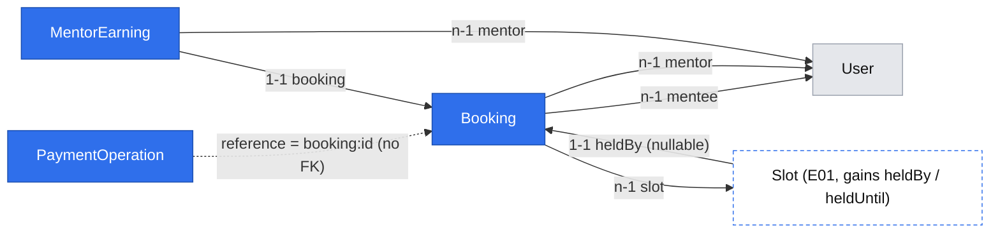

# Book and pay (E02)

Status: draft (gate answered 2026-10-29: Q1 = a, Q2 = a, Q3 = a, Q4 = a, Q5 = a; not implemented)
Review: fresh-context review 2026-10-29 (verdict: revise) — corrections incorporated: lock order, `paying` reconciliation and start-time cutoff, `slot_id` delete rule, a single hold-expiry source, commit-then-refuse, mentor-page links gated on #19, Phase 4 provisional
Issue: #9 — stories #18 (book and pay), #25 (payments port, task of #18), #20 (cancel and refund)
Design authority: `.ai/specs/product-brief.md` (Scope → Now, Key flows 3–4; R03, R06, R08, R09, R11, R14, R15, R17, D09, D13, D14, D18, N01)
Builds on: `2026-10-29-platform-primitives.md` (ids `B*`/`F*` below), `2026-10-29-mentor-pages-and-discovery.md` (E01: `MentorPage.rate`, `Slot`, `SlotService`); requires the accounts spec (#24, not written yet) for the `mentee` role and sign-in

## 📝 TLDR

**Who needs it:** mentees with one blocker and a deadline, who must be able to book in minutes ("jak booking trwa więcej niż pięć minut to robię rollback"). **Today:** nothing can be booked or paid. E01 (designed, not built) gives a mentor a priced page with published start times, but its slots are not clickable. **Proposed (future behavior):**
- A signed-in mentee picks a published slot and a length and sees that length's price. They write the question, then pay on a simulated payment screen. The booking then waits for the mentor (flow steps 3–4).
- The price is always derived from the mentor's stored rate (R08). One booking holds a slot (D09). A mentee has at most one unpaid booking (R17). An unpaid booking holds the slot for 30 minutes (proposed R20), then simply stops counting, with no timer (D13).
- A mentee can cancel; the refund follows R14. Every charge and refund goes through a payments port with only a mock adapter (D13), idempotent per booking.

## 📝 Problem Statement

Mentees lose hours or days waiting for community help. A Friday-evening outage was answered wrongly on Saturday, and the release slipped to Tuesday (`[INTERVIEW]` 2026-09-01). 23 of 109 Discord help threads got no human reply (`[DATA]`, an English-speaking community, so context only, D10).

Damian chose a paid text session in a booked slot (D01, D09): the price seen first and paid before the session (R03), sign-in before paying (D18), and simulated money only (D13). Whether mentees will pay a stranger (A03) cannot be tested on this build; that waits for real Stripe (D14).

This epic proves that the booking and money rules hold before real money exists: a server-side price, one booking per slot, one unpaid booking per mentee, and refunds per R14. It also lets invited mentors take bookings on the mock build (A02). The `abandoned` and `expired` outcomes are recorded separately, so D18's review trigger ("if mentees drop out between the mentor page and payment") has data.

## 📝 Proposed Solution

Three concepts, following the folder convention:
- **`payments`:** a generic ledger of money operations, plus the gateway port and its mock adapter. It knows nothing about bookings.
- **`bookings`:** the `Booking`, its statuses and transitions (B8), and the slot hold.
- **`earnings`:** one record per booking that pays the mentor. It is created first by #20's late cancellation (Q4 = a) and reused by #22, and E05 (#23) displays it.

Delivery is four PRs (Q1 = a):
1. #25 with #18's API.
2. #18's screens, reachable only by direct URL.
3. Opening booking from the mentor page, after E03-S01 (#19) has merged, so that a paid booking always has a mentor who can see it and a decline or R12 refund.
4. #20 after #19.

**The booking flow (Q2 = a):**
1. On the mentor's public page, a bookable slot links to `/rezerwacje/nowa/<slotId>`. That page is mentee-only: a visitor who is not signed in is redirected to sign-in and returns afterwards (F2, D18).
2. The mentee picks 25 or 50 minutes. The options carry their prices, and the choice sits above the question box (R03). They write the question and press *Przejdź do płatności*.
3. `POST /api/bookings`: in one transaction, the server locks the slot row, checks eligibility, R17 and the hold, prices the booking from the stored rate, inserts it as `awaiting_payment` and holds the slot until `now + 30 min` (R20). One `clock.now()` snapshot sets both `bookings.hold_expires_at` and `slots.held_until`.
4. `/rezerwacje/<id>/platnosc` is a simulated checkout: "Płatność symulowana — nie pobieramy żadnych pieniędzy", the amount, the slot, and "Termin czeka na Ciebie do 18:32". There are two actions, *Zapłać 120 zł* and *Zrezygnuj*.
5. `POST …/pay`: the winning transaction moves the booking to `paying`, holds the slot without a time limit, snapshots the commission (Q5 = a) and records a pending charge with key `booking:<id>:charge`. After commit, the charge runs through the port. The result moves the booking to `paid` ("Czeka na decyzję mentora") or `payment_failed` (slot released).
6. If the mentee walks away, the hold lapses at its time: the slot shows as free again and R17 stops counting the booking. The status is written as `expired` the next time anything touches the booking or its slot. *Zrezygnuj* releases the slot immediately (`abandoned`).

**Cancellation (#20, R14).** `POST …/cancel` covers four cases:
- Unpaid: `abandoned`, with nothing to refund.
- Paid and not accepted, or accepted 12 h or more before the start: `cancelled`. A pending refund is recorded with key `booking:<id>:refund`, and the slot is released.
- Accepted, less than 12 h before the start: `cancelled_late`. This counts as a mentee no-show, so the mentor's earnings are recorded, nothing is refunded and the slot stays held.

The request carries the outcome the mentee was shown. If the outcome has changed meanwhile (the mentor accepted, or the 12-hour line passed), the server refuses with `409 cancel_outcome_changed` instead of applying a different one.

**Recovery without timers (B9, adopted here first).** `POST …/settle` does three things:
- writes an expired hold's status;
- runs the booking's pending money operations with their stored key and payload;
- **reconciles a `paying` booking with its charge operation.** A `succeeded` charge makes the booking `paid` and a `failed` one makes it `payment_failed`. This covers a crash between recording the charge and applying it to the booking.

The payment and booking screens call settle on mount when the booking is `paying` or shows a pending refund, and the *Spróbuj ponownie* button calls it too.

**The cutoff for a payment in progress.** A booking still `paying` at its slot's start cannot be held any longer. The next settle runs the pending charge once more with the same key, to learn the outcome. A `succeeded` result records a full refund (`booking:<id>:refund`); either way the booking becomes `payment_failed` ("Płatność nie została potwierdzona przed sesją — zwrot w toku" when a refund exists) and the slot is released. This mirrors R12, under which an unaccepted booking is refunded at the start. A gateway that is still `unavailable` leaves the booking `paying` until it answers. *pay* and *cancel* run their own operation inline after commit, so one request is enough when nothing fails. E03 widens the endpoint to the mentor and adds R12's due event.

**Alternatives considered:**
- **One-click pay (Q2 = b)** was rejected at the gate. It leaves R17 and "payment unfinished" without meaning.
- **A Stripe-Checkout-shaped port now (Q2 = c)** was rejected at the gate. A redirect and a signed mock webhook would be fake machinery built ahead of D14's spec, which will reshape the port anyway (see Risks).
- **Holding the slot through the booking table alone** (a partial unique index on `bookings.slot_id` over live statuses) was not chosen. Every new non-releasing status in E03 and E04 would have to change the index predicate, and E01's availability reads would need a join. Two columns on `slots` make the hold a slot-local predicate.
- **A mock adapter with its own table** was not chosen. B10 requires the guarantee to survive restarts and concurrent calls, and leaves storage to this spec. The ledger's unique key and immutable payload already guarantee "one key, one operation", and a deterministic mock returns the same result for the same key with no state.

### Research (from prior knowledge, not re-checked on 2026-10-29)

- **Stripe Checkout:** a session expires after 30 minutes at the shortest. That is why R20 uses 30 minutes, so D14 keeps the rule. Its idempotency keys return the first result for a repeated request; the ledger's keys pass straight through to a future adapter.
- **Cal.com:** it reserves a slot briefly while the booker fills in the form (a reservation with a release time, read lazily). Our hold is the same idea, applied at the payment step instead.
- **Medusa (payment collections and sessions):** it separates authorisation from capture across several providers. We skip that: there is one mock provider, payment is taken in full before the session (R03), and there are no partial refunds (R13 refunds the full price).
- **Preply:** free cancellation up to 12 hours before a lesson, the source of R14's value, and the lesson stays paid after that, which matches `cancelled_late`.

## 📝 Architecture

| Layer | `payments` | `bookings` | `earnings` (Phase 4) |
|---|---|---|---|
| db | `entities/payments/payment-operation.entity.ts` | `entities/bookings/booking.entity.ts`; E01's `Slot` gains `heldBy`, `heldUntil` | `entities/earnings/mentor-earning.entity.ts` |
| core rules | — | `rules/bookings.ts` (R20 hold, R14 12 h, question length, release/live status sets, `effectiveStatus`, `cancellationOutcome`) | B1 `percentOf`, `subtract` |
| core services | `payment-gateway.port.ts`, `adapters/mock-payment-gateway.ts`, `payment-operation.service.ts` | `booking.service.ts` | `mentor-earning.service.ts` |
| core validators | — | `bookings/booking-create.schema.ts`, `bookings/booking-cancel.schema.ts` | — |
| app API | — | `api/bookings/route.ts` (POST), `api/bookings/[id]/pay`, `…/cancel`, `…/settle` | — |
| app pages | — | `(mentee)/rezerwacje/nowa/[slotId]`, `(mentee)/rezerwacje/[id]/platnosc`, `(mentee)/rezerwacje/[id]`, `(mentee)/rezerwacje` | — |
| ui | — | `components/bookings/booking-status.ts` (status → F6 tone/label) | — |


Takeaway: dependencies run one way, bookings → {mentors, availability, payments, earnings}. `PaymentOperationService` and `MentorEarningService` never depend on `BookingService`, and `SlotService` still depends on nothing (the lesson on Awilix cycles).

- **Container:** `paymentGateway: asValue(new MockPaymentGateway({ failure: env.PAYMENTS_MOCK_FAILURE }))` is process-wide infrastructure with no `em`. `paymentOperationService`, `bookingService` and `mentorEarningService` are `.scoped()`. `clock` comes from E01 (B3). There is no gateway switch: one adapter exists (D13), and D14 adds the switch.
- **Port (B10, #25):**
  ```ts
  export interface PaymentGateway {
    charge(input: { idempotencyKey: string; amount: Money; description: string }): Promise<GatewayResult>;
    refund(input: { idempotencyKey: string; chargeRef: string; amount: Money }): Promise<GatewayResult>;
  }
  export type GatewayResult =
    | { outcome: "succeeded"; providerRef: string }
    | { outcome: "declined"; reasonCode: string }   // definitive: never retried
    | { outcome: "unavailable" };                   // transient or ambiguous: retried with the same key
  ```
  `PaymentOperationService` treats a thrown error as `unavailable`. `description` is "Mentio — sesja tekstowa 25 min" and never contains the question or names.
- **Mock adapter:** stateless and deterministic. `providerRef` is `mock_ch_`/`mock_re_` plus the first 24 hex digits of `sha256(idempotencyKey)`, so a repeated key returns the same reference. `PAYMENTS_MOCK_FAILURE` (`none` by default, or `charge_declined` / `charge_unavailable` / `refund_failed` / `refund_unavailable`) lets unit tests and local QA exercise the failure screens. Because QA runs the production build, it cannot be tied to `NODE_ENV`. Instead it is made visible: any value other than `none` logs a `warn` at container build, and the payment screen then shows "Tryb testowy: symulowane błędy płatności" (tested). `.env.example` says never to set it on a shared deployment. The adapter imports no SDK.
- **`PaymentOperationService`:**
  - `createPending(tx, { kind, reference, idempotencyKey, amount, chargeRef? })` inserts the row.
  - `execute(op)` runs after commit and outside any lock. It increments `attempts`, calls the gateway and records the result with a conditional `update … where id = ? and status = 'pending'`.
  - `pendingFor(reference)` lists a reference's pending operations.
  - On a concurrent `execute`, both calls may reach the gateway; the deterministic key gives both the same result, and one conditional write records it.
- **`BookingService`** owns every booking transition and is the only writer of the slot hold, through `SlotService.holdWithinLock(tx, slot, booking, until)` and `releaseWithinLock(tx, slotId, bookingId)`. Each named transition (`create`, `startPayment`, `applyChargeResult`, `abandon`, `cancel`, `expireHold`, `reconcile`) is one transaction. Every slot-releasing transition calls one `releaseSlot` helper, and a test per transition asserts that the slot is free afterwards.
  - **Lock order, for every transaction that touches both a slot and a booking (E03 included):** lock the **slot row first**, then the booking rows. A transition that starts from a booking id reads the booking without a lock to find its slot, locks the slot, then locks the booking and re-checks its status. `create` locks the slot before writing the mentee's lapsed bookings as `expired`. No transaction locks a booking and then its slot, so two transactions cannot wait on each other. A deadlock test covers the case where M re-books a slot their own lapsed booking still points at while N books it too.
  - **Holder check:** `startPayment` asserts, under the slot lock, that `slots.held_by_id = booking.id` and that the hold is live. If either fails, the hold has lapsed or been taken over: `hold_expired`.
  - **Refusals that write:** when a refusal also records something (`hold_expired` writes `expired` and releases the slot), the transaction commits first. The service then throws the `ConflictError` outside `em.transactional`; throwing inside would roll the write back.
  - **Conditional native updates** (`… where status = ?`) set `updated_at` explicitly and refresh the entity before projecting a DTO (B8).
- **E01 changes made here** (as E01 anticipated): `SlotService.listWithinBookingWindow` and `MentorPageService.listPublic` (`next_starts_at`) exclude slots with a live hold, which is a slot-local predicate (`held_by_id is null or held_until <= :now`). `SlotService.removeOwn` becomes a conditional delete with the same predicate, so removing a held slot is `409 slot_held`. The public page links each bookable slot.

## 📝 Data Model

All money is integer grosze (B1). Every unique constraint is named (B7). Entities are registered in `entities/index.ts`.

**`PaymentOperation`** — table `payment_operations`, concept `payments` (Phase 1).

| Property / column | Type | Notes |
|---|---|---|
| `id`, `createdAt`, `updatedAt` | `baseProperties()` | |
| `kind` / `kind` | enum `charge \| refund` | |
| `reference` / `reference` | `varchar(80)`, indexed | `booking:<uuid>`; no FK, so `payments` stays independent of bookings |
| `idempotencyKey` / `idempotency_key` | `varchar(120)`, unique `payment_operations_idempotency_key_unique` | `booking:<id>:charge` / `booking:<id>:refund`. **One refund per booking**, whichever transition creates it (a mentee's cancel or E03's decline), so a cancel/decline race can never refund twice |
| `amountGrosze` / `amount_grosze` | `integer` | immutable after insert; copied from the booking's stored price |
| `currency` / `currency` | `varchar(3)` `PLN` | |
| `chargeRef` / `charge_ref` | `varchar(80)` nullable | refunds only: the charge's `providerRef`, copied at creation |
| `status` / `status` | enum `pending \| succeeded \| failed` | written only by conditional updates from `pending` |
| `providerRef` / `provider_ref` | `varchar(80)` nullable | set on success |
| `failureCode` / `failure_code` | `varchar(40)` nullable | set on `declined`; safe, never a provider message |
| `attempts` / `attempts` | `integer` default 0 | |
| `completedAt` / `completed_at` | `timestamptz` nullable | |

**`Booking`** — table `bookings`, concept `bookings` (Phase 1; statuses added in Phase 4 and by E03).

| Property / column | Type | Notes |
|---|---|---|
| `id`, `createdAt`, `updatedAt` | `baseProperties()` | |
| `mentee` / `mentee_id` | n-1 → `User`, index with `created_at` | the owner; owner-in-`where` (B5) |
| `mentor` / `mentor_id` | n-1 → `User`, index with `starts_at` | copied from the slot; E03's list key |
| `slot` / `slot_id` | n-1 → `Slot`, nullable, indexed, `ON DELETE SET NULL` | A mentor may remove a slot whose only bookings are finished (`expired`, `abandoned`, `payment_failed`, `cancelled`). The booking keeps its own `startsAt`/`mentor` snapshot, so its history survives. A live hold blocks removal first (`409 slot_held`) |
| `startsAt` / `starts_at` | `timestamptz` | snapshot of the slot's start (R14 measures from it) |
| `lengthMinutes` / `length_minutes` | `smallint` 25 \| 50 | R01 |
| `question` / `question` | `text` | 20–5,000 characters after trimming; sensitive (see below) |
| `priceGrosze` / `price_grosze` | `integer` | `multiply(rate, lengthMinutes / 25)` at creation; never from the request |
| `commissionBps` / `commission_bps` | `integer` nullable | `PLATFORM_COMMISSION_BPS` snapshotted when payment starts (Q5 = a); set for every booking that reached `paying` |
| `status` / `status` | enum, Phase 1: `awaiting_payment, paying, paid, payment_failed, expired, abandoned`; Phase 4: `+ cancelled, cancelled_late`; E03: `+ accepted, declined` | partial unique index `bookings_mentee_unpaid_unique` on `(mentee_id)` where `status in ('awaiting_payment','paying')` (R17) |
| `holdExpiresAt` / `hold_expires_at` | `timestamptz` | `clock.now() + 30 min` (R20), from the same snapshot as `slots.held_until`; never derived from `createdAt` (B3) |
| `paidAt` / `paid_at`, `cancelledAt` / `cancelled_at` | `timestamptz` nullable | `paidAt` also anchors D07's payment-to-first-reply measure (E04) |

**`Slot` additions** (E01's `slots`, Phase 1): `heldBy` / `held_by_id` (1-1 → `Booking`, nullable, unique `slots_held_by_id_unique`) and `heldUntil` / `held_until` (`timestamptz` nullable). A hold is **live** when `held_by_id` is set and either `held_until` is null (a booking past payment start) or `held_until > now`. One column means at most one holder per slot. Releasing clears both columns. An expired hold may stay in the columns until the next booking takes the slot over, and every read treats it as free.

**`MentorEarning`** — table `mentor_earnings`, concept `earnings` (Phase 4).

| Property / column | Type | Notes |
|---|---|---|
| `id`, `createdAt`, `updatedAt` | `baseProperties()` | |
| `booking` / `booking_id` | 1-1 → `Booking`, unique `mentor_earnings_booking_id_unique` | at most one per booking; the winning transition alone inserts it (B8) |
| `mentor` / `mentor_id` | n-1 → `User`, indexed | E05's list key |
| `priceGrosze`, `commissionBps`, `commissionGrosze`, `shareGrosze` | `integer` | `commission = percentOf(price, bps)` rounded half up, `share = subtract(price, commission)`; a unit test asserts `commission + share = price` for every rate from 90 to 600 zł and both lengths |
| `reason` / `reason` | enum `mentee_late_cancel` (Phase 4); E04 adds `session_held`, `mentee_no_show` | |

Stripe's fees (D11) and payouts (R16) wait for D14. No money moves (D13).

- **R17 under concurrency:** the create transaction first writes the mentee's lapsed `awaiting_payment` bookings as `expired` (a conditional update), then inserts. The partial unique index decides between two concurrent creates by the same mentee, and the loser maps to `409 unpaid_booking_exists` (B7, outside the transaction). MikroORM emits a partial index through an `expression` in the entity's `uniques`. The generated migration and the snapshot diff must be checked by hand (see Risks).
- **Slot under concurrency (D09):** `PESSIMISTIC_WRITE` on the slot row serialises every create on that slot. The single `held_by_id` column plus its unique constraint is the backstop. Lock order is always the slot first, then the booking, so the transitions cannot deadlock.
- **Sensitive data:** `question` may contain a mentee's proprietary code or configuration. Only the mentee reads it in E02; E03 shows it to the mentor once the booking is paid (#19). `question` and `*.question` are added to `REDACTED_PATHS`, and neither the question nor the description passed to the gateway is ever logged. There is no admin access. Retention belongs to the terms (D06, D20).
- **Migrations:** Phase 1 has two, `payment_operations` and then `bookings` with the slot columns. Phase 4 has one: the two new statuses and `mentor_earnings`. Each has a hand-written `down()` and runs through E01's migration harness up → down → up. Rolling back Phase 1 deletes every booking and payment record; that is acceptable before launch and must be stated in the PR's rollback plan.



Interactive view: `.ai/data-model/2026-10-29-book-and-pay.html`. The dashed `Slot` is defined by E01 and not built yet.

## 📝 API Contracts

All routes are `force-dynamic` and use `apiHandler`, which checks CSRF first. Each handler then runs `requireSession` → `requireRole(session, "mentee")` → id and body parsing, so `401`/`403` come before `400`. Lookups put the owner in the `where` clause, so someone else's booking is `404` (B5). Only parsed output reaches services. Responses use the envelope with Polish messages and stable codes (B12). There are no GET routes: pages read through `loadPage` (F2), as in E01.

**`BookingMenteeDto`** (exact key set, B6): `id, status, mentor { displayName, slug }, startsAt, lengthMinutes, price (MoneyDto), question, holdExpiresAt, paidAt, cancelledAt, charge, refund, cancellation`.
- `status` is the **effective** status: an `awaiting_payment` booking whose hold has lapsed projects as `expired` without a write.
- `charge` and `refund` are each `"none" | "pending" | "succeeded" | "failed"`.
- `cancellation` is `{ allowed: boolean; outcome: "release" | "full_refund" | "no_refund" | null }`, computed by `cancellationOutcome(booking, now)` (R14).
- It never contains the mentor's id or email, `commissionBps`, `providerRef`, `idempotencyKey` or `failureCode`.

| Method & path | Phase | Body | Success | Failures |
|---|---|---|---|---|
| `POST /api/bookings` | 1 | `{ slotId: uuid, lengthMinutes: 25 \| 50, question: string }` (unknown keys such as `price` are stripped) | `201 BookingMenteeDto` (`awaiting_payment`) | `400 validation_error`; `404 not_found` (unknown slot); `409 unpaid_booking_exists` (R17); `409 slot_taken` (live hold, D09); `409 slot_unavailable` (page unpublished, no rate, outside R11's window, or the mentee's own slot) |
| `POST /api/bookings/[id]/pay` | 1 | — | `200 BookingMenteeDto`: `paid`; `paying` with `charge: "pending"` when the gateway is unavailable (retry); `payment_failed` on a decline. A repeat call on `paying`/`paid` runs or returns the same charge | `404`; `409 hold_expired` (commits `expired` and the slot release, then refuses); `409 booking_not_payable` (abandoned, expired, failed or cancelled) |
| `POST /api/bookings/[id]/cancel` | 1: unpaid only; 4: R14 | `{ expectedOutcome: "release" \| "full_refund" \| "no_refund" }` | `200 BookingMenteeDto`: `abandoned` / `cancelled` with `refund` pending→succeeded / `cancelled_late`. A repeat call returns the same result and runs a pending refund | `404`; `409 payment_in_progress` (`paying`); `409 cancel_outcome_changed` (the computed outcome differs from `expectedOutcome`); `409 cancel_not_allowed` (session started, or already declined, expired or failed) |
| `POST /api/bookings/[id]/settle` | 1 (E03 widens it to the mentor via B11 and adds R12) | — | `200 BookingMenteeDto` after writing a lapsed hold, running pending operations, reconciling `paying` with its charge, and applying the start-time cutoff; safe to repeat | `404` |

Cancellation outcome (`cancellationOutcome`, R14, Phase 4; Phase 1 implements only the first row):

| Status (and time) | Outcome | Writes |
|---|---|---|
| `awaiting_payment` (hold live) | `release` | `abandoned`; slot released |
| `paid` (any time; the mentor hasn't accepted) | `full_refund` | `cancelled`; refund `pending`; slot released |
| `accepted`, `now ≤ startsAt − 12 h` | `full_refund` | `cancelled`; refund `pending`; slot released |
| `accepted`, `startsAt − 12 h < now < startsAt` | `no_refund` | `cancelled_late`; `MentorEarning(mentee_late_cancel)`; slot stays held |
| `accepted`, `now ≥ startsAt`; or `paying`, `declined`, `expired`, `payment_failed`, `abandoned` | not allowed | — |

The slot stays held after a late cancellation: the mentor is already paid for that time. This is an agent proposal and cheap to reverse (see Decisions in play).

Configuration (`config/env.ts`, both in `.env.example`): `PLATFORM_COMMISSION_BPS` (an integer 0–10,000, default 2,000, R06) and `PAYMENTS_MOCK_FAILURE` (above, default `none`).

## 📝 UI/UX

All copy is Polish (R15, F1). Times are Europe/Warsaw and money is in `zł` (F7). The mentee screens use a `(mentee)` route group with `PanelShell` (F8) and shadcn components. Each page parses its `[slotId]`/`[id]` parameter as a UUID before any service call (a malformed value gives `notFound()`, F2), then loads through `loadPage({ role: "mentee", returnTo })`, so a signed-out visitor is sent to sign-in and comes back (D18), and a mentor gets the 404. Every booking screen carries "Sesja odbywa się wyłącznie tekstowo — bez rozmowy wideo" (N01).

- **Mentor page (E01, `(marketing)`; Phase 3):** each bookable slot becomes a link "Zarezerwuj" to `/rezerwacje/nowa/<slotId>`. Held slots are not listed from Phase 1. Unpriced slots stay plain text.
- **`/rezerwacje/nowa/[slotId]` — `NowaRezerwacjaPage`:**
  - Content in order: the mentor's name and the slot time (`formatSlotTime`), then a `CrudForm` with a `select` "Długość sesji" whose options carry the price ("25 minut — 120 zł", "50 minut — 240 zł"; F4 `select`, built here). The `textarea` "Twoje pytanie" (20–5,000 characters, with a hint to paste error messages and code) follows. Under it is one line of R14: "Możesz anulować bezpłatnie, dopóki mentor nie zaakceptuje, a potem do 12 godzin przed sesją."
  - The submit button is *Przejdź do płatności*. Success navigates to the payment screen.
  - If the slot is not bookable or not found: "Ten termin nie jest już dostępny", with a link back to the mentor page and no form.
  - If the mentee has a live unpaid booking: "Masz już nieopłaconą rezerwację", with a link to its payment screen and no form (R17). The loader checks this, so the mentee is pointed to the first booking before writing anything. A `409 unpaid_booking_exists` from a race shows the same message with a link to `/rezerwacje`.
  - `409 slot_taken`: "Ten termin został właśnie zajęty", with a link back to the mentor page.
- **`/rezerwacje/[id]/platnosc` — `PlatnoscPage`:**
  - A banner: "Płatność symulowana — nie pobieramy żadnych pieniędzy" (D13). Then the amount, the slot and length, and "Termin czeka na Ciebie do 18:32" (the hold time, shown once with no live countdown).
  - Actions: *Zapłać 120 zł* (F5 `ActionButton`; on `paid`, it navigates to the booking) and *Zrezygnuj* (F5 with a confirmation step; it returns to the mentor page).
  - `paying` on load: "Płatność w toku…" and the settle POST on mount (see below). `payment_failed`: "Płatność odrzucona — termin został zwolniony", with a link to the mentor page. `expired`: "Czas na płatność minął", with the same link. `paid`: redirect to the booking.
- **`/rezerwacje/[id]` — `RezerwacjaPage`:** the status (F6 `StatusBadge`), the mentor, time, length, price, the full question (`whitespace-pre-wrap`, monospace for pasted code), and the payment or refund state.
  - Labels: "Czeka na płatność", "Płatność w toku", "Czeka na decyzję mentora", "Płatność odrzucona", "Wygasła", "Zrezygnowano", "Anulowana — zwrot w toku" / "Anulowana — zwrócono", "Anulowana po terminie — bez zwrotu". The map lives in `ui/src/components/bookings/booking-status.ts`, keyed on status strings declared there (`ui` must not import `core`).
  - From Phase 4, a cancel `ActionButton` names the outcome before confirming: "Otrzymasz pełny zwrot 120 zł" or "Do sesji zostało mniej niż 12 godzin — anulowanie nie daje zwrotu, a mentor otrzyma wynagrodzenie". It sends that outcome as `expectedOutcome`. On `409 cancel_outcome_changed`, it refreshes and shows the new terms.
  - A refund is shown as *started* until the operation succeeds; a pending refund is never shown as completed (B9). A `failed` refund reads "Zwrot nie powiódł się — skontaktuj się z nami", with the contact the terms will name (D20). The contact is a known gap until then.
- **`/rezerwacje` — `RezerwacjePage`:** a `DataTable` of the mentee's bookings, newest first, with time, mentor, status badge and a link. An unpaid booking is listed first. Empty state: "Nie masz jeszcze rezerwacji".
- **Settle on mount:** a small client component in `app/src/components/bookings/settle-on-mount.tsx`, shared by the payment and booking pages. When the server-rendered DTO shows `status: "paying"` or a pending refund, it calls `POST …/settle` through F3's mutation hook, then `router.refresh()`. A retryable failure shows *Spróbuj ponownie*. GET loaders and metadata never write (B9).
- **Accessibility:** the action failures and the "slot taken" message use `role="alert"`. The price lives in the option label, so screen readers hear it when choosing the length. The hold time is plain text, not a timer.
- **Prototype:** none accepted. Screens follow `/admin`'s shadcn look; the mentor page keeps E01's plain Tailwind.

## 📝 Edge Cases & Failure Scenarios

- **Two mentees book the same slot at once:** the slot row lock serialises them. One gets `201`; the other gets `409 slot_taken` before reaching payment (D09; concurrency integration test).
- **The same mentee in two tabs, or two different slots at once:** the R17 check runs first, under the partial unique index. The second request gets `409 unpaid_booking_exists`, pointing to the first (concurrency integration test).
- **A hold lapses with no timer:** reads treat the slot as free and the booking as `expired` at once. The status is written on the next create for that slot or by that mentee, or on the next pay, cancel or settle. A late *Zapłać* gets `409 hold_expired`, and the mentee books again. A pending charge never lapses: `paying` holds the slot without a time limit.
- **Price tampering:** a `price` or `amount` in the body is stripped by the schema. The charge amount is the stored `priceGrosze`, from `multiply(rate, length / 25)` (R08). A rate change after booking leaves existing bookings at their snapshot (test).
- **The gateway is unavailable (`unavailable`):** the operation stays `pending` and the booking `paying`. The screen shows *Spróbuj ponownie*, and every retry uses the same key.
- **A crash after commit but before the gateway call, or after the gateway's success but before recording it:** the next settle or pay repeats the call with the same key. The mock returns the same `providerRef`, and the result is recorded once.
- **A crash after recording the charge but before applying it to the booking:** the operation is `succeeded` or `failed` while the booking is still `paying`. Settle's reconcile step applies the result with a conditional `where status = 'paying'` update (unit-tested at this crash point).
- **A mentee who never returns to a `paying` booking:** the slot stays held, out of the mentor's view, and R17 blocks that mentee. This lasts until the next visit at or after the start, when the cutoff releases the slot and refunds any charge that succeeded. Only a crash or an unavailable gateway can cause it on the mock build; D14's webhook closes it for real Stripe.
- **A declined charge:** the operation is `failed` with a safe `failureCode`, the booking is `payment_failed` and the slot is released. It is never retried; the mentee books again.
- **A double click on *Zapłać* or cancel:** F5 deduplicates on the client. On the server, the booking row lock and status check make the second request return the first result, and the unique key makes a second charge or refund impossible.
- **A cancel and E03's decline at the same moment:** both lock the booking. Whichever commits first wins, and the other gets a `409`. Both would use `booking:<id>:refund`, so even a missed status check could not refund twice.
- **The mentor accepts, or the 12-hour line passes, while the cancel dialog is open:** `409 cancel_outcome_changed`; the screen refreshes and shows the new outcome. The mentee is never refunded less than the screen promised.
- **The mentor removes a held slot:** `409 slot_held`. A slot whose bookings are all finished can be removed; `bookings.slot_id` becomes null and the booking history stays (integration test). They unpublish or change the rate during a booking: the booking stands at its snapshot (E03 handles the mentor's side).
- **Booking one's own slot** (if accounts lets one person hold both roles): `409 slot_unavailable`.
- **A refund fails definitively (`refund_failed`):** the operation is `failed` and logged at `error` level with the booking id only. The mentee sees the contact message. Correcting it is manual and out of scope; there is no admin screen.
- **Someone else's booking id, a malformed id, or a mentor calling a mentee route:** `404`, `404` (`notFound()` on pages, `400` on routes) and `403`.
- **Prefetch of `/rezerwacje/...` links, or metadata rendering:** these are read-only, so no expiry write, settlement or charge happens (test).
- **The database is unreachable:** the Polish error page; the app still builds and boots.

## 📝 Risks & Impact Review

- **`risk-high` for every phase** (money, slot holds under concurrency, schema migrations, data scoping). Each PR carries what `SDLC.md` requires:
  - tests for the failure, retry and idempotency paths;
  - concurrency tests for the slot and for R17;
  - an isolation test showing one mentee cannot read or act on another's booking;
  - a migration up/down test and a rollback plan;
  - a second reviewer, and `needs-qa` with no self-QA. QA uses `PAYMENTS_MOCK_FAILURE` locally to see the failure screens.
- **The port will change with D14.** Real Stripe Checkout is a redirect plus a webhook, not a synchronous charge. The D14 spec reshapes `charge` into a checkout session and a confirmation, and replaces the payment screen with the redirect. The ledger, keys, statuses and hold stay, and `paying` maps to "checkout open, webhook awaited". This rewrite is accepted at the gate (Q2 = a) and costs one adapter, one service method and one screen.
- **Partial unique index:** MikroORM's `expression` indexes are raw DDL, so the schema diff can churn. The migration and snapshot are reviewed by hand, and the harness asserts the index exists after `up` and is gone after `down`.
- **Denormalised hold columns:** a releasing transition that forgets to clear them would make a slot look taken forever. All releases go through one helper with a test per transition, and E03 must use it for `declined`.
- **Earnings created ahead of E05 (Q4 = a):** E05 (#23) displays rows that #20 and #22 write. If E05 needs another field, it adds it with a migration. Existing rows are pre-launch mock data.
- **Phase 4 rests on an unwritten contract:** E03's spec may define `accepted` differently (for example, acceptance after the start). Phase 4 is therefore provisional and re-reviewed against E03's spec before it starts.
- **New rules need brief rows from Damian before the PR that applies them merges** (`SDLC.md`, protected decisions): R20 (Phase 1) and R21 (Phase 1). See Decisions in play.
- **Product direction, not defects:** a slot held for 30 minutes by someone who never pays is unavailable to others for that time. That is the cost of a payment step that can be abandoned (Q2 = a), bounded by R17 and R20.

## 📝 Decisions in play

- **Relies on:**
  - R01 (25/50), R03 (price first, pay before), R06 (commission taken from the price), R08 (rate × length).
  - R11 (2 h–14 d, checked at booking), R14 (cancellation), R15 (Polish), R17 (one unpaid booking).
  - D09 (booked slots), D13 (mock only, no timers), D16 (settle on the next visit), D18 (sign in before paying), D19 (in-app only: nothing is emailed), D21 (`mentee`), N01 (text only, stated on every booking screen).
- **Proposed new rules, owned by Damian and to be entered in the brief before the phase that needs them merges:**
  - **R20 (Phase 1, Q3 = a):** an unpaid booking holds its slot for 30 minutes from creation. After that, the slot is bookable again and the booking no longer counts under R17. A started payment holds the slot until it resolves.
  - **R21 (Phase 1, Q5 = a):** a booking's commission is the R06 rate in force when its payment starts, stored on the booking. A later change to the rate does not alter existing bookings.
- **Product choices recorded here (agent proposals, cheap to reverse, no brief row needed):** a late-cancelled slot stays held rather than reopening, and an unpaid cancellation is recorded as `abandoned`, separately from `expired`, for D18's review trigger. Damian may ask for either to change.
- **How this spec meets the primitives' safety invariants** (`2026-10-29-platform-primitives.md`; after the 2026-10-29 grilling round, B8–B11 leave the concrete design to their consumers):
  - B8: named transitions, conditional writes under the slot-first lock order, and payment intent or earnings created only by the winner, in the same transaction.
  - B9: `POST …/settle` is the protected mutation. Screens trigger it on mount and on retry; GET, loaders, prefetch and metadata never write. Its first consumer is #18 (pending charges, `paying` reconciliation, the start cutoff), and #19 adds R12's due event.
  - B10: the app ledger (unique key, immutable payload) plus a stateless, deterministic mock adapter.
  - B11: E02 routes are mentee-only with the owner in the `where` clause; E03 defines the participant helper from its callers.
- **Amendments to the primitives spec, made with this spec** (its Phase 4 assignment only): B9 starts with #18 as well as #19, and `percentOf`/`subtract` move from #23 to #20 (Q4 = a). F4 `select` and F6 stay with #18.
- **Contract with E03 (#19), to be accepted in its spec:**
  - It adds `accepted` (with `acceptedAt`) and `declined`. A decline releases the slot through `releaseSlot` and refunds through `booking:<id>:refund`.
  - It widens `settle` to the mentor (B11) and adds R12's due event.
  - It shows the mentor only `paid` and later bookings (#19 AC 4).
  - It uses this spec's lock order (slot first, then booking) in accept and decline.
  - Phases 3 and 4 here land after it.
- **Depends on accounts (#24):** the `mentee` role (D21), the sign-in path with `returnTo`, and whether one person can hold both roles. Integration tests need a signed `mentee` session; `support/session.ts` signs `student` today. The accounts PR renames the role and the `AGENTS.md` route group `(student)/` → `(mentee)/` (D21); this spec only adds the group's first pages.

## 📋 Phasing

0. **Prerequisites:** the accounts spec (#24) with primitives Phase 2 (`loadPage`); E01 #15 (rate, B1) and #16 (slots, B3/B4, `SlotService`); R20 and R21 entered by Damian.
1. **#25 + #18 API — payments port, ledger, bookings and holds.** It is shippable alone: the API books, pays (simulated), abandons and recovers, with integration tests. No screen links to it yet. #25 closes here, since its port ships with its first consumer.
2. **#18 screens, reachable by direct URL only.** The booking, payment, booking-detail and list screens work end to end, and tests open them by URL. Nothing public links to them yet, so no mentee can reach a `paid` booking that no mentor screen shows.
3. **Open booking from the mentor page, after E03-S01 (#19) merges.** Bookable slots become links, and #18 closes. From then on, a paid booking is seen by its mentor and is either accepted or refunded (a decline, or R12 at the start). Cancellation under R14 is not offered until Phase 4. Until then a mentee can abandon only before paying, and the screen says so ("Anulowanie opłaconej rezerwacji będzie dostępne wkrótce").
4. **#20 — cancellation and refunds, after #19.** **Provisional:** its `accepted` rows and `acceptedAt` come from E03's spec, which is not written yet. This phase must be re-reviewed against that spec before implementation starts. Mentees cancel under R14, and late cancellations record earnings; #20 closes, and with it #9.

**Dependency order:** prerequisites → 1 → 2 → (#19) → 3 → 4. Phases 3 and 4 may share one PR if #20 is ready when #19 merges.

## 📋 Implementation Plan

Each step leaves the app working and ends with its tests. Each phase is one PR that passes `lint`, `typecheck`, `test:coverage` (100%), `build`, `test:integration` and `audit`.

### Phase 1 — payments port, ledger, bookings API (#25, #18)

1. **Configuration.** Add `PLATFORM_COMMISSION_BPS` (0–10,000, default 2,000) and `PAYMENTS_MOCK_FAILURE` (enum, default `none`) to `config/env.ts` and `.env.example`. Tests: defaults, bounds and an invalid value → `ConfigError`.
2. **Port and mock adapter (#25).** Add `payment-gateway.port.ts` and `adapters/mock-payment-gateway.ts`, registered as `paymentGateway` (`asValue`) in the container and on the `Cradle`. Tests: the same key gives the same `providerRef`, different keys give different references, and each `PAYMENTS_MOCK_FAILURE` value gives its outcome for charge and refund.
3. **Ledger (#25).** Add the `PaymentOperation` entity, its migration (`down()` included) and `PaymentOperationService` (`createPending`, `execute`, `pendingFor`). Tests:
   - succeeded, declined, unavailable and thrown errors;
   - a repeated `execute` on a succeeded operation never calls the gateway;
   - crash recovery: still pending → execute → the same `providerRef`;
   - two concurrent executes → one recorded result;
   - an immutable payload (a programmer `Error` if a key is reused with a different payload).

   Migration harness: up → down → up.
4. **Booking schema and rules.** Add the `Booking` entity with the partial unique index, `Slot.heldBy`/`heldUntil`, and the migration (hand-check the index DDL and snapshot). Add `rules/bookings.ts` (R20, the question length, live and release status sets, `effectiveStatus`, and `cancellationOutcome` with only the unpaid row), `booking-create.schema.ts` and `booking-cancel.schema.ts`. Tests: an entity metadata test; the harness asserts the index and constraints; `effectiveStatus` at the hold edge (fixed clock); schema refusals and stripping of `price`.
5. **Holds in E01's services.** Add `SlotService.holdWithinLock`/`releaseWithinLock`, make `removeOwn` a conditional delete (`409 slot_held`), and exclude live holds in `listWithinBookingWindow`, `listPublic` and the eligibility flags. Tests: a held slot is hidden and not removable; a lapsed hold is visible and removable; the container still resolves with no cycle.
6. **`BookingService`.**
   - `create`: slot lock first, then write lapsed holds as `expired`, R17, eligibility, hold takeover, price snapshot, and the hold until R20 from one clock snapshot.
   - `pay`: the `startPayment` transaction (slot lock → booking lock, holder check, commission snapshot, pending charge, indefinite hold), then `execute` → `applyChargeResult`.
   - `cancel`: unpaid only → `abandoned`.
   - `settle`: lapsed-hold write, pending operations, `reconcile` of `paying` against its charge, and the start-time cutoff (charge re-run, refund if it succeeded, `payment_failed`, slot released).
   - `getOwnForMentee`, `listOwnForMentee`, `getBookingDraft(slotId)` (for the page loader).
   - `toBookingMenteeDto` with its exact key set.
   - `question` added to `REDACTED_PATHS`.

   Tests: every refusal and code; owner-in-`where`; the slot is released by every releasing transition; the charge amount equals the stored price whatever the request said; an unavailable gateway → `paying`, then settle → `paid`; declined → `payment_failed` and a freed slot; a charge recorded `succeeded` with the booking still `paying` → settle → `paid` once; `paying` at the start → refund and a freed slot; `hold_expired` leaves `expired` committed; a pay whose slot was taken over → `hold_expired`.
7. **Routes.** Add `POST /api/bookings`, `…/[id]/pay`, `…/[id]/cancel` and `…/[id]/settle` on `apiHandler`. Integration tests:
   - envelopes for `201`/`200`, `400`, `401`, `403` (mentor role, missing CSRF), `404` (another mentee's booking), and `409` for `slot_taken`, `unpaid_booking_exists`, `slot_unavailable` and `hold_expired` (seeded `hold_expires_at` in the past);
   - two mentees `POST` the same slot concurrently → exactly one `201`;
   - one mentee `POST`s two slots concurrently → exactly one `201`;
   - a repeated pay → one `payment_operations` row;
   - an abandon makes the slot bookable for another mentee;
   - lock order: M re-books the slot their lapsed booking still points at while N books it concurrently → one `201` and one `409`, never a deadlock `500`;
   - a slot whose only booking is `abandoned` can be removed, and the booking survives with `slot_id` null.
8. **Docs.** `AGENTS.md`: the payments port and ledger rule ("money moves only through `PaymentOperationService` with a deterministic key"), the hold-release helper, and B8–B10 as adopted. Amend the primitives spec (see Decisions in play). Add a `.ai/lessons.md` entry if anything surprised.

### Phase 2 — booking screens (#18)

1. **UI primitives.** Add F4 `select` (shadcn `select` via the CLI) and F6 `StatusBadge`, plus `components/bookings/booking-status.ts`. Tests: select initialisation and parse → JSON → route round trip; the badge tones; a label for every Phase 1 status.
2. **`(mentee)` group and pages.** Add `NowaRezerwacjaPage`, `PlatnoscPage`, `RezerwacjaPage` and `RezerwacjePage` with `loadPage`, and `settle-on-mount.tsx`. Tests (awaited server components): a malformed id gives 404 before a service call; each state above, the price in the option labels before the question, the R17 pointer, N01 text and Polish copy; settle-on-mount calls the POST only when something is pending.
3. **Browser integration tests (opening the screens by URL):**
   - signed out, `/rezerwacje/nowa/<id>` leads to sign-in, then back to the booking form (D18);
   - a signed-in mentee picks 50 minutes, sees twice the rate, writes the question, pays, and the booking shows "Czeka na decyzję mentora";
   - *Zrezygnuj* frees the slot (it reappears on the mentor page);
   - the screen says the session is text only;
   - `/rezerwacje` lists the mentee's bookings with the unpaid one first, and shows "Nie masz jeszcze rezerwacji" for a mentee with none;
   - with `PAYMENTS_MOCK_FAILURE` unset, the test-mode banner is absent.

   Prefetching a booking link performs no write. Add `AGENTS.md` lines for F4 `select` and F6.

### Phase 3 — open booking from the mentor page (#18; after #19)

1. **Mentor page links.** Bookable slots link to `/rezerwacje/nowa/<id>`; held slots are not listed; the booking detail shows the "cancellation coming" notice for paid bookings. Page test.
2. **Browser integration test:** signed out, clicking "Zarezerwuj" on the mentor page leads to sign-in, then back to the booking form for that slot (D18). #18 closes.

### Phase 4 — cancellation and refunds (#20; after #19; provisional until E03's spec is reviewed)

1. **Schema.** A migration adds `cancelled`/`cancelled_late` to the status check and the `mentor_earnings` table. Add B1 `percentOf`/`subtract`. Tests: harness up/down; rounding half up, and `commission + share = price` across 90–600 zł × {25, 50}.
2. **Earnings and R14.** Add `MentorEarningService.recordWithin(tx, booking, reason)` (one row per booking, unique) and `cancellationOutcome` with every row of the table (fixed clock at 12 h ± 1 minute and at the start).
3. **Cancel.** Extend `BookingService.cancel`: `expectedOutcome` check, `cancelled` + pending refund + slot release, `cancelled_late` + earnings, then `execute` of the refund after commit; `settle` runs pending refunds. Tests: each branch; refund unavailable → settle → succeeded; refund failed; repeated cancel → one refund and no second earnings row; cancel vs decline race → one refund key used once.
4. **UI and integration.** Add the cancel `ActionButton` with the outcome text and the refund states on `RezerwacjaPage`. Integration tests:
   - unaccepted paid → `200`, refund succeeded, and the slot is bookable again;
   - accepted at `start − 13 h` → full refund;
   - accepted at `start − 11 h` → `cancelled_late`, one `mentor_earnings` row and no refund operation;
   - `cancel_outcome_changed`, and `401`/`403`/`404`.

   Browser: cancel and see "Anulowana — zwrócono". Update `AGENTS.md` for the earnings rule.

## ✅ Done means

- [ ] #25: every charge and refund goes through `PaymentGateway` with only the mock adapter; a key is used once, and retries and crash recovery never charge or refund twice (tests); no vendor SDK is imported.
- [ ] #18: a signed-in mentee sees the price for the chosen length before the question box, pays on the simulated screen, and the booking shows "Czeka na decyzję mentora". A signed-out mentee is sent to sign-in first. The amount charged is the stored price whatever the request says.
- [ ] #18: concurrent bookings of one slot give one hold; a second unpaid booking is refused with a pointer to the first; an abandoned or lapsed payment frees the slot, and no question reaches anyone.
- [ ] #18: every booking screen is Polish and says the session is text only; the mentor-page links go live only after #19 has merged.
- [ ] Recovery: a booking left `paying` by a crash at any point is reconciled on the next visit; one still `paying` at the slot's start releases the slot and refunds any successful charge.
- [ ] #20: unaccepted or ≥ 12 h-before cancellations refund in full at once and free the slot; < 12 h cancellations refund nothing and record the mentor's earnings once; the outcome shown is the outcome applied.
- [ ] Each phase: migration up/down, isolation and denied-path tests, concurrency tests where named, 100% unit coverage, an integration test per new route and page, and the full validation gate.
- [ ] R20 and R21 entered in the brief by Damian before Phase 1 merges; the primitives-spec amendments recorded; E03's spec accepts the contract above, and Phase 4 is re-reviewed against it, before Phases 3 and 4 start.
- [ ] Moved to `.ai/specs/implemented/` when Phase 4 merges.
