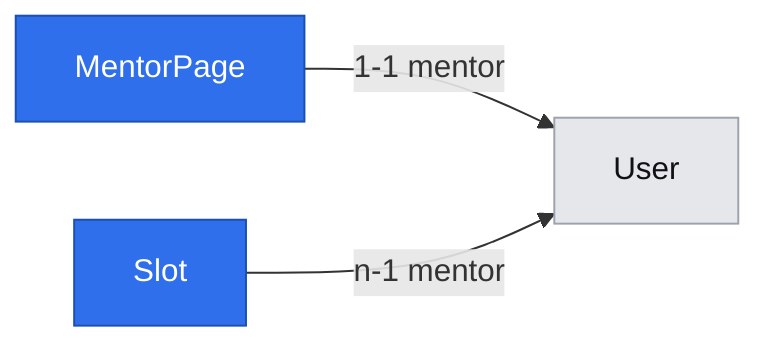

# Mentor pages and discovery (E01)

Status: draft (gate answered 2026-10-29; not implemented)
Issue: #8 — stories #14 (page and share link), #15 (rate), #16 (slots), #17 (public list)
Design authority: `.ai/specs/product-brief.md` (Scope → Now, Key flows 1–3; D02, D09, D10, R03, R08, R11, R15, N01, N02)
Builds on: `2026-10-29-platform-primitives.md` (ids `B*`/`F*` below); requires the accounts spec (#24) to have landed

## 📝 TLDR

**Who needs it:** mentors, who need a page to point people to, and mentees, who need to find a mentor and judge them by their public work. **Today:** no mentor can publish anything. **Proposed (future behavior):**
- A signed-in mentor builds a page from a description and links to their public work, and publishes it at `/mentorzy/<slug>`.
- They set one rate per 25 minutes (the page shows both prices) and publish individual start times.
- They can opt into a public list at `/mentorzy`.
- Mentees open both without signing in. No page shows ratings (N02).

This is the supply side of flow steps 1–3 and the test of A02 (do mentors publish a priced page?).

## 📝 Problem Statement

A mentee with a deadline needs to reach someone who has done exactly their problem, either by a link the mentor shares or, failing that, through a list (D02). The mentor must be judged by their work, not stars: 41 of 54 survey respondents would choose by what someone built or wrote, and all three mentors interviewed rejected ratings (N02). Before any booking (E02) can exist, there must be a published page with a price (R03: the price is seen before the question) and bookable start times (D09, R11). Whether mentors will do this at all is untested (A02, accepted untested in D08); this epic is that test, run on the mock build (D14).

## 📝 Proposed Solution

Two concepts, following the folder convention: **`mentors`** (the page, its rate and its listing) and **`availability`** (slots). There are four phases, one per story, and each can ship on its own. Every phase adds its own columns and migration, so #15–#17 can ship in any order after #14.

- **Rendering:** public pages are server-rendered through `loadPage` (F2), with `generateMetadata` for link previews. The mentor's own screens live in a `(mentor)` route group built from `@mentio/ui` (shadcn, gate Q5 = a). Their reads also go through `loadPage`; their writes go through `apiCall` → API routes, and `router.refresh()` reloads the page afterwards.
- **No public JSON API:** nothing outside the server-rendered pages reads public data in the first build, so no public endpoints are added (YAGNI). Adding one later is additive.
- **Who may publish:** anyone with a `mentor` role (gate Q9 = a). There is no approval step. An admin "hide page" switch is a later, separate change. ⛔ D14 reads "invited mentors may publish", and under `SDLC.md`'s protected-decisions rule a PR that contradicts it without a superseding row is a review blocker. Phase 1 therefore needs a superseding or clarifying decision row (proposed D22, "any mentor account may publish on the mock build") approved by Damian **before it merges**. If Damian declines, Phase 1 adds an admin-set `canPublish` flag instead.
- **Alternatives considered:**
  - Recurring weekly availability rules (Cal.com and Calendly style) were rejected for now: D09 publishes start times, and individual slots are the smallest thing that tests A01. If mentors find adding times one by one tedious, that is the signal to add rules.
  - A slot as a free-form time range was rejected: R01 fixes lengths at 25 or 50 minutes, and D09 books a start time.

### Research (from prior knowledge, not re-checked on 2026-10-29)

- **Topmate:** one link per expert is the whole entry point. That backs the share link being the primary path and the list opt-in (D02).
- **Cal.com and Calendly:** both have "minimum notice" and "how far ahead" settings, which match R11, and buffers between events, which match our 50-minute block (gate Q8 = a). They carry recurring rules, date overrides and calendar sync, all skipped here.
- **ADPList:** shows a session count as a trust signal. It is not a rating, but it is not in scope either; noted for later.

## 📝 Architecture

| Layer | `mentors` | `availability` |
|---|---|---|
| db | `entities/mentors/mentor-page.entity.ts` (`MentorPage`) | `entities/availability/slot.entity.ts` (`Slot`) |
| core rules | `rules/mentors.ts` (R08 bounds, lengths) — B2 | `rules/availability.ts` (R11 window, 50-min block, 15-min grid) — B2 |
| core services | `services/mentors/mentor-page.service.ts` (`MentorPageService`) | `services/availability/slot.service.ts` (`SlotService`) |
| core validators | `validators/mentors/mentor-page-update.schema.ts`, `mentor-page-rate.schema.ts`, `mentor-page-listing.schema.ts`, `mentor-list.schema.ts`, plus `slug.ts` (`slugify`, `slugSchema`) | `validators/availability/slot-create.schema.ts` |
| app API | `api/mentors/me/page/route.ts`, `…/publish/route.ts`, `…/unpublish/route.ts`, `…/rate/route.ts`, `…/listing/route.ts` | `api/availability/slots/route.ts` (`makeCrudRoute` with `access: { role: "mentor" }`, B13: create, remove) |
| app pages | `(marketing)/mentorzy/page.tsx`, `(marketing)/mentorzy/[slug]/page.tsx`, `(mentor)/mentor/strona/page.tsx` | `(mentor)/mentor/terminy/page.tsx` |

**How the services depend on each other — one way only, `mentors` → `availability`:**
- `SlotService` owns the `slots` table and **never** depends on `MentorPageService`. A two-way dependency would make Awilix (PROXY mode, constructor destructuring) throw "Cyclic dependencies detected" on every resolve.
- `SlotService` exposes:
  - `insertWithinLock(tx, mentorId, startsAt)`: the window, grid and 50-minute neighbour checks plus the insert, run inside a transaction the caller holds;
  - `removeOwn(mentorId, slotId)`;
  - `listOwnUpcoming`, `listBookable(mentorId)` and `nextBookableQuery()`, the subquery the list orders by.
- `MentorPageService` composes `SlotService` from the cradle. `addSlot(mentorId, wallTime)` opens the transaction, locks the mentor's own `mentor_pages` row (its own table; a missing page → `409 mentor_page_required`) and calls `slotService.insertWithinLock`. It also builds the public page's slot list and the list's ordering from `SlotService`'s queries.
- The `POST /api/availability/slots` route therefore calls `mentorPageService.addSlot`, and `DELETE` calls `slotService.removeOwn`. Routes are wiring and may call either service.
- Both services are `.scoped()` on the cradle; `clock` is new (B3).

**What later work relies on:**
- E02 (#18) adds `Slot` holds and bookings priced from `MentorPage.rate` (B1, `multiply`), and must make slot removal refuse a held slot.
- E01 adds nothing that later stories would have to undo.

## 📝 Data Model

**`MentorPage`** — table `mentor_pages`, concept `mentors`.

| Property / column | Type | Phase | Notes |
|---|---|---|---|
| `id`, `createdAt`, `updatedAt` | `baseProperties()` | 1 | |
| `mentor` / `mentor_id` | 1-1 → `User`, unique `mentor_pages_mentor_id_unique` | 1 | the owner; one page per mentor |
| `slug` / `slug` | `varchar(40)`, unique `mentor_pages_slug_unique` | 1 | lower-case `^[a-z0-9]+(-[a-z0-9]+)*$`, 3–40 characters, prefilled from the name (`slugify` transliterates Polish letters); editable — an old link then 404s (gate Q7 = a) |
| `displayName` / `display_name` | `varchar(80)` | 1 | shown publicly; independent of `User.name` |
| `description` / `description` | `text`, default `''` | 1 | plain text (no markdown, no HTML); 0–2,000 characters while a draft, **at least 50 to publish**, so a draft can be saved early and publishing names what is missing |
| `publicWorkLinks` / `public_work_links` | `jsonb` (`{ url: string; label: string \| null }[]`), default `[]` | 1 | 0–10 while a draft; **at least 1 to publish** (N02); `http`/`https` only |
| `status` / `status` | `varchar` `draft \| published`, default `draft` | 1 | |
| `publishedAt` / `published_at` | `timestamptz` nullable | 1 | set on each publish |
| `rate` / `rate_grosze` | `integer` nullable | 2 | B1; null = no rate yet, so nothing is bookable (R03); bounds checked in the service and the schema (R08), not by a DB `CHECK`, so changing R08 needs no migration |
| `isListed` / `is_listed` | `boolean`, default `false` | 4 | opt-in (D02) |
| `listedAt` / `listed_at` | `timestamptz` nullable | 4 | for list ordering |

**`Slot`** — table `slots`, concept `availability` (Phase 3).

| Property / column | Type | Notes |
|---|---|---|
| `id`, `createdAt`, `updatedAt` | `baseProperties()` | |
| `mentor` / `mentor_id` | n-1 → `User`, indexed | the owner. Keyed on the user, not the page, so ownership checks use `session.userId` directly (B5) and E02's bookings reference the same mentor id |
| `startsAt` / `starts_at` | `timestamptz` | always UTC (B4); unique `slots_mentor_id_starts_at_unique` with `mentor_id`; index `slots_starts_at_index` for the list's next-slot query |

- **Block rule (gate Q8 = a):** one mentor's slots start at least 50 minutes apart, on :00, :15, :30 or :45 Warsaw time. Enforced by `MentorPageService.addSlot` → `SlotService.insertWithinLock`, inside a transaction that holds a `PESSIMISTIC_WRITE` lock on the mentor's `mentor_pages` row (B7). The insert checks the neighbouring starts. The unique constraint backs the exact-duplicate case. A Postgres `EXCLUDE … USING gist` constraint was considered and rejected for now: it needs the `btree_gist` extension on every database, and the per-mentor lock has no contention.
- **Deleting a slot:** a hard delete (no bookings exist in E01). E02 adds the hold and turns removing a held slot into a `409`.
- **Sensitive data:** none new. The mentor's email (`User.email`) never appears in a public DTO (B6 key-set tests). Descriptions and links are public by design, once the mentor publishes.
- **Migrations:** one per phase, each with a hand-written `down()` that drops what it added. Rolling back Phase 1 deletes every mentor page; that is acceptable before launch and stated in the PR's rollback plan.
- **Migration test harness (built in Phase 1, reused by every later migration and by E02–E05):** `tests/integration/migrations.test.ts`. It creates its own throwaway database on the same Postgres server (`mentio_it_migrations_<random>`), so it never touches the database the running `next start` uses. It runs the real CLI up → down (step by step to the previous migration) → up with an explicit `DATABASE_URL` (see the lessons on exported `DATABASE_URL`), asserts the tables and named constraints after each step, and drops the database afterwards.

## 📝 API Contracts

All routes are `force-dynamic`, mentor-only and CSRF-checked by `apiHandler`. The order is `requireSession` → `requireRole(session, "mentor")` → body parsing, so a mentee gets `403` and no session gets `401`, both before any `400`. Bodies go through Zod (`parseJsonBody`), and only parsed output reaches services. Responses use the standard envelope; `code` values are the client contract (B12).

**DTO key sets** (each projection's unit test asserts exactly these keys, B6):

| DTO | Keys | Never contains |
|---|---|---|
| `MentorPageOwnerDto` | `slug, displayName, description, publicWorkLinks, status, publishedAt, rate, isListed, shareUrlPath` | — |
| `MentorPagePublicDto` | `slug, displayName, description, publicWorkLinks, prices` (`{ min25: MoneyDto; min50: MoneyDto } \| null`), `bookableSlots` (`{ id, startsAt }[]`), `isIndexable` | mentor/user id, email, `status`, `publishedAt`, `isListed`, `listedAt`, `rate` (raw), any `rating*`/`review*`/`stars*` key |
| `MentorListItemDto` | `slug, displayName, descriptionExcerpt, price25` (`MoneyDto \| null`), `nextBookableStartsAt` (`string \| null`) | the same exclusions as above |
| `SlotOwnerDto` | `id, startsAt, isBookable` | — |

`isIndexable` is `isListed` under a public name, so the page can set `noindex` without exposing the listing flag itself.

| Method & path | Phase | Body | Success | Failures |
|---|---|---|---|---|
| `PUT /api/mentors/me/page` | 1 | `{ slug, displayName, description?, publicWorkLinks: { url, label? }[] }` | `200 MentorPageOwnerDto` (creates the draft on first call through `em.upsert` on `mentor`, so two concurrent first saves cannot collide, B7) | `400 validation_error` with `fieldErrors`; `409 slug_taken` (`mentor_pages_slug_unique`, mapped outside the transaction) |
| `POST /api/mentors/me/page/publish` | 1 | — | `200 MentorPageOwnerDto` (`status: "published"`) | `404 not_found` (no page yet); `400 validation_error` naming each missing field, e.g. `publicWorkLinks: ["Dodaj co najmniej jeden link do swojej publicznej pracy"]` (#14 AC 3) |
| `POST /api/mentors/me/page/unpublish` | 1 | — | `200 MentorPageOwnerDto` (`status: "draft"`; the listing flag is kept but has no effect) | `404 not_found` |
| `PUT /api/mentors/me/page/rate` | 2 | `{ ratePln: integer }` | `200 MentorPageOwnerDto` | `400 validation_error`, `fieldErrors.ratePln` names the bound: "Stawka musi wynosić od 90 zł do 600 zł" (R08, #15 AC 2); `404 not_found` |
| `PUT /api/mentors/me/page/listing` | 4 | `{ isListed: boolean }` | `200 MentorPageOwnerDto` | `404 not_found` |
| `POST /api/availability/slots` | 3 | `{ startsAt: "YYYY-MM-DDTHH:mm" }` (Warsaw wall time, B4) | `201 { id, startsAt }` (ISO UTC) | `400` (format, not on a quarter hour, nonexistent DST time, outside the publish window); `409 slot_too_close` (within 50 minutes of another of the mentor's slots, or the same start); `409 mentor_page_required` (no page yet) |
| `DELETE /api/availability/slots?id=<uuid>` | 3 | — | `200 { id }` | `404 not_found` when the slot is missing **or someone else's** (B5) |

- **Publish window (a proposal; ⚠ Damian to confirm):** a mentor may publish a start time from 2 hours to 14 days ahead, the same as R11's bookable window. Every published future slot is therefore bookable until 2 hours before it. Widening the publish window later only relaxes a check.
- **What "bookable" means in E01:** a slot shown to mentees is one with `startsAt` in `[now + 2 h, now + 14 d]` (R11, `isBookable`) whose page is published. "Bookable" additionally needs a rate (R03); without one, the page shows the slots but no prices and says booking is not possible yet. E02 adds "not held".

## 📝 UI/UX

All copy is Polish (R15), written directly in the code (F1). Times are Europe/Warsaw and money is in `zł`, both through `@mentio/ui/lib/format` (F7). Public pages use plain Tailwind; mentor screens use `PanelShell` with shadcn components.

- **`/mentorzy/<slug>` — public mentor page** (`MentorProfilePage`, `(marketing)`, `loadPage("public")`).
  - Content in order: the display name; the description (`whitespace-pre-line`, plain text); "Publiczna praca" with the link list; prices ("25 min — 120 zł", "50 min — 240 zł") or "Mentor nie ustalił jeszcze stawki — rezerwacja jest niedostępna"; "Wolne terminy" grouped by day; and the line "Sesje odbywają się wyłącznie tekstowo" (N01).
  - Slots are not clickable in E01 (E02 links them to booking).
  - No rating, stars or review element exists (N02, asserted by test).
  - Links open in a new tab with `rel="noopener noreferrer nofollow ugc"`.
  - `generateMetadata`: title = display name, description = the first 160 characters.
  - The page is `noindex` unless the mentor is listed, so a mentor who refused the list (A04) is not surfaced by search engines either. This is an agent proposal, cheap to reverse.
  - A draft, unpublished or unknown slug → `notFound()` (the Polish 404).
- **`/mentorzy` — public list** (`MentorzyPage`, `(marketing)`).
  - Lists published and listed mentors only.
  - Ordering: mentors with a bookable slot first, by their soonest one; then the others by `listedAt`, newest first, with `id` as the final tie-breaker so pages are stable. The order never depends on ratings (N02).
  - The ordering is computed **in SQL**, with limit and offset in the same query. The query is a MikroORM QueryBuilder over `mentor_pages` (published and listed), left-joined to `SlotService.nextBookableQuery()`: `min(starts_at)` per mentor within `[now + 2 h, now + 14 d]`, with `now` from `clock` passed as a parameter. It orders by `next_starts_at asc nulls last, listed_at desc, id asc`. A separate count query feeds `Page<T>`. Nothing is sorted in memory, so the list scales past launch size without a redesign.
  - Card: name, the first 200 characters of the description, the 25-minute price or "brak stawki", and the next free slot or "brak wolnych terminów", linking to the page.
  - Pagination is `?strona=N` with 20 per page; an invalid value → page 1.
  - Empty: "Na liście nie ma jeszcze mentorów".
  - The card is shared by two pages only if E02 reuses it; until then it is colocated (placement rule 4).
- **`/mentor/strona` — my page** (`StronaPage`, `(mentor)`, `loadPage({ role: "mentor", returnTo })`).
  - A status card (Szkic / Opublikowana) with an `ActionButton` to publish or unpublish (F5), the share link with a "Kopiuj link" button, and a "Zobacz stronę" link when published.
  - A `CrudForm` for slug (prefilled from the name), display name, description and `urlList` links (F4).
  - Changing the slug of a published page shows a warning before saving: "Stary link przestanie działać".
  - From Phase 2, a rate form (`money` field, with the help text "50 minut kosztuje dwukrotność stawki").
  - From Phase 4, a listing `checkbox` ("Pokaż mnie na liście mentorów").
  - A publish refusal shows the server's `fieldErrors` on the fields they name.
- **`/mentor/terminy` — my slots** (`TerminyPage`, `(mentor)`, Phase 3).
  - A `CrudForm` with one `datetime` field ("Początek sesji, czas polski", 15-minute step).
  - A `DataTable` of upcoming slots (day, time, status: "widoczny dla mentees" or "poza oknem rezerwacji"), each with a remove `ActionButton` behind a confirm step.
  - Empty state: "Nie masz opublikowanych terminów".
  - Without a page, the screen points to `/mentor/strona` first.
- **Accessibility:** form errors are linked through `aria-describedby` (already in `CrudForm`), action failures are announced with `role="alert"`, and the copy button announces "Skopiowano" through a polite live region.
- **Prototype:** none accepted. Screens follow the existing `/admin` look (shadcn) and the marketing page's plain Tailwind.

## 📝 Edge Cases & Failure Scenarios

- **Two mentors save the same slug at once:** the unique constraint maps to `409 slug_taken` (B7), and the field shows "Ten adres jest już zajęty".
- **A slug change on a published page:** the old link returns 404 from that moment, which was accepted at the gate (Q7 = a). The UI warns before saving. No redirect table exists.
- **A mentee lands on a page that was just unpublished:** they see the 404 on the next load. Nothing is cached (`force-dynamic`).
- **Publishing with no public-work link:** `400`, and the field names the problem (#14 AC 3). A description under 50 characters is named the same way (a draft may be saved without one).
- **A `javascript:` or `data:` URL in the links:** refused by the schema (only `http`/`https`). Rendered links never use `dangerouslySetInnerHTML`, and React escapes the description.
- **Two slot creates within 50 minutes of each other at the same moment:** the per-mentor row lock serialises them, so one gets `201` and the other `409 slot_too_close` (concurrency integration test).
- **DST:** "2026-03-29T02:30" is refused as nonexistent; "2026-10-25T02:30" resolves to its first occurrence. The 50-minute rule is measured on UTC instants, so it holds across the change.
- **A slot that ages inside 2 hours, or past its start:** it disappears from the public page and the list (#16 AC 2–3); the owner sees it as "poza oknem rezerwacji" until it has passed.
- **A mentor with no rate:** the page shows slots without prices and says booking is unavailable (#15 AC 3). E02 refuses to book.
- **A rate change after bookings exist:** this is E02's concern; bookings snapshot the price at booking time. E01 stores only the current rate.
- **A mentee calls a mentor endpoint:** `403`. A mentor deletes another mentor's slot by id: `404`, indistinguishable from a missing slot.
- **An unlisted or draft page in the list:** never shown. An isolation integration test seeds a listed, an unlisted and a draft page, and asserts that only the listed one appears (#17).
- **Database unreachable:** the public pages show the Polish error page, and the app still builds and boots.

## 📝 Risks & Impact Review

- **`risk-high` per `SDLC.md` for every phase** (new tables or columns; ownership; stored money; list scoping). Each PR carries the evidence its story names: migration up/down with a rollback plan, a denied-path test for editing another mentor's data, an isolation test for the list, bound tests for the rate, a second reviewer, and `needs-qa` with no self-QA.
- **The slug is a durable public contract:** once shared, a link must keep working or fail visibly. Editability (Q7 = a) trades link stability for mentor control. If mentors change slugs often, the fix is a `mentor_page_slug_history` redirect table, which is additive.
- **The block and grid rule (Q8 = a) and the publish window are new business rules** not yet in the brief. The brief requires a superseding row approved by Damian; see Decisions in play.
- **Open publishing (Q9 = a) contradicts D14's "invited mentors" as written:** this is a merge blocker for Phase 1 until Damian approves the proposed D22 (see Proposed Solution). If approved, anyone who signs up as a mentor can publish a priced, bookable page on the mock build. No money moves (D13), so the exposure is reputational (an unvetted page on the list). Counting A02 must separate invited mentors from others.
- **Rollback:** each phase's migration has a `down()`. Phase 1's deletes all pages, Phase 3's deletes all slots; both are acceptable before launch and must be called out in each PR.

## 📝 Decisions in play

- Relies on: D02 (link plus opt-in list), D09 (published start times), D10 (PLN, Warsaw time), D13 (mock build, no timers), D14 (mentors may publish on the mock build), R01 (25/50 minutes), R03 (no rate → not bookable), R08 (rate bounds), R11 (2 h–14 d), R15 (Polish), N01 (text only, stated on the page), N02 (no ratings, public work required).
- **Proposed new rules, to be entered in the brief as rows owned by Damian before the phase that needs them ships:**
  - **R18 (Phase 3):** a slot reserves a 50-minute block, and one mentor's slots start at least 50 minutes apart on a 15-minute Warsaw-time grid. Chosen at this spec's gate (Q8 = a).
  - **R19 (Phase 3, ⚠ needs confirmation):** mentors publish start times from 2 hours to 14 days ahead. An agent proposal.
  - **D22 (Phase 1, ⛔ blocks merge):** any account with the `mentor` role may publish on the mock build. It supersedes or clarifies D14's "invited mentors" and was chosen at this spec's gate (Q9 = a).
  - **Product choices recorded here, no brief row needed:** a slug change breaks the old link (Q7 = a); unlisted pages are `noindex` (an agent proposal).
- Depends on the accounts spec (#24, gate Q2 = a): `mentor`/`mentee` roles (D21), sign-in path, `returnTo`. Integration tests need a signed session with role `mentor` (`tests/integration/support/session.ts` signs `student` today; accounts renames it).

## 📋 Phasing

0. **Prerequisites:** the accounts spec (#24), carrying primitives Phase 2 (`loadPage`, `isSafeReturnTo`), and primitives Phase 1a (Polish UI) are merged. D22 is approved by Damian before Phase 1 merges.
1. **#14 — page, publish, share link.** Shippable alone: mentors publish pages; mentees open links.
2. **#15 — rate.** Pages show both prices.
3. **#16 — slots.** Pages show bookable start times; the "no rate" notice from Phase 2 applies to them.
4. **#17 — public list.** Mentees find mentors without a link; cards show the rate (Phase 2) and the next slot (Phase 3).

**The order is strict: 1 → 2 → 3 → 4.** Each phase ships and leaves the app working, but each builds on the primitives and columns of the one before: B1/F7 money from Phase 2, and `clock` and `nextBookableQuery` from Phase 3, which the list needs.

## 📋 Implementation Plan

Each step leaves the app working and ends with its tests; each phase is one PR that passes the full validation gate.

### Phase 1 — mentor page (#14)

1. **Entity, migration and the migration harness:** `MentorPage` with the Phase 1 columns, named constraints and registration in `entities/index.ts`; `db/src/errors.ts` (`isUniqueViolation`, `LockMode` re-export) (B7); `tests/integration/migrations.test.ts` in its own throwaway database (see Data Model). Tests: entity metadata test; migration up → down → up.
2. **Primitives for this phase:** `persistence/find.ts` (the `notFound` fail handler, B5), `persistence/conflicts.ts` (`mapConflicts`, B7), and `makeCrudRoute`'s `access: { role }` (B13). Unit tests for each branch, including a mentee with an invalid body getting `403`, not `400`.
3. **Validators:** `slug.ts` (`slugify` with Polish transliteration, `slugSchema`) and `mentor-page-update.schema.ts` (http/https links, length bounds, Polish messages). Tests: transliteration (`Łukasz Żółć` → `lukasz-zolc`), every refusal.
4. **`MentorPageService`:**
   - `getOwn`;
   - `upsertOwn` (`em.upsert` on `mentor`; `slug_taken` mapped outside the transaction);
   - `publishOwn` (each missing field named: description under 50 characters, no link);
   - `unpublishOwn`, `getPublishedBySlug`;
   - `toMentorPageOwnerDto` / `toMentorPagePublicDto` with the exact key sets from API Contracts (B6, N02);
   - cradle and container registration.
   Tests: every rule and refusal, plus the owner-in-`where` behaviour. Integration: two concurrent first saves both return `200` with one row.
5. **Routes:** `api/mentors/me/page` (PUT), `…/publish`, `…/unpublish` on `apiHandler`. Integration tests: `200`, `400` naming the missing link, `409 slug_taken`, `401`, `403` for a mentee, and CSRF `403`.
6. **`(mentor)` shell and editor:** extract `PanelShell` (F8) from `admin/layout.tsx` and move `/admin` onto it (the admin layout test keeps passing); the `(mentor)` layout on `PanelShell`; `/mentor/strona` with `loadPage`, `CrudForm` (`urlList`, F4), publish/unpublish `ActionButton` (F5), the copy-link button and the slug-change warning. Page tests (Testing Library) and a browser integration test: the editor loads for a mentor and redirects without a session.
7. **Public page:** `/mentorzy/[slug]` with `loadPage("public")`, `cache()`, `generateMetadata` and `noindex`. Page tests (no rating element, links' `rel`); browser integration test: a published page renders signed out, and a draft gives 404.
8. **Docs:** the `AGENTS.md` lines for B5–B7, a `.ai/lessons.md` entry if anything surprised, and the run log.

### Phase 2 — rate (#15)

1. Migration adding `rate_grosze`; `lib/money.ts` (B1) and `rules/mentors.ts` (B2) with full tests (rounding, bounds, `multiply`).
2. `mentor-page-rate.schema.ts` (an integer złoty within R08, a message naming the bounds); `MentorPageService.setOwnRate`; both prices in the public DTO (`multiply(rate, 2)`). Tests: 89/90/600/601 zł; DTO prices.
3. `PUT /api/mentors/me/page/rate`; integration tests `200`, `400` naming the bound, `401`, `403`.
4. The rate form on `/mentor/strona` (`money` kind, F4); prices or the "no rate" notice on the public page (`formatMoney`, F7). Page tests and a browser check of both prices.

### Phase 3 — slots (#16)

1. Migration for `slots` (named unique constraint, `starts_at` index); `Slot` entity; `lib/clock.ts` (B3) on the cradle; `lib/zoned-time.ts` (B4) with DST tests; `rules/availability.ts` (`isBookable`, the block and grid constants).
2. `slot-create.schema.ts` (wall time, quarter hour, nonexistent time). `SlotService`, with no dependency on `MentorPageService`:
   - `insertWithinLock(tx, …)`: check the publish window and the neighbours, insert;
   - `removeOwn`: owner in `where`, 404 otherwise;
   - `listOwnUpcoming`, `listBookable(mentorId)`, `nextBookableQuery()`.
   Then `MentorPageService.addSlot`: transaction, lock the own page (`409 mentor_page_required` if missing), `insertWithinLock`, with `mapConflicts` around the whole transaction. Unit tests with `fixedClock` for every window edge; a container test resolves both services (no cycle).
3. `api/availability/slots` via `makeCrudRoute` with `access: { role: "mentor" }` (B13): create → `mentorPageService.addSlot`, remove → `slotService.removeOwn`. Integration tests: `201`; `409 slot_too_close`; a **concurrent** pair of creates gives exactly one `201`; `404` deleting someone else's slot; `401`, `403`.
4. `/mentor/terminy` (`datetime` kind, `DataTable`, remove `ActionButton`); "Wolne terminy" on the public page grouped by Warsaw day. Page tests and a browser check: a slot added → shown publicly; removed → gone.

### Phase 4 — public list (#17)

1. Migration for `is_listed` and `listed_at`; `mentor-page-listing.schema.ts`; `MentorPageService.setOwnListing`; `mentor-list.schema.ts` (`strona`, which falls back to 1); `MentorPageService.listPublic` (published and listed; one SQL query with ordering, limit and offset, as in UI/UX, using `nextBookableQuery`; plus a count). Unit tests for the scoping; an integration test for the ordering across pages (slots now/later/none, ties).
2. `PUT /api/mentors/me/page/listing`; integration tests `200`, `401`, `403`.
3. `/mentorzy` page with cards, pagination and the empty state; the listing checkbox on `/mentor/strona`; `noindex` lifted when listed. **Isolation integration test**: listed, unlisted and draft pages are seeded, and only the listed one appears. Browser check of the list and of the empty state.

## ✅ Done means

- [ ] #14: a signed-in mentor saves a page with public-work links and a description, publishes it, and anyone with `/mentorzy/<slug>` sees it signed out; publishing without a link is refused with the field named; no page shows ratings, stars or reviews.
- [ ] #15: a rate of 90–600 zł is saved and the page shows 25 min at the rate and 50 min at twice the rate; 89 and 601 are refused with the bound named; a page without a rate offers no booking.
- [ ] #16: a published start time appears on the page; a slot under 2 hours or over 14 days away, or already past, is not offered; a removed slot disappears; two slots under 50 minutes apart are refused, including under concurrency.
- [ ] #17: an opted-in, published mentor appears on `/mentorzy` with a link; one who has not opted in is absent while their link still works; no list entry shows a rating.
- [ ] Every screen is Polish; times show Europe/Warsaw; money shows in zł.
- [ ] Each phase: migration up/down tested, denied-path and wrong-owner tests, 100% unit coverage, an integration test per new route and page, and `lint`, `typecheck`, `test:coverage`, `build`, `test:integration`, `audit` all pass.
- [ ] D22 approved by Damian before Phase 1 merges (or Phase 1 gates publishing with `canPublish` instead).
- [ ] R18 and R19 entered in the brief by Damian before Phase 3 ships (or Phase 3 adjusted to his answer).
- [ ] The spec is moved to `.ai/specs/implemented/` when Phase 4 merges.
