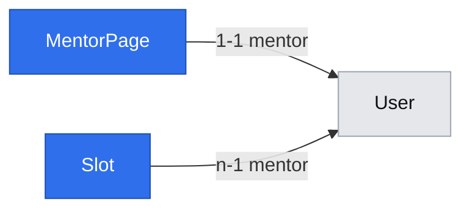

# Mentor pages and discovery (E01)

Status: draft (gate answered 2026-10-29; not implemented)
Review corrections: accepted by the user 2026-10-29; incorporated below
Platform grilling refinements: accepted and application confirmed by the user 2026-10-29; dependent contracts aligned below
Issue: #8 — stories #14 (page and share link), #15 (rate), #16 (slots), #17 (public list)
Design authority: `.ai/specs/product-brief.md` (Scope → Now, Key flows 1–3; D02, D09, D10, R03, R08, R11, R15, N01, N02)
Builds on: `2026-10-29-platform-primitives.md` (ids `B*`/`F*` below); requires the accounts spec (#24) to have landed

## 📝 TLDR

**Who needs it:** mentors, who need a page to point people to, and mentees, who need to find a mentor and judge them by their public work. **Today:** no mentor can publish anything. **Proposed (future behavior):**
- A signed-in mentor builds a page from a description and links to their public work, and publishes it at `/mentorzy/<slug>`.
- They set one rate per 25 minutes (the page shows both prices) and publish individual start times.
- They can opt into a public list at `/mentorzy`.
- Mentees open both without signing in. No page shows ratings (N02).

This is the supply side of flow steps 1–3 and the test of A02 (do mentors publish a priced page?).

## 📝 Problem Statement

A mentee with a deadline needs to reach someone who has done exactly their problem, either by a link the mentor shares or, failing that, through a list (D02). The mentor must be judged by their work, not stars: 41 of 54 survey respondents would choose by what someone built or wrote, and all three mentors interviewed rejected ratings (N02). Before any booking (E02) can exist, there must be a published page with a price (R03: the price is seen before the question) and bookable start times (D09, R11). Whether mentors will do this at all is untested (A02, accepted untested in D08); this epic is that test, run on the mock build (D14).

## 📝 Proposed Solution

Two concepts, following the folder convention: **`mentors`** (the page, its rate and its listing) and **`availability`** (slots). Each story adds its own columns and migration. #14 ships first; #15 (rate) and #16 (slots) can then ship independently; #17's complete discovery list follows both. Each phase leaves the app working without querying columns or tables from an unmerged phase.

- **Rendering:** public pages are server-rendered through `loadPage` (F2), with `generateMetadata` for link previews. The mentor's own screens live in a `(mentor)` route group built from `@mentio/ui` (shadcn, gate Q5 = a). Their reads also go through `loadPage`; their writes go through `apiCall` → API routes, and `router.refresh()` reloads the page afterwards.
- **Concurrent valid content saves:** last-write-wins (B7): the last valid write applied by the database supplies saved content. No revision token or edit history is added. Publication validation remains inside the shared row-lock transaction, and refresh preserves dirty local form input (F4).
- **No public JSON API:** nothing outside the server-rendered pages reads public data in the first build, so no public endpoints are added (YAGNI). Adding one later is additive.
- **Who may publish:** anyone with a `mentor` role (gate Q9 = a). There is no approval step. An admin "hide page" switch is a later, separate change. ⛔ D14 reads "invited mentors may publish", and under `SDLC.md`'s protected-decisions rule a PR that contradicts it without a superseding row is a review blocker. Phase 1 therefore needs a superseding or clarifying decision row (proposed D22, "any mentor account may publish on the mock build") approved by Damian **before it merges**. If Damian declines, Phase 1 adds an admin-set `canPublish` flag instead.
- **Alternatives considered:**
  - Recurring weekly availability rules (Cal.com and Calendly style) were rejected for now: D09 publishes start times, and individual slots are the smallest thing that tests A01. If mentors find adding times one by one tedious, that is the signal to add rules.
  - A slot as a free-form time range was rejected: R01 fixes lengths at 25 or 50 minutes, and D09 books a start time.

### Research (from prior knowledge, not re-checked on 2026-10-29)

- **Topmate:** one link per expert is the whole entry point. That backs the share link being the primary path and the list opt-in (D02).
- **Cal.com and Calendly:** both have "minimum notice" and "how far ahead" settings, which match R11, and buffers between events, which match our 50-minute block (gate Q8 = a). They carry recurring rules, date overrides and calendar sync, all skipped here.
- **ADPList:** shows a session count as a trust signal. It is not a rating, but it is not in scope either; noted for later.

## 📝 Architecture

| Layer | `mentors` | `availability` |
|---|---|---|
| db | `entities/mentors/mentor-page.entity.ts` (`MentorPage`) | `entities/availability/slot.entity.ts` (`Slot`) |
| core rules | `rules/mentors.ts` (R08 bounds, lengths) — B2 | `rules/availability.ts` (time-window predicate, 50-min block, 15-min grid) — B2 |
| core services | `services/mentors/mentor-page.service.ts` (`MentorPageService`) | `services/availability/slot.service.ts` (`SlotService`) |
| core validators | `validators/mentors/mentor-page-update.schema.ts`, `mentor-page-rate.schema.ts`, `mentor-page-listing.schema.ts`, `mentor-list.schema.ts`, plus `slug.ts` (`slugify`, `slugSchema`) | `validators/availability/slot-create.schema.ts` |
| app API | `api/mentors/me/page/route.ts`, `…/publish/route.ts`, `…/unpublish/route.ts`, `…/rate/route.ts`, `…/listing/route.ts` | `api/availability/slots/route.ts` (`makeCrudRoute` with `access: { role: "mentor" }`, B13: create, remove) |
| app pages | `(marketing)/mentorzy/page.tsx`, `(marketing)/mentorzy/[slug]/page.tsx`, `(mentor)/mentor/strona/page.tsx` | `(mentor)/mentor/terminy/page.tsx` |

**How the services depend on each other — one way only, `mentors` → `availability`:**
- `SlotService` owns the `slots` table and **never** depends on `MentorPageService`. A two-way dependency would make Awilix (PROXY mode, constructor destructuring) throw "Cyclic dependencies detected" on every resolve.
- `SlotService` exposes:
  - `insertWithinLock(tx, mentorId, startsAt)`: the window, grid and 50-minute neighbour checks plus the insert, run inside a transaction the caller holds;
  - `removeOwn(mentorId, slotId)`;
  - `listOwnUpcoming(mentorId, now)` and `listWithinBookingWindow(mentorId, now)`, returning slot data, not ORM builders. They share B2's time-window bounds.
- `MentorPageService` composes `SlotService` from the cradle once #16 lands. `addSlot(mentorId, wallTime)` converts the validated string with B4, opens the transaction, locks the mentor's own `mentor_pages` row (a missing page → `409 mentor_page_required`) and calls `slotService.insertWithinLock` with the resulting instant. It builds public availability and owner-slot visibility/eligibility from the page facts and the slot data, taking one `clock.now()` snapshot per operation.
- `MentorPageService.listPublic` owns the composite discovery query in #17. It may read both `MentorPage` and `Slot` schemas through `@mentio/db`; `SlotService` continues to own slot mutations. No service exports an ORM builder, alias or subquery API. The discovery query uses B2's bounds and the same eligibility definition as the public page.
- The `POST /api/availability/slots` route therefore calls `mentorPageService.addSlot`, and `DELETE` calls `slotService.removeOwn`. Routes are wiring and may call either service.
- Both services are `.scoped()` on the cradle; `clock` is new (B3).

**What later work relies on:**
- E02 (#18) adds `Slot` holds and bookings priced from `MentorPage.rate` (B1, `multiply`), and must make slot removal refuse a held slot.
- E01 adds nothing that later stories would have to undo.

## 📝 Data Model

**`MentorPage`** — table `mentor_pages`, concept `mentors`.

| Property / column | Type | Phase | Notes |
|---|---|---|---|
| `id`, `createdAt`, `updatedAt` | `baseProperties()` | 1 | |
| `mentor` / `mentor_id` | 1-1 → `User`, unique `mentor_pages_mentor_id_unique` | 1 | the owner; one page per mentor |
| `slug` / `slug` | `varchar(40)`, unique `mentor_pages_slug_unique` | 1 | lower-case `^[a-z0-9]+(-[a-z0-9]+)*$`, 3–40 characters, prefilled from the name (`slugify` transliterates Polish letters); editable — an old link then 404s (gate Q7 = a) |
| `displayName` / `display_name` | `varchar(80)` | 1 | shown publicly; independent of `User.name` |
| `description` / `description` | `text`, default `''` | 1 | plain text (no markdown, no HTML); 0–2,000 characters while a draft, **50–2,000 while published**; incomplete draft saves are allowed, and publish/edit refusals name missing fields |
| `publicWorkLinks` / `public_work_links` | `jsonb` (`string[]`), default `[]` | 1 | 0–10 URL strings while a draft; **at least 1 while published** (N02); `http`/`https` only; the same shape as F4 and the API, with no separate labels |
| `status` / `status` | `varchar` `draft \| published`, default `draft` | 1 | |
| `publishedAt` / `published_at` | `timestamptz` nullable | 1 | set on each publish |
| `rate` / `rate_grosze` | `integer` nullable | 2 | B1; null = no rate yet, so no slot is bookable, although published availability may be visible (R03); bounds checked in the service and schema (R08), not by a DB `CHECK` |
| `isListed` / `is_listed` | `boolean`, default `false` | 4 | opt-in (D02) |
| `listedAt` / `listed_at` | `timestamptz` nullable | 4 | for list ordering |

**`Slot`** — table `slots`, concept `availability` (Phase 3).

| Property / column | Type | Notes |
|---|---|---|
| `id`, `createdAt`, `updatedAt` | `baseProperties()` | |
| `mentor` / `mentor_id` | n-1 → `User`, indexed | the owner. Keyed on the user, not the page, so ownership checks use `session.userId` directly (B5) and E02's bookings reference the same mentor id |
| `startsAt` / `starts_at` | `timestamptz` | always UTC (B4); unique `slots_mentor_id_starts_at_unique` with `mentor_id`; index `slots_starts_at_index` for the list's next-slot query |

- **Block rule (gate Q8 = a):** one mentor's slots reserve 50 minutes and start on :00, :15, :30 or :45 Warsaw time. The block plus grid makes the **effective minimum spacing 60 minutes**: 18:00 followed by 18:45 is refused, 18:50 is off-grid, and 19:00 is allowed. A 50-minute session therefore has at least 10 minutes of buffer, and a 25-minute session leaves at least 35 minutes unavailable. This consequence must be explicit in R18's approval; no finer grid or duration-dependent spacing is introduced. Enforce the 50-minute neighbour check and grid inside `MentorPageService.addSlot` → `SlotService.insertWithinLock` while holding a `PESSIMISTIC_WRITE` lock on the mentor's page row (B7). The named unique constraint backs exact duplicates. No exclusion constraint/extension is needed.
- **Publication invariant:** a published page always has a description of at least 50 characters and at least one valid public-work URL. `upsertOwn`, `publishOwn` and `unpublishOwn` serialize on the same page row in a transaction. Upsert merges content fields only (B7), refreshes the row and checks the resulting published candidate before commit; invalid edits roll back without changing the public page. Publishing validates the latest saved content while holding that lock. Draft saves may still be incomplete; there is no separate draft-copy/versioning system.
- **Deleting a slot:** a hard delete (no bookings exist in E01). E02 adds the hold and turns removing a held slot into a `409`.
- **Sensitive data:** none new. The mentor's email (`User.email`) never appears in a public DTO (B6 key-set tests). Descriptions and links are public by design, once the mentor publishes.
- **Migrations:** one per phase, generated from the latest merged snapshot, each with a hand-written `down()` that drops what it added. Rate and slot migration order follows actual delivery, not their story numbers; rollback traverses that real order. Rolling back Phase 1 deletes every mentor page; that is acceptable before launch and stated in the PR's rollback plan.
- **Migration test harness (built in Phase 1, reused by every later migration and by E02–E05):** `tests/integration/migrations.test.ts`. It creates its own throwaway database on the same Postgres server (`mentio_it_migrations_<random>`), so it never touches the database the running `next start` uses. It runs the real CLI up → down (step by step to the previous migration) → up with an explicit `DATABASE_URL` (see the lessons on exported `DATABASE_URL`), asserts the tables and named constraints after each step, and drops the database afterwards.

## 📝 API Contracts

All routes are `force-dynamic`, mentor-only and CSRF-checked by `apiHandler`. After the wrapper accepts the CSRF header, handler order is `requireSession` → `requireRole(session, "mentor")` → body parsing: a mentee gets `403` and no session gets `401` before body-validation `400`s. Missing/invalid CSRF is the wrapper's `403`, independent of session/body validity. Bodies go through Zod (`parseJsonBody`), and only parsed output reaches services. Responses use the standard envelope; `code` values are the client contract (B12).

**DTO key sets** (each projection's unit test asserts exactly these keys, B6):

| DTO | Keys | Never contains |
|---|---|---|
| `MentorPageOwnerDto` | `slug, displayName, description, publicWorkLinks, status, publishedAt, rate, isListed, shareUrlPath` | — |
| `MentorPagePublicDto` | `slug, displayName, description, publicWorkLinks` (`string[]`), `prices` (`{ min25: MoneyDto; min50: MoneyDto } \| null`), `availableSlots` (`{ id, startsAt }[]`), `canBook`, `isIndexable` | mentor/user id, email, `status`, `publishedAt`, `isListed`, `listedAt`, `rate` (raw), any `rating*`/`review*`/`stars*` key |
| `MentorListItemDto` | `slug, displayName, descriptionExcerpt, price25` (`MoneyDto \| null`), `nextBookableStartsAt` (`string \| null`) | the same exclusions as above |
| `SlotOwnerDto` | `id, startsAt, isWithinBookingWindow, isPubliclyVisible, isBookable` | — |

`isIndexable` reflects the listing choice for metadata; it is not a secret or a different permission. `publicWorkLinks` is a URL string array in every DTO. Phase 1 projects the future fields as `rate: null`, `prices: null`, `availableSlots: []`, `canBook: false`, `isListed: false` and `isIndexable: false`, without reading absent columns/tables. The DTO declarations can describe money structurally (`{ amountGrosze: number; currency: "PLN" }`) without importing an unbuilt B1 module; `rate` is that shape or null. #15 fills rate/prices and #16 fills availability; the later PR integrates combined eligibility through these stable projection contracts. No runtime feature-flag or missing-column detection is added.

URL validation keeps top-level `fieldErrors.publicWorkLinks`; invalid entries include one-based row numbers in Polish message text, e.g. `"Link 3: wpisz poprawny adres."` (F4). The shared schema validates row positions before dropping empty rows from successful output, so client errors match the displayed row. Direct API calls use the same numbering against their submitted array. List-wide bounds and publication errors remain list-wide messages. No nested-error envelope is introduced.

| Method & path | Phase | Body | Success | Failures |
|---|---|---|---|---|
| `PUT /api/mentors/me/page` | 1 | `{ slug, displayName, description?, publicWorkLinks: string[] }` | `200 MentorPageOwnerDto` (transactional content-only upsert on `mentor`, B7; validates the complete candidate if published; valid saves use last-write-wins) | `400 validation_error` with `fieldErrors`, including invalid published edits and one-based invalid-link messages; `409 slug_taken` (`mentor_pages_slug_unique`, mapped outside the transaction) |
| `POST /api/mentors/me/page/publish` | 1 | — | `200 MentorPageOwnerDto` (`status: "published"`) | `404 not_found` (no page yet); `400 validation_error` naming each missing field, e.g. `publicWorkLinks: ["Dodaj co najmniej jeden link do swojej publicznej pracy"]` (#14 AC 3) |
| `POST /api/mentors/me/page/unpublish` | 1 | — | `200 MentorPageOwnerDto` (`status: "draft"`; the listing flag is kept but has no effect) | `404 not_found` |
| `PUT /api/mentors/me/page/rate` | 2 | `{ ratePln: integer }` | `200 MentorPageOwnerDto` | `400 validation_error`, `fieldErrors.ratePln` names the bound: "Stawka musi wynosić od 90 zł do 600 zł" (R08, #15 AC 2); `404 not_found` |
| `PUT /api/mentors/me/page/listing` | 4 | `{ isListed: boolean }` | `200 MentorPageOwnerDto` | `404 not_found` |
| `POST /api/availability/slots` | 3 | `{ startsAt: "YYYY-MM-DDTHH:mm" }` (Warsaw wall time, B4) | `201 { id, startsAt }` (ISO UTC) | `400` (format, not on a quarter hour, nonexistent DST time, outside the publish window); `409 slot_too_close` (within 50 minutes of another of the mentor's slots, or the same start); `409 mentor_page_required` (no page yet) |
| `DELETE /api/availability/slots?id=<uuid>` | 3 | — | `200 { id }` | `404 not_found` when the slot is missing **or someone else's** (B5) |

- **Publish window (a proposal; ⚠ Damian to confirm):** a mentor may publish a start time from 2 hours to 14 days ahead. Saving a start time does not imply visibility or eligibility: those also depend on the page's state and rate. Widening this input window later relaxes a check.
- **Rate conversion:** `ratePln` is an integer within R08, converted with B1's `fromWholePln`; prices use checked `multiply`. B1 also supports fractional-zł amounts through `fromGrosze` for later consumers and display, while E01's rate input stays whole złoty.
- **Wall-time conversion:** #16 selects B4's maintained timezone dependency for browser/server validation; the HTTP value stays a wall-time string and the service converts it to UTC. Reject invalid calendar dates and DST gaps; use the earliest autumn overlap occurrence.
- **Availability and eligibility:** `isWithinBookingWindow(startsAt, now)` checks `[now + 2 h, now + 14 d]` only. A slot is publicly visible when its page is published and it is within that window; visible slots form `availableSlots`, even without a rate. A visible slot is bookable only when the page also has a rate. `canBook` is true when at least one displayed slot is bookable; it describes domain readiness, not an implemented E01 booking action. E02 adds the hold check and only makes eligible slots clickable. `SlotOwnerDto` computes these three flags from the same facts; the list's `nextBookableStartsAt` is null for an unpriced mentor regardless of their visible availability.

## 📝 UI/UX

All copy is Polish (R15), written directly in the code (F1). Times are Europe/Warsaw and money is in `zł`, both through `@mentio/ui/lib/format` (F7). Public pages use plain Tailwind; mentor screens use `PanelShell` with shadcn components.

- **`/mentorzy/<slug>` — public mentor page** (`MentorProfilePage`, `(marketing)`, `loadPage("public")`).
  - Content in order: the display name; the description (`whitespace-pre-line`, plain text); "Publiczna praca" with the link list; prices ("25 min — 120 zł", "50 min — 240 zł") or "Mentor nie ustalił jeszcze stawki — rezerwacja jest niedostępna"; "Wolne terminy" grouped by day; and the line "Sesje odbywają się wyłącznie tekstowo" (N01).
  - Slots are not clickable in E01 (E02 links them to booking).
  - No rating, stars or review element exists (N02, asserted by test).
  - Public-work URL strings are the link destinations and visible text; links open in a new tab with `rel="noopener noreferrer nofollow ugc"`.
  - `generateMetadata`: title = display name, description = the first 160 characters.
  - The page is `noindex` unless the mentor is listed, so a mentor who refused the list (A04) is not surfaced by search engines either. This is an agent proposal, cheap to reverse.
  - Parse the slug explicitly in the page: a malformed slug → `notFound()` before a service call. A draft, unpublished or unknown slug also gives the Polish 404. F2 logs/rethrows unexpected service validation failures to the error boundary.
- **`/mentorzy` — public list** (`MentorzyPage`, `(marketing)`).
  - Lists published and listed mentors only.
  - Ordering: priced mentors with a bookable slot first, by their soonest one; then all other published/listed mentors by `listedAt`, newest first, with `id` as a deterministic final tie-breaker. Ratings never affect the order (N02).
  - `MentorPageService.listPublic` computes ordering and pagination in one MikroORM query over the two schemas, with its aggregation local to that read operation. `next_starts_at` is the minimum start within B2's window **only when the mentor has a rate**; otherwise it is null. Capture `now` once from `clock`, parameterize the bounds, and order by `next_starts_at asc nulls last, listed_at desc, id asc`. A separate count uses the same published/listed scope. No in-memory sorting or cross-service query-builder contract is added; E02 updates this local query and eligibility predicates together for held slots.
  - Card: name, the first 200 description characters, the 25-minute price or "brak stawki", and the next bookable slot or "brak terminów do rezerwacji", linking to the page. An unpriced mentor is never presented as having a bookable time.
  - Pagination is `?strona=N` with 20 per page; the page parses it explicitly and an invalid value → page 1. F2 does not convert pagination validation into a 404. This list is server-rendered; F3's client-query retention contract applies to its actual client consumers.
  - Empty: "Na liście nie ma jeszcze mentorów".
  - The card is shared by two pages only if E02 reuses it; until then it is colocated (placement rule 4).
- **`/mentor/strona` — my page** (`StronaPage`, `(mentor)`, `loadPage({ role: "mentor", returnTo })`).
  - A status card (Szkic / Opublikowana) with an `ActionButton` to publish or unpublish (F5), the share link with a "Kopiuj link" button, and a "Zobacz stronę" link when published. Publish validates **saved content**; it is disabled while the content form is dirty, with "Zapisz zmiany przed publikacją". Unpublishing may act on the saved page even while edits are unsaved.
  - A `CrudForm` for slug (prefilled from the name), display name, description and `urlList` URL strings (F4), with `onDirtyChange` and `externalFieldErrors`. Invalid URL messages name the one-based row under the whole list. The editor clears external action errors on an edit or successful save/action, and resets the saved baseline after a successful save; route refresh preserves dirty local input, while clean forms can adopt refreshed values. Another tab's valid save can overwrite stored content under last-write-wins.
  - Changing the slug of a published page shows a warning before saving: "Stary link przestanie działać".
  - From Phase 2, a rate form (`money` field, with the help text "50 minut kosztuje dwukrotność stawki").
  - From Phase 4, a listing `checkbox` ("Pokaż mnie na liście mentorów").
  - `ActionButton.onError` passes publish `fieldErrors` into `CrudForm.externalFieldErrors`, using its existing accessible rendering. Content-save errors use the normal form submission path. A refusal leaves the prior public page unchanged. Busy mutation calls return `null` without another request or success/error callback (F3/F5).
- **`/mentor/terminy` — my slots** (`TerminyPage`, `(mentor)`, Phase 3).
  - A `CrudForm` with one `datetime` field ("Początek sesji, czas polski", 15-minute step), plus "Terminy można dodawać co najmniej co godzinę; każdy rezerwuje 50 minut".
  - A `DataTable` of upcoming slots with day/time and a status derived from the owner flags: "Poza oknem rezerwacji", "Strona nieopublikowana", "Widoczny — brak stawki" or "Widoczny — można zarezerwować". Each has a remove `ActionButton` behind a confirm step. Publication and price facts come from `MentorPageService`, not a reverse dependency in `SlotService`.
  - Empty state: "Nie masz opublikowanych terminów".
  - Without a page, the screen points to `/mentor/strona` first.
- **Accessibility:** form errors are linked through `aria-describedby` (already in `CrudForm`), action failures are announced with `role="alert"`, and the copy button announces "Skopiowano" through a polite live region.
- **Prototype:** none accepted. Screens follow the existing `/admin` look (shadcn) and the marketing page's plain Tailwind.

## 📝 Edge Cases & Failure Scenarios

- **Two mentors save the same slug at once:** the unique constraint maps to `409 slug_taken` (B7), and the field shows "Ten adres jest już zajęty".
- **A slug change on a published page:** the old link returns 404 from that moment, which was accepted at the gate (Q7 = a). The UI warns before saving. No redirect table exists.
- **A mentee lands on a page that was just unpublished:** they see the 404 on the next load. Nothing is cached (`force-dynamic`).
- **Publishing with no public-work link:** `400`, and the field names the problem (#14 AC 3). A description under 50 characters is named the same way (a draft may be saved without one).
- **Editing a published page to remove its last link or shorten its description:** `400` with field errors, transaction rollback and the prior public page intact. Concurrent publish/edit requests serialize; either a valid edit wins or an invalid edit is refused, never an incomplete published page. Content upsert preserves status, ownership, rate and listing fields.
- **Two valid saves from different tabs:** both can return `200`; the last database write supplies the saved content, without a revision conflict/history. Publication remains complete, and a refresh in a dirty editor preserves its unsaved input.
- **Publish with unsaved editor changes:** the UI requests a save first. A failed publish places field errors on the saved draft's editor fields; changing a field clears stale action errors. Unpublish/refresh preserves unsaved input rather than remounting the form.
- **A `javascript:` or `data:` URL in the links:** refused by the schema (only `http`/`https`), with a one-based row message under `publicWorkLinks`; multiple invalid rows each get a message, and preceding blanks do not shift displayed row numbers. Rendered links never use `dangerouslySetInnerHTML`, and React escapes the description.
- **Two slot creates within 50 minutes of each other at the same moment:** the per-mentor row lock serialises them, so one gets `201` and the other `409 slot_too_close` (concurrency integration test).
- **Grid/block interaction:** 18:00/18:45 collide, 18:50 fails grid validation and 18:00/19:00 are valid. Tests and mentor help text capture the effective 60-minute spacing.
- **DST and invalid dates:** B4's maintained-library wrapper refuses invalid calendar values and "2026-03-29T02:30" as nonexistent; "2026-10-25T02:30" resolves to its first occurrence. The 50-minute rule is measured on UTC instants, so it holds across the change.
- **A slot that ages inside 2 hours, or past its start:** it disappears from the public page and the list (#16 AC 2–3); the owner sees it as "poza oknem rezerwacji" until it has passed.
- **A mentor with no rate:** the page shows slots without prices and says booking is unavailable (#15 AC 3). E02 refuses to book.
- **A listed mentor without a rate but with the earliest visible slot:** `nextBookableStartsAt` is null; priced mentors with eligible slots rank first. A draft page's owner sees its slots as not publicly visible and not bookable, even within the time window.
- **A rate change after bookings exist:** this is E02's concern; bookings snapshot the price at booking time. E01 stores only the current rate.
- **A mentee calls a mentor endpoint:** `403`. A mentor deletes another mentor's slot by id: `404`, indistinguishable from a missing slot.
- **An unlisted or draft page in the list:** never shown. An isolation integration test seeds a listed, an unlisted and a draft page, and asserts that only the listed one appears (#17).
- **Database unreachable:** the public pages show the Polish error page, and the app still builds and boots.

## 📝 Risks & Impact Review

- **`risk-high` per `SDLC.md` for every phase** (new tables or columns; ownership; stored money; list scoping). Each PR carries the evidence its story names: migration up/down with a rollback plan, a denied-path test for editing another mentor's data, an isolation test for the list, bound tests for the rate, a second reviewer, and `needs-qa` with no self-QA.
- **The slug is a durable public contract:** once shared, a link must keep working or fail visibly. Editability (Q7 = a) trades link stability for mentor control. If mentors change slugs often, the fix is a `mentor_page_slug_history` redirect table, which is additive.
- **Valid saves can overwrite another tab's saved content:** last-write-wins is accepted for E01. Keep publication validation under the transaction lock and dirty input during refresh; add revision tokens/history only if a real consumer requires them.
- **The block and grid rule (Q8 = a) and the publish window are new business rules** not yet in the brief. The brief requires a superseding row approved by Damian; see Decisions in play.
- **Open publishing (Q9 = a) contradicts D14's "invited mentors" as written:** this is a merge blocker for Phase 1 until Damian approves the proposed D22 (see Proposed Solution). If approved, anyone who signs up as a mentor can publish a priced, bookable page on the mock build. No money moves (D13), so the exposure is reputational (an unvetted page on the list). Counting A02 must separate invited mentors from others.
- **Rollback:** each phase's migration has a `down()`. Phase 1's deletes all pages, Phase 3's deletes all slots; both are acceptable before launch and must be called out in each PR.

## 📝 Decisions in play

- Relies on: D02 (link plus opt-in list), D09 (published start times), D10 (PLN, Warsaw time), D13 (mock build, no timers), D14 (mentors may publish on the mock build), R01 (25/50 minutes), R03 (no rate → not bookable), R08 (rate bounds), R11 (2 h–14 d), R15 (Polish), N01 (text only, stated on the page), N02 (no ratings, public work required).
- **Proposed new rules, to be entered in the brief as rows owned by Damian before the phase that needs them ships:**
  - **R18 (Phase 3):** a slot reserves a 50-minute block on a 15-minute Warsaw-time start grid. The effective minimum spacing is 60 minutes, including at least a 10-minute buffer after a 50-minute session or 35 minutes after a 25-minute session. Q8 = a chose the block/grid; the approval row must state their combined consequence explicitly.
  - **R19 (Phase 3, ⚠ needs confirmation):** mentors publish start times from 2 hours to 14 days ahead. An agent proposal.
  - **D22 (Phase 1, ⛔ blocks merge):** any account with the `mentor` role may publish on the mock build. It supersedes or clarifies D14's "invited mentors" and was chosen at this spec's gate (Q9 = a).
  - **Product choices recorded here, no brief row needed:** a slug change breaks the old link (Q7 = a); unlisted pages are `noindex` (an agent proposal).
- Depends on the accounts spec (#24, gate Q2 = a): `mentor`/`mentee` roles (D21), sign-in path, `returnTo`. Integration tests need a signed session with role `mentor` (`tests/integration/support/session.ts` signs `student` today; accounts renames it).

## 📋 Phasing

0. **Prerequisites:** the accounts spec (#24), carrying primitives Phase 2 (`loadPage`, `isSafeReturnTo`), and primitives Phase 1a (Polish UI) are merged. D22 is approved by Damian before Phase 1 merges.
1. **#14 — page, publish, share link.** Shippable alone: mentors publish pages; mentees open links.
2. **#15 — rate, after #14.** Pages show both prices; if slots have landed, their eligibility updates with the rate.
3. **#16 — slots, after #14.** Pages show published availability, with the baseline no-rate notice until #15 lands.
4. **#17 — public list.** Mentees find mentors without a link; cards show the rate (Phase 2) and the next slot (Phase 3).

**Dependency order: prerequisites → #14 → {#15, #16} → #17.** Numbers identify stories, not a strict sequence between rate and slots. Stable DTO defaults let either follow #14; whichever lands second integrates the combined eligibility projection. #17 needs both B1/F7 money from #15 and clock/slot data from #16. Platform Phase 1b's admin query refactor is independent and is not an E01 prerequisite: #14 builds its own first-use mutation hook. B13 waits for #16's actual factory consumer.

## 📋 Implementation Plan

Each step leaves the app working and ends with its tests; each phase is one PR that passes the full validation gate.

### Phase 1 — mentor page (#14)

1. **Entity, migration and the migration harness:** `MentorPage` with the Phase 1 columns, named constraints and registration in `entities/index.ts`; `db/src/errors.ts` (`isUniqueViolation`, `LockMode` re-export) (B7); `tests/integration/migrations.test.ts` in its own throwaway database (see Data Model). Tests: entity metadata test; migration up → down → up.
2. **Primitives for this phase:** `persistence/find.ts` (B5), `persistence/conflicts.ts` (B7), and B12's optional domain-specific error codes, preserving defaults. Tests: conflict mapping, a custom code in the envelope and existing codes unchanged. Role checks remain explicit in `apiHandler`; B13 waits for #16.
3. **Validators:** `slug.ts` (`slugify` with Polish transliteration, `slugSchema`) and `mentor-page-update.schema.ts` (URL string arrays, http/https, length bounds, Polish messages with one-based invalid-row numbers). Tests: transliteration (`Łukasz Żółć` → `lukasz-zolc`), every refusal, multiple invalid rows with preceding blanks, top-level field-error messages through client and API parsing, and F4's link initialization/client parse → JSON → route-schema round trip.
4. **`MentorPageService`:**
   - `getOwn`;
   - `upsertOwn` (transactional `em.upsert` on `mentor`, explicit content-only merge fields, refreshed candidate and published-state validation; `slug_taken` mapped outside the transaction);
   - `publishOwn` (same page-row lock as edits; validate saved description/links and name every missing field);
   - `unpublishOwn`, `getPublishedBySlug`;
   - `toMentorPageOwnerDto` / `toMentorPagePublicDto` with the exact key sets from API Contracts (B6, N02);
   - cradle and container registration.
   Tests: every rule/refusal and owner-in-`where`, including invalid published edits and upsert preserving state. Integration: concurrent first saves return two `200`s with one row; valid saves applied in a controlled order demonstrate last-write-wins; concurrent publish/content edits never leave an incomplete published row. Later #15/#17 tests also prove content saves preserve rate/listing fields.
5. **Routes:** `api/mentors/me/page` (PUT), `…/publish`, `…/unpublish` on `apiHandler`. Integration tests: `200`, `400` naming the missing link, `409 slug_taken`, `401`, `403` for a mentee, and CSRF `403`.
6. **`(mentor)` shell and editor:** extract `PanelShell` (F8), move `/admin` onto it (existing layout behavior stays tested), and build the mentor editor with `loadPage`. Build F3's mutation hook with F5's first `ActionButton`; extend `CrudForm` with URL arrays, external errors and dirty state (F4). Wire publish errors into fields, disable publish until dirty content is saved, preserve unsaved input on refresh, and add copy-link/slug warnings. Tests: busy calls return `null` (same tick/different input too), duplicate actions make one request and one callback, reset cannot release an active request, server errors attach to fields, URL messages identify rows, edits clear stale errors, save resets dirty state, and refreshed values preserve dirty input but update clean forms. Browser: mentor editor loads, signed-out users redirect, and incomplete saved drafts show publish field errors.
7. **Public page:** `/mentorzy/[slug]` with explicit slug parsing, `loadPage("public")`, `cache()`, `generateMetadata` and `noindex`. Page tests: malformed slug gives 404 before a service call; unexpected service validation failures reach the error boundary; no rating element; links' `rel`. Browser integration test: a published page renders signed out, and a draft gives 404.
8. **Docs:** the `AGENTS.md` lines for B5–B7/B12, F3's mutation hook and F4/F5, a `.ai/lessons.md` entry if anything surprised, and the run log.

### Phase 2 — rate (#15)

1. Migration adding `rate_grosze`; `lib/money.ts` (B1) and `rules/mentors.ts` (B2); add `formatMoney` to F7 with this first consumer. Tests: nonnegative safe-integer bounds, zero, invalid/fractional/unsafe inputs, `fromWholePln` conversion overflow, checked `multiply`, `fromGrosze` fractional-zł amounts, whole and fractional zł formatting. Commission arithmetic waits for its later consumer.
2. `mentor-page-rate.schema.ts` (an integer złoty within R08, a message naming the bounds); `MentorPageService.setOwnRate` converts with `fromWholePln`; both prices in the public DTO (`multiply(rate, 2)`). Tests: 89/90/600/601 zł and fractional rate refusal; DTO prices.
3. `PUT /api/mentors/me/page/rate`; integration tests `200`, `400` naming the bound, `401`, `403`.
4. The rate form on `/mentor/strona` (`money` kind, F4); prices replace the baseline no-rate notice (`formatMoney`, F7). Page tests and a browser check of both prices. If #16 is already merged, update/test slot eligibility when the rate is set; no dependency on an unmerged slots table.

### Phase 3 — slots (#16)

1. Migration for `slots` (named unique constraint, `starts_at` index); `Slot` entity; `lib/clock.ts` (B3) on the cradle; select one maintained timezone dependency compatible with Node 24 and supported browsers for `lib/zoned-time.ts`/`wallTimeSchema` (B4). Tests reject invalid calendar dates and spring gaps, select the earliest autumn overlap instant and verify browser/server parity. Add `rules/availability.ts` (`isWithinBookingWindow`, block/grid constants) and F7's first `formatSlotTime` consumer.
2. `slot-create.schema.ts` (retained wall-time string, quarter hour, nonexistent time). `SlotService`, with no dependency on `MentorPageService`:
   - `insertWithinLock(tx, …)`: check the publish window and the neighbours, insert;
   - `removeOwn`: owner in `where`, 404 otherwise;
   - `listOwnUpcoming(mentorId, now)`, `listWithinBookingWindow(mentorId, now)`, returning slot data only.
   Then `MentorPageService.addSlot`: service-side conversion, transaction, own-page lock (`409 mentor_page_required` if missing), `insertWithinLock`, with `mapConflicts` outside. Compose owner/public visibility and eligibility with one clock snapshot. Tests: fixed-clock window edges, draft-page flags, no-rate availability, effective 60-minute spacing, and a container resolve proving no cycle.
3. Build B13's role-scoped `makeCrudRoute` with this actual consumer; `api/availability/slots` wires create → `mentorPageService.addSlot`, remove → `slotService.removeOwn`. Tests: wrong role plus invalid body gets `403` before `400`; datetime client parse → JSON → route parse retains wall time and stores the correct UTC instant. Integration: `201`, `409 slot_too_close`, exactly one success for concurrent conflicting creates, grid refusals, foreign-slot `404`, `401`, `403`.
4. `/mentor/terminy` (`datetime`, `DataTable`, remove `ActionButton`, grid/block help); public availability grouped by Warsaw day. Page/browser tests: added → visible, removed → gone, unpublished page not visible, no rate → visible but not bookable. This phase can land before #15 using the baseline null-price projection; if #15 has landed, test combined eligibility. Add B2–B4/B13/F4/F7 documentation.

### Phase 4 — public list (#17)

1. Migration for `is_listed` and `listed_at`; `mentor-page-listing.schema.ts`; `MentorPageService.setOwnListing`; `mentor-list.schema.ts` (`strona`, fallback to 1); `MentorPageService.listPublic` with local aggregation, price-aware eligibility, ordering/limit/offset and identically scoped count. Tests: scoping and ordering across pages, including an unpriced mentor with the earliest visible slot, now/later/none and ties; content saves preserve listing/rate and publication requirements. No exported query-builder primitive is added.
2. `PUT /api/mentors/me/page/listing`; integration tests `200`, `401`, `403`.
3. `/mentorzy` page with cards, explicit pagination parsing and the empty state; malformed `strona` falls back to page 1 (page test). The listing checkbox on `/mentor/strona`; `noindex` lifted when listed. **Isolation integration test**: listed, unlisted and draft pages are seeded, and only the listed one appears. Browser check of the list and of the empty state.

## ✅ Done means

- [ ] #14: a signed-in mentor saves a page with public-work links and a description, publishes it, and anyone with `/mentorzy/<slug>` sees it signed out; publishing without a link is refused with the field named; no page shows ratings, stars or reviews.
- [ ] #14: URL string arrays round-trip through F4/JSON/the route; invalid-link messages name one-based rows under the top-level field; publish errors reach editor fields; dirty content is saved before publishing; refresh preserves dirty input; invalid published edits roll back and concurrent edits/publishing preserve completeness while valid saves use last-write-wins. Busy mutations return `null` without duplicate requests/callbacks.
- [ ] #14/#17: malformed slugs explicitly give 404, malformed pagination falls back to page 1, and unexpected service validation failures are logged/rethrown by F2.
- [ ] #15: a whole-zł rate of 90–600 is converted with `fromWholePln`, saved and shown at the rate for 25 min and twice the rate for 50 min; 89, 601 and fractional rates are refused; B1 rejects negative/unsafe amounts and overflow while fractional-zł amounts still work via `fromGrosze`/display; a page without a rate offers no booking.
- [ ] #16: a maintained timezone dependency rejects invalid dates and DST gaps, selects the earliest overlap instant, and preserves the wall-time JSON → UTC persistence contract; visible availability is distinct from booking eligibility; unpublished pages never expose slots; out-of-window slots disappear; removals disappear; the block/grid's effective 60-minute spacing holds under concurrency.
- [ ] #17: opted-in published mentors appear; unlisted links still work; unpriced mentors have no next bookable time and do not outrank priced mentors with eligible slots; no rating appears. Discovery query construction stays local to its read operation.
- [ ] #15 and #16 can each follow #14 without absent-column/table reads, unused primitives or dependencies on platform Phase 1b; #17 follows both.
- [ ] Every screen is Polish; times show Europe/Warsaw; money shows in zł.
- [ ] Each phase: migration up/down tested, denied-path and wrong-owner tests, 100% unit coverage, an integration test per new route and page, and `lint`, `typecheck`, `test:coverage`, `build`, `test:integration`, `audit` all pass.
- [ ] D22 approved by Damian before Phase 1 merges (or Phase 1 gates publishing with `canPublish` instead).
- [ ] R18 and R19 entered in the brief by Damian before Phase 3 ships (or Phase 3 adjusted to his answer).
- [ ] The spec is moved to `.ai/specs/implemented/` when Phase 4 merges.
