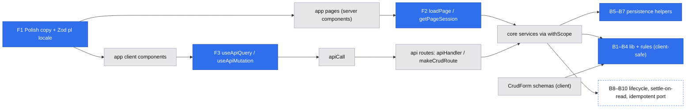

# Platform primitives — shared backend and frontend building blocks for the first build

Status: draft (design accepted at the gate 2026-10-29; not implemented)
Issue: #8 asked for it (see "Consumers" below); no tracker issue of its own yet
Design authority: `AGENTS.md`, `.ai/specs/implemented/2026-10-23-engineering-standards.md`, `.ai/specs/product-brief.md`
Consumers: accounts and sign-in (#24, own spec), `2026-10-29-mentor-pages-and-discovery.md` (E01), then E02–E05 (#18–#23, #25)

## 📝 TLDR

**Who needs this:** everyone building the next 17 backlog items. **Today:** the foundation has an HTTP layer (`apiHandler`, `makeCrudRoute`, auth helpers) and a client layer (`apiCall`, `CrudForm`, `DataTable`, `feedback/`). Nothing covers the patterns the backlog repeats story after story:
- money that must be recomputed on the server,
- time windows that tests must control,
- records only their owner may touch,
- a booking lifecycle that settles once under concurrent visits and without timers,
- payment calls that must not run twice,
- server-rendered public pages,
- a Polish interface.

**Proposed (future behavior):** this spec defines a catalog of small primitives for those patterns, with their contracts, homes and rules. Each primitive is **built in the PR of its first consumer**, never ahead of it. The exception is Phase 1, whose consumers exist today (the admin screens and the shared components). It ships as two small PRs: 1a makes every existing screen Polish (strings written in the code, plus Zod's Polish locale, with no i18n library); 1b removes the copied fetch-state code. Contracts whose consumers are E02–E05 (B8–B11, F6) are **design guidance**: the consumer's own spec adopts or amends them.

## 📝 Problem Statement

Without shared primitives, each story would re-solve the same problem in slightly different ways. The engineering standards call this "the single biggest risk of adding ~9 concepts one at a time". Here is what the backlog asks for, mapped to the pattern underneath:

| Pattern | Stories that need it | What goes wrong without a primitive |
|---|---|---|
| Money is computed by the server, never trusted from the client | #15, #18, #19, #20, #22, #23 | Float arithmetic, a different rounding rule per story, a client-supplied price persisted |
| Named business-rule values (R08, R11, R06, R10, R12, R14) shared by the form and the server | #15, #16, #18–#23 | The bound in the form drifts from the bound on the server; a magic `12` in a cancellation check |
| "Now" decides behavior (R11, R12, R14, R10) | #16, #18–#22 | Untestable time logic; tests that fail near midnight or across DST |
| Wall time in Europe/Warsaw (D10) | #16, #18, #21 | A slot entered at 18:00 stored as 18:00 UTC |
| Only the owner edits; nobody else learns the record exists | #14, #15, #16, #17, #23 | Fetch-then-compare checks that someone forgets; 403s that confirm a record exists |
| One entity, two audiences (public vs owner) | #14, #16, #17, #19 | An unpublished field or an email reaches the public page |
| Check-then-write on shared state, backed by a constraint | #16, #18, #22 | Two slots in the same block; one slot sold twice |
| A status lifecycle where concurrent requests transition once | #18, #19, #20, #21, #22 | Double refunds when both sides open the booking at the same moment (#22) |
| Settle when someone next opens the record, with no timers (D13, D16) | #19, #22 | Each service invents its own "is it due?" pass |
| Payment port calls that are safe to retry | #18, #19, #20, #22, #25 | A retry charges or refunds twice |
| Only the two participants read a booking or session | #19, #21 | A wrong-scope read leaks the mentee's question or code |
| Public share links render without JS, with link-preview metadata | #14, #17 | Client-fetched pages show a spinner to crawlers and link unfurlers |
| Persona screens guarded by role | #14–#17, #18–#23 | Auth checked in a layout, which Next 16 does not re-run on navigation |
| Polish everywhere, including validation messages (R15) | every screen | English defaults ("Save", "Loading…", Zod's "Too small") leaking into Polish screens |
| Fetch, retry, loading and stale-response state on the client | every list and every action | `admin/users/users-table.tsx` hand-rolls 30 lines that every list would copy |
| Forms beyond plain text: money, dates, checkboxes, link lists | #14, #15, #16, #17, #18 | Bespoke forms that lose `fieldErrors` mapping and the keyboard rules |

## 📝 Proposed Solution

### Build policy (gate answer Q3 = a)

- Every primitive in the catalog has a **contract** (this spec) and a **first consumer**. Its code, tests and `AGENTS.md` line land in that consumer's PR. A primitive whose first consumer has not started stays text.
- Phase 1 (PRs 1a and 1b) is the only standalone work, because its consumers already exist: admin, the marketing home page, `users-table`, and the copy in `CrudForm`, `DataTable` and `feedback/`.
- A contract for a story without a spec (B8–B11, F6) binds nobody yet. It records the intended shape so that E02–E05 start from one design rather than three.
- A consumer spec cites the primitive by its id (`B3`, `F4`, …) and does not redesign it. If the contract does not fit, the consumer amends this spec in the same PR, and the review covers that amendment.
- **Not proposed:** a base repository or service class, a module loader, RBAC, multi-tenancy, a queue or scheduled jobs (D13), Server Actions, or a generic event bus. No backlog story needs an in-process event consumer. `core/src/events` stays planned in `AGENTS.md`, to be added when a real consumer appears.

### Where things live

Client-safe code (importable by `CrudForm` schemas and client components without pulling in the ORM) is kept apart from server-only code. Today that separation rests on discipline; this spec turns it into a lint rule.

| Folder | Holds | Client-safe | New subpath export |
|---|---|---|---|
| `core/src/lib/` | Pure helpers: `money`, `clock`, `zoned-time`, `state-machine` | yes | `@mentio/core/lib/*` |
| `core/src/rules/<concept>.ts` | Business-rule values and pure predicates, each citing its brief id | yes | `@mentio/core/rules/*` |
| `core/src/validators/` | Zod schemas (exists) | yes | exists |
| `core/src/persistence/` | `em`-based helpers: not-found lookups, conflict mapping, locking, conditional transitions | **no** | none: services import it relatively |
| `app/src/server/` | `loadPage`, `getPageSession` (server-only) | no | `@/server/*` alias |
| `ui/src/backend/<category>/` | Generic panel primitives (exists): new `copy`, `actions`, `layout` categories | client | `@mentio/ui/backend/<category>` |
| `app/src/components/<concept>/` | **Placement rule only, nothing built:** the home for plain-Tailwind components once two public (`(marketing)`) pages share one | server/client | `@/components/*` |

ESLint gets one new boundary entry: files in `core/src/{lib,rules,validators}` must not import `@mentio/db`, `../container`, `../persistence`, `../services`, `../http`, `../config` or `../logger`. That keeps them importable from client code: `config` validates server secrets, and `logger` is pino. Code there signals problems by returning a result or throwing a plain `Error` for programmer errors, never an `AppError`. Callers in `services`/`persistence` translate results into `AppError`s.

### Alternatives considered

- **Build the whole kit up front (Q3 = b).** Rejected at the gate. It would ship untested-in-use abstractions and break the `AGENTS.md` rule against scaffolding.
- **Client-fetch public pages (Q4 = b).** Rejected. A share link must render for crawlers and link previews, and `generateMetadata` needs the data on the server.
- **Server Actions for mutations.** Not adopted. A second mutation path would bypass `apiHandler`'s CSRF check, the envelope and the error mapping. Mutations stay `apiCall` → route → service.
- **next-intl now (gate Q6 = b, chosen and then reversed to c on 2026-10-29).** It would have meant a Next plugin, a request config, a provider, a typed catalog, a copy provider in `ui` (which may not depend on next-intl), and a separate dictionary in `core` (verified: `use-intl@4.14.9`'s `core` entry imports `react`). That is too much machinery for one language that is fixed by R15.
- **XState (or similar) for lifecycles.** Rejected. A booking needs about ten transitions guarded by a conditional `UPDATE`. A 40-line helper with a persistence contract is easier to review than a statechart runtime. Revisit if lifecycles gain parallel or nested states.

### Research (from prior knowledge of these projects, not re-checked on 2026-10-29)

- **Medusa** (OSS commerce) stores money as integers in minor units, with a currency next to the amount. Its v2 moved to big-number amounts because of multi-currency tax maths. We have one currency and no tax lines, so integer grosze (B1) is enough; the DTO shape keeps the currency so this can change later.
- **Stripe's idempotency keys** make a retried request return the first result instead of acting twice. B10 copies that contract for the mock gateway, so the later Stripe adapter (D14) can pass keys straight through.
- **Cal.com** (OSS scheduling) keeps every time as UTC and converts at the edges with an explicit time zone. Its availability engine (recurring rules, buffers, overrides) carries complexity we skip: D09 publishes individual start times.

## 📝 Architecture



Takeaway: pages read through `loadPage`; every mutation still goes through `apiCall` and `apiHandler`. Both paths end in the same services, which compose the persistence, lib and rules primitives. Nothing new crosses a package boundary in the wrong direction.

## 📝 Backend primitive contracts

Every primitive has 100% unit coverage in its first consumer's PR. "Rule" lines become `AGENTS.md` text in that PR.

### B1 — `Money` (`core/src/lib/money.ts`) · first consumer E01 #15

```ts
export type Currency = "PLN";
export interface Money { readonly grosze: number; readonly currency: Currency } // integer minor units
export interface MoneyDto { amountGrosze: number; currency: Currency }
export function pln(zloty: number): Money;                 // throws on non-finite or more than 2 decimals
export function fromGrosze(grosze: number): Money;         // throws on a non-integer
export function multiply(m: Money, factor: number): Money; // integer factor only (50 min = rate × 2, R08)
export function percentOf(m: Money, basisPoints: number): Money; // rounds half up to a whole grosz (R06, E05)
export function subtract(a: Money, b: Money): Money;
export function compare(a: Money, b: Money): -1 | 0 | 1;
export function toDto(m: Money): MoneyDto;
export function toMajorUnits(m: MoneyDto | Money): number; // for display formatting only
```

Rules: money columns are `p.integer()` named `<name>_grosze`; never float or decimal. A price that is charged is always derived from stored values (`multiply(rate, lengthMinutes / 25)`), never parsed from a request. Splits compute the commission with `percentOf` and the mentor's share as `subtract(price, commission)`, so the two always add up to the price.

### B2 — Business rules (`core/src/rules/<concept>.ts`) · first consumer E01 #15, #16

```ts
// rules/mentors.ts
/** R08 — one rate per 25 minutes, 90–600 PLN. Change only with a superseding brief row. */
export const RATE_PER_25_MIN = { min: pln(90), max: pln(600) } as const;
export const SESSION_LENGTHS_MINUTES = [25, 50] as const;           // R01
// rules/availability.ts
export const BOOKABLE_LEAD = { minMinutes: 120, maxDays: 14 } as const; // R11
export function isBookable(startsAt: Date, now: Date): boolean;
```

Rules: every rule value lives here once and carries its brief id. Schemas, services and forms import it; nothing restates it inline. A value that must be configurable per deployment (R06's commission) is **not** read here: the service reads it from `getEnv()` and passes it into the pure function (`mentorShare(price, commissionBasisPoints)`), so `rules/` stays client-safe.

### B3 — `Clock` (`core/src/lib/clock.ts`, cradle key `clock`) · first consumer E01 #16

```ts
export interface Clock { now(): Date }
export const systemClock: Clock;
export function fixedClock(at: Date | string): Clock & { advance(ms: number): void }; // tests only
```

Registered with `asValue(systemClock)` (a singleton with no scoped dependencies). Rule: any decision that depends on the current time takes it from `clock.now()`. `new Date()` remains fine for audit timestamps (`baseProperties`). Code review checks this, because lint cannot.

### B4 — Zoned wall time (`core/src/lib/zoned-time.ts`) · first consumer E01 #16

```ts
export const APP_TIME_ZONE = "Europe/Warsaw"; // D10
export type WallTimeResult = { ok: true; instant: Date } | { ok: false; reason: "invalid" | "nonexistent" };
export function wallTimeToInstant(wall: string /* "YYYY-MM-DDTHH:mm" */, timeZone?: string): WallTimeResult;
export function instantToWallTime(instant: Date, timeZone?: string): string;
```

The matching schema, `wallTimeSchema` (`"YYYY-MM-DDTHH:mm"` → `wallTimeToInstant` → `Date`, with Polish messages), lives in `core/src/validators/zoned-time.schema.ts`, so it uses the shared `z` (F1).

This is built on `Intl.DateTimeFormat` offset lookup, with no new dependency. A time inside the spring-forward gap is `nonexistent` and refused. A time in the autumn fall-back hour resolves to its **first** occurrence. Storage is always UTC `timestamptz`, and display goes through F7. Tests cover the last Sundays of March and October.

### B5 — Owner-scoped lookups (`core/src/persistence/find.ts`) · first consumer E01 #14, #16

```ts
/** MikroORM 7's `findOneOrFail` already takes a per-call `failHandler`; this is the one shared handler. */
export const notFound = (): Error => new NotFoundError();
// usage: em.findOneOrFail(Slot, { id, mentor: session.userId }, { failHandler: notFound })
```

No wrapper and no new `@mentio/db` type re-exports are needed.

Rules (these refine the security baseline; the `AGENTS.md` change goes with E01):
- Put the owner **in the `where` clause** (`{ id, mentor: session.userId }`). Never load by id and compare afterwards.
- A record that exists but belongs to someone else returns **404** (`NotFoundError`), exactly like a missing one, so an id never confirms that another user's record exists.
- `assertOwner` remains for an aggregate already loaded through a parent.
- Singleton "my X" resources (`/api/mentors/me/page`) take the owner from the session alone and accept no id.

### B6 — Audience DTO projections (convention, no shared code) · first consumer E01 #14

Each service exposes `to<Name>PublicDto` and `to<Name>OwnerDto` (only the projections it needs), written as explicit object literals; an entity is never spread. Each projection's unit test asserts the **exact key set**, so a new column cannot reach the public page without a test changing. N02 rides on this: public mentor DTOs are tested to have no `rating*`, `review*` or `stars*` keys.

### B7 — Constraint-backed writes (`db/src/errors.ts`, `core/src/persistence/conflicts.ts`, `…/locking.ts`) · first consumer E01 #14 (slug), #16 (slots)

```ts
// db (the only MikroORM importer)
export function isUniqueViolation(error: unknown, constraint?: string): boolean;
export { LockMode } from "@mikro-orm/postgresql";
// core
export async function mapConflicts<T>(fn: () => Promise<T>, map: Record<string, () => AppError>): Promise<T>;
// lock: tx.findOneOrFail(Entity, where, { lockMode: LockMode.PESSIMISTIC_WRITE, failHandler: () => new ConflictError(…, { code }) })
```

Rules:
- Every unique constraint a service maps is **named explicitly** in the entity (`name: "<table>_<cols>_unique"`), so the mapping survives regenerated migrations.
- A check-then-write runs inside `em.transactional`, either locked on the owning parent row or backed by a unique constraint, and preferably both. The lock's `failHandler` is chosen per call site: a missing parent can mean `404` or a specific `409`.
- `mapConflicts` wraps the **whole** `em.transactional(…)` call, never a statement inside it. After a violation, Postgres aborts the transaction, so the mapping must run after the rollback.
- A singleton "my X" row created on first write uses `em.upsert(Entity, data, { onConflictFields: ["owner"] })`, so two concurrent first writes cannot collide on the owner's unique constraint.
- A violation maps to a `ConflictError` with a specific `code` (`slug_taken`, `slot_too_close`). The client branches on the code, never on the message. An unmapped constraint is rethrown and becomes a logged 500.

### B8 — Lifecycle state machine with conditional transitions (`core/src/lib/state-machine.ts`, `core/src/persistence/transition.ts`) · first consumer #18

```ts
export function defineStateMachine<S extends string, E extends string>(def: {
  initial: S;
  transitions: Record<E, { from: readonly S[]; to: S }>;
}): { can(state: S, event: E): boolean; next(state: S, event: E): S | null }; // pure, client-safe; never throws

// persistence/transition.ts (server-only)
export async function applyTransition<E extends { status: string }, P>(
  tx: EntityManager, entity: EntityClass<E>, id: string, machine: Machine, event: string, patch: P /* per-transition type defined by the concept */,
): Promise<{ applied: boolean; record: E }>;
// UPDATE … SET status = :to, updated_at = :now, …patch WHERE id = :id AND status IN (:from)
// then re-fetch the row (the identity map's copy is stale after a native update)
// 0 rows and status already == to → { applied: false } (someone else did it); otherwise ConflictError "invalid_transition"
```

Rules:
- Side effects (refunds, earnings rows) run **only when `applied` is true**. That one rule is what makes "two visits settle once" (#22) hold without locks across requests.
- `updated_at` is set explicitly, because a native update skips `baseProperties`' `onUpdate`.
- `patch` is a per-transition type the concept declares (for example `{ decidedAt: Date }`), never request data or `Partial<Entity>`.

### B9 — Settle-on-read (`core/src/persistence/settle.ts`) · first consumer #19 (R12), then #22 (R10)

Each lifecycle concept supplies a pure `dueEvent(record, now): Event | null` (in `rules/<concept>.ts`, so it is unit-testable without a DB). Every service read that returns the record to a participant runs `settleIfDue(tx, record, clock)` first. That function calls `applyTransition` and, when the transition is applied, writes the pending side effect in the same transaction (for example `refundStatus = "pending"`). After commit, the service calls the port with an idempotency key (B10). If the port call fails, the record stays `pending` and the next read retries it. This is D16's "settle on the next visit" turned into one mechanism; no timer is involved (D13).

Decisions recorded for #19 to confirm:
- **Settlement deliberately writes on GET routes and in page loaders**, because "opening it" is the trigger (D16). CSRF does not apply: a forged GET can only cause a settlement that is already due and would happen on the next honest visit, and every step is idempotent.
- Loaders wrap their load in `cache()`, so `generateMetadata` and the page settle once per request.
- #19 must check that `<Link>` prefetch of a booking page does not run its loader. If it does, those links set `prefetch={false}`.

### B10 — Idempotent port calls (`core/src/services/payments/payment-gateway.port.ts`) · first consumer #25

Every port method that moves money takes `idempotencyKey: string`, derived deterministically from the business event (`booking:<id>:charge`, `booking:<id>:refund`). Repeating a key returns the first result. The mock adapter persists its operations with a unique key, so the guarantee survives restarts. Details belong to #25; this spec fixes only the key contract that B9 relies on.

### B11 — `assertParticipant` (`core/src/http/auth.ts`) · first consumer #19

```ts
export function assertParticipant(session: Session, parties: { mentorId: string; menteeId: string }): "mentor" | "mentee";
// not a participant → NotFoundError (404, per B5's policy)
```

### B12 — Error codes as the client contract (`core/src/http/errors.ts`) · Phase 1a

`ConflictError`, `NotFoundError`, `ForbiddenError` and `ValidationError` accept an optional `code` (backwards compatible; the defaults stay `conflict`, `not_found`, …). Exposed messages are user-facing Polish literals (F1). Codes are stable `snake_case` identifiers, documented next to the throwing service method.

### B13 — Role-scoped `makeCrudRoute` (`core/src/http/makeCrudRoute.ts`) · first consumer E01 #16

`access` widens from `"session" | "public"` to also accept `{ role: SessionRole }`, in which case `session` is typed non-null and `requireRole` runs **before** query or body parsing. A mentee then gets `403`, never a `400` that reveals the schema. This keeps the existing order (auth → validation → service). Most E01–E05 resources are role-specific, so without this every `run` would repeat the check after the body had already been parsed.

## 📝 Frontend primitive contracts

### F1 — Polish copy written directly in the code (gate Q6 = c) · Phase 1a

- **Pages and app components:** Polish text is written directly in the JSX, and the root layout renders `<html lang="pl">`. There is no catalog and no i18n library.
- **Shared `ui` components:** their default labels become Polish literals: "Zapisz", "Anuluj", "Zapisywanie…", "Wczytywanie…", "Nic tu jeszcze nie ma", "Coś poszło nie tak", "Spróbuj ponownie", "Akcje", "Poprzednia"/"Następna", and "1–20 z 45" for pagination. Every default that has a prop today (`submitLabel`, `emptyTitle`, `label`, `title`) stays overridable. No new props are added until a screen needs a different text.
- **Text produced by `core`:** the exposed `AppError` default messages in `errors.ts` are Polish literals, and services throw with Polish messages (B12). Clients branch on `code`, never on the text.
- **Validation messages:** `core/src/validators/z.ts` calls `z.config(z.locales.pl())` once and re-exports `z`. Every schema imports `z` from there, never from `"zod"` directly; an ESLint `no-restricted-imports` entry for `core/src/validators/**` enforces this.
  - Wherever a schema loads, `z.ts` is evaluated first: `parseWith` on the server, `CrudForm` in the browser. Zod's generic messages are therefore Polish on both sides, and client-side errors match the server's `fieldErrors`.
  - Custom rule messages (for example R08's bounds) are Polish literals in the schema.
- **If a second language ever arrives** (D10's English beachhead, not planned): extract the literals into a catalog then. It is a mechanical sweep, a cost accepted now to keep the first build simple. Read the `.ai/lessons.md` entry on `use-intl/core` first.

### F2 — Server page loading and guards (`app/src/server/`) · first consumer accounts (#24)

```ts
// session.ts
export async function getPageSession(): Promise<Session | null>; // cookies() + core's verifySessionToken; never throws on a bad token
// load-page.ts
type PageAccess = "public" | { role: SessionRole; returnTo: string };
export async function loadPage<T>(access: PageAccess, load: (cradle: Cradle, ctx: { session: Session | null }) => Promise<T>): Promise<T>;
```

- `core/src/http/auth.ts` splits `requireSession(req)` into `verifySessionToken(token)` plus cookie reading, so both paths share one verification.
- A guarded page with no session redirects (`redirect()`) to the accounts spec's sign-in path, carrying `returnTo`. A wrong role gives `notFound()`.
- `isSafeReturnTo(value)` lives in `core/src/lib/`, so it is client-safe and shared. It accepts only a value that:
  - starts with a single `/`,
  - contains no `\` and no control or whitespace characters,
  - and, resolved with `new URL(value, "http://mentio.invalid")`, keeps that origin.
  It is checked where `returnTo` is produced **and again where it is consumed** (the sign-in redirect in #24). Anything else falls back to the persona's home.
- Inside `load`, `NotFoundError`, `ForbiddenError` and `ValidationError` become `notFound()`; anything else is rethrown to the segment's Polish `error.tsx`.
- `forbidden()` and `unauthorized()` are not used: they are experimental in Next 16.4 (`authInterrupts`).
- The guard runs **in each page's loader**, never only in a layout. Next 16's auth guide warns that layouts do not re-run on client navigation. Layouts may read the session for the shell (the name in the nav), never to authorize.
- Pages wrap their loader in React `cache()` so `generateMetadata` and the page share one load. Each page still declares `export const dynamic = "force-dynamic"`.

### F3 — `useApiQuery` / `useApiMutation` (`ui/src/backend/api/`) · Phase 1b (consumer: `admin/users`)

```ts
export function useApiQuery<T>(path: ApiPath, options?: { query?: ApiCallOptions["query"]; enabled?: boolean }):
  { data: T | undefined; error: ApiErrorBody | null; status: number | null; isLoading: boolean; retry(): void };
export function useApiMutation<TInput, TData>(call: (input: TInput) => Promise<ApiResult<TData>>):
  { run(input: TInput): Promise<ApiResult<TData>>; isPending: boolean; error: ApiErrorBody | null; reset(): void };
```

These hooks ignore stale responses (the last request wins), keep the previous data while reloading (`isLoading` alongside `data`), and never throw. `useApiMutation` ignores a second `run` while one is pending (double-submit guard). `admin/users/users-table.tsx` is rewritten on them in Phase 1b, which proves the contract. After a mutation, a server-rendered screen calls `router.refresh()` in the app-side `onSuccess`; `ui` never imports `next/navigation`.

### F4 — `CrudForm` field kinds (`ui/src/backend/forms/`) · first consumer E01 #14–#17

- Form values widen from `string` to `string | boolean | string[]`. Existing text fields behave exactly as today, and existing tests stay green unchanged.
- **New kinds, each built with the story that first uses it:**
  - `urlList` (#14): repeatable rows with add/remove, `max`; empty rows dropped; sends `string[]`.
  - `money` (#15): an integer złoty input with a `zł` suffix and `inputMode="numeric"`; the schema converts the value.
  - `datetime` (#16): native `datetime-local` with `step=900`; sends `"YYYY-MM-DDTHH:mm"` wall time that B4's schema turns into an instant; the label says "czasu polskiego".
  - `checkbox` (#17): a boolean.
- `select` (`options: { value, label }[]`) is listed for #18 (25 or 50 minutes) and is built there.
- No generic `render` escape hatch: a control that fits no kind is a new kind or a bespoke form with a stated reason.
- Field errors stay keyed by top-level field. Errors for a `urlList` show under the whole list, a known limitation.
- shadcn primitives (`checkbox`, later `select`) are added via `npx shadcn@latest add` in the PR that needs them.

### F5 — `ActionButton` (`ui/src/backend/actions/`) · first consumer E01 #14 (publish/unpublish), #16 (remove slot)

```ts
<ActionButton label run={() => apiCall(...)} confirm?={{ title, description, confirmLabel }} onSuccess? variant? />
```

`ActionButton` runs `useApiMutation`, optionally confirms first in a shadcn `alert-dialog`, disables itself while pending, and shows a failure inline with `role="alert"`. Later consumers are accept/decline (#19) and cancel (#20).

### F6 — `StatusBadge` (`ui/src/backend/feedback/`) · first consumer #18

`<StatusBadge tone label />` with tones `neutral | waiting | success | danger`. The state → tone/label map lives with the concept (`ui/src/components/bookings/`), and its labels are Polish literals.

### F7 — Formatting helpers (`ui/src/lib/format.ts`, `@mentio/ui/lib/format`) · Phase 1a

```ts
export const APP_TIME_ZONE = "Europe/Warsaw"; // keep in sync with core's lib/zoned-time (ui must not import core)
export function formatMoney(money: { amountGrosze: number }): string; // "120 zł"; "120,50 zł" only when there are grosze
export function formatSlotTime(iso: string): string;                 // "środa, 4 listopada, 18:00"
export function formatDay(iso: string): string;                      // "4 listopada 2026"
```

These are pure functions with no React and no shadcn, built on `Intl` with `pl-PL` and `timeZone: APP_TIME_ZONE` passed **explicitly** (never the runtime default). That makes a server render and the browser's hydration produce the same string. Public `(marketing)` pages may import this module (gate Q5 = a). It is the only formatter: no page formats money or dates by hand. The `MoneyDto` shape is declared structurally here, the same way the envelope is shared between `core` and `ui`. First consumer today: `users-table`'s "Created" column, which currently slices the ISO string.

### F8 — Placement additions

- **`PanelShell`** (`ui/src/backend/layout/`): the sidebar-and-header shell `admin/layout.tsx` hand-builds today. It takes nav items and a title. It is extracted in **E01 Phase 1**, when the `(mentor)` layout becomes its second consumer (placement rule 4), and `/admin` moves onto it in the same PR.
- **`app/src/components/<concept>/`:** a placement rule only. It is the home for plain-Tailwind components once two public pages share one, because `(marketing)` pages may not import `@mentio/ui` components. Nothing goes there until then.

## 📝 Edge Cases & Failure Scenarios

- **Server/client time-zone mismatch:** F7 always passes `pl-PL` and `Europe/Warsaw` explicitly, so a server in UTC and a browser in any zone print the same time. Unit tests format fixed UTC instants in summer and in winter, and assert the Warsaw wall time.
- **DST:** a nonexistent wall time is a field error ("Ta godzina nie istnieje w dniu zmiany czasu"). An ambiguous one resolves to its first occurrence, and the stored UTC instant is what gets displayed back, so the mentor sees the exact time saved.
- **Stale responses:** `useApiQuery` discards a response that is not for the latest request (this is how `users-table` works today; F3 keeps it).
- **Double submit:** `CrudForm` and `useApiMutation` both ignore a second submit while one is pending. Idempotency on money paths (B10) protects anything that slips past.
- **Unique violation with an unmapped constraint:** it is rethrown and becomes a logged 500. It must never be silently mapped to a generic conflict, because that would hide a real bug.
- **`applyTransition` on a deleted record:** it returns 0 rows and finds no current state, which is a `NotFoundError`.
- **Bad or expired session cookie on a page:** `getPageSession` returns `null`, and a guarded page redirects to sign-in. A `ConfigError` (missing `JWT_SECRET`) is rethrown, giving a 500 page and never treating the user as signed out.
- **Database down:** `loadPage` rethrows to `error.tsx` (Polish, no details), and the app still builds and boots (`force-dynamic`).

## 📝 Risks & Impact Review

- **Polish literals spread through the code:** adding a second language later is a sweep across pages and `ui` defaults rather than a catalog swap. This was accepted at the gate (Q6 = c), because R15 fixes one language for the first build and D10's English beachhead has no date.
- **Visible change for existing clients:** exposed error messages turn Polish, and `ui` defaults turn Polish. The only clients are this app and its tests; integration tests that assert English messages are updated in Phase 1a. Clients must branch on `code`, which is unchanged.
- **The `CrudForm` value refactor** (E01) touches a shared component. Its tests as they stand after Phase 1a must pass unchanged; that is the proof of backwards compatibility. New kinds get their own tests.
- **The new ESLint boundary** might flag existing imports. Today only `validators/` exists in that set, and it imports only `zod` and siblings.
- **Product calls vs rule violations:** the 404-for-others policy (B5) refines, but does not break, the `AGENTS.md` security baseline ("check ownership of the specific record"). It is recorded as an `AGENTS.md` edit in E01's PR.

## 📝 Decisions in play

- R15 (Polish only): F1 is how every screen meets it, without an i18n library. D10 (PLN, Polish market): B1, B4, F7. D13 (no timed jobs) and D16 (settle on the next visit): B8 and B9. D14 (real Stripe later): B10's key contract carries over to the Stripe adapter unchanged.
- Gate answers recorded here: Q1 = b (separate specs), Q3 = a (build with the first consumer), Q4 = a (server-rendered public pages), Q5 = a (shadcn persona screens), Q6 = c (Polish literals in the code; switched from b on 2026-10-29).

## 📝 `AGENTS.md` changes (each lands with the phase that builds the primitive)

- **1a:** Polish copy in the code (F1), schemas import `z` from `validators/z.ts`, `@mentio/ui/lib/format` as the only formatter (F7), error codes as the client contract (B12), and the client-safe folder rule with its ESLint entries.
- **1b:** `useApiQuery`/`useApiMutation` as the only client fetch-state code.
- **2, with #24:** "pages read through `loadPage`; auth is checked in the loader, never only in a layout", and `isSafeReturnTo`. This sanctions server components calling services through `loadPage`, which changes today's client-fetch-only reference.
- **3, with E01:** the B1–B7 and B13 rules (money columns, rules modules, `clock`, wall time, owner-in-`where` and 404, DTO key tests, named constraints, upsert for singletons, role-scoped CRUD routes), `PanelShell`, and the `app/src/components/<concept>/` placement rule.
- **Phase 4:** each E02–E05 spec adds the B8–B11/F6 rules it adopts.

## 📋 Phasing

| Phase | Ships in | Builds | Consumer that proves it |
|---|---|---|---|
| 1a | its own PR (now) | F1, F7, B12, the ESLint client-safe and `z.ts` rules | existing admin, marketing home, `users-table` dates, `CrudForm`/`DataTable`/`feedback` copy |
| 1b | its own PR (now; independent of 1a) | F3 | `admin/users/users-table.tsx` |
| 2 | the accounts (#24) PR | F2 (`verifySessionToken`, `getPageSession`, `loadPage`, `isSafeReturnTo`), Polish `not-found.tsx`/`error.tsx` | sign-in pages and the first guarded page |
| 3 | E01 PRs (see the E01 spec) | B1–B7, B13, F4 (`urlList`, `money`, `datetime`, `checkbox`), F5, F8 `PanelShell` | mentor page, rate, slots, list |
| 4 | E02–E05 PRs: **design guidance**, adopted or amended by each consumer spec | B8, B9, B10, B11, F4 `select`, F6, `percentOf` | #18, #19, #20, #22, #23, #25 |

## 📋 Implementation Plan

### Phase 1a — Polish copy, Zod locale, formatting (standalone PR)

1. **Polish UI copy.**
   - `lang="pl"` and Polish metadata titles. The marketing home page, the admin layout and pages, and `users-table` are translated. The `CrudForm`, `DataTable` and `feedback/*` defaults become Polish.
   - Tests: existing component and page tests are updated to the Polish strings, with behavior assertions unchanged.
2. **Zod locale and Polish errors.**
   - Add `core/src/validators/z.ts`, switch the existing schemas (`pagination`, `user-list`) to it, and add the ESLint `zod` import rule.
   - `AppError` subclasses get Polish default messages and an optional `code` (B12).
   - Tests: a `too_small` issue arrives in Polish through `parseWith` and through `CrudForm`'s client-side validation; error codes are unchanged; an envelope test covers a custom `code`; integration tests that asserted English messages are updated.
3. **Formatting.** Add `ui/src/lib/format.ts`; `users-table` shows `formatDay(createdAt)`. Tests: whole and fractional zł; summer and winter instants in Warsaw time; the users-table date.
4. **Boundaries and docs.** Add the ESLint client-safe rule (with a fixture test proving that a banned import fails lint) and the Phase 1a `AGENTS.md` lines. The full validation gate passes.

### Phase 1b — fetch-state hooks (standalone PR)

1. **`useApiQuery` / `useApiMutation`.** Add them to `ui/backend/api` and rewrite `admin/users/users-table.tsx` on them. Tests: stale-response discard, retry, the double-run guard; existing `users-table` tests keep passing. Add the `AGENTS.md` line.

### Phase 2 — page loading (in the accounts PR)

1. `verifySessionToken` split out of `requireSession` (existing auth tests unchanged), then `getPageSession`.
2. `isSafeReturnTo`, with tests for `//x`, `/\x`, `%2F%2Fx`, control characters and absolute URLs.
3. `loadPage` with its access modes and error mapping; Polish `not-found.tsx` and `error.tsx`. Unit tests cover every mapping branch, including the `ConfigError` rethrow.

### Phase 3 — in E01 PRs (steps listed in the E01 spec; each primitive's tests land with it)

- With #14: B5, B6, B7, B13, F4 `urlList`, F5, `PanelShell`.
- With #15: B1, B2 (mentors), F4 `money`.
- With #16: B3, B4, B2 (availability), F4 `datetime`.
- With #17: F4 `checkbox`.

### Phase 4 — in E02–E05 PRs

B10 with #25; B8, F4 `select` and F6 with #18; B9 and B11 with #19; `percentOf` with #23. Each consumer spec cites the ids and records any amendment here.

## ✅ Done means

- [ ] Phase 1a merged: every existing screen is Polish (`lang="pl"`), no English default remains in `CrudForm`/`DataTable`/`feedback`, every schema imports `z` from `validators/z.ts`, dates and money go through `@mentio/ui/lib/format`, and the ESLint client-safe rule is active.
- [ ] Phase 1b merged: `users-table` uses `useApiQuery`, and no other component holds hand-rolled fetch state.
- [ ] Phase 2 merged with #24, and Phase 3's primitives merged with E01: each with 100% coverage, its `AGENTS.md` rule, and a reference to this spec's id.
- [ ] `npm run lint`, `typecheck`, `test:coverage`, `build`, `test:integration` and `audit` pass on every PR above.
- [ ] Moved to `.ai/specs/implemented/` when Phase 3 completes. Phase 4's contracts then live on as design guidance cited by the E02–E05 specs, each of which owns its adoption.
