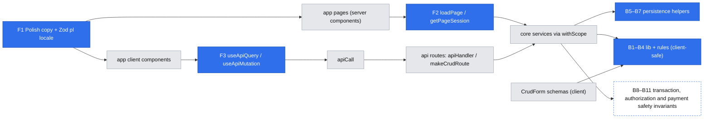

# Platform primitives — shared backend and frontend building blocks for the first build

Status: draft (design accepted at the gate 2026-10-29; not implemented)
Review corrections: accepted by the user 2026-10-29; incorporated below
Grilling decisions: Q1–Q10 accepted and application confirmed by the user 2026-10-29; incorporated below
Issue: #8 asked for it (see "Consumers" below); no tracker issue of its own yet
Design authority: `AGENTS.md`, `.ai/specs/implemented/2026-10-23-engineering-standards.md`, `.ai/specs/product-brief.md`
Consumers: accounts and sign-in (#24, own spec), `2026-10-29-mentor-pages-and-discovery.md` (E01), then E02–E05 (#18–#23, #25)

## 📝 TLDR

**Who needs this:** everyone building the next 17 backlog items. **Today:** the foundation has an HTTP layer (`apiHandler`, `makeCrudRoute`, auth helpers) and a client layer (`apiCall`, `CrudForm`, `DataTable`, `feedback/`). Nothing covers the patterns the backlog repeats story after story:
- money that must be recomputed on the server,
- time windows that tests must control,
- records only their owner may touch,
- a booking lifecycle that settles once under concurrent visits and without timers,
- payment calls that must not run twice,
- server-rendered public pages,
- a Polish interface.

**Proposed (future behavior):** this spec defines a catalog of small primitives for those patterns, with their contracts, homes and rules. Each primitive is **built in the PR of its first consumer**, never ahead of it. Phase 1 has existing consumers: PR 1a translates existing screens and exposed errors into Polish, configures Zod's Polish locale and formats admin dates; PR 1b extracts the admin list's query state. Mutation hooks, money and slot formatting, and domain-specific error codes land with E01's actual consumers. B8–B11 keep **safety invariants** here; E02–E05 own their concrete endpoints, states, storage and UI. F6 remains design guidance; no generic lifecycle engine is prescribed.

## 📝 Problem Statement

Without shared primitives, each story would re-solve the same problem in slightly different ways. The engineering standards call this "the single biggest risk of adding ~9 concepts one at a time". Here is what the backlog asks for, mapped to the pattern underneath:

| Pattern | Stories that need it | What goes wrong without a primitive |
|---|---|---|
| Money is computed by the server, never trusted from the client | #15, #18, #19, #20, #22, #23 | Float arithmetic, a different rounding rule per story, a client-supplied price persisted |
| Named business-rule values (R08, R11, R06, R10, R12, R14) shared by the form and the server | #15, #16, #18–#23 | The bound in the form drifts from the bound on the server; a magic `12` in a cancellation check |
| "Now" decides behavior (R11, R12, R14, R10) | #16, #18–#22 | Untestable time logic; tests that fail near midnight or across DST |
| Wall time in Europe/Warsaw (D10) | #16, #18, #21 | A slot entered at 18:00 stored as 18:00 UTC |
| Only the owner edits; nobody else learns the record exists | #14, #15, #16, #17, #23 | Fetch-then-compare checks that someone forgets; 403s that confirm a record exists |
| One entity, two audiences (public vs owner) | #14, #16, #17, #19 | An unpublished field or an email reaches the public page |
| Check-then-write on shared state, backed by a constraint | #16, #18, #22 | Two slots in the same block; one slot sold twice |
| A status lifecycle where concurrent requests transition once | #18, #19, #20, #21, #22 | Double refunds when both sides open the booking at the same moment (#22) |
| Settle when someone next opens the record, with no timers (D13, D16) | #19, #22 | Each service invents its own "is it due?" pass |
| Payment port calls that are safe to retry | #18, #19, #20, #22, #25 | A retry charges or refunds twice |
| Only the two participants read a booking or session | #19, #21 | A wrong-scope read leaks the mentee's question or code |
| Public share links render without JS, with link-preview metadata | #14, #17 | Client-fetched pages show a spinner to crawlers and link unfurlers |
| Persona screens guarded by role | #14–#17, #18–#23 | Auth checked in a layout, which Next 16 does not re-run on navigation |
| Polish everywhere, including validation messages (R15) | every screen | English defaults ("Save", "Loading…", Zod's "Too small") leaking into Polish screens |
| Fetch, retry, loading and stale-response state on the client | every list and every action | `admin/users/users-table.tsx` hand-rolls 30 lines that every list would copy |
| Forms beyond plain text: money, dates, checkboxes, link lists | #14, #15, #16, #17, #18 | Bespoke forms that lose `fieldErrors` mapping and the keyboard rules |

## 📝 Proposed Solution

### Build policy (gate answer Q3 = a)

- Every primitive in the catalog has a **contract** (this spec) and a **first consumer**. Its code, tests and `AGENTS.md` line land in that consumer's PR. A primitive whose first consumer has not started stays text.
- Phase 1 (PRs 1a and 1b) is the only standalone work, because its consumers already exist: admin, the marketing home page, `users-table`, and the copy in `CrudForm`, `DataTable` and `feedback/`.
- B8–B11 record safety invariants for stories without a spec. Their consumer specs must satisfy those invariants and define concrete endpoints, state models, storage and UI. F6 records an intended presentation shape for its future consumer.
- A consumer spec cites the primitive by its id (`B3`, `F4`, …) and does not redesign it. If the contract does not fit, the consumer amends this spec in the same PR, and the review covers that amendment.
- **Not proposed:** a base repository or service class, a module loader, RBAC, multi-tenancy, a queue or scheduled jobs (D13), Server Actions, or a generic event bus. No backlog story needs an in-process event consumer. `core/src/events` stays planned in `AGENTS.md`, to be added when a real consumer appears.

### Where things live

Client-safe code (importable by `CrudForm` schemas and client components without pulling in the ORM) is kept apart from server-only code. Today that separation rests on discipline; this spec turns it into a lint rule.

| Folder | Holds | Client-safe | New subpath export |
|---|---|---|---|
| `core/src/lib/` | Pure helpers: `money`, `clock`, `zoned-time` | yes | `@mentio/core/lib/*` |
| `core/src/rules/<concept>.ts` | Business-rule values and pure predicates, each citing its brief id | yes | `@mentio/core/rules/*` |
| `core/src/validators/` | Zod schemas (exists) | yes | exists |
| `core/src/persistence/` | Shared not-found handler and conflict mapping; locking uses MikroORM at the service call site | **no** | none: services import it relatively |
| `app/src/server/` | `loadPage`, `getPageSession` (server-only) | no | `@/server/*` alias |
| `ui/src/backend/<category>/` | Generic panel primitives (exists): `actions` and `layout` added with their consumers | client | `@mentio/ui/backend/<category>` |
| `app/src/components/<concept>/` | **Placement rule only, nothing built:** the home for plain-Tailwind components once two public (`(marketing)`) pages share one | server/client | `@/components/*` |

ESLint adds client-safe restrictions for files in `core/src/{lib,rules,validators}`. They prohibit `@mentio/db` and all its subpaths, plus imports reaching `container`, `persistence`, `services`, `http`, `config` or `logger`, through relative paths at any depth or `@mentio/core/*` subpaths. Compose these with the existing core restrictions on workspace, framework and ORM imports: flat-config entries for `no-restricted-imports` replace rather than merge previous entries. Fixture tests exercise the effective configuration, including nested `../../services/...`, package subpaths, React and direct ORM imports; allowed lib/rules/schema imports also pass. Code in these folders returns results or throws a plain `Error` for programmer errors, never an `AppError`; server callers translate results into `AppError`s.

### Alternatives considered

- **Build the whole kit up front (Q3 = b).** Rejected at the gate. It would ship untested-in-use abstractions and break the `AGENTS.md` rule against scaffolding.
- **Client-fetch public pages (Q4 = b).** Rejected. A share link must render for crawlers and link previews, and `generateMetadata` needs the data on the server.
- **Server Actions for mutations.** Not adopted. A second mutation path would bypass `apiHandler`'s CSRF check, the envelope and the error mapping. Mutations stay `apiCall` → route → service.
- **next-intl now (gate Q6 = b, chosen and then reversed to c on 2026-10-29).** It would have meant a Next plugin, a request config, a provider, a typed catalog, a copy provider in `ui` (which may not depend on next-intl), and a separate dictionary in `core` (verified: `use-intl@4.14.9`'s `core` entry imports `react`). That is too much machinery for one language that is fixed by R15.
- **A generic state-machine runtime, including a home-grown one.** Deferred. Start with concrete booking transitions and due-event predicates in the booking concept. Extract shared machinery only when another implemented lifecycle demonstrates the same contract; revisit a runtime if parallel or nested states become necessary.

### Research (from prior knowledge of these projects, not re-checked on 2026-10-29)

- **Medusa** (OSS commerce) stores money as integers in minor units, with a currency next to the amount. Its v2 moved to big-number amounts because of multi-currency tax maths. We have one currency and no tax lines, so integer grosze (B1) is enough; the DTO shape keeps the currency so this can change later.
- **Stripe's idempotency keys** make a retried request return the first result instead of acting twice. B10 copies that contract for the mock gateway, so the later Stripe adapter (D14) can pass keys straight through.
- **Cal.com** (OSS scheduling) keeps every time as UTC and converts at the edges with an explicit time zone. Its availability engine (recurring rules, buffers, overrides) carries complexity we skip: D09 publishes individual start times.

## 📝 Architecture



Pages read through `loadPage`; every mutation, including next-visit settlement, goes through `apiCall` and `apiHandler` with session, record-scope and CSRF checks. GET handlers, loaders and metadata generation only read. Both paths end in the same services without reversing package dependencies; the booking consumer spec defines its mutation endpoint and trigger.

## 📝 Backend primitive contracts

Every primitive has 100% unit coverage in its first consumer's PR. "Rule" lines become `AGENTS.md` text in that PR.

### B1 — `Money` (`core/src/lib/money.ts`) · first consumer E01 #15

```ts
export type Currency = "PLN";
export interface Money { readonly grosze: number; readonly currency: Currency } // nonnegative safe-integer minor units
export interface MoneyDto { amountGrosze: number; currency: Currency }
export function fromWholePln(zloty: number): Money;        // nonnegative safe integer; checked × 100
export function fromGrosze(grosze: number): Money;         // nonnegative safe integer
export function multiply(m: Money, factor: number): Money; // nonnegative safe-integer factor; checked result (R08)
export function percentOf(m: Money, basisPoints: number): Money; // #20 (E02 late cancellation); integer 0..10000; rounds half up (R06)
export function subtract(a: Money, b: Money): Money;       // #20 (E02 late cancellation); refuses b > a
export function compare(a: Money, b: Money): -1 | 0 | 1;
export function toDto(m: Money): MoneyDto;
```

Rules: every money input, DTO amount and arithmetic result is a nonnegative safe integer (`Number.isSafeInteger`); reject negatives, fractions, non-finite values and overflow with a plain `Error`. Refund direction belongs to the operation, so refunds carry positive amounts. `fromWholePln` accepts whole złoty only; fractional amounts enter through `fromGrosze` and remain supported in commission arithmetic and F7 display. `percentOf` accepts only integer basis points in `0..10000` and uses exact integer arithmetic for rounding, avoiding an unsafe intermediate product even when the final share fits. `subtract` rejects a negative result. Boundary tests cover zero, the safe-integer limit, factory/multiplication overflow, and invalid inputs; #23 adds basis-point bounds and half-up rounding tests.

Money columns are `p.integer()` named `<name>_grosze`; never float or decimal. Services also enforce the column's representable range before persistence; B1's safe-integer range does not widen PostgreSQL `integer`. A price that is charged is always derived from stored values (`multiply(rate, lengthMinutes / 25)`), never parsed from a request. Build the rate/price operations with #15; `percentOf` and `subtract` wait for #20 (E02, which records earnings first), where the commission and remaining share must add up to the price. Display conversion stays inside F7's formatter; no unused core display helper is added.

### B2 — Business rules (`core/src/rules/<concept>.ts`) · first consumer E01 #15, #16

```ts
// rules/mentors.ts
/** R08 — one rate per 25 minutes, 90–600 PLN. Change only with a superseding brief row. */
export const RATE_PER_25_MIN = { min: fromWholePln(90), max: fromWholePln(600) } as const;
export const SESSION_LENGTHS_MINUTES = [25, 50] as const;           // R01
// rules/availability.ts
export const BOOKABLE_LEAD = { minMinutes: 120, maxDays: 14 } as const; // R11
export function isWithinBookingWindow(startsAt: Date, now: Date): boolean;
```

Rules: every rule value lives here once and carries its brief id. Schemas, services and forms import it; nothing restates it inline. A value that must be configurable per deployment (R06's commission) is **not** read here: the service reads it from `getEnv()` and passes it into the pure function (`mentorShare(price, commissionBasisPoints)`), so `rules/` stays client-safe.

`isWithinBookingWindow` checks time only. Final slot eligibility also needs a published page and a rate; E02 adds the hold check. A service composes those facts from server-owned data. Visible availability may exist without a rate, but it is not called bookable or ranked as bookable.

### B3 — `Clock` (`core/src/lib/clock.ts`, cradle key `clock`) · first consumer E01 #16

```ts
export interface Clock { now(): Date }
export const systemClock: Clock;
export function fixedClock(at: Date | string): Clock & { advance(ms: number): void }; // tests only
```

Registered with `asValue(systemClock)` (a singleton with no scoped dependencies). Rule: any decision that depends on the current time takes it from `clock.now()`. `new Date()` remains fine for audit timestamps (`baseProperties`). Code review checks this, because lint cannot.

### B4 — Zoned wall time (`core/src/lib/zoned-time.ts`) · first consumer E01 #16

```ts
export const APP_TIME_ZONE = "Europe/Warsaw"; // D10
export type WallTimeResult = { ok: true; instant: Date } | { ok: false; reason: "invalid" | "nonexistent" };
export function wallTimeToInstant(wall: string /* "YYYY-MM-DDTHH:mm" */): WallTimeResult;
export function instantToWallTime(instant: Date): string;
```

The matching `wallTimeSchema` lives in `core/src/validators/zoned-time.schema.ts` and uses the shared `z` (F1). It validates the exact `YYYY-MM-DDTHH:mm` shape and uses `wallTimeToInstant` to reject invalid/nonexistent times, but **retains the string as its parsed output**. `CrudForm` submits parsed output and `apiCall` JSON-serializes it, so a shared transport schema must not turn it into a `Date`. The service converts the validated string with B4 and translates any conversion failure into a Polish `ValidationError`. A form → JSON → route-schema test proves both sides accept the same value.

Use one maintained timezone-library dependency for conversion and validation in both browser and server, behind this wrapper and the fixed `APP_TIME_ZONE`. Select it in #16 based on Node 24 and Next's supported browser compatibility, client-safe imports and explicit calendar/DST behavior; no custom inverse-offset algorithm or arbitrary-zone parameter is added. The wrapper rejects invalid calendar dates and spring-forward gaps rather than allowing normalization. A time in the autumn fall-back hour resolves to its **first** occurrence. A library's “earlier” option alone is insufficient if it also shifts gap times; validate that the resulting instant maps back to the exact input. Storage is always UTC `timestamptz`, and display goes through F7. Tests cover invalid dates, the last Sundays of March and October, `2026-03-29T02:30` rejection and the first occurrence of `2026-10-25T02:30`, plus the shared-schema JSON round trip.

### B5 — Owner-scoped lookups (`core/src/persistence/find.ts`) · first consumer E01 #14, #16

```ts
/** MikroORM 7's `findOneOrFail` already takes a per-call `failHandler`; this is the one shared handler. */
export const notFound = (): Error => new NotFoundError();
// usage: em.findOneOrFail(Slot, { id, mentor: session.userId }, { failHandler: notFound })
```

No wrapper and no new `@mentio/db` type re-exports are needed.

Rules (these refine the security baseline; the `AGENTS.md` change goes with E01):
- Put the owner **in the `where` clause** (`{ id, mentor: session.userId }`). Never load by id and compare afterwards.
- A record that exists but belongs to someone else returns **404** (`NotFoundError`), exactly like a missing one, so an id never confirms that another user's record exists.
- `assertOwner` remains for an aggregate already loaded through a parent.
- Singleton "my X" resources (`/api/mentors/me/page`) take the owner from the session alone and accept no id.

### B6 — Audience DTO projections (convention, no shared code) · first consumer E01 #14

Each service exposes `to<Name>PublicDto` and `to<Name>OwnerDto` (only the projections it needs), written as explicit object literals; an entity is never spread. Each projection's unit test asserts the **exact key set**, so a new column cannot reach the public page without a test changing. N02 rides on this: public mentor DTOs are tested to have no `rating*`, `review*` or `stars*` keys.

### B7 — Constraint-backed writes (`db/src/errors.ts`, `core/src/persistence/conflicts.ts`) · first consumer E01 #14 (slug/publication), #16 (slots)

```ts
// db (the only MikroORM importer)
export function isUniqueViolation(error: unknown, constraint?: string): boolean;
export { LockMode } from "@mikro-orm/postgresql";
// core
export async function mapConflicts<T>(fn: () => Promise<T>, map: Record<string, () => AppError>): Promise<T>;
// lock: tx.findOneOrFail(Entity, where, { lockMode: LockMode.PESSIMISTIC_WRITE, failHandler: () => new ConflictError(…, { code }) })
```

Rules:
- Every unique constraint a service maps is **named explicitly** in the entity (`name: "<table>_<cols>_unique"`), so the mapping survives regenerated migrations.
- A check-then-write runs inside `em.transactional`, either locked on the owning parent row or backed by a unique constraint, and preferably both. The lock's `failHandler` is chosen per call site: a missing parent can mean `404` or a specific `409`.
- `mapConflicts` wraps the **whole** `em.transactional(…)` call, never a statement inside it. After a violation, Postgres aborts the transaction, so the mapping must run after the rollback.
- A singleton "my X" row created on first write uses `em.upsert(Entity, data, { onConflictFields: ["owner"], onConflictMergeFields: [...] })`. The explicit merge fields include only that operation's writable content and its update timestamp, never lifecycle state, owner, rate or listing fields. Insert defaults do not reset an existing row. When validation depends on existing state, re-read/refresh the resulting row while holding its transaction lock, validate the complete candidate and roll back a refusal. Publish and content edits use the same row lock.
- E01 content edits use **last-write-wins**: among valid concurrent saves, the last write applied by the database supplies the saved content. No revision token or edit-history mechanism is added. Publication validation still runs under the shared transaction lock, and F4 preserves dirty local input when refreshed server values arrive.
- A violation maps to a `ConflictError` with a specific `code` (`slug_taken`, `slot_too_close`). The client branches on the code, never on the message. An unmapped constraint is rethrown and becomes a logged 500.

### B8 — Booking transition safety · first consumer #18; future consumer owns the design

The booking spec defines its own statuses, events, transition-specific inputs, rules and persistence. Start with concrete booking operations; extract shared machinery only after another implemented consumer needs the same contract.

Rules:
- A transition checks the participant scope, allowed prior status and relevant business conditions in one transaction. Conditional writes or a row lock select one winner; a retry must identify the same recorded business operation, not infer success merely because another event reached the same destination status.
- Only the winner **creates** its durable payment intent or earnings row, atomically with the transition. A deterministic operation key has a unique constraint, and its immutable payload comes from stored booking values.
- Native updates set `updated_at` explicitly and refresh the entity before projecting a DTO; they bypass `baseProperties`' `onUpdate` and leave identity-map copies stale.
- Persistence patches are concrete server-built shapes for each booking operation, never request data or `Partial<Entity>`.
- **Executing or retrying an unconfirmed payment intent does not require another winning transition.** B9/B10 govern that separate step.

### B9 — Next-visit settlement safety · first consumer #18 (pending-operation recovery), then #19 (R12) and #22 (R10); future consumer owns the design

GET routes, page loaders, prefetch, speculative renders and `generateMetadata` only read. Settlement uses an explicit CSRF-protected mutation through `apiCall` and `apiHandler`, requiring a valid session and participant scope before any write. The service derives events, amounts and ownership from stored data and the injected clock. This preserves D16 without timers; the consumer spec owns the endpoint, actual-visit trigger and retry UI.

Due-state checks, the winning transition and creation of durable payment intent happen in one authorized transaction (B8). External money calls happen after commit and use the immutable stored payload with B10's key. Recovery must process **existing unconfirmed intent**, even if no new transition is due or another request won it.

Required recovery behavior:
- A crash after intent commit but before the call can resume that intent with its original payload/key.
- A crash after provider success but before local confirmation repeats the same key, recovers the original result and records confirmation.
- Concurrent attempts and repeated visits cannot move money twice.
- Transient/ambiguous failures remain recoverable; unconfirmed or failed money movement is never reported as completed. Provider exceptions and credentials stay out of responses.

The booking/payment consumer specs define concrete operation states, storage, failure classification, DTOs and UI, with acceptance tests for both crash points, concurrent retries, denied access, missing CSRF and rendering paths that perform no writes. This spec adds no settlement framework, queue or dispatcher.

### B10 — Idempotent money-call safety · first consumer #25; future consumer owns the port and storage

Every port operation that moves money carries a deterministic idempotency key identifying the recorded business operation. Repeating a key with the same immutable payload returns the original confirmed result; reusing it with a different amount, currency or operation is an error. The mock and future provider adapters must preserve this guarantee across restarts and concurrent calls. A transient failure must not be recorded as completed money movement. #25 defines the port, key format, storage and adapter details; B8/B9 define the intent and recovery invariants its consumers rely on.

### B11 — Participant access safety · first consumer #19; future consumer owns the helper

Require a valid session and restrict record reads/mutations to its mentor or mentee. Prefer participant scope in the database lookup; a non-participant receives `NotFoundError` (404), indistinguishable from a missing record, before any state or payment write. The booking spec defines any reusable helper's signature and placement from its actual callers.

### B12 — Error codes as the client contract (`core/src/http/errors.ts`) · first consumer E01 #14 (`slug_taken`)

`ConflictError`, `NotFoundError`, `ForbiddenError` and `ValidationError` accept an optional `code` (backwards compatible; the defaults stay `conflict`, `not_found`, …). Exposed messages are user-facing Polish literals (F1). Codes are stable `snake_case` identifiers, documented next to the throwing service method.

### B13 — Role-scoped `makeCrudRoute` (`core/src/http/makeCrudRoute.ts`) · first consumer E01 #16

`access` widens from `"session" | "public"` to also accept `{ role: SessionRole }`, in which case `session` is typed non-null and `requireRole` runs **before** query or body parsing. A mentee then gets `403`, never a `400` that reveals the schema. This keeps the existing order (auth → validation → service). Most E01–E05 resources are role-specific, so without this every `run` would repeat the check after the body had already been parsed.

## 📝 Frontend primitive contracts

### F1 — Polish copy written directly in the code (gate Q6 = c) · Phase 1a

- **Pages and app components:** Polish text is written directly in the JSX, and the root layout renders `<html lang="pl">`. There is no catalog and no i18n library.
- **Shared `ui` components:** their default labels become Polish literals: "Zapisz", "Anuluj", "Zapisywanie…", "Wczytywanie…", "Nic tu jeszcze nie ma", "Coś poszło nie tak", "Spróbuj ponownie", "Akcje", "Poprzednia"/"Następna", and "1–20 z 45" for pagination. Every default that has a prop today (`submitLabel`, `emptyTitle`, `label`, `title`) stays overridable. No new props are added until a screen needs a different text.
- **Text produced by `core`:** the exposed `AppError` default messages in `errors.ts` are Polish literals, and services throw with Polish messages (B12). Clients branch on `code`, never on the text.
- **HTTP/client fallback errors:** translate exposed literals in `http/request.ts` (malformed JSON and validation fallback), `http/auth.ts` (the explicit invalid/expired-session message), `apiHandler.ts` (CSRF and the internal-error envelope), and `ui/backend/api/apiCall.ts` (network and invalid-response messages). A network failure returns a fixed Polish message, never `error.message` from the browser. Auth messages remain generic and config failures remain unexposed; diagnostics stay in server logs. Exposed error codes/statuses do not change.
- **Validation messages:** `core/src/validators/z.ts` calls `z.config(z.locales.pl())` once and re-exports `z`. Every schema imports `z` from there, never from `"zod"` directly. The ESLint restriction covers `core/src/validators/**` with **exactly `validators/z.ts` exempted**, since that wrapper must import Zod. Compose the restriction with all applicable core/client-safe restrictions; fixtures prove both the wrapper exception and the bans remain effective.
  - Wherever a schema loads, `z.ts` is evaluated first: `parseWith` on the server, `CrudForm` in the browser. Zod's generic messages are therefore Polish on both sides, and client-side errors match the server's `fieldErrors`.
  - Custom rule messages (for example R08's bounds) are Polish literals in the schema.
- **If a second language ever arrives** (D10's English beachhead, not planned): extract the literals into a catalog then. It is a mechanical sweep, a cost accepted now to keep the first build simple. Read the `.ai/lessons.md` entry on `use-intl/core` first.

### F2 — Server page loading and guards (`app/src/server/`) · first consumer accounts (#24)

```ts
// session.ts
export async function getPageSession(): Promise<Session | null>; // cookies() + core's verifySessionToken; never throws on a bad token
// load-page.ts
type PageAccess = "public" | { role: SessionRole; returnTo: string };
export async function loadPage<T>(access: PageAccess, load: (cradle: Cradle, ctx: { session: Session | null }) => Promise<T>): Promise<T>;
```

- `core/src/http/auth.ts` splits `requireSession(req)` into `verifySessionToken(token)` plus cookie reading, so both paths share one verification.
- A guarded page with no session redirects (`redirect()`) to the accounts spec's sign-in path, carrying `returnTo`. A wrong role gives `notFound()`.
- `isSafeReturnTo(value)` lives in `core/src/lib/`, so it is client-safe and shared. It accepts only a value that:
  - starts with a single `/`,
  - contains no `\` and no control or whitespace characters,
  - and, resolved with `new URL(value, "http://mentio.invalid")`, keeps that origin.
  It is checked where `returnTo` is produced **and again where it is consumed** (the sign-in redirect in #24). Anything else falls back to the persona's home.
- Inside `load`, only `NotFoundError` and `ForbiddenError` become `notFound()`. Unexpected errors, including `ValidationError` from a service, are logged through the server logger and rethrown to the segment's Polish `error.tsx`.
- Each page parses its route/search parameters explicitly and handles expected invalid input before the service call: an invalid mentor slug gives `notFound()`; malformed list pagination uses the existing page-1 fallback. The shared loader does not turn every validation failure into a 404.
- `forbidden()` and `unauthorized()` are not used: they are experimental in Next 16.4 (`authInterrupts`).
- The guard runs **in each page's loader**, never only in a layout. Next 16's auth guide warns that layouts do not re-run on client navigation. Layouts may read the session for the shell (the name in the nav), never to authorize.
- Pages wrap their loader in React `cache()` so `generateMetadata` and the page share one load. Each page still declares `export const dynamic = "force-dynamic"`.

### F3 — `useApiQuery` / `useApiMutation` (`ui/src/backend/api/`) · query: Phase 1b (`admin/users`); mutation: E01 #14 (`ActionButton`)

```ts
export function useApiQuery<T>(path: ApiPath, options?: { query?: ApiCallOptions["query"]; enabled?: boolean }):
  { data: T | undefined; error: ApiErrorBody | null; status: number | null; isLoading: boolean; retry(): void };
export function useApiMutation<TInput, TData>(call: (input: TInput) => Promise<ApiResult<TData>>):
  { run(input: TInput): Promise<ApiResult<TData> | null>; isPending: boolean; error: ApiErrorBody | null; reset(): void };
```

`useApiQuery` ignores stale responses (the last request wins) and never throws. Resource identity is the API path plus every effective query parameter except the shared pagination keys `offset` and `limit`. Canonicalize query options using `apiCall`'s serialization semantics: omit `undefined`, apply `String(value)` and serialize with `URLSearchParams` in stable key order. Object identity, insertion order and equivalent serialized values do not cause a new resource identity. Only a retry or an `offset`/`limit` change for the same resource retains prior data while loading (`isLoading` alongside `data`). Path or any other effective query-parameter change clears prior data, error and status before loading. Disabling (`enabled: false`) clears them too and invalidates in-flight responses; a late response cannot repopulate a disabled query. There is no cache of previously visited resources. Phase 1b rewrites the read-only `admin/users/users-table.tsx` on this hook only.

`useApiMutation` is built with E01 #14's `ActionButton`, its first actual consumer. It never throws. Any `run` while busy, even in the same event tick or with different input, returns `null` without calling `call`, changing the accepted action's state or triggering callbacks. Busy state is guarded synchronously; `reset()` clears a displayed error without releasing an active request. Callers ignore `null`; success/failure callbacks run only for the accepted call's `ApiResult`, once. After an accepted mutation succeeds, a server-rendered screen calls `router.refresh()` in the app-side `onSuccess`; `ui` never imports `next/navigation`.

### F4 — `CrudForm` field kinds (`ui/src/backend/forms/`) · first consumer E01 #14–#17

- Form values widen from `string` to `string | boolean | string[]`. Existing text fields behave exactly as today, and existing tests stay green unchanged.
- `initialValues` accepts those same shapes plus the existing number/null values. Shared schemas output JSON-compatible transport values: numeric coercion is allowed, but date conversion happens in the server service. Initialization, client validation, JSON serialization and route validation get a round-trip test for each new shape.
- **New kinds, each built with the story that first uses it:**
  - `urlList` (#14): repeatable URL rows with add/remove, `max`; passes displayed rows to the shared schema, which validates nonempty entries before dropping empty rows from successful output; sends `string[]`. The mentor API, DTOs and JSONB field use the same array; there are no optional link-label objects.
  - `money` (#15): an integer złoty input with a `zł` suffix and `inputMode="numeric"`; the schema converts the value.
  - `datetime` (#16): native `datetime-local` with `step=900`; B4's schema validates and retains `"YYYY-MM-DDTHH:mm"` wall time; the service converts it to an instant. The label says "czasu polskiego".
  - `checkbox` (#17): a boolean.
- `select` (`options: { value, label }[]`) is listed for #18 (25 or 50 minutes) and is built there.
- No generic `render` escape hatch: a control that fits no kind is a new kind or a bespoke form with a stated reason.
- Field errors stay keyed by top-level field. Invalid `urlList` entries appear under the list with one-based row numbers in Polish message text, e.g. `publicWorkLinks: ["Link 3: wpisz poprawny adres."]`. Validation numbers the displayed rows before dropping empty rows, so an earlier blank row does not shift an invalid link's number. The client and API schema keep the existing envelope; no nested-error framework is added. List-wide bounds and publication requirements remain list-wide messages.
- With #14, add `externalFieldErrors?: FieldErrors` and `onDirtyChange?(dirty: boolean)` for its publish action. External errors appear through the same accessible field rendering; current local validation errors take precedence for a field. Dirty state compares current normalized values with the last successful save. The editor clears external errors on an edit or a successful save/action; after success, the form's saved baseline and refreshed initial values agree. A refresh preserves dirty local input; clean forms can adopt refreshed values. Valid concurrent server saves use B7's last-write-wins, without revision tokens or history. Publishing validates saved content, and the editor disables publish until dirty changes are saved. This is a small extension of the existing form, not a second form implementation.
- shadcn primitives (`checkbox`, later `select`) are added via `npx shadcn@latest add` in the PR that needs them.

### F5 — `ActionButton` (`ui/src/backend/actions/`) · first consumer E01 #14 (publish/unpublish), #16 (remove slot)

```ts
<ActionButton label run={() => apiCall(...)} confirm?={{ title, description, confirmLabel }} onSuccess? onError? disabled? variant? />
```

`ActionButton` builds and runs F3's `useApiMutation`, optionally confirms first in a shadcn `alert-dialog`, guards against duplicate invocation, respects `disabled`, and shows a failure inline with `role="alert"`. A `null` result triggers neither `onSuccess` nor `onError`. `onError?(error: ApiErrorBody)` lets the mentor editor pass publish `fieldErrors` into F4; it runs once per accepted failed action. Later consumers are accept/decline (#19) and cancel (#20).

### F6 — `StatusBadge` (`ui/src/backend/feedback/`) · first consumer #18

`<StatusBadge tone label />` with tones `neutral | waiting | success | danger`. The state → tone/label map lives with the concept (`ui/src/components/bookings/`), and its labels are Polish literals.

### F7 — Formatting helpers (`ui/src/lib/format.ts`, `@mentio/ui/lib/format`) · dates: Phase 1a; money: #15; slot time: #16

```ts
export const APP_TIME_ZONE = "Europe/Warsaw"; // keep in sync with core's lib/zoned-time (ui must not import core)
export function formatMoney(money: { amountGrosze: number }): string; // "120 zł"; "120,50 zł" only when there are grosze
export function formatSlotTime(iso: string): string;                 // "środa, 4 listopada, 18:00"
export function formatDay(iso: string): string;                      // "4 listopada 2026"
```

These are pure functions with no React and no shadcn, built on `Intl` with `pl-PL` and `timeZone: APP_TIME_ZONE` passed **explicitly** (never the runtime default). That makes server rendering and browser hydration agree. Public `(marketing)` pages may import this module (gate Q5 = a). It is the only formatter. Build `formatDay` in Phase 1a with the users table's existing date column; add `formatMoney` with #15 and `formatSlotTime` with #16. The structural money shape is declared when that formatter lands, as with the independently declared envelope; no unused formatter ships ahead of its consumer.

### F8 — Placement additions

- **`PanelShell`** (`ui/src/backend/layout/`): the sidebar-and-header shell `admin/layout.tsx` hand-builds today. It takes nav items and a title. It is extracted in **E01 Phase 1**, when the `(mentor)` layout becomes its second consumer (placement rule 4), and `/admin` moves onto it in the same PR.
- **`app/src/components/<concept>/`:** a placement rule only. It is the home for plain-Tailwind components once two public pages share one, because `(marketing)` pages may not import `@mentio/ui` components. Nothing goes there until then.

## 📝 Edge Cases & Failure Scenarios

- **Server/client time-zone mismatch:** F7 always passes `pl-PL` and `Europe/Warsaw` explicitly, so a server in UTC and a browser in any zone print the same time. Unit tests format fixed UTC instants in summer and in winter, and assert the Warsaw wall time.
- **DST:** B4's maintained library wrapper rejects invalid dates and nonexistent wall times ("Ta godzina nie istnieje w dniu zmiany czasu"). An ambiguous one resolves to its first occurrence, and the stored UTC instant is what gets displayed back, so the mentor sees the exact time saved.
- **Stale responses and resource changes:** `useApiQuery` discards responses from superseded requests or after disabling. Retain data only for retries or shared `offset`/`limit` changes; switching path, search, sort, filters or any other effective parameter clears it. Equivalent canonical queries do not reload.
- **Double submit:** `CrudForm` ignores a second submit while pending; a busy `useApiMutation.run` returns `null` and consumers invoke no callbacks for it. Idempotency on money paths (B10) protects anything that slips past.
- **Invalid money:** reject negative/fractional/unsafe amounts, factory or multiplication overflow and, with #20 (moved from #23 by the E02 spec), out-of-range/fractional basis points or subtraction below zero. Refunds use positive money with a refund operation.
- **Form transport drift:** shared schema output survives JSON serialization and passes the same route schema. Datetime remains wall time on the wire; URL lists remain string arrays.
- **URL row errors:** invalid links name their one-based row in the existing top-level field messages, including when blank rows precede them; multiple invalid rows each get a message.
- **Publish action errors and concurrent saves:** an incomplete saved draft puts the server's errors under the relevant editor fields. Dirty content must be saved first; a rejected published-page edit leaves the prior public page intact. Valid saves use last-write-wins; refreshing preserves dirty local input.
- **Unique violation with an unmapped constraint:** it is rethrown and becomes a logged 500. It must never be silently mapped to a generic conflict, because that would hide a real bug.
- **A booking transition on a deleted or inaccessible record:** the participant-scoped lookup returns `NotFoundError` before any transition or pending operation is created.
- **Payment crash/retry:** existing unconfirmed intent is processed without another transition; repeated keys recover provider success after a crash. Unconfirmed/failed operations are never presented as completed refunds; consumer specs define concrete states.
- **Prefetch or metadata rendering:** GET/loaders only read, so no settlement or payment call occurs. Settlement starts through an authorized CSRF-protected mutation whose endpoint and trigger are defined by the booking spec.
- **Bad or expired session cookie on a page:** `getPageSession` returns `null`, and a guarded page redirects to sign-in. A `ConfigError` (missing `JWT_SECRET`) is rethrown, giving a 500 page and never treating the user as signed out.
- **Bad page input versus a service bug:** a page rejects a malformed slug with 404 or falls back to page 1 for malformed pagination. An unexpected service `ValidationError` is logged and rethrown to `error.tsx`, preserving visibility of the failure.
- **Database down:** `loadPage` logs and rethrows to `error.tsx` (Polish, no details), and the app still builds and boots (`force-dynamic`).

## 📝 Risks & Impact Review

- **Polish literals spread through the code:** adding a second language later is a sweep across pages and `ui` defaults rather than a catalog swap. This was accepted at the gate (Q6 = c), because R15 fixes one language for the first build and D10's English beachhead has no date.
- **Visible change for existing clients:** exposed error messages turn Polish, and `ui` defaults turn Polish. The only clients are this app and its tests; integration tests that assert English messages are updated in Phase 1a. Clients must branch on `code`, which is unchanged.
- **The `CrudForm` value refactor** (E01) touches a shared component. Its tests as they stand after Phase 1a must pass unchanged; that is the proof of backwards compatibility. New kinds get their own tests.
- **The new ESLint boundary** might flag existing imports. Today only `validators/` exists in that set, and it imports only `zod` and siblings.
- **Product calls vs rule violations:** the 404-for-others policy (B5) refines, but does not break, the `AGENTS.md` security baseline ("check ownership of the specific record"). It is recorded as an `AGENTS.md` edit in E01's PR.
- **Timezone dependency:** #16 selects one maintained library compatible with browser and server, and verifies rejection of normalization/gaps plus overlap selection. This keeps inverse conversion out of custom time arithmetic; F7's forward display formatting stays on `Intl`.
- **Concurrent valid edits:** last-write-wins can overwrite a save from another tab. This tradeoff is accepted for E01; transaction locks protect publication completeness and refresh preserves dirty local input. Revision tokens/history wait for a demonstrated need.
- **Next-visit settlement:** the future booking spec must make D16's authorized mutation trigger and recovery concrete while keeping GET/rendering read-only. Its UI must represent unconfirmed money movement accurately; endpoint, states and interaction details belong there.

## 📝 Decisions in play

- R15 (Polish only): F1 is how every screen meets it, without an i18n library. D10 (PLN, Polish market): B1, B4, F7. D13 (no timed jobs) and D16 (settle on the next visit): B8 and B9. D14 (real Stripe later): B10's key contract carries over to the Stripe adapter unchanged.
- Gate answers recorded here: Q1 = b (separate specs), Q3 = a (build with the first consumer), Q4 = a (server-rendered public pages), Q5 = a (shadcn persona screens), Q6 = c (Polish literals in the code; switched from b on 2026-10-29).
- Separate grilling round, Q1–Q10 (accepted 2026-10-29): B8–B11 safety invariants with concrete designs owned by consumers; nonnegative safe-integer money and bounded basis points; busy mutations return `null`; explicit page-input handling; last-write-wins valid edits; maintained timezone conversion; query clearing on path/disable; one-based URL row messages; resource identity includes every effective non-pagination parameter, with retention only for retries/`offset`/`limit`; integer-only `fromWholePln`.

## 📝 `AGENTS.md` changes (each lands with the phase that builds the primitive)

- **1a:** Polish copy and all exposed fallback errors (F1), schemas import `z` from `validators/z.ts` with its exact lint exception, `@mentio/ui/lib/format` as the only formatter (F7; `formatDay` first), and composed client-safe ESLint restrictions.
- **1b:** `useApiQuery` as shared client query-state code, with F3's canonical resource identity, data-retention limits and disabled-response protection.
- **2, with #24:** "pages read through `loadPage`; auth is checked in the loader, never only in a layout", and `isSafeReturnTo`. This sanctions server components calling services through `loadPage`, which changes today's client-fetch-only reference.
- **3, with E01:** B5–B7/B12, F3's mutation hook, F4/F5 action errors and `PanelShell` with #14; B1/B2 and money formatting with #15; B2–B4/B13 and slot formatting with #16; the `app/src/components/<concept>/` placement rule when its second consumer appears. Shared-schema output stays JSON-compatible; publication requirements hold after every published-content write; valid saves use last-write-wins and refresh preserves dirty input.
- **Phase 4:** each E02–E05 spec defines concrete B8–B11 contracts satisfying the safety invariants and adds the rules for those implementations; F6 lands with its consumer.

## 📋 Phasing

| Phase | Ships in | Builds | Consumer that proves it |
|---|---|---|---|
| 1a | its own PR (now) | F1, F7 `formatDay`, composed client-safe and `z.ts` import rules | existing screens, exposed errors and `users-table` dates |
| 1b | its own PR (now; independent of 1a) | F3 `useApiQuery` only | read-only `admin/users/users-table.tsx` |
| 2 | the accounts (#24) PR | F2 (`verifySessionToken`, `getPageSession`, `loadPage`, `isSafeReturnTo`), Polish `not-found.tsx`/`error.tsx` | sign-in pages and the first guarded page |
| 3 | E01 PRs (see the E01 spec) | B1–B7, B12/B13, F3 `useApiMutation`, F4/F5, F7 money/slot formatting, F8 `PanelShell` | each primitive's actual page/rate/slot/list consumer |
| 4 | E02–E05 PRs: consumers define concrete designs satisfying B8–B11 safety invariants | B8, B9, B10, B11, F4 `select`, F6, `percentOf`/`subtract` | #18, #19, #20, #22, #25 (E02's design: `2026-10-29-book-and-pay.md`) |

## 📋 Implementation Plan

### Phase 1a — Polish copy, Zod locale, formatting (standalone PR)

1. **Polish UI copy.**
   - `lang="pl"` and Polish metadata titles. The marketing home page, the admin layout and pages, and `users-table` are translated. The `CrudForm`, `DataTable` and `feedback/*` defaults become Polish.
   - Tests: existing component and page tests are updated to the Polish strings, with behavior assertions unchanged.
2. **Zod locale and Polish errors.**
   - Add `core/src/validators/z.ts`, switch existing schemas (`pagination`, `user-list`) to it, and add the Zod import restriction with its exact wrapper exemption.
   - Translate `AppError` defaults and exposed fallback messages in `request.ts`, `auth.ts`, `apiHandler.ts` and `apiCall.ts`; use a fixed Polish network failure message.
   - Tests: Polish Zod errors through server parsing and `CrudForm`; invalid/expired sessions, malformed JSON, missing CSRF, unexpected 500, invalid envelope and network failures all produce Polish messages with unchanged codes/statuses. Auth stays generic, and a missing JWT secret remains an unexposed config failure. Update integration assertions that used English messages.
3. **Existing date formatting.** Add `ui/src/lib/format.ts` with `formatDay`; `users-table` uses it. Tests: Warsaw dates in summer/winter and the users-table date. Money and slot formatters wait for #15/#16.
4. **Boundaries and docs.** Compose the ESLint client-safe/Zod rules with existing package restrictions. Fixture tests cover the wrapper exception, nested relative paths, subpaths and existing framework/ORM bans. Add Phase 1a `AGENTS.md` lines. The full validation gate passes.

### Phase 1b — query-state hook (standalone PR)

1. **`useApiQuery`.** Add it to `ui/backend/api` and rewrite `admin/users/users-table.tsx`. Tests: stale-response discard; retention during retry and `offset`/`limit` changes only; clearing on path/search/sort/filter changes and disabling; disabled queries ignore late responses; re-enabling loads fresh data; key order, omitted `undefined` and equivalent `String(value)` values preserve identity without redundant requests. Existing users-table tests pass. Add the `AGENTS.md` line. `useApiMutation` is built with #14, not in this read-only refactor.

### Phase 2 — page loading (in the accounts PR)

1. `verifySessionToken` split out of `requireSession` (existing auth tests unchanged), then `getPageSession`.
2. `isSafeReturnTo`, with tests for `//x`, `/\x`, `%2F%2Fx`, control characters and absolute URLs.
3. `loadPage` with its access modes and error mapping; Polish `not-found.tsx` and `error.tsx`. Unit tests cover not-found/forbidden mapping plus logging/rethrow of unexpected `ValidationError`, `ConfigError` and other failures. Each consuming page tests its explicit malformed-parameter behavior; E01 tests bad slug → 404 and bad pagination → page 1.

### Phase 3 — in E01 PRs (steps listed in the E01 spec; each primitive's tests land with it)

- With #14: B5, B6, B7, B12, F3 `useApiMutation`, F4 `urlList`/external errors/dirty state, F5, `PanelShell`. Tests prove busy calls return `null` without extra requests/callbacks, URL errors name rows, and valid last-write-wins saves preserve publication completeness and dirty input on refresh.
- With #15: B1, B2 (mentors), F4 `money`, F7 `formatMoney`. Tests cover `fromWholePln` integer-only inputs, `fromGrosze` fractional-zł amounts, safe-integer bounds and arithmetic overflow.
- With #16: B3, B4, B2 (availability), B13, F4 `datetime`, F7 `formatSlotTime`. Select the maintained timezone dependency and test invalid-calendar/gap rejection, earliest overlap selection and browser/server transport parity.
- With #17: F4 `checkbox`.

### Phase 4 — in E02–E05 PRs

B10 with #25; B8, F4 `select` and F6 with #18; B9 with #18 (pending-operation recovery, per `2026-10-29-book-and-pay.md`) and #19 (R12's due event); B11 with #19; `percentOf`/`subtract` with #20 (its late-cancellation earnings, per the E02 spec's gate Q4 = a). Each consumer spec cites the ids, defines its endpoints, states, storage and UI, and records any invariant amendment here. Tests prove transactional one-winner intent creation, authenticated participant scope, CSRF-protected settlement, both crash-recovery points without another transition, idempotency across concurrent calls/restarts, and GET/prefetch/metadata paths that do not write. #23 tests integer basis points in `0..10000`, exact half-up rounding without unsafe intermediates, nonnegative subtraction and split conservation.

## ✅ Done means

- [ ] Phase 1a merged: existing screens and exposed HTTP/client errors are Polish (`lang="pl"`); schemas use the shared `z` with an exact wrapper exemption; admin dates use `formatDay`; effective lint restrictions preserve all existing package boundaries.
- [ ] Phase 1b merged: `users-table` uses `useApiQuery`; canonical resource identity includes all effective non-pagination query parameters; only retries and shared `offset`/`limit` changes retain data; path/other-parameter changes or disabling clear it and ignore stale responses.
- [ ] Phase 2 merged with #24, and Phase 3's primitives merged with E01: each with 100% coverage, its `AGENTS.md` rule, and a reference to this spec's id.
- [ ] Page loaders map only not-found/forbidden to 404 and log/rethrow unexpected validation failures; each page handles malformed inputs explicitly.
- [ ] E01 proves shared-schema JSON round trips, published-edit invariants under last-write-wins valid saves, dirty-input preservation, one-based URL row errors, external action field errors and busy mutation calls returning `null` without callbacks.
- [ ] E01 proves nonnegative safe-integer money, integer-only `fromWholePln`, fractional amounts via `fromGrosze`, checked arithmetic and maintained-library calendar/DST conversion; eligibility stays distinct from availability, and formatter/hook/B13 delivery follows actual consumers.
- [ ] `npm run lint`, `typecheck`, `test:coverage`, `build`, `test:integration` and `audit` pass on every PR above.
- [ ] Moved to `.ai/specs/implemented/` when Phase 3 completes. B8–B11 safety invariants remain cited by E02–E05, which own their concrete endpoints, states, storage, UI and recovery acceptance tests; F6 remains guidance until its consumer implements it.
