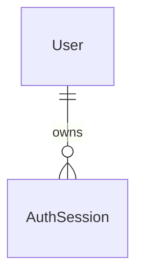

# Accounts and sign-in (E01-S01-T01)

Status: draft (gate, review corrections and grilling decisions approved 2026-10-30; D22/D23 recorded; not implemented). Amendment 2026-11-02 — screen criteria from the approved screen map (`lekcja-07/mapa-ekranow.md`, L04–L09, L12) and the reviewed prototype `prototypes/konta-i-role/`: **approved by the product owner 2026-11-02**
Issue: #24 — task of story #14; also a prerequisite of #18 (E02-S01)
Design authority: `.ai/specs/product-brief.md` (D18, D19, D21–D23, R15, D10; Key flows step 4)
Builds on: `2026-10-29-platform-primitives.md` (F1 Polish copy, F2 `loadPage`/`isSafeReturnTo`, B12 error codes, B13 role-scoped routes). Consumers: `2026-10-29-mentor-pages-and-discovery.md` (E01), `2026-10-29-book-and-pay.md` (E02)

## 📝 TLDR

**Who needs it:** mentors, who must sign in to publish a page, and mentees, who must sign in before paying (D18). **Today:** the repo has session helpers (`signSessionToken`, `requireSession`) but no way to create an account or sign in, and the session carries a single `student` role. **Proposed (future behavior):**
- A person registers with a name, email and password, and signs in and out. There is no email verification and no emailed reset (D18, D19).
- One account can hold several roles. The session carries a `roles` list (`mentee` always, plus `mentor` and, for operators, `admin`).
- Anyone can make themselves a mentor, at sign-up or later (D22 approved; shipped last).
- Each sign-in has a PostgreSQL session record. Logout revokes that session only; password reset and role removal invalidate every session for the account. Protected requests check this state, retaining the 24-hour deadline and no refresh.
- Recovery uses a private contact channel established with the participant beforehand; without one, recovery is refused. The pilot recruits invited participants but has no invitation or deployment access gate.
- `GET /api/users` and the `/admin` pages become admin-only in the same core-accounts PR that opens registration, because sign-up would otherwise expose every user's email to every account.
- Every screen is Polish (R15).

## 📝 Problem Statement

Nothing in the product can happen without an account: a mentor cannot publish a page (#14) and a mentee cannot pay (D18, E02). The only evidence against the account step is one interview: a mentee rejected "zakładam konto, weryfikacja maila" before getting help `[INTERVIEW]` 2026-09-01. D18 accepts that risk and D19 removes the email step, so the aim is the shortest credible sign-up: three fields, no verification, signed in straight away. Whether this loses mentees between the mentor page and payment is untested (D18's review trigger).

Sign-up also creates a new exposure: `GET /api/users` returns every user's email to any session today. `/admin` is already publicly reachable, including its server-rendered user count. The core-accounts PR protects both the API and the pages before opening registration.

## 📝 Proposed Solution

One concept, `auth`, following the folder convention. `AuthService` becomes the single writer of credentials and roles; the existing `UserService` stays read-only (list/count for `/admin`).

- **Credentials:** email and password, hashed with bcrypt at cost 12 (`bcryptjs`, behind `core/src/lib/password.ts`, the only importer). No OAuth, MFA or magic links.
  - Why `bcryptjs`: no native build in CI or on the host, and the standards allow either. The price is event-loop time (about 0.25 s per hash at cost 12), bounded by the rate limits below.
  - Native `bcrypt` can reuse this boundary. Adopting argon2id later also needs a reviewed storage-length change, validation policy, compatibility with existing bcrypt hashes, and a rehashing policy. No algorithm-selection framework is added now.
- **Session:** HS256 JWT, `JWT_SECRET` of at least 32 bytes, 24 hours, no refresh flow, cookie `mentio_session` (`httpOnly`, `sameSite=lax`, `secure` in production). Registration and login create an individual PostgreSQL session and sign the user in immediately. Tokens carry its ID and the account's session version as well as `roles`. Every protected API/page authentication checks fresh database state. Logout revokes only that session, including copied tokens; other sign-ins remain valid. A session means one credential sign-in, not a hardware fingerprint; tabs sharing its cookie share logout.
- **Roles (Q1 = a, superseded in part by grilling Q7–Q9):** the user row stores `roles`, always containing `mentee`. A session carries a copy. Grants become visible at the next password sign-in or authorized mentor-enrollment replacement. Removing a role increments the account's session version in the same transaction and invalidates all existing sessions; removing an absent role is an idempotent no-op. Password reset also increments this version atomically. Role mutations lock the user row; responses and new claims use committed roles, never a request array or stale token. `JWT_SECRET` rotation remains a global emergency logout.
- **Becoming a mentor (Q2 = a, Phase 2):** `POST /api/auth/mentor` adds the role and replaces the cookie without extending the original token's expiry. This also applies to an existing mentor's no-op. Registration with `asMentor: true` creates the initial roles atomically with the account. The variant `/rejestracja?jako=mentor` is chosen by the URL, so no new `CrudForm` field kind is needed (the `checkbox` kind stays with #17).
- **Admin (Q3 = a):** `admin` is a third role, granted only by an operator script. `/api/users` uses B13 (`access: { role: "admin" }`), and the `/admin` pages guard in their loaders (F2).
- **No verification, operator recovery (D23):** an address is not verified and never emailed. Recovery requests and delivery of the generated password use a private contact channel independently established with the participant beforehand. Knowing an email/display name or supplying a new profile/contact link is insufficient. Without that channel, refuse recovery even if access is lost. The operator script requires explicit confirmation of this check, sets the generated password, invalidates all sessions atomically and prints the password once after commit. This confirmation records the operator's attestation, not an automated identity check. There is no change-password screen.
- **Rate limits (Q5 = a):** a process-memory limiter (below). Counters reset on restart and are not shared between instances; this is stated in `AGENTS.md`.
- **Sign-up reveals taken addresses (Q6 = a):** register answers `409 email_taken`; login stays generic ("Nieprawidłowy e-mail lub hasło") and runs a dummy bcrypt compare for unknown or password-less accounts so timing does not give the answer away. This departs from the AGENTS.md line "auth error messages stay generic" for sign-up only; it is carried as decision D23 (below) and the line is amended in the same PR.
- **Alternatives considered:**
  - Server Actions for the forms (the Next.js auth guide's default): rejected, because the project routes every mutation through `apiHandler` (CSRF header, error envelope) and `apiCall`.
  - Fully stateless JWT authorization: superseded by grilling Q2/Q7–Q11. Per-account versions support reset/role-removal invalidation; individual session records support logout without signing out other devices. PostgreSQL is the only store; no additional auth framework is introduced.
  - Re-reading the full role array on every request: unnecessary because role removal invalidates tokens through the account version; grants retain their documented next-sign-in/replacement behavior.
  - Sign in with GitHub for mentors (their public work lives there): out of scope; the cheapest follow-up if sign-up friction shows up in A02.

### Research

- **Auth.js, Clerk, better-auth, Cal.com, Topmate (prior knowledge, not re-checked):** OAuth, verification and emailed recovery are common capabilities deliberately omitted here (D18, D19). This comparison is context, not evidence supporting the chosen policy.
- **OWASP (checked during review on 2026-10-30):** [password storage guidance](https://cheatsheetseries.owasp.org/cheatsheets/Password_Storage_Cheat_Sheet.html) prefers argon2id and documents bcrypt's 72-byte input limit. The project fixes bcrypt at cost 12 or more. Enforce its byte maximum separately from the character minimum, without truncation. [Authentication guidance](https://cheatsheetseries.owasp.org/cheatsheets/Authentication_Cheat_Sheet.html) supports throttling; the exact counters and timing estimates below remain unmeasured proposals.
- **Session revocation:** approved in grilling Q2/Q7–Q11: fresh PostgreSQL checks reject revoked sessions or account-version mismatches. Requests authorized before a revocation commits may finish; checks after commit must reject the old session. The 24-hour deadline is a maximum, not a revocation delay. This is a design decision, not a claim of implemented behavior.

## 📝 Architecture

| Layer | `auth` |
|---|---|
| db | `entities/auth/user.entity.ts` (`User`: three columns added), `entities/auth/auth-session.entity.ts` (`AuthSession`); `db/src/errors.ts` (`isUniqueViolation`, so `core` can recognise a unique violation without importing MikroORM) |
| core lib (client-safe) | `lib/roles.ts` (`ROLES`, `Role`, `hasRole`), `lib/return-to.ts` (`isSafeReturnTo`); redirect fallback is the literal `/` until a consumer needs another destination |
| core lib (server) | `lib/password.ts` (`hashPassword`, `verifyPassword`, lazy `dummyHash`), `lib/rate-limit.ts` (`RateLimiter`), `lib/client-key.ts` (`getClientKey`) |
| core http | `auth.ts` (roles in `Session`, `verifySessionToken`, `sessionCookieHeader`, `clearedSessionCookieHeader`), `errors.ts` (B12 codes, `TooManyRequestsError`), `apiHandler.ts` (response headers, `Retry-After`), `makeCrudRoute.ts` (B13) |
| core validators | `validators/auth/register.schema.ts`, `login.schema.ts`, plus `email.ts`/`password.ts` pieces |
| core services | `services/auth/auth.service.ts` (`AuthService`: `register`, `login`, `logout`, `becomeMentor`, and operator methods `grantRole`, `revokeRole`, `resetPassword`); `services/auth/session.service.ts` (fresh session-state checks); `services/auth/auth.limits.ts` (`AUTH_RATE_LIMITS`); `services/auth/user.service.ts` unchanged |
| core cli | `cli/user-admin.ts` (`runUserAdmin`) plus a thin entry file |
| app API | `api/auth/register/route.ts`, `login/route.ts`, `logout/route.ts`, `mentor/route.ts` (Phase 2); `api/users/route.ts` guarded |
| app pages | `(auth)/logowanie/page.tsx`, `(auth)/rejestracja/page.tsx`, `(auth)/zostan-mentorem/page.tsx` (Phase 2); `app/src/server/session.ts`, `load-page.ts` (F2); `not-found.tsx`, `error.tsx` |
| app components | `app/src/components/auth/account-nav.tsx` (server), `logout-button.tsx` (client), shared by the `(marketing)` and `(auth)` layouts |

**Dependencies, one way only:**
- `AuthService` takes `em`, `passwordHasher`, `authRateLimiter` and `logger` from the cradle. It never depends on `UserService` or on any later concept's service.
- `passwordHasher` (an object around `lib/password.ts`) and `authRateLimiter` (a `RateLimiter` instance) are process-wide `asValue` registrations. `authService` is `.scoped()`, because it touches `em`.
- `sessionService` takes only `em`, is explicitly registered as `.scoped()` on `Cradle`, and never depends on `AuthService`. The shared HTTP verifier uses a request scope to call it; services do not call HTTP auth helpers. Authentication currently precedes the CRUD service scope: use a short fresh scope for verification, then the existing business scope. Do not resolve either service at the root or reuse cached identity-map state for a later check.
- The routes sign the token (`signSessionToken`) and set the cookie; the service never builds HTTP responses, and returns DTOs only.
- Verified `Session` is `{ userId, roles, sessionId, sessionVersion, expiresAt }`: JWT `sub`, `roles`, `jti`, `sv`, and required integer `exp`. Require a UUID `jti` and nonnegative version within PostgreSQL integer range; missing/legacy/out-of-range claims fail closed before lookup. `verifySessionToken` verifies signature/claims/expiry, then checks a fresh coherent database view: session exists, belongs to `sub`, is unrevoked, has the same deadline, and user version equals `sv`. Missing/deleted users or sessions are invalid. It returns null only for invalid authentication; database/config failures propagate. `requireSession` converts null to `UnauthorizedError`; page auth shares the same checks. Never cache positive authorization across requests.
- Credential sign-in/registration creates the row and its 24-hour deadline in the account transaction; the service returns an internal authentication DTO containing account plus claims. Routes serialize only `AccountDto`. `signSessionToken({ userId, roles, sessionId, sessionVersion }, { expiresAt })` signs that exact committed deadline rather than independently choosing one. Mentor replacement preserves the same session ID, version and deadline, including a no-op. Reject a deadline crossed during the service call and bound cookie `maxAge` by remaining lifetime. Session metadata never appears in `AccountDto`/`UserDto`.
- **Races and ordering:** when both rows are involved, lock user before session. Login compares the observed hash outside the lock, then under the user lock verifies that the hash and version still match before creating a session; otherwise return generic invalid credentials. Reset and role removal update credentials/roles and version under that same lock. Enrollment rechecks the incoming version and the original session's owner/revocation/deadline under locks before modifying roles; it never adopts the latest version to rescue an old token. Logout marks only the identified session revoked, idempotently. A revocation committed after authorization can make a returned token unusable; it must never mint a valid replacement for revoked credentials/session state. Previously authorized work may finish; there is no cancellation of in-flight requests.

**What later work relies on:**
- E01 and E02 call `requireRole(session, "mentor" | "mentee")` and `loadPage({ role, returnTo })` exactly as their specs already assume. Their signatures do not change.
- `Session.userId` is the owner key for B5 lookups.
- E01 #14 introduces role-aware redirect selection when `/mentor/strona` exists; no role-dependent landing helper is built before then.

## 📝 Data Model

**`User`** — table `users`, concept `auth` (three columns added).

| Property / column | Type | Notes |
|---|---|---|
| `passwordHash` / `password_hash` | `varchar(60)`, nullable | bcrypt `$2b$12$…` (always 60 characters). Null means the account cannot sign in (rows that predate this spec, or a cleared password). Never in any DTO, never logged (already in `REDACTED_PATHS`) |
| `roles` / `roles` | `jsonb` (`string[]`), not null, default `["mentee"]` | values from `ROLES` (`mentee`, `mentor`, `admin`); always contains `mentee`; written only by `AuthService`, which enforces that in code. Existing rows become `["mentee"]` |
| `sessionVersion` / `session_version` | integer, not null, default `0`, nonnegative check | incremented atomically on password reset and actual role removal; server-issued claim only; never exposed in account/admin DTOs |

**`AuthSession`** — table `auth_sessions`, concept `auth`, registered explicitly in `entities/index.ts`; uses `baseProperties()` (UUID `id`, timestamps). No raw token is stored.

| Property / column | Type | Notes |
|---|---|---|
| `user` / `user_id` | n-1 → `User`, not null, indexed | owner; foreign key with cascade delete |
| `expiresAt` / `expires_at` | timestamptz, not null | exact original JWT deadline, at integer-second precision; never extended |
| `revokedAt` / `revoked_at` | timestamptz, nullable | current-session logout sets this; missing row also fails authentication |

Expired/revoked rows need no timer for correctness: reads reject them without mutation. Future deliberate maintenance may remove them. The pilot introduces no worker or scheduled cleanup.

- **Email:** `email` (`varchar(320)`, unique `users_email_unique`) is trimmed and lower-cased on every service write and lookup, including operator commands. The migration first checks the canonical forms of all existing emails for collisions, then normalizes them, and adds a named `users_email_canonical_check` requiring stored emails to equal that canonical form. Together with the existing unique constraint, this enforces canonical uniqueness even for a future writer. Service normalization, migration normalization and the check must agree on casing and surrounding whitespace; tests include uppercase, spaces and tabs/newlines. If canonicalization would collide, abort the migration atomically with a diagnostic identifying row IDs only; an operator must resolve ownership deliberately before retrying. Never merge or delete accounts automatically.
- **Role writes:** `grantRole`, `revokeRole` and `becomeMentor` use `em.transactional` and a pessimistic write lock on the `User` row before reading/modifying `roles`. Use `LockMode` re-exported by `db` (B7). Only the locked current array is changed; no whole-array write based on a pre-lock read. A fresh account's initial roles are inserted with the account. No role table or generic permission engine is introduced.
- **Legacy rows:** users with no hash (the integration seeds, any development data) cannot sign in. `register` with their address answers `email_taken`, so an unclaimed row cannot be taken over by signing up. The operator script sets a password.
- **Sensitive data:**
  - Passwords are never stored or logged; only the bcrypt hash is.
  - `AccountDto` has exactly `id, email, name, roles` (key-set test, as B6 does for later DTOs). `UserDto` keeps its current key set; hashes, session IDs/versions, raw tokens and session records stay out of the admin list. Redact session authentication metadata from logs alongside credentials.
  - A unique-violation error is mapped before it can be logged; a test provokes an unexpected database error during register and asserts that neither the password nor the hash reaches the log destination.
- **Migration:** one atomic migration adds the three user columns, their checks and `auth_sessions` with its FK/index; normalizes legacy emails after collision preflight; and adds the canonical-email check. Generate/review it with the entities and `.snapshot-mentio.json`. `down()` drops the session table first, then the new user checks/columns, retaining normalized email spelling. Rollback loses credentials, roles and session state and forces logout. `tests/integration/migrations.test.ts` uses a throwaway database and real CLI up → down → up, checking tables, defaults, FK/cascade, version check, normalization, constraint rejection and atomic collision rollback. E01 preserves and extends these cases.
- **Graph:** the new ownership relation is:

## 📝 API Contracts

All routes are `force-dynamic` and go through `apiHandler`, so the CSRF header is checked first on every unsafe method, including login and register. Bodies go through Zod (`parseJsonBody`), and only parsed output reaches the service. Responses carry `Cache-Control: no-store`. Before any database work, each route that signs a token calls `getJwtSecret()`, so a missing `JWT_SECRET` fails with a `ConfigError` (unexposed `500`) rather than after an account was created.

**DTO:** `AccountDto` = `{ id, email, name, roles }`. It is returned only to the account's owner.

| Method & path | Phase | Body | Success | Failures |
|---|---|---|---|---|
| `POST /api/auth/register` | 1 | `{ email, password, name }` | `201 AccountDto` + `Set-Cookie` | `400 validation_error` with `fieldErrors`; `409 email_taken` with `fieldErrors.email`; `429 too_many_attempts` + `Retry-After` |
| `POST /api/auth/login` | 1 | `{ email, password }` | `200 AccountDto` + `Set-Cookie` | `401 invalid_credentials` (the same for an unknown email, a wrong password and a password-less account); `400`; `429` |
| `POST /api/auth/logout` | 1 | — | `200 {}` after revoking only the current session + clearing its cookie; idempotent, works signed out | CSRF `403`; unexposed `500` if required revocation cannot reach DB |
| `POST /api/auth/mentor` | 2 | — | `200 AccountDto` from committed roles + replacement cookie preserving the original `exp`; role mutation is a no-op for an existing mentor | `401` without a valid, unexpired session |
| `GET /api/users` | 1 | — (query as today) | as today | `401` without a session; `403` for a session without `admin` |

- **Register (Phase 2 adds `asMentor?: boolean`):** the schema takes only these fields, so a client can never send `roles`. `asMentor` is the only way to the `mentor` role through this route.
- **Logout:** no cookie or a cryptographically invalid/expired/legacy token only needs cookie clearing. A valid token goes through persisted-state checks/revocation; already absent/revoked/version-invalid sessions are harmless no-ops. Never swallow a database failure as invalid authentication or report successful revocation: return the generic error, retain the cookie, and let the UI retry. No other session is revoked and the account version is unchanged.
- **Taken-email error:** `ConflictError` accepts optional `code` and `fieldErrors` while retaining existing defaults. Registration throws `code: "email_taken"` and `fieldErrors: { email: ["Ten adres e-mail jest już zajęty"] }`; `apiHandler` preserves them and `CrudForm` renders the email error without a second code-to-field mapping.
- **Validation (all messages Polish, F1):**
  - `email`: trimmed, lower-cased, a valid address, at most 320 characters.
  - Registration `password`: at least 10 Unicode code points (`Array.from(value).length`), and at most 72 UTF-8 bytes (`TextEncoder`, also in the browser). Do not trim, normalize or truncate passwords. No composition rules. Copy distinguishes the character minimum from the byte maximum; Polish letters may take two bytes, and other characters may take more.
  - `name`: trimmed, 1 to 80 characters. 80 matches the mentor page's display name (E01), which is pre-filled from it.
  - Login: `password` is a nonempty string with at most 72 UTF-8 bytes; there is no registration minimum. Overlong input gives `400 validation_error` with a Polish password field error, identically in the form and API. A bounded but incorrect password gives generic `401 invalid_credentials`. The password helper also refuses overlong input before bcrypt; it never truncates.
- **Rate limits** (`AUTH_RATE_LIMITS`, one constant in `services/auth/auth.limits.ts`; fixed windows; checked before any hashing; agent proposals with no research basis, cheap to change):

| Bucket | Key | Limit | Window | Counts |
|---|---|---|---|---|
| login by email | normalised email | 5 | 15 min | every admitted attempt, including success; no reset on success |
| login by client | `getClientKey(req)` | 20 | 15 min | every admitted attempt, including success |
| register by email | normalised email | 3 | 1 h | every admitted attempt |
| register by client | `getClientKey(req)` | 10 | 1 h | every admitted attempt |

  - After body validation and before database lookup or hashing, admission synchronously checks every applicable bucket and increments all of them only if all permit the attempt; no `await` occurs between checking and incrementing. At the stated limit, refuse the next attempt with `429 too_many_attempts` ("Zbyt wiele prób. Spróbuj ponownie za N minut.") and `Retry-After` (integer seconds). Refusals do not increment or extend windows. Count every admitted attempt to avoid failure-completion bookkeeping and concurrent-check bypasses. Success does not reset counters.
  - `getClientKey` reads the header named by the new optional env `TRUSTED_IP_HEADER` (unset by default; for `x-forwarded-for` it takes the last entry, the one added by our own proxy). Next route handlers expose no socket address and the headers are spoofable, so with the variable unset the two client buckets are skipped and only the per-email buckets apply. Document it in `.env.example`.
  - The client buckets stay even though they are inactive by default: Q6 = a lets sign-up reveal taken addresses, and only a per-client limit slows someone probing many addresses (the per-email buckets cannot). Deployments behind a proxy should set the variable.
  - Each bucket map is capped at 10,000 keys. Drop expired entries before admission, but never evict a live entry. If a full map would need a new key, refuse admission with the same `429` and a `Retry-After` until its earliest expiry. Existing keys continue under their own budgets. When several checks deny admission, use the longest applicable wait. The all-or-nothing admission check must include capacity, so a refusal never partially consumes another bucket. Test concurrent same-email admission and saturation while a target email remains locked.
  - Trade-off: the per-email login bucket lets someone lock a known address out for 15 minutes. That denies a login, never grants one, and is accepted.

## 📝 UI/UX

All copy is Polish (R15, F1). The sign-in and sign-up pages are in an `(auth)` route group and use `CrudForm` from `@mentio/ui` (reuse over a second form implementation); the layout header is plain Tailwind. This applies the E01 precedent (gate Q5 = a) to `(auth)`; `AGENTS.md` gets a line saying so.

- **`/logowanie`** (`LogowaniePage`): fields "Adres e-mail" (`autoComplete="username"`) and "Hasło" (`current-password`); submit "Zaloguj się"; a link "Nie masz konta? Zarejestruj się"; and a link "Nie pamiętasz hasła?" to `/pomoc-z-logowaniem` (L08). The page reads `?returnTo=`, validates it with `isSafeReturnTo`, and after success goes to it (else `/`), then `router.refresh()`. A signed-in visitor is redirected immediately to the same target instead of seeing the form. Preserve validated `returnTo` when switching between login and registration.
- **`/rejestracja`** (`RejestracjaPage`): fields "Imię i nazwisko", "Adres e-mail", "Hasło" (`new-password`; help text "Co najmniej 10 znaków, maksymalnie 72 bajty UTF-8. Polskie litery mogą zajmować 2 bajty, inne znaki więcej."); submit "Załóż konto"; a link to sign-in. It honours `returnTo` the same way, and a signed-in visitor is redirected away. The field error for a taken address reads "Ten adres e-mail jest już zajęty". The server `fieldErrors` appear under their fields through `CrudForm`; a `429` shows its message in the form's `role="alert"` line.
- **Registration response lost / taken address:** keep the conflict and show a sign-in link with validated `returnTo` and Polish help: "Jeśli konto zostało już utworzone, zaloguj się ustawionym hasłem." Never automatically authenticate on a duplicate, move passwords through URLs/storage, or assume a conflict proves the caller created the account. The user enters the password on the normal login form. A network error also leaves the sign-in path available.
- **Phase 2:** `/rejestracja?jako=mentor` shows "Załóż konto mentora" and posts `asMentor: true`. For a signed-in non-mentor it redirects to `/zostan-mentorem` (`loadPage({ role: "mentee", returnTo })`), which shows one button, "Zostań mentorem", and sends the user on to validated `returnTo` (else `/`) after success. A signed-in mentor skips the form and uses the same target. If the session expires during enrollment, send the user to sign-in with `returnTo`; a committed role addition is retained and is idempotent on retry.
- **Header (`AccountNav`):** inside `<Suspense>` in the `(marketing)` and `(auth)` layouts.
  - It only checks that the session cookie is present (an optimistic UI hint, never an authorization): signed out shows "Zaloguj się" and "Załóż konto"; signed in shows a "Wyloguj się" button.
  - No JWT is verified there, so a missing `JWT_SECRET` or a bad cookie cannot break the public pages.
  - It makes those routes dynamic, which is already the rule for pages that touch the session.
  - Logout calls `POST /api/auth/logout` through `apiCall`, then `router.refresh()` on success. Failure shows Polish feedback and permits retry; it must not claim the session was revoked.
  - The header shows no name: the token carries an id, roles and session timestamps, and showing a name would cost a database read on public pages.
  - The header and the pages can disagree: a stale or old-format cookie makes the header show "Wyloguj się" while `/logowanie` shows the form. This is harmless; "Wyloguj się" clears the cookie, which is the recovery path, and a test covers it.
- **Admin pages:** `admin/page.tsx` and `admin/users/page.tsx` call `loadPage({ role: "admin", returnTo })` in their own loaders; `admin/layout.tsx` stays presentational (layouts do not re-run on client navigation, F2). A signed-out visitor is sent to `/logowanie?returnTo=…`; a signed-in non-admin gets the Polish 404.
- **Landing without `returnTo` (L04):** a validated `returnTo` always wins, and the target page checks its own role. Without one, once the panels exist: `admin` → `/admin`, otherwise `mentor` → `/mentor/strona`, otherwise `/`; with all three roles `admin` wins. Until E01 #14 ships `/mentor/strona` the fallback stays `/` for every role. An unsafe `returnTo` always gives `/`, also for `admin`. Panels link only to areas the session's roles reach ("Panel mentora", "Panel operatora", "Strona główna"); there is no role switcher.
- **Session lost while working (L07):** a `401` in a protected view sends the user to `/logowanie` with a validated `returnTo` and the alert "Twoja sesja zakończyła się. Zaloguj się ponownie, aby kontynuować." plus "Niewysłane dane nie zostały zachowane.". Unsent input is not kept and the earlier operation is never replayed after sign-in. A valid session without the required role gets the Polish 404, not a new sign-in. A successful logout from a panel goes to `/`.
- **`/pomoc-z-logowaniem` (L08):** a static public page, no session read, database or secrets: "Nie pamiętasz hasła? Skontaktuj się z operatorem przez prywatny kanał, którym kontaktowaliście się wcześniej. Bez wcześniej ustalonego kanału nie możemy przywrócić dostępu do konta." and a link "Wróć do logowania" that keeps a validated `returnTo`. No reset form, email or new identity channel; the reset itself stays the operator CLI (D23).
- **Polish 404 (L09):** one page for a missing address and for a valid session without the role: heading "Nie znaleziono strony", text "Ta strona nie istnieje lub jest niedostępna.", link "Przejdź do strony głównej" (`/`) and a button "Wróć do poprzedniej strony" (browser history). It reveals nothing about the protected view.
- **Error page (L12):** when session verification or configuration fails on a guarded page: "Nie udało się otworzyć strony", "Spróbuj ponownie za chwilę. Możesz też wrócić do strony głównej.", a "Spróbuj ponownie" button that only re-reads the page and a link "Przejdź do strony głównej". It never grants access or pretends the user signed out; public pages keep working. When a submitted operation's result is unknown, the message at that operation is "Nie możemy potwierdzić wyniku operacji. Sprawdź jej stan przed ponowieniem." and nothing is resent automatically.
- **Operator start `/admin` (L05, L06):** Polish copy over the existing data scope: "Panel operatora", "Podstawowe informacje o Mentio", "Użytkownicy" (account count), "Baza danych" ("Połączono"), link "Przejdź do strony głównej". While loading: Skeleton and "Ładowanie danych panelu…", never a provisional 0; heading and navigation stay available. A data error reads "Nie udało się pobrać danych panelu. Spróbuj ponownie." with a retry. A real count of 0 shows 0. The PanelShell frame shown in the prototype is a proposed future look (DS04), not part of this spec.
- **Accessibility:** field errors are linked by `aria-describedby` (`CrudForm`), failures are announced with `role="alert"`, and the autocomplete attributes let password managers work.
- **Prototype:** `prototypes/konta-i-role/` (clickable, reviewed by the product owner 2026-11-02; covers s01–s04, s06–s08, s11, s12 of the screen map). It is a reference for screens and states, not production code; its simulation limits are in its README.

## 📝 Edge Cases & Failure Scenarios

- **Two registrations with the same address at once:** the unique constraint decides; one gets `201`, the other `409 email_taken`. The violation is mapped outside any transaction (a violation aborts a Postgres transaction). Concurrency integration test.
- **Mixed-case or padded email** (`" Ada@Example.COM "`): normalised, so it matches the existing account and cannot create a duplicate.
- **Register with a password-less legacy address:** `409 email_taken`; no takeover.
- **Login to a password-less or unknown account:** the same `401 invalid_credentials` after a dummy compare. A unit test asserts the dummy compare runs in both cases.
- **Password boundaries:** fewer than 10 code points fails registration even when the value has 10 or more UTF-8 bytes; a password over 72 bytes gives `400 validation_error` at both registration and login. Validated passwords are never truncated. Test five Polish letters, ten Polish letters, emoji, and the exact byte boundary through form → API validation.
- **`JWT_SECRET` unset:** register, login and the mentor route fail with the unexposed `500` before writing anything; guarded pages give the 500 page (never "signed out", F2); public pages keep working (the header does not verify).
- **Old-format or forged token** (a `role` claim, a missing `roles`, a bad signature, expiry): `401`, and on pages a redirect to sign-in. A test signs a legacy-shaped token to prove it fails closed.
- **`returnTo` tricks** (`//evil.test`, `/\evil.test`, `%2F%2Fevil.test`, control characters, absolute URLs, a very long value): `isSafeReturnTo` is false, so the user lands on `/`. It is checked where produced (F2 redirect) and again where consumed (sign-in form).
- **Login CSRF** (an attacker's form signing the victim into the attacker's account): the custom header is required on login and register too, and a cross-site form cannot set it.
- **Double submit:** `CrudForm` disables the button while submitting; the server's unique constraint makes a duplicate register harmless.
- **Rate limit hit by a legitimate user:** a clear Polish message with the wait time; successful logins consume the same fixed-window budget and never reset it. Simultaneous requests cannot admit more than that budget. Map saturation rejects new keys without removing existing lockouts.
- **Several instances or a restart:** counters are per process and reset (original Q5 = a). The pilot runs one application process; sessions and revocations persist in PostgreSQL across restarts. Recruitment is invitation-led, but registration/API access is publicly reachable: no invite allowlist, access gate or obscure-URL protection is required or implied. Before broad promotion or multi-instance operation, review shared throttling, trusted client identification and recovery operations. This is an operational review, not an invitation enforcement mechanism.
- **Role grant/removal while signed in:** grants appear at next sign-in or authorized enrollment. Actual removal immediately invalidates all account sessions through the committed version change. Test concurrent grant/revoke/enrollment in both orders; the old version cannot regain access through replacement.
- **Reset/login race:** a password comparison begun before reset must not create a valid session afterward from the old hash/version. Test both lock orders; only authorization completed before reset may finish, and its token becomes invalid at the next check.
- **Logout on one device:** copy that session's token before logout and prove it is rejected afterward, while another independently signed-in session remains usable. Test logout/enrollment races: preserving the original session ID ensures any replacement is also revoked. Signed-out/repeated logout remains successful.
- **Unknown recovery requester:** refuse reset without the pre-established private channel. Email/display-name knowledge and newly supplied profile links do not establish ownership. The operator sends the generated password only through the established channel; no email is sent by the app.
- **Enrollment near expiry:** first-time enrollment and repeated no-ops preserve the original `exp`, and the replacement cookie expires no later. If the deadline passes during the transaction, do not issue another token; return `401` and require sign-in. The role may already be committed, which is safe to retry.
- **Database unreachable:** register/login and protected APIs give the generic Polish error; guarded pages give the error page, never an authenticated result or a misleading signed-out redirect. Login/registration pages verifying a present cookie also propagate infrastructure failures. Public marketing pages and their optimistic header do no session lookup and still work; the app builds and boots without DB access. Logout needing persisted revocation reports failure and can be retried.
- **Logging a failed register:** the unexpected-error path logs `err`; the redaction list already covers `password` and `passwordHash`, and the test above covers the rest.
- **Signed-in user opens `/logowanie` or `/rejestracja`:** redirected, no form shown. Signing in as a different user means logging out first.
- **Cookie on `http://localhost` in the browser tests:** the `Secure` flag applies in production builds; Chrome accepts Secure cookies on localhost, and the Phase 1 Stage B browser test verifies it (see Risks).

## 📝 Risks & Impact Review

- **`risk-high` per `SDLC.md`** (authentication and sessions, a schema migration). Each PR carries its evidence: denied-path and wrong-scope integration tests, a migration up/down test with a rollback plan, a second reviewer, and `needs-qa` with no self-QA.
- **D22 and D23 approved:** Damian explicitly approved both in grilling Q12/Q13 and authorized recording them in Q14. D22 permits self-service mentor access/publication on the mock build; D23 records the signup exception and operator recovery policy. These owner gates are resolved; implementation and validation remain outstanding.
- **Unverified addresses:**
  - Anyone can register with someone else's address, which only costs that person the ability to register it (squatting). Nothing is ever sent to the address (D19), so no one is harassed.
  - When real Stripe arrives (D14), receipts and payouts make verification necessary; the spec for that change must revisit this.
- **Impersonation by a mentor account:** anyone can register as a mentor under any display name. Required public-work links (N02) provide context, not verified identity. Invitation-led recruitment imposes no access restriction. Counting A02 must separate invited mentors from others.
- **No change-password screen:** the reset script sets a generated password that the user keeps. Acceptable for an invited, mock build; it is the first follow-up if mentors ask.
- **In-memory limiter:** ineffective across instances and resets on restart; without `TRUSTED_IP_HEADER` there is no per-client limit at all, so address probing through `email_taken` is only slowed per address. Accepted for the mock build; stated in `AGENTS.md`.
- **Authorization availability/cost:** every protected authentication now reads PostgreSQL. Outages fail closed, and fresh checks must not use stale ORM state. Revocation does not undo already-authorized operations. Role grants may still require sign-in/replacement; removals no longer retain a 24-hour privilege window.
- **bcryptjs CPU:** about 0.25 s of event-loop time per hash or compare. The limits bound it per address and, when configured, per client; a distributed attack on `/api/auth/login` could still stall a single process. Revisit with the native `bcrypt` or argon2id if load tests show it.
- **One deployable core-accounts PR.** Phase 1 includes the backend, operator tools, sign-in/up pages, header and admin guards. Its backend and UI stages are internal work units, not separate PRs or deployments. Registration never ships ahead of the page/API guards or a working browser sign-in path. Phase 2 remains an independent mentor-enrollment PR under approved D22.
- **Changes to the reference implementation:** `AGENTS.md` calls `User` (`api/users` via `makeCrudRoute`) the reference example; it now needs `access: { role: "admin" }`, and its description is updated.
- **Rollback:** revert each phase as one deployment unit. Phase 1's migration `down()` removes `auth_sessions`, the new user checks and three columns, losing credentials, roles and sessions but retaining normalized email spelling. Changed claims force logout on deployment and rollback; state this in the PR and require a second review under `BACKWARD_COMPATIBILITY.md`.

## 📝 Decisions in play

- Relies on: D18 (sign in before paying), D19 (nothing emailed), D21 (`mentee`), D10 and R15 (Polish), D13 (mock build), D14 (real Stripe later), N02 (public work, for the impersonation note).
- **Original gate answers recorded (2026-10-30):** Q1 = a (a `roles` list), Q2 = a (self-service mentor), Q3 = a (an `admin` role granted by script), Q4 = a (no verification or reset by email), Q5 = a (in-memory limiter), Q6 = a (sign-up says "taken"), Q7 = a (self-service mentor stays the final, independently deployable phase). Subsequent grilling resolves D22/D23 and revocation policy; the spec moves to `implemented/` only when both phases are implemented and verified.
- **Technical review corrections accepted (2026-10-30):** preserve authentication deadlines on token replacement; count every admitted attempt synchronously and retain active limiter entries; migrate/enforce canonical email identity; serialize role writes; separate password code-point minimum and byte maximum, with overlong login input returning `400`; transport taken-email field errors explicitly. Merge backend and UI into one core-accounts PR and defer a role-dependent landing helper until another destination exists. Grilling subsequently adds persisted revocation and resolves D22/D23.
- **Grilling decisions approved (2026-10-30, Q14 confirms application):** recovery only through a pre-established private channel; password reset and actual role removal invalidate all account sessions; every protected check reads PostgreSQL; already-authorized work may finish; credential/enrollment races cannot restore invalidated access; registration retry offers sign-in with `returnTo`; pilot recruitment is invitation-led with no enforced access restriction. Q10's initial all-device logout answer was explicitly withdrawn: final Q10/Q11 requires individual session records and current-session-only logout. Single-process pilot throttling stays accepted; review shared limits, trusted IP and recovery before broader promotion/multiple instances. These decisions supersede the earlier stateless/revocation proposals.
- **Brief rows approved by Damian and recorded:**
  - **D22 (Q12):** anyone may register as a mentor, or add the mentor role to their account, and publish a page on the mock build. Supersedes D14's invitation-only publishing restriction; its real-Stripe-before-real-money condition remains.
  - **D23 (Q13, supported by Q1/Q5):** email/password with no email verification or emailed recovery; operator recovery requires a pre-established private channel and is refused without one; registration reveals a taken address while login stays generic. This approves the sign-up exception to generic auth errors and amends D21's earlier assertion that role naming was the only first-build standards change.
  - **Technical defaults resolved by the accepted corrections:** password minimum 10 Unicode code points and maximum 72 UTF-8 bytes; all-attempt fixed-window limits as tabled; an 80-character name limit. No password-policy change is applied to existing hashes silently.
- **Product choices recorded here, no brief row:** the `/logowanie`, `/rejestracja` and `/zostan-mentorem` paths; the header shows no name.

## 📝 Cross-spec alignment and implementation documentation

The design contracts and product decision rows below are aligned with the approved interview. Implementation documentation remains a task for the implementation PR; none of this marks application behavior shipped.

| Where | Change |
|---|---|
| Platform primitives, B12 | First consumer becomes accounts Phase 1: optional `code` and `fieldErrors` on `ConflictError` (`email_taken`), optional `code` on `UnauthorizedError` (`invalid_credentials`), plus `TooManyRequestsError`. E01 #14 step 2 adds `code` to the remaining classes it needs |
| Platform primitives, B13 | First consumer becomes accounts Phase 1 (`/api/users`, role `admin`); E01 #16 step 3 uses it instead of building it |
| Platform primitives, B7 | `db/src/errors.ts` `isUniqueViolation` and the `LockMode` re-export are built here for registration and role locks; E01 #14 adds `persistence/conflicts.ts` |
| E01 spec, Phase 1 step 1 | `tests/integration/migrations.test.ts` is created by accounts Phase 1 for its own migration; E01 extends it rather than creating it |
| E02 spec, account dependency and auth tests | Depends on core accounts Phase 1. Every valid session has `mentee`, including mentors; test mentors booking another mentor's slot, owner denials and self-booking refusal rather than an impossible authenticated mentor-only denial |
| Platform primitives, F2 | Session becomes `{ userId, roles, sessionId, sessionVersion, expiresAt }`; API/page verification shares fresh PostgreSQL revocation checks; invalid auth returns null, DB/config failures propagate. `PageAccess` unchanged. Platform Phase 2 ships inside accounts Phase 1; fallback stays `/` |
| E01/E02 auth fixtures | Seed persisted users and individual sessions with matching `jti`/`sv`/`exp`, not just signed claims; preserve denied-path and ownership tests |
| Product brief | D22/D23 entered with decision records; D14 invitation restriction and D21 only-change restriction explicitly superseded; real-payment gate unchanged |
| `AGENTS.md` | At implementation: `(student)/` → `(mentee)/`; roles/admin; sign-up generic-error exception; persisted sessions/version checks and logout/reset/removal semantics; limiter/single-process pilot and no invitation enforcement; `TRUSTED_IP_HEADER`; `(auth)` uses `CrudForm`; pages use `loadPage`; users route's `access`; operator recovery commands |
| `.env.example` | `TRUSTED_IP_HEADER` |

## 📋 Phasing

0. **Prerequisites:** platform Phase 1a (Polish copy, the `z` locale and `formatDay`) is merged. D22/D23 are approved and recorded; confirm cross-spec alignment before implementation.
1. **Core accounts: backend, operator tools, pages, guards and header.** One deployable PR, with internal backend and UI stages. Includes platform Phase 2 page-loading primitives. No backend-only deployment or cross-PR release hold.
2. **Self-service mentor,** under approved D22. Independent of #14: E01 can start once core accounts merge, with mentor roles granted by the operator script until enrollment ships.

**Dependency order: platform Phase 1a → accounts Phase 1 → {E01 #14, accounts Phase 2}. D22/D23 are resolved owner decisions, not outstanding gates.**

## 📋 Implementation Plan

Each step ends with its tests and leaves the build green; each phase is one deployable PR that passes the full validation gate. Stage A and Stage B below both belong to the same Phase 1 PR. No stage is published independently.

### Phase 1 — core accounts (one PR)

#### Stage A — backend and operator tools

0. **Prerequisite check.** Confirm platform Phase 1a is merged, cross-spec alignment is current, and the approved D22/D23 records remain active.
1. **Roles and the session model.**
   - Add `core/src/lib/roles.ts` and move the role list there; `SESSION_ROLES`/`SessionRole` stay exported from `http/auth.ts`.
   - `Session` becomes `{ userId, roles, sessionId, sessionVersion, expiresAt }`, JWT requires `{ sub, roles, jti, sv, exp }`, and `requireRole` becomes a membership check. Session metadata is never an account DTO field. Introduce claims parsing/signing here; persisted authorization is wired with the entity/service steps before routes ship.
   - Rename `student` to `mentee` in code, `tests/integration/support/session.ts` and the `AGENTS.md` route-group lines (D21).
   - Tests: legacy claims, invalid roles, missing/invalid `jti`/`sv`/`exp` and expired deadlines fail closed. Signing uses the explicit deadline committed with the session row; credential sign-in creates a 24-hour deadline and replacement preserves it.
2. **Errors, headers and cookies.**
   - B12, only what this spec uses: optional `code` and `fieldErrors` on `ConflictError`, optional `code` on `UnauthorizedError`, defaults unchanged. Add `TooManyRequestsError` (429).
   - `apiHandler`: handler args gain `headers` (response headers); `errorResponse` sets `Retry-After`.
   - `sessionCookieHeader` and `clearedSessionCookieHeader`, built from `sessionCookieOptions()`. Replacement cookies use a `maxAge` bounded by remaining token lifetime.
   - Tests: a custom code plus `fieldErrors.email` in the envelope and unchanged defaults, a 429 with `Retry-After`, exact cookie attributes, a replacement cookie preserving expiry, and a cleared cookie.
3. **B13 and the guarded users route.**
   - `makeCrudRoute` accepts `access: { role }`, running `requireRole` before query and body parsing.
   - `api/users/route.ts` uses `{ role: "admin" }`. Update `users-api` and `admin` integration tests to seed a persisted admin user/session with matching token claims; complete the shared fixture conversion with step 7.
   - Tests: a mentee gets `403` even with an invalid query (never a `400`), and no session gets `401`.
4. **Entity, migration and harness.**
   - Add `passwordHash`, `roles`, `sessionVersion` and its nonnegative check to `User`; add/register `AuthSession` with ownership FK/index and exact expiry/revocation fields. Generate/review the atomic migration and snapshot. Preserve canonical collision preflight/normalization. `down()` drops the session table before the new user columns/checks and retains normalized email.
   - Add `db/src/errors.ts` `isUniqueViolation` and re-export `LockMode` for role mutations.
   - Create `tests/integration/migrations.test.ts` for this migration.
   - Tests: entity metadata; migration up → down → up with user/session columns, defaults, checks, FK/index and cascade tested; padded/uppercase legacy normalization, collision rollback with no partial table/schema/data changes, and noncanonical insert rejection; unique-violation classification.
5. **Server libs.**
   - `lib/password.ts` (cost 12, 72-byte guard, lazy dummy hash), `lib/rate-limit.ts` (fixed windows, key cap, injectable clock), `services/auth/auth.limits.ts`, `lib/client-key.ts`, and `TRUSTED_IP_HEADER` in `config/env.ts` and `.env.example`.
   - Tests: hash and verify round trip, no overlong input reaches bcrypt, the dummy compare, fixed-window expiry, concurrent same-email admission, successes consuming budget without reset, all-or-nothing multi-bucket admission, and refusal at capacity preserving active keys; `getClientKey` for `x-forwarded-for` (last entry), a plain header, an invalid IP and an unset variable.
6. **Validators.** `email`, `password`, `register.schema.ts`, `login.schema.ts`. Tests: normalization; registration's 10-code-point minimum and separate 72-byte maximum with Polish letters and emoji; both schemas reject overlong input with `400`; no password normalization/truncation; Polish messages; `roles` is not accepted.
7. **`AuthService`, container and DTOs.**
   - `register`, `login`, `logout`, operator methods and `SessionService`; register scoped services and infrastructure explicitly on `Cradle`. Wire shared HTTP/page verification through a fresh request scope. Role/reset writes and credential-session creation serialize on the user row; enrollment/logout recheck session state under user-before-session locking when both are involved. Convert integration session fixtures to persist real records; token-only fixtures are deliberately invalid.
   - Tests: fresh owner/version/revocation/deadline checks on every protected auth; missing/deleted records; no stale ORM/cache authorization; DB/config failures propagate; reset/actual removal invalidate all sessions while grants/no-op removal do not; logout revokes copied current-session tokens but preserves other sessions. Deterministic concurrency tests cover reset versus login and concurrent grant/revoke in both commit orders; Phase 2 adds enrollment races. An old hash/version cannot create valid access after reset.
   - Tests: every refusal; admission before lookup/hashing; the dummy compare for unknown and password-less accounts; `email_taken` with the actual field payload for a normalized legacy row; `AccountDto` key set; roles always contain `mentee`; concurrent operator grant/revoke preserving unrelated roles; the log-redaction test; a container resolve proves there is no cycle.
8. **Routes.**
   - `api/auth/register`, `login`, `logout` on `apiHandler`. Register/login call `getJwtSecret()` before service writes, then set the signed cookie and `no-store`; logout follows its idempotent persisted-revocation contract and clears the cookie only on success. Signed-out logout with no cookie needs no JWT configuration/database lookup.
   - Integration tests: `201`/`200`/`401`/`409`/`400`/`429`, overlong login `400`, CSRF `403`, concurrent registers/admission, legacy-email refusal, cookie attributes, old/token-only claims rejected. Seed two independent sessions and replay copied tokens after logout/reset/role removal; assert only the intended sessions fail and revoked requests are denied before parsing/service work. Logout is idempotent; DB revocation failure gives an error without a success cookie clear.
9. **Operator CLI.**
   - `core/src/cli/user-admin.ts`: `grant-role`, `revoke-role` (never `mentee`) and `reset-password`, run with `tsx` through npm scripts. Load `.env` like the ORM CLI; print database target/source without credentials. Explain that grants appear at sign-in/authorized replacement while reset/actual removal invalidate all sessions immediately. Normalize email identically to login.
   - Reset requires an explicit `--identity-confirmed` operator attestation that the request came through the pre-established private channel. Without it, make no mutation and print no password. The runbook refuses recovery without that channel, including legacy accounts; it requires delivery through the same channel. Print the generated password only once after the reset/version transaction commits; never log password or channel details.
   - A thin entry file is excluded from coverage in `vitest.config.mts` with a comment (tool entry point).
   - Tests: argument handling, each command/output/refusal; missing identity attestation makes no change; reset failure emits no generated password; reset/removal version changes are atomic and a no-op removal preserves sessions.
10. **Backend checkpoint.** Run affected checks; continue in this same PR to Stage B. Record the migration rollback loss and forced-logout compatibility note for final review.

#### Stage B — pages, guards and header (same PR)

1. **F2 primitives.**
   - Shared `verifySessionToken` plus `getPageSession`: bad/revoked auth returns null, database/config failures propagate, and positive checks always read fresh persisted state. Public loaders/optimistic headers do not require DB session checks. `isSafeReturnTo` fallback stays `/`.
   - `loadPage` with its access modes and error mapping; Polish `not-found.tsx` and `error.tsx`.
   - Tests as the platform spec lists them (return-to attacks, not-found/forbidden mapping, unexpected errors logged and rethrown).
2. **Header.** `AccountNav` in `<Suspense>` and `LogoutButton`, in the `(marketing)` layout and a new `(auth)` layout. Tests: signed out and signed in, logout calls the route and refreshes, a bad `JWT_SECRET` does not affect the header, and a stale or old-format cookie shows "Wyloguj się" yet still lets the visitor reach `/logowanie`.
3. **Auth pages.**
   - `/logowanie` and `/rejestracja`, with colocated client forms over `CrudForm` and `apiCall`.
   - Tests: shared parsed output and real field-error serialization; password boundaries; switching/recovery links preserve validated `returnTo`; signed-in redirects; registration committed with response lost → retry conflict → ordinary password sign-in reaches the original target. A conflict never authenticates the caller or puts credentials in URLs/storage.
4. **Admin guard.** `loadPage({ role: "admin" })` in `admin/page.tsx` and `admin/users/page.tsx`. Tests: signed out redirects with `returnTo`, a non-admin gets 404, an admin sees the page.
5. **Browser integration tests** (`agent-browser`):
   - register → lands signed in; log out; log in with a `returnTo` to `/admin` as an admin;
   - a non-admin gets 404 on `/admin`;
   - a forged `returnTo` goes to the landing path;
   - the cookie works over the production build on localhost.
   - two independent browser contexts: current-session logout rejects its copied token, leaves the other context signed in; reset/role removal reject both on the next protected check;
   - DB failure during auth gives the error page; marketing remains available; logout failure permits retry without claiming success.
6. **Docs and full gate.** The core-accounts `AGENTS.md` lines, `.env.example`, run log and any lessons; note that platform Phase 2 shipped only when this PR is implemented. Run the complete gate and verify pages with the dev server. One PR/release contains both stages, the admin/API guards and browser sign-in, with the migration rollback/forced-logout notes and second reviewer.

### Phase 2 — self-service mentor (D22 approved)

1. **Service and route.** `register` accepts `asMentor` and inserts initial roles/account/session atomically. `becomeMentor` revalidates version and the original persisted session under user-before-session locks before changing roles. Sign committed roles with that same session ID/version/deadline, including a no-op, and bound cookie lifetime accordingly. Tests: no client role/version input; no new session or deadline on replacement; `401` on expiry/revocation/version mismatch, including changes after the initial route guard. Concurrent reset/admin removal/logout/enrollment never restores invalid access in either order. Revocation after enrollment commit also invalidates its replacement token on the next check.
2. **Pages.** The `?jako=mentor` variant of `/rejestracja` and `/zostan-mentorem` (guarded with `loadPage({ role: "mentee" })`), including the redirects for signed-in visitors. Tests: copy, redirects, and a browser check of both paths landing signed in with `mentor`.
3. **Docs.** The `AGENTS.md` line for the mentor path; E01's Prerequisites note that mentors can now self-register.

## ✅ Done means

- [ ] A person can register with a name, email and password and is signed in at once; can log out and log in again; sign-up with a taken address is refused with the field named; login errors are generic and equal for unknown, wrong-password and password-less accounts.
- [ ] Sessions carry `roles` (always `mentee`), `sessionId`, `sessionVersion` and verified `expiresAt`. Every protected API/page auth checks fresh PostgreSQL owner/version/revocation/deadline state; invalid claims/records fail closed, infrastructure errors propagate. `student` is gone from code/tests/`AGENTS.md`.
- [ ] Logout revokes only the current session, including copied tokens; independent sign-ins remain valid. Password reset and actual role removal atomically invalidate all account sessions. Already-authorized requests may finish; concurrency tests prove no stale password/session can obtain valid replacement access.
- [ ] Operator recovery requires an independently pre-established private channel and explicit CLI attestation; without one it is refused. Generated passwords are printed once after commit and delivered through that channel, never emailed/logged.
- [ ] Lost registration responses/taken-email errors offer ordinary password sign-in with validated `returnTo`; duplicate registration never authenticates or transports passwords through URLs/storage.
- [ ] `/admin` and `GET /api/users` are admin-only: signed out → `401` or a redirect with `returnTo`; a mentee → `403` or the Polish 404. Both are covered by integration tests (denied path and wrong scope).
- [ ] Passwords are bcrypt (cost 12), registration requires 10 Unicode code points, both schemas enforce a 72-byte maximum with overlong input returning `400`, and passwords are never truncated or exposed in HTTP/DTO/logs. The nullable hash prevents legacy sign-in; legacy rows cannot be claimed. The taken-email conflict's real envelope renders under the email field.
- [ ] Login and registration count every admitted attempt synchronously before lookup/hashing, with no success reset, `429` and `Retry-After`. Concurrent admission cannot exceed limits; saturation cannot erase active lockouts or partly consume another bucket. The limitations (per process, no client key without `TRUSTED_IP_HEADER`) are in `AGENTS.md`.
- [ ] `returnTo` is validated where produced and where consumed; tricks fall back to `/`. Without `returnTo` the landing follows L04 (`admin` → `/admin`, then `mentor` → `/mentor/strona`, otherwise `/`), and is `/` for every role until E01 #14 ships `/mentor/strona`; a validated target is still role-checked on arrival.
- [ ] The migration normalizes legacy emails, refuses collisions atomically, enforces canonical uniqueness and the account-version check, and creates the session table/FK/index. Tested `down()` drops sessions and the three user columns/checks, retaining normalized spelling. The PR states credential/role/session loss and forced logout; later migrations preserve these harness tests.
- [ ] The operator script grants and revokes roles and resets a password, prints its database target, and is covered by tests.
- [ ] Every screen is Polish; the forms use `CrudForm`; the public pages still work when `JWT_SECRET` is unset.
- [ ] The header shows sign-in/sign-up or "Wyloguj się" from cookie presence only; a stale or old-format cookie shows "Wyloguj się" next to the login form and logging out clears it; a failed logout shows Polish feedback and allows retry without claiming success.
- [ ] `/logowanie` links "Nie pamiętasz hasła?" to the static `/pomoc-z-logowaniem` page with the L08 text and "Wróć do logowania"; the page works with no session, database or `JWT_SECRET`, and offers no reset form or email.
- [ ] A `401` while working in a protected view leads to `/logowanie` with validated `returnTo` and both L07 messages; unsent input is dropped and no operation is replayed after sign-in.
- [ ] A missing address and a valid session without the role render the same Polish 404 (L09 heading, text, home link and history-back button), with no data from the protected view.
- [ ] A session-verification or configuration failure on a guarded page renders the L12 error page; "Spróbuj ponownie" only re-reads, the home link works, no access is granted and no sign-out is faked. Unknown operation results show the L12 message and are not resent.
- [ ] `/admin` shows the L05 Polish copy with the account count and database status, the L06 loading state without a provisional 0, the L05 data error with retry, and 0 only for a real empty count.
- [ ] `/mentor/strona` is reached as the mentor landing only per L04; its first-visit content (status card or a new page with the slug prefilled from the name) is E01 #14's UI and criteria.
- [ ] Role mutations serialize on the user row; concurrent grant/revoke/enrollment never overwrites a committed change from a stale read. Responses and replacement tokens use the committed role snapshot.
- [ ] Phase 2: a visitor can register as a mentor or enroll from an account under approved D22. First enrollment and no-op replacements preserve session identity/version/deadline; expiry or revocation during the call yields `401` rather than renewed access.
- [x] D22/D23 approved by Damian and recorded in the brief with decision records; design contracts aligned. Reconfirm their active status before implementation.
- [ ] Deployment/runbook documents one-process pilot limits and invitation-led recruitment without enforced access/registration restrictions; broader promotion/multiple instances trigger a review of shared throttling, trusted IP identification and recovery.
- [ ] Phase 1 ships backend, operator tools, pages, header and all admin/API guards in one deployable PR; no separate backend-only release.
- [ ] Each phase: 100% unit coverage, an integration test per new route and page, and `lint`, `typecheck`, `test:coverage`, `build`, `test:integration`, `audit` all pass.
- [ ] The spec is moved to `.ai/specs/implemented/` when both phases are fully implemented and verified.
