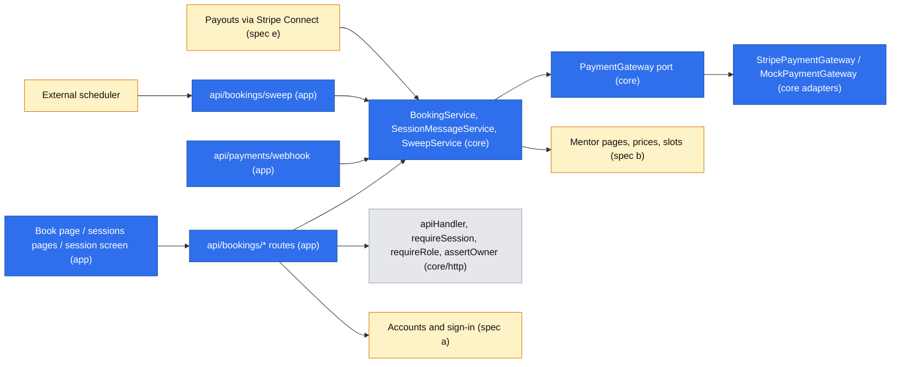
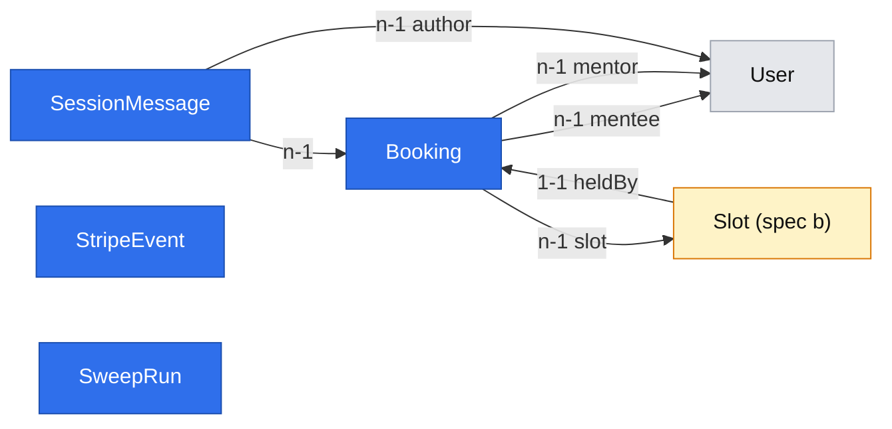

# Book a paid text session

Status: archived 2026-10-28, superseded, never implemented. On 2026-10-28 Damian turned down all three departures from the engineering standards that this draft records as approved below; that record was never confirmed (D13). The first build uses a mock-only payment gateway, a price of one rate per 25 minutes (R08), and no timed jobs, with time-dependent cases settled when either side next opens the booking (R09). The rules BR1–BR8, sign-in before paying, in-app notifications and the `mentee` rename were confirmed and now live in `.ai/specs/product-brief.md` as R10–R17, D18, D19 and D21. The backlog filed from the brief is in `.ai/specs/backlog.md` (#8–#25). Kept for history only; do not implement from it.

Original status: draft for review. Source: `.ai/specs/product-brief.md` (Now; D01–D12, R01–R07). Gate answered by Damian, 2026-10-27: this spec covers paid booking and the text session; all three departures from the engineering standards approved; in-app notifications only; mentees sign in before paying; the `student` role is renamed `mentee`; the proposed rules BR1–BR7 below approved.

## 📝 TLDR

A mentee stuck on one problem has no way today to pay a senior engineer for a written answer. Mentio has a technical foundation and a `User` table, and nothing else for this flow. This spec proposes, as future behavior, that a signed-in mentee picks a slot a mentor published, writes the question and pays by card or BLIK through Stripe Checkout. The mentor accepts or declines it from their sessions page. At the slot time the two hold a 25- or 50-minute text session inside Mentio. Refunds for declines, missed starts and cancellations happen automatically, and the mentor's earnings (price minus 20% and Stripe's fees) are recorded for the payouts spec to pay out. To do this, the spec replaces three parts of the implemented engineering standards: the mock-only payment gateway, the `rate × duration` price, and the no-timed-jobs rule.

## 📝 Problem Statement

Mentees with a deadline and no senior to ask lose hours or days. 23 of 109 Discord help threads got no human reply (`.ai/specs/research/2026-09-04-discord-help-requests.csv`, an English-speaking community, so context rather than evidence for Polish mentees, D10). Senior engineers answer the same questions unpaid (`.ai/specs/research/2026-08-22-interview-mentor.md`, `2026-09-03-interview-senior-python-meetups.md`). Damian chose a paid text session in a booked slot as the first build (D01, D09). It serves help the same day or later, not "within the hour" (brief, Decision summary). Whether mentors publish slots and mentees pay is untested and accepted as risk (A01–A03, D08); this spec does not change that.

## 📝 Proposed Solution

One booking moves through a server-side state machine. Every money movement goes through a payments port; every timed transition runs through one idempotent sweep that an external scheduler triggers.

1. The mentee opens a published slot, picks 25 or 50 minutes, writes the question and starts payment. The server creates a `pending_payment` booking that holds the slot, prices it from the mentor's stored price for that length, and opens a Stripe Checkout session (card and BLIK, PLN, expiring in 30 minutes).
2. Stripe's signature-verified webhook marks it `paid`. From then on the mentor sees the question on their sessions page.
3. The mentor accepts (`accepted`) or declines (`declined` → refunded) before the slot starts. A paid booking still unaccepted at the start is declined automatically (BR3).
4. From the slot start both sides can post in the session screen. If the mentor posts within the first 10 minutes, the session is held (BR1). Otherwise it becomes `mentor_no_show` and is refunded.
5. At the slot's end a held session becomes `completed`, and the mentor's earnings are recorded with a `payableAt`. The payouts spec moves the money through Stripe Connect (D12, out of scope here).

**Alternatives considered:**

| Alternative | Why not |
|---|---|
| Pre-authorise at booking and capture after the session (Codementor's model, per the founders' benchmark notes) | BLIK has no separate authorisation and capture, and a card authorisation lapses after about 7 days while slots open 14 days ahead (BR2). |
| Destination charges straight to the mentor's Connect account | D12 lets a mentor take bookings before finishing Connect setup, so there may be no account to charge to. Separate charges and transfers keep the money on Mentio's Stripe account until the payouts spec transfers it. |
| A job queue (pg-boss or similar) for timed transitions | It is a queue, which `AGENTS.md` excludes. The approved alternative is one stateless sweep route (decision (iii)). |
| Starting on the mentor's acceptance instead of a slot | Rejected by Damian in D09. |

## 📝 Architecture

New concepts follow the repository convention: `bookings` and `payments` sub-folders across `db`, `core` and `app`.

The blue parts are this spec. It depends on spec (a) for sign-in, and on spec (b) for the `MentorProfile` prices and `Slot` it books. Spec (e), payouts, reads the earnings this spec records.

- **Payments port** (`core/src/services/payments/payment-gateway.port.ts`): `createCheckout`, `expireCheckout`, `refund`, `getRefund`, `getChargeFee`, `parseWebhook`. Each mutating call takes an idempotency key derived from the booking id (`{bookingId}:checkout`, `{bookingId}:refund`), so a retry never charges or refunds twice.
- **Adapters:**
  - `StripePaymentGateway` is the only file that imports the `stripe` SDK. A new ESLint `no-restricted-imports` entry enforces that.
  - `MockPaymentGateway` is used in local dev and in the integration suite (`PAYMENTS_GATEWAY=mock`). Its "checkout URL" is the success URL, and its webhook is HMAC-signed with a test secret, so tests can post signed events.
  - `getEnv()` rejects `PAYMENTS_GATEWAY=mock` when `NODE_ENV=production` (`ConfigError`, fail closed).
- **Container:** the gateway is registered as a singleton (`asValue`, infrastructure). `BookingService`, `SessionMessageService` and `SweepService` are `.scoped()` because they use `em`.
- **Sweep** (decision (iii)): `POST /api/bookings/sweep` is called every 5 minutes by a scheduler outside the app.
  - It authenticates with `Authorization: Bearer ${SWEEP_SECRET}` (≥ 32 bytes, compared in constant time).
  - It runs with `csrf: false`, the same exemption a signature-verified webhook gets.
  - Each transition handles at most 100 bookings per call. Each booking moves in its own transaction behind a row lock (`SELECT … FOR UPDATE` through MikroORM's `LockMode.PESSIMISTIC_WRITE`) and only from its expected state, so overlapping calls are harmless.
  - Every call appends a `SweepRun` row, so a stopped scheduler is visible.
  - Which scheduler runs it depends on hosting, which is not decided. Any cron that can POST every 5 minutes works.
- **Time:** all instants are stored in UTC and shown in `Europe/Warsaw` (D10). There is one time zone, since the first build is Polish only.
- **Notifications:** in-app only (gate answer). There is no email; mentors see new paid questions on their sessions page, and BR3 refunds anything they don't act on.

## 📝 Contracts with the other specs

This spec cannot ship before specs (a) and (b), and it asks them for the following. Each spec must accept these explicitly before this one is implemented.

- **Spec (a), accounts and sign-in:**
  - a signed session whose role is `mentee` or `mentor`. Spec (a) should use `mentee` from the start, as Damian approved the rename; this spec's Phase 1 step 1 then only checks it;
  - one role per session; whether one person can hold both roles is spec (a)'s call;
  - a support contact the session screen can show when a refund fails. Damian owns it as owner of the terms (D06).
- **Spec (b), mentor pages:**
  - `MentorProfile.price25Grosze` and `price50Grosze` within R05;
  - `Slot` with `mentor`, `startsAt` and `published`;
  - slots at least 50 minutes apart;
  - acceptance that this spec's migration adds `Slot.heldBy` to its `slots` table.
- **Spec (e), payouts:** reads `mentorEarningsGrosze`, `payableAt` and `refundStatus`; owns recovery when a manual refund follows a payout.

## 📝 Data Model

All money is integer grosze. Entities use `defineEntity` with `baseProperties()` and are registered in `entities/index.ts`; every migration has a `down()`.

- **`Booking`** (`entities/bookings/booking.entity.ts`, table `bookings`):
  - Who and what: `mentee` (n-1 `User`), `mentor` (n-1 `User`), `slot` (n-1 `Slot`), `lengthMinutes` (25 | 50), `question` (text, 20–5,000 chars).
  - Status enum: `pending_payment`, `paid`, `accepted`, `declined`, `cancelled`, `cancelled_late`, `expired`, `mentor_no_show`, `completed`.
  - Refund status, separate from the booking status: `none`, `pending`, `succeeded`, `failed`, `manual`.
  - Price and commission, snapshotted at booking because the rate is configurable: `priceGrosze`, `commissionBps`.
  - Recorded later: `commissionGrosze` and `stripeFeeGrosze` (both nullable), `mentorEarningsGrosze` (nullable, set on `completed` or `cancelled_late`), `payableAt` (nullable).
  - Times: `startsAt` and `endsAt` (snapshotted from the slot), `checkoutExpiresAt`, and the nullable `paidAt`, `decidedAt`, `cancelledAt`, `mentorFirstReplyAt`.
  - Stripe references: `checkoutSessionId` (unique), `paymentIntentId` (nullable, unique), `refundId` (nullable).
  - Indexes: `(status, startsAt)` for the sweep; `(mentee, createdAt)` and `(mentor, startsAt)` for the lists.
- **`Slot.heldBy`**: a nullable, unique 1-1 link to `Booking`, added by this spec's migration to spec (b)'s `slots` table. Holding a slot sets it inside the booking transaction; the unique constraint backs it, so no slot is sold twice. It is cleared on `expired`, `declined`, `cancelled` and `mentor_no_show`.
- **`SessionMessage`** (`entities/bookings/session-message.entity.ts`, table `session_messages`): `booking` (n-1), `author` (n-1 `User`), `body` (text, 1–20,000 chars). Index `(booking, createdAt)`.
- **`StripeEvent`** (`entities/payments/stripe-event.entity.ts`, table `stripe_events`): `eventId` (unique), `type`, `processedAt`. A webhook event already in the table is acknowledged and skipped.
- **`SweepRun`** (`entities/bookings/sweep-run.entity.ts`, table `sweep_runs`): `ranAt`, `transitions` (JSON counts per transition), `failures` (int).
- **Consumed from spec (b), not defined here:** `MentorProfile.price25Grosze` and `price50Grosze`, validated against R05's bounds there and re-checked here at booking; `Slot` with `mentor`, `startsAt` and `published`. A slot reserves a 50-minute block whatever the booked length, so a 25-minute booking never overlaps the next slot. Spec (b) must enforce slots at least 50 minutes apart.

Sensitive data: `question` and `body` may contain a mentee's proprietary code or configuration. Only the booking's two participants can read them; there is no admin access, because no admin role exists. They are added to `REDACTED_PATHS` and never logged. Their retention is not decided (see Risks).

`StripeEvent` and `SweepRun` stand alone. The amber `Slot` is defined by spec (b).

## 📝 API Contracts

All routes use `apiHandler` and the `{ ok, data }` envelope, and parse input through Zod schemas in `core/src/validators/bookings/`. The `Mentee` and `Mentor` columns name the role required (`requireRole`); every per-booking route also checks ownership (`assertOwner` against the booking's mentee or mentor).

| Route | Who | Request | Result / errors |
|---|---|---|---|
| `POST /api/bookings` | mentee | `{ slotId, lengthMinutes: 25\|50, question }` | `201 { bookingId, checkoutUrl }`. `403` with "Rezerwacje są chwilowo wyłączone" while `BOOKINGS_ENABLED` is off. `409 CONFLICT` if the slot is held, booked, unpublished, or outside BR2's window; `409` if the mentee already has a `pending_payment` booking (BR8); `400` validation; `403` if the mentee is the slot's mentor |
| `GET /api/bookings?as=mentee\|mentor&status=` | either | pagination schema | `Page<BookingDto>` of the caller's own bookings only |
| `GET /api/bookings/[id]` | participant | — | `BookingDto` (no Stripe ids, no fee breakdown for the mentee) |
| `POST /api/bookings/[id]/accept` | mentor | — | `paid` → `accepted` only before `startsAt`, otherwise `409` |
| `POST /api/bookings/[id]/decline` | mentor | — | `paid` → `declined`, refund started; `409` from any other state |
| `POST /api/bookings/[id]/cancel` | mentee | — | per BR5: `pending_payment` → `expired` (Checkout expired, slot released); `paid`, or `accepted` ≥ 12 h before → `cancelled` + refund; `accepted` < 12 h before → `cancelled_late` (no refund); otherwise `409` |
| `GET /api/bookings/[id]/messages?after=` | participant | ISO timestamp | messages after the cursor; the session screen polls this every 5 s while open |
| `POST /api/bookings/[id]/messages` | participant | `{ body }` | only for `accepted` bookings between `startsAt` and `endsAt`, otherwise `409`. The mentor's first post sets `mentorFirstReplyAt` |
| `POST /api/payments/webhook` | Stripe | raw body + `Stripe-Signature` | `csrf: false`; the handler reads `req.text()` before any JSON parsing, because the signature covers the exact bytes; signature verified via the port, events deduplicated through `StripeEvent`. Handles `checkout.session.completed` (when `payment_status=paid`), `checkout.session.async_payment_succeeded` (→ `paid`) / `_failed` (→ `expired`, slot released, nothing to refund), `checkout.session.expired`, and `charge.refunded` / `refund.updated` (including refunds made by hand in the Stripe dashboard) |
| `POST /api/bookings/sweep` | scheduler | bearer secret | `200 { transitions, failures }`; `401` on a wrong or missing secret |

The charge amount is never taken from the client: the server reads `MentorProfile.price{25|50}Grosze` and re-checks the R05 bounds (decision (ii)). `commissionGrosze = round(priceGrosze × commissionBps / 10,000)`. `stripeFeeGrosze` is read from the charge's balance transaction when payment is confirmed. `mentorEarningsGrosze = priceGrosze − commissionGrosze − stripeFeeGrosze` (D11).

Webhook handling:
- When `paid` arrives for a booking already `expired` (a payment that completed after the hold lapsed), the booking is refunded at once and the mentee sees "payment arrived late and was refunded".
- A refund made by hand in the Stripe dashboard on a `completed` booking sets `refundStatus=manual` and clears `payableAt`, so the payouts spec won't pay it. If it was already paid out, the payouts spec owns the recovery.

**Sweep transitions**, each guarded by state and idempotent:

| From | When | To |
|---|---|---|
| `pending_payment` | `now ≥ checkoutExpiresAt + 5 min` with no webhook | `expired`; Checkout session expired, slot released |
| `paid` | `now ≥ startsAt` | `declined` (BR3); refund |
| `accepted` | `now ≥ startsAt + 10 min` and `mentorFirstReplyAt` is null | `mentor_no_show` (BR1); refund |
| `accepted` | `now ≥ endsAt` and the mentor replied | `completed`; earnings recorded with `payableAt = endsAt` |
| `cancelled_late` | `now ≥ endsAt` | earnings recorded with `payableAt = endsAt` |
| refund `pending` | older than 1 hour | re-read through `getRefund`; `failed` is logged at `error` level |

Configuration (`config/env.ts`, all optional at boot and failing closed when used, documented in `.env.example`): `BOOKINGS_ENABLED` (default `false`; the kill switch — while off, no new booking can be created, while webhooks, refunds and the sweep keep running for bookings that exist), `PAYMENTS_GATEWAY` (`stripe` | `mock`, default `stripe`), `STRIPE_SECRET_KEY`, `STRIPE_WEBHOOK_SECRET`, `MOCK_WEBHOOK_SECRET`, `PLATFORM_COMMISSION_BPS` (0–10,000, default 2,000), `SWEEP_SECRET` (≥ 32 bytes), `APP_BASE_URL` (Checkout return URLs).

## 📝 UI/UX

The screens are in Polish (BR6). Data fetching goes only through `apiCall`. The pages reuse the shared layers: `CrudForm` for the Book form, `DataTable` for the session lists, and `feedback/` for loading, error and empty states. Spec (a) may set a different convention for persona pages; if it does, it wins. This spec adds four pages:

- **Book** (`(mentee)/book/[slotId]`). Shows the mentor's two prices, the slot time in Warsaw time, the question box with its 20–5,000 character count, and the cancellation rule in one sentence before paying (BR5). After "Pay" the mentee goes to Stripe Checkout.
  - Slot just taken or held: "Ten termin został właśnie zajęty", with a link back to the mentor's page.
  - Slot outside the booking window: the reason, with no Pay button.
  - Mentee already has a pending payment: a link to that booking.
  - Return from Checkout with `cancelled=1`: "Płatność nieukończona", with *Spróbuj ponownie* (same Checkout URL while it is valid) and *Zrezygnuj* (cancel).
- **My sessions** (`(mentee)/sessions`). Bookings by status, one line each: "Czeka na płatność", "Czeka na decyzję mentora", "Zaakceptowana", "Odrzucona — zwrot w toku / zwrócono", "Mentor się nie pojawił — zwrócono", "Zakończona".
  - After a successful payment it shows "Potwierdzamy płatność…" and polls until the webhook lands. After 2 minutes it says the payment is still confirming and that, if not confirmed, the money is refunded automatically.
  - Refund lines state that the refund was *started* today, and that the bank or BLIK sets when it arrives (R07 is about starting the refund, not its arrival).
- **Mentor sessions** (`(mentor)/mentor/sessions`). The waiting paid questions at the top, each with the full question, length, time and price after the commission, plus *Akceptuj* and *Odrzuć* buttons. From Phase 5, a countdown shows "auto-odrzucenie za …" until the slot starts (BR3). Upcoming and past sessions sit below. Empty, loading and error states use the `feedback/` components.
- **Session screen** (`session/[bookingId]`). Shared by both participants, so it sits outside the persona route groups; access is by ownership check.
  - The question is pinned at the top, then the messages, then the reply box. Messages keep whitespace and use a monospace font inside triple-backtick blocks, so pasted code stays readable.
  - It shows the time remaining.
  - Before `startsAt`: read-only, "Sesja zaczyna się o …". After `endsAt`: read-only transcript.
  - If 10 minutes pass with no mentor reply, the mentee sees "Mentor się nie pojawił — zwrot w toku" within one sweep interval.
  - Text only (N01): no video and no attachments. No rating step afterwards (N02).

## 📝 Edge Cases & Failure Scenarios

- **Two mentees pay for the same slot.** It can't happen: the hold is taken in the booking transaction behind `Slot.heldBy`'s unique constraint, so the second mentee gets `409` before Checkout.
- **Webhook lost or delayed.** The booking stays `pending_payment`. The sweep expires the Checkout session after its lifetime plus 5 minutes. A payment that still completes is refunded on its late webhook (see API Contracts).
- **Stripe unreachable while booking.** The hold is committed in its own transaction first; the Checkout call happens after it, never inside a row lock. If the call fails, a compensating transaction expires the booking and releases the slot, and the mentee sees "Płatności chwilowo niedostępne, spróbuj za chwilę". A crash between the two steps leaves a `pending_payment` hold with no Checkout session, which the sweep expires like any other. If Stripe is unreachable when refunding, the refund is retried by the next sweep under the same idempotency key.
- **The scheduler stops.** Declines, no-shows and completions wait until it resumes. `SweepRun` shows the last run. Running real payments with no scheduler monitoring is a release blocker (Done means).
- **The mentor accepts a second before the start while the sweep auto-declines.** Both lock the row and check the state; whichever commits first wins and the other gets `409` or does nothing.
- **Mentor posts at 9:59 versus 10:01.** BR1 compares `mentorFirstReplyAt` with `startsAt + 10 min` on the server clock. The mentor's screen shows the countdown.
- **Mentee is also a mentor.** Roles are one per session (`SESSION_ROLES`); whether one person can hold both is spec (a)'s question. A booking of one's own slot is refused (`403`).
- **Commission rate changes while bookings are open.** Bookings keep the rate snapshotted when they were created (`commissionBps`).
- **Refund fails** (a closed card, for example). `refundStatus=failed` is logged at `error` level. With no admin role, Damian resolves it in the Stripe dashboard; the mentee's screen says "Zwrot wymaga kontaktu", with a contact route that spec (a) or the terms must name. This is a known gap.
- **Hypotheses from the synthetic panel, seen once.** That panel walked the DevMentor demo brief, not this one, and nothing repeated:
  - `[SYNTHETIC]` An urgent mentee would leave when the earliest slot is hours away. BR2's 2-hour minimum keeps same-day possible but can't serve "within the hour" (D09, accepted).
  - `[SYNTHETIC]` A mentee needs to know the mentor can see their code. This motivates the whitespace-preserving message rendering.
  - Source: `.ai/specs/research/walkthroughs/2026-10-27-future-state-booking-and-session-1-0-decided-steps-session-001/report.md`.

## 📝 Risks & Impact Review

- **Contracts this spec changes:**
  - Session role `student` → `mentee`. It is in JWT claims, but nothing has signed tokens yet, since there is no sign-in.
  - The `(student)/` route group name in `AGENTS.md` and the engineering standards.
  - Three engineering-standards rules (decisions (i)–(iii)). `AGENTS.md` is updated in the same PR.
  - The implemented standards spec is left as the historical record, and this spec is cited as superseding those three points.
- **New dependency:** the `stripe` npm package, in `core` only, behind the adapter; it must pass `npm run audit`.
- **Reversibility:** every migration has a `down()`. Refunds and payouts are irreversible money movements; idempotency keys and state guards are their only protection, and tests cover both.
- **Real money, legal and tax** (Damian, owner of the terms, D06). These are questions for a professional adviser, not settled by this spec:
  - the terms must exist before the first real payment;
  - whether a Polish consumer's 14-day right of withdrawal from a service applies before the session is held, and how BR5's no-refund window squares with it;
  - the EU platform reporting duty (DAC7) for mentor income;
  - whether holding mentees' payments for mentors without Connect setup (D12, BR7) is acceptable under Stripe's Connect terms in Poland.
- **Data retention:** how long questions and session transcripts are kept is not decided. It belongs in the terms.
- **Scheduler dependency:** the app depends on an external trigger for refunds; hosting is not chosen. A run of more than 15 minutes without a `SweepRun` should alert someone, but alerting isn't part of the current stack.
- **Product direction, not defects:** the booked-slot model can't meet "within the hour" (D09), and in-app-only notice relies on mentors checking their page (A01). These are accepted choices; BR3 bounds the cost of a mentor who doesn't check.

## 📝 Decisions in play

- Relies on D01, D02, D04–D12; R01, R02, R03, R05, R06, R07; N01 (text only), N02 (no rating step).
- **New rules from this spec, approved by Damian on 2026-10-27.** The brief records them at the next `om-discover --refresh`, closing Q05, Q06, Q08, Q09, Q10 and Q12:
  - **BR1 (Q05):** the session counts as held if the mentor posts within 10 minutes of the slot start. Otherwise it is a mentor no-show, refunded automatically. A mentee who never opens a held session is a mentee no-show, and the mentor is paid. No research basis for 10 minutes.
  - **BR2 (Q06):** a slot is bookable from 2 hours to 14 days before its start. No research basis.
  - **BR3 (Q06):** a paid booking not accepted by the slot's start counts as declined and is refunded.
  - **BR4 (Q08):** Mentio absorbs Stripe's fee on any refund; the mentee always gets the full price back.
  - **BR5 (Q12):** a mentee cancels free until the mentor accepts. After acceptance, free up to 12 hours before the slot (Preply's rule, a benchmark). Later counts as a mentee no-show.
  - **BR6 (Q10):** the interface is Polish only in the first build; payment is by card and BLIK.
  - **BR7 (Q09):** a mentor's earnings are held until their Connect setup is done; cases unclaimed after 90 days go to Damian. Paid out by spec (e).
  - **BR8 (new, agent proposal, not yet approved):** a mentee can have one `pending_payment` booking at a time, so nobody can hold many slots without paying. ⚠ Needs Damian's approval.
- Q07: both `paidAt` → `mentorFirstReplyAt` and `startsAt` → `mentorFirstReplyAt` are recorded, so D07's measure can be either. What it means is still Damian's call.
- Supersedes no brief entry. It supersedes three points of `.ai/specs/implemented/2026-10-23-engineering-standards.md` (payments port with a mock-only MVP; `mentor.rate × duration`; no timed jobs) under the gate approval.

## 📋 Phasing

Specs (a) accounts and (b) mentor pages must land first; this spec's phases start after them.

- **Phase 1 — Payments foundation.** Role rename, configuration, payments port with mock and Stripe adapters, webhook deduplication. Ships nothing user-visible.
- **Phase 2 — Paid booking.** A mentee can book and pay, and sees the booking on My sessions. `BOOKINGS_ENABLED` stays off in every shared environment until Phase 5, the terms (D06) and a running scheduler are in place, because until then a paid booking has no automatic decline, refund retry or expiry.
- **Phase 3 — Mentor decision and cancellation.** Accept, decline, cancel and refunds, plus both sessions pages.
- **Phase 4 — Text session.** Messages and the session screen.
- **Phase 5 — Timed transitions.** The sweep, auto-decline, no-show and completion with recorded earnings. `BOOKINGS_ENABLED` may be switched on once this phase, the terms (D06) and a running scheduler are in place.

## 📋 Implementation Plan

Every step ends with `npm run lint`, `typecheck` and `test:coverage` (100%) green. Every new route and page gets an integration test in `tests/integration/` (status codes and envelope including the auth failure; pages through `agent-browser`), run with `PAYMENTS_GATEWAY=mock`.

**Phase 1**
1. Make sure the session role is `mentee`, not `student`. If spec (a) shipped `student`, rename it in `core/src/http/auth.ts` and its tests. Update `AGENTS.md`'s route-group names either way.
2. Add the configuration keys to `config/env.ts`, including `BOOKINGS_ENABLED`, with fail-closed getters and the production ban on the mock gateway. Update `.env.example`. Unit-test every getter.
3. Add the `PaymentGateway` port and `MockPaymentGateway` (HMAC-signed webhooks), registered in the container by `PAYMENTS_GATEWAY`. Unit tests.
4. Add `stripe`, the `StripePaymentGateway` adapter, and the ESLint rule limiting `stripe` imports to it. Unit tests mock the SDK at the package boundary, covering the idempotency keys, PLN, card+BLIK and the 30-minute expiry.
5. Add the `StripeEvent` entity and migration, and `POST /api/payments/webhook` with signature check and deduplication (no handlers yet: acknowledge and record). Integration test: bad signature `400`, good signature `200`, replay ignored.

**Phase 2**
1. Add the `Booking` entity, `Slot.heldBy`, and the migration with `down()`.
2. `BookingService.create`: the `BOOKINGS_ENABLED` check, the BR2 window, the R05 re-check, the BR8 limit and own-slot refusal, a transaction that holds the slot and prices the booking from the stored price, then Checkout through the port outside the transaction, with a compensating release on failure. Then `POST /api/bookings`. Unit tests cover each refusal; an integration test covers `201`, `409` on a taken slot, `401`, `403` for the wrong role, and `403` while bookings are disabled.
3. Webhook handlers for completed, async succeeded or failed, and expired. Record the fee and `paidAt`; refund a late payment. Unit tests per event; an integration test posts mock-signed events.
4. The Book page, the Checkout return handling, and a read-only My sessions page. Browser integration test: book through the mock gateway, then land on My sessions showing "Czeka na decyzję mentora".

**Phase 3**
1. Accept and decline (service and routes), with the refund through the port and BR4. Unit and integration tests, including the `409`s.
2. Cancel per BR5 in every state. Unit tests for each branch; integration test.
3. Refund webhooks (`succeeded`, `failed`, `manual`). Unit tests; the `manual` case on a `completed` booking uses a seeded booking, because `completed` is produced only from Phase 5.
4. Mentor sessions page, and cancel actions on My sessions, using the `feedback/` states. Browser tests: the mentor accepts; the mentee cancels and sees "zwrot w toku".

**Phase 4**
1. The `SessionMessage` entity and migration.
2. `SessionMessageService` and the message routes: window rules, participants only, `mentorFirstReplyAt`. Add `question` and `body` to `REDACTED_PATHS`. Unit and integration tests.
3. The session screen with 5-second polling and whitespace-preserving rendering. Browser test: two participants exchange messages in an open window; the screen is read-only before the start.

**Phase 5**
1. `SweepService` with every transition from the table, using an injected clock. Unit tests for each transition, for overlapping runs, and for the accept-versus-auto-decline race.
2. The `SweepRun` entity and migration, `POST /api/bookings/sweep` with the bearer secret, and the mentor page's auto-decline countdown. Integration test: `401` without the secret; with it, a paid booking past its start is refunded.
3. Document how to run the scheduler in `README.md`. Update `AGENTS.md` (payments adapter, the sweep exception to "no worker"). Add a `.ai/lessons.md` entry if anything non-obvious turns up.

## Done means

- [ ] A signed-in mentee can book a published slot, pay by card or BLIK in Stripe test mode, and see the booking wait for the mentor.
- [ ] A mentor can accept or decline a paid question before the slot. A decline starts a full refund the same day (R07, BR4).
- [ ] An unaccepted booking at the slot start, and a mentor who doesn't post within 10 minutes, are refunded automatically by the sweep (BR1, BR3).
- [ ] Cancellations follow BR5 in every state, with the right refund or none.
- [ ] Both participants can exchange text in the session window only. Pasted code keeps its formatting.
- [ ] Completed and late-cancelled bookings record `mentorEarningsGrosze = price − 20% − Stripe fee` and `payableAt`. Nothing is paid out by this spec.
- [ ] No slot can be sold twice (concurrency test). No webhook or sweep run moves money twice (idempotency tests).
- [ ] The `student` role is renamed `mentee`, and `AGENTS.md` reflects the three approved departures.
- [ ] `npm run lint`, `npm run typecheck`, `npm run test:coverage` (100%), `npm run build`, `npm run test:integration` and `npm run audit` pass.
- [ ] `BOOKINGS_ENABLED` is off by default. Before it is switched on in production, outside this spec's code: the terms exist (D06); specs (a) and (b) have accepted the contracts above; a support contact for failed refunds exists; a scheduler calls the sweep every 5 minutes and someone watches `SweepRun`; and Damian has approved BR8 and taken advice on the legal and tax points under Risks.
