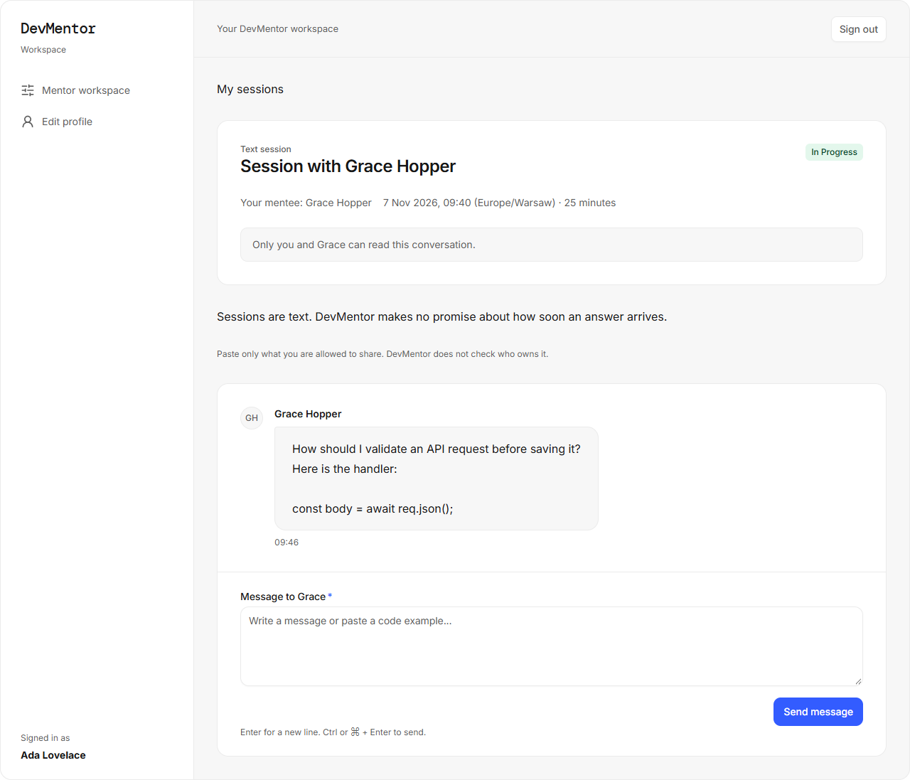
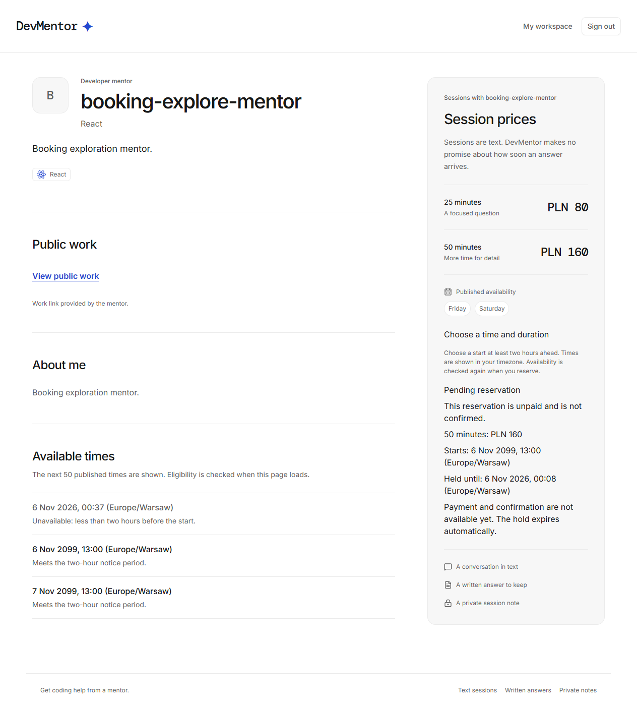
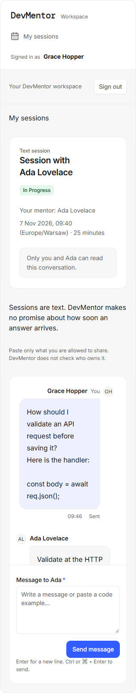
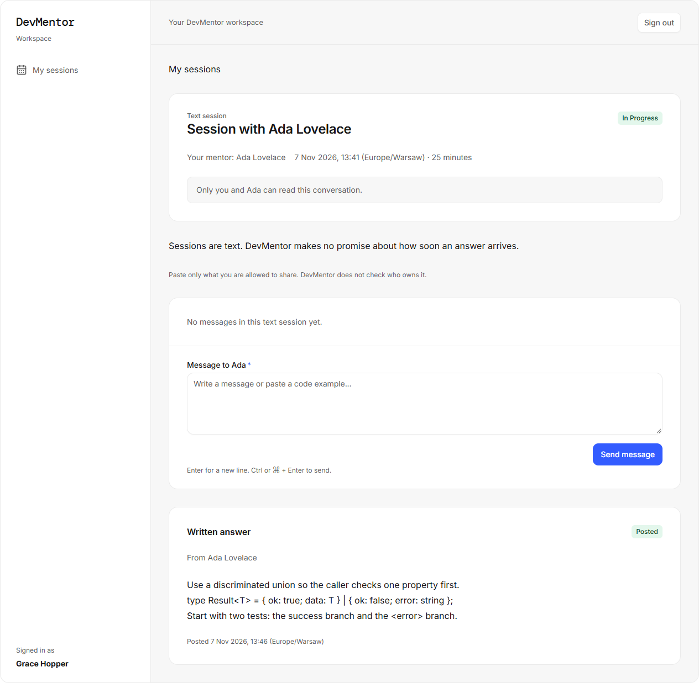
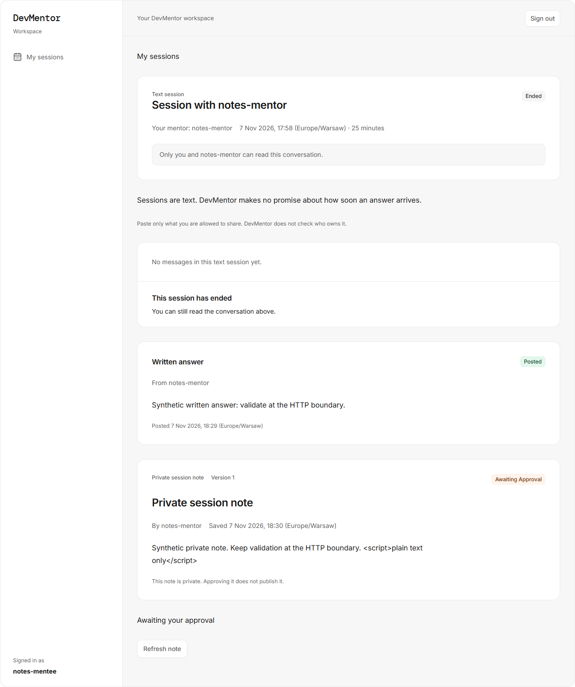
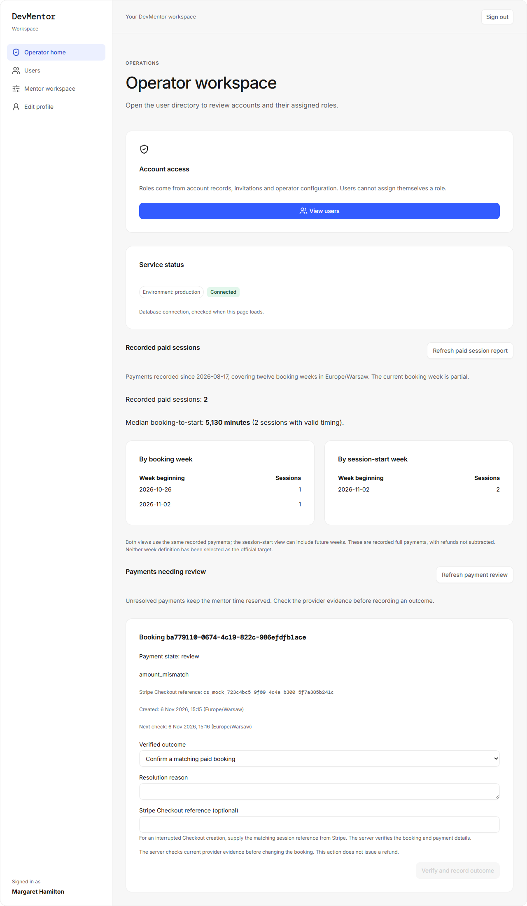

<h1 align="center">🧑‍💻 DevMentor</h1>

<p align="center">
  <strong>Specific technical help from a named developer mentor — in a short, private text session.</strong>
</p>

<p align="center">
  <a href="#-getting-started">🚀 Getting started</a> ·
  <a href="#-features">✨ Features</a> ·
  <a href="#-how-it-works">🔄 How it works</a> ·
  <a href="docs/development.md">📚 Development guide</a> ·
  <a href="CHANGELOG.md">📝 Changelog</a>
</p>

<p align="center">
  
</p>

---

## 💡 What is DevMentor?

You are stuck on a TypeScript release blocker, a production incident or a React estimate.
Searching has not helped, and a community thread has contradictory answers. DevMentor lets
you book **25 or 50 minutes with an experienced mentor**, ask in text, and keep a
**written answer** and a **private session note** afterwards.

For mentors it is bounded, paid help on their own terms, instead of the same unpaid
questions over and over.

> 🚧 **Status: 0.1.0, pre-launch.** The core marketplace flow works end to end, but
> mentor discovery and Stripe Connect payouts are not built yet. See
> [what is not here yet](#-what-is-not-here-yet).

## 🔄 How it works

1. 🔑 **Sign in** with GitHub or email. Mentors join by invitation.
2. 🔎 **Open a mentor's page** and see their stack, public work, session prices and
   availability.
3. 📅 **Pick a time** and duration. The slot is held while you pay through Stripe Checkout.
4. 💬 **Ask in text** when the session starts. Only the mentee and mentor can read it.
5. 📄 **Keep the result:** the mentor's written answer and, if you approve it, a private
   session note.

## ✨ Features

### 👩‍🏫 Mentors you can check before you book

Mentors are invited by the operators and get a **public page with a stable share link**:
stack tags, a link to their public work, a short bio, **fixed PLN prices** for 25- and
50-minute sessions and their **published availability**. Times are shown in your own
timezone, and a start must be at least two hours ahead.

<p align="center">
  
</p>

### 💳 Booking and payment

Reserve a slot at **server-side prices** that clients cannot override. **Stripe Checkout**
takes the payment, a reconciliation command recovers delayed or lost provider events, and both
sides get a **confirmation** once the payment is verified.

### 💬 Text sessions

A confirmed booking opens a **private text conversation** with a clear status
(not started, in progress, ended). Paste code, ask follow-ups and read the thread again
after the session ends. Sessions are text only, and DevMentor makes no promise about how
fast an answer arrives.

<p align="center">
  
</p>

### 📝 A written answer to keep

The mentor posts a **written answer** that appears on the mentee's session screen and can
be edited by the mentor afterwards. It stays readable long after the conversation is
over.

<p align="center">
  
</p>

### 🔒 Private session notes, approved by the mentee

The mentor drafts a **private note** and sends it for approval. The mentee **approves it
or declines with a comment**, and the mentor can redraft. Approval never publishes
anything: the note stays between the two of them.

<p align="center">
  
</p>

### 🛡️ An operator workspace

Operators manage **users and roles**, see **paid sessions by booking week and by
session-start week** with the booking-to-start median, and work through **payments that
need review** against the provider's evidence.

<p align="center">
  
</p>

> 📸 Screenshots come from the project's QA runs and integration tests, with synthetic
> data. They are kept under [`.ai/qa/`](.ai/qa).

### 🧭 Deliberately not included

- 🚫 **No video or voice calls.** Sessions are text by design.
- 🚫 **No ratings or reviews.**
- 🚫 **No ownership checks of pasted code.** Participants share only what they may share.

## 🚧 What is not here yet

- **Finding a mentor** by list or filter. Today you reach a mentor through their share link.
- **Stripe Connect onboarding and mentor payouts.**
- **Later:** vault publication, subscriptions, MCP and team plans.

The reasoning and scope decisions live in the [product brief](.ai/specs/product-brief.md).

## 🚀 Getting started

You need **Node ≥ 24**. Docker is optional and only used if no PostgreSQL is reachable.

```bash
npm install
npm run setup   # creates .env, starts PostgreSQL, migrates, seeds sample data
npm run dev
```

Open <http://localhost:3000>. `npm run setup` is idempotent, so run it again whenever you
like. To sign in locally, use the seeded mentee `mock-mentee@devmentor.test` with the
password `devmentor-demo-password`. For GitHub sign-in, your own PostgreSQL, Stripe and
every other setting, see the **[development guide](docs/development.md)**.

## 📚 Documentation

| 📖 Document | What is in it |
| --- | --- |
| [Development guide](docs/development.md) | Setup in depth, configuration, scripts, testing, architecture, operator tasks |
| [Payment operations](docs/payments-operations.md) | Provider outages, stuck payments, rollback |
| [Threat model](docs/security/threat-model.md) | Security analysis of the whole system |
| [Changelog](CHANGELOG.md) | What shipped in each release |
| [Product brief](.ai/specs/product-brief.md) | Problem, evidence, scope and decisions |
| [AGENTS.md](AGENTS.md) | Conventions for contributors and AI agents |

## 🧱 Built with

Next.js 16 · React 19 · TypeScript · PostgreSQL with MikroORM · Tailwind CSS ·
shadcn-ui · Stripe — in an npm-workspaces monorepo (`app → core → db`, `app → ui`).
