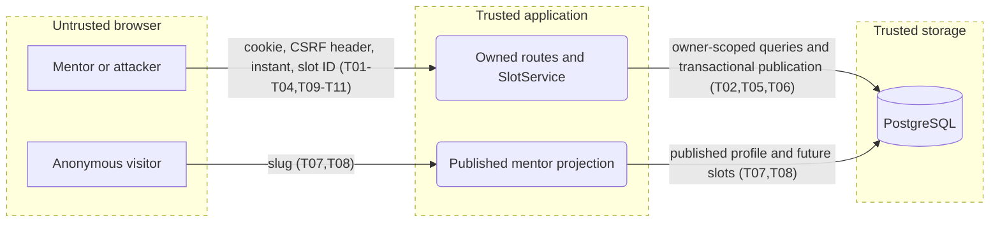
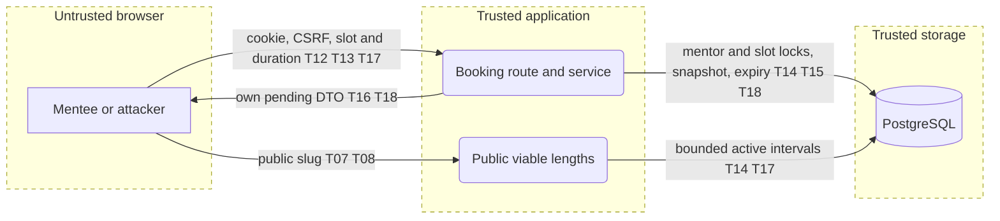

# Threat model: E02 availability

Scope: Slice 3. Updated: 2026-11-05. Owner: implementation team; no risk acceptance is inferred from this model.

## System profile
Next.js 16 / React 19 browser app and HTTP API, TypeScript services, MikroORM PostgreSQL. Single application; core/ui/db are shared libraries. Deployment target is not assumed. Signed session cookies reload live roles; owner identity comes from the session, never request data. There is no organization tenant: mentor profiles are the ownership boundary. No AI or external integration is introduced; AI Rule of Two is inapplicable.

Assets: private account/profile data, accurate availability and publication ordering, historical removed slots. Actors: anonymous visitor, mentee, mentor owner, another mentor, operator without mentor role. Entries: mentor slots page, GET/POST slots, DELETE slot ID, public mentor page/API. The database is trusted storage; browsers and all request fields are untrusted.

## Data flow and trust boundaries

## Threats and controls

| ID | Threat | STRIDE | L/I | Response and control | How verified | Mapping |
| --- | --- | --- | --- | --- | --- | --- |
| T01 | Signed-out or mentee caller publishes availability | S/E | H/H | Mitigate: page, route and service mentor guards; existing live session verification | Denied page/API/service tests | A01:2025 CWE-862 |
| T02 | Mentor deletes or reads another mentor's slots | I/T/E | H/H | Mitigate: profile from session; ID plus owner query; identical missing/foreign 404 | Two-owner API test, service query assertions | API1:2023 CWE-639 |
| T03 | Cross-site request changes slots | T | M/H | Mitigate: central apiHandler CSRF header, existing JSON-only path | POST/DELETE without header denied | A01:2025 CWE-352 |
| T04 | Crafted body changes owner or publishes past instant | T | H/M | Mitigate: explicit schema/projection; server clock after lock; local conversion is convenience only | Extra keys, invalid ISO, past/now tests | A06:2025 CWE-602 |
| T05 | Concurrent publication duplicates an active instant or regresses timestamp | T | M/M | Mitigate: profile row lock, partial unique index, atomic publication timestamp | Parallel POST DB test; named-constraint mapping | A06:2025 CWE-362 |
| T06 | Removed slot disappears from history or publication cannot be attributed | R/T | M/M | Mitigate: soft removal, preserved owner/start/timestamps, typed event after commit; no claim of durable audit bus | Remove/republish test, failed-transaction event absence | A09:2025 CWE-778 |
| T07 | Public API leaks private profile/removed availability | I | M/H | Mitigate: published-profile lookup, future active slots, explicit public allowlist | Exact key and unpublished/removed/past tests | API3:2023 CWE-200 |
| T08 | Unlimited public or owner reads exhaust resources | D | M/M | Mitigate: indexed owner/start queries, server-filtered owner pages of 25 and public next-50 cap; no unbounded materialized collections | Query/index/page-limit assertions, integration smoke | API4:2023 CWE-400 |

STRIDE considered across browser/application and application/storage: S/E live-session and owner guards; T schema/clock/transaction; R stored timestamps/event; I explicit projection; D indexed queries with bounded materialized collections. No secrets or provider calls enter this feature.

## Test scope and boundaries
Synthetic local ephemeral PostgreSQL and browser only. Unit: authorization, invalid input, clock boundary, named constraint, transaction/event ordering, exact DTOs, local timezone/DST conversion. Integration: parallel duplicates, foreign/missing IDs, soft removal and republish, signed-out public visibility, CSRF and role denial, migration up/down. No production scans or live accounts. Booking occupancy and payment policy are out of scope; Slice 4 policy was explicitly approved on 2026-11-05. No SVG renderer is installed; render the sibling Mermaid source with an existing Mermaid viewer if needed.

Changelog: 2026-11-05 initial preimplementation model; mitigations above are planned until verified by the run gate.

## Slice 4 extension — approved and reviewed on 2026-11-05
Money assets: exact minor-unit amounts, authoritative policy, truthful offer readiness. Entry PUT prices plus owner/public reads. T09 (T/E, H/H, A06:2025 CWE-602): client supplies price/currency/bounds/storage fields; mitigate with decimal-only schema, exact bounded integer parsing, session-owned profile and server-only settings. Test extra keys, role/scope/CSRF denial and one-invalid rollback. T10 (T, M/H, CWE-362): partial/concurrent two-price save; validate both before any mutation inside the profile row transaction, test persisted atomicity. T11 (T/I, M/H, A02:2025): missing/malformed policy or stale stored price masquerades as ready; settings validates complete positive integer PLN bounds, readiness rechecks current bounds, public projection excludes bounds. Test malformed JSON, missing settings, inverted/zero/overflow bounds and subsequent policy changes. No charge, fee, booking snapshot or payout is introduced. The same application/storage boundaries apply. Final verification evidence is recorded in the PR; no payment-launch approval is inferred.

## Booking reservation extension — 2026-11-05

Scope: issue #40, pending unpaid reservations only. The system profile and boundaries above still apply. New assets are booking identity, price/time snapshots, reservation history and exclusive mentor time. New entry is POST /api/bookings plus the public SlotPicker. No AI or payment provider is introduced.

| ID | Threat | STRIDE | L/I | Planned mitigation | How verified | Mapping |
| --- | --- | --- | --- | --- | --- | --- |
| T12 | Anonymous or mentor-only caller reserves as a mentee | S/E | H/H | Live route and service mentee guards; identity from scope | API 401/403 and service denial tests | API5:2023 CWE-862 |
| T13 | Cross-site or forged body changes price, owner or status | T/E | H/H | Central CSRF, explicit schema, stored bounded mentor prices and DTO allowlist | CSRF, extra-key and price-change tests | A01:2025 CWE-352; API3:2023 |
| T14 | Two slot IDs reserve overlapping mentor time | T | M/H | Mentor then slot lock; half-open interval overlap check; partial active slot uniqueness; lazy expiry | Same-slot/cross-slot concurrent requests, adjacency and expired holds | A06:2025 CWE-362 |
| T15 | Removal, unpublish or price edit races a reservation | T | M/H | Profile lock shares E02 price/unpublish serialization; slot lock shares removal serialization; occupied removal denied | Concurrent removal and stale-price integration tests | A06:2025 CWE-367 |
| T16 | Retry leaks another mentee's hold or extends own hold forever | I/T | M/H | Recover only same-owner same-slot same-duration pending hold; never extend expiry; generic conflict otherwise | Owner retry and different-owner tests; DTO exact keys | API1:2023 CWE-639 |
| T17 | Free holds exhaust inventory or requests overload locking | D | H/M | Account attempt throttle using existing limiter; 30-minute lazy expiry; bounded public projection | 429/Retry-After, exact expiry and viable-length tests | API4:2023 CWE-400 |
| T18 | Expiry destroys history or unpaid state looks confirmed | R/T | M/M | Preserve immutable slot/start/price snapshot; explicit expired status; pending/unpaid copy and nullable bookedAt | Persisted history, retry and UI status assertions | A09:2025 CWE-778 |

Multi-account inventory abuse remains a residual product risk; this document does not imply owner acceptance or invent a per-user booking quota. Follow-up product work must decide whether stronger anti-hoarding controls are needed. Operational throttling is not proof that abuse is impossible.

Test scope: synthetic ephemeral PostgreSQL, real app/API and isolated browser sessions. Cover all T12–T18 controls in unit/integration/QA, including failed input, role denial, concurrency, expiry, price tampering and retry. No real accounts, provider calls, production scans or destructive cleanup. STRIDE: S/E role/identity; T transactional invariants; R history/timestamps; I explicit DTO; D bounded reads/throttling. Controls remain planned until the recorded gate proves them.

Implementation sequence: entity/migration; service and occupied removal; route/DI; viable lengths and picker; documented integration scenarios; coverage/full gate/independent review and QA. Each step is a separate commit; the local run plan tracks exact hashes without committing runtime artifacts.
