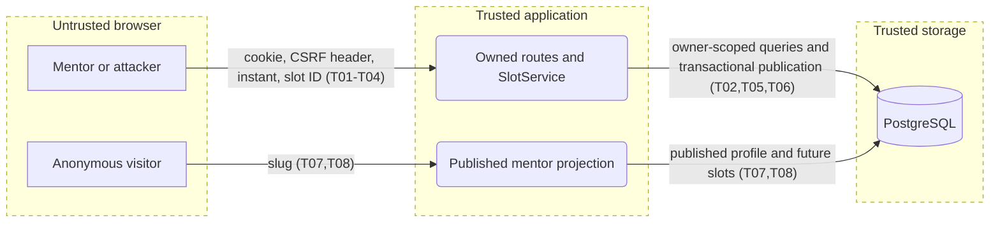

# Threat model: E02 availability

Scope: Slice 3. Updated: 2026-11-05. Owner: implementation team; no risk acceptance is inferred from this model.

## System profile
Next.js 16 / React 19 browser app and HTTP API, TypeScript services, MikroORM PostgreSQL. Single application; core/ui/db are shared libraries. Deployment target is not assumed. Signed session cookies reload live roles; owner identity comes from the session, never request data. There is no organization tenant: mentor profiles are the ownership boundary. No AI or external integration is introduced; AI Rule of Two is inapplicable.

Assets: private account/profile data, accurate availability and publication ordering, historical removed slots. Actors: anonymous visitor, mentee, mentor owner, another mentor, operator without mentor role. Entries: mentor slots page, GET/POST slots, DELETE slot ID, public mentor page/API. The database is trusted storage; browsers and all request fields are untrusted.

## Data flow and trust boundaries

## Threats and controls

| ID | Threat | STRIDE | L/I | Response and control | How verified | Mapping |
| --- | --- | --- | --- | --- | --- | --- |
| T01 | Signed-out or mentee caller publishes availability | S/E | H/H | Mitigate: page, route and service mentor guards; existing live session verification | Denied page/API/service tests | A01:2025 CWE-862 |
| T02 | Mentor deletes or reads another mentor's slots | I/T/E | H/H | Mitigate: profile from session; ID plus owner query; identical missing/foreign 404 | Two-owner API test, service query assertions | API1:2023 CWE-639 |
| T03 | Cross-site request changes slots | T | M/H | Mitigate: central apiHandler CSRF header, existing JSON-only path | POST/DELETE without header denied | A01:2025 CWE-352 |
| T04 | Crafted body changes owner or publishes past instant | T | H/M | Mitigate: explicit schema/projection; server clock after lock; local conversion is convenience only | Extra keys, invalid ISO, past/now tests | A06:2025 CWE-602 |
| T05 | Concurrent publication duplicates an active instant or regresses timestamp | T | M/M | Mitigate: profile row lock, partial unique index, atomic publication timestamp | Parallel POST DB test; named-constraint mapping | A06:2025 CWE-362 |
| T06 | Removed slot disappears from history or publication cannot be attributed | R/T | M/M | Mitigate: soft removal, preserved owner/start/timestamps, typed event after commit; no claim of durable audit bus | Remove/republish test, failed-transaction event absence | A09:2025 CWE-778 |
| T07 | Public API leaks private profile/removed availability | I | M/H | Mitigate: published-profile lookup, future active slots, explicit public allowlist | Exact key and unpublished/removed/past tests | API3:2023 CWE-200 |
| T08 | Unlimited public or owner reads exhaust resources | D | M/M | Existing indexed owner/start query; rate limits/pagination are not introduced by this slice and remain a residual scaling risk for product review | Query/index assertions, integration smoke | API4:2023 CWE-400 |

STRIDE considered across browser/application and application/storage: S/E live-session and owner guards; T schema/clock/transaction; R stored timestamps/event; I explicit projection; D indexed queries with residual unbounded-list risk. No secrets or provider calls enter this feature.

## Test scope and boundaries
Synthetic local ephemeral PostgreSQL and browser only. Unit: authorization, invalid input, clock boundary, named constraint, transaction/event ordering, exact DTOs, local timezone/DST conversion. Integration: parallel duplicates, foreign/missing IDs, soft removal and republish, signed-out public visibility, CSRF and role denial, migration up/down. No production scans or live accounts. Booking occupancy and payment policy are out of scope; Slice 4 remains blocked on explicit founder approval. No SVG renderer is installed; render the sibling Mermaid source with an existing Mermaid viewer if needed.

Changelog: 2026-11-05 initial preimplementation model; mitigations above are planned until verified by the run gate.
