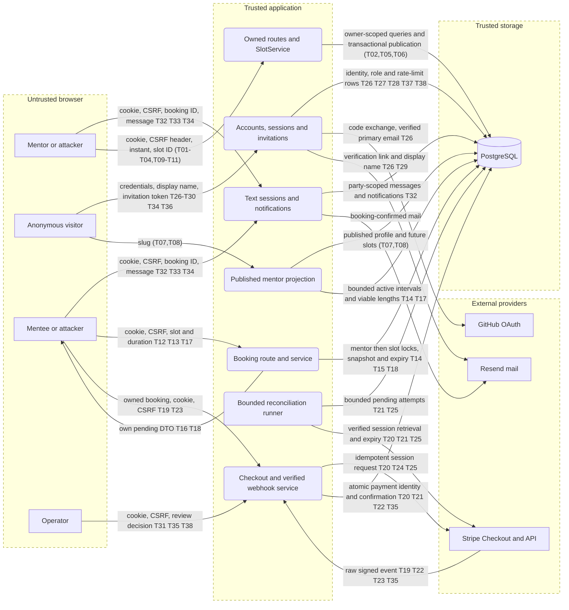
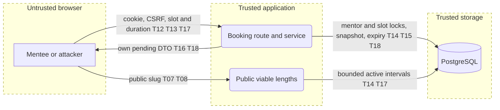

# Threat model: DevMentor

Scope: whole system since 2026-11-09 (see "System-wide review" at the end, start there); earlier sections are the dated per-slice records, beginning with E02 availability. Updated: 2026-11-09. Owner: implementation team; the only accepted risks are those listed under "Decisions — 2026-11-09" at the end.

## System profile
Next.js 16 / React 19 browser app and HTTP API, TypeScript services, MikroORM PostgreSQL. Single application; core/ui/db are shared libraries. Deployment target is not assumed. Signed session cookies reload live roles; owner identity comes from the session, never request data. There is no organization tenant: mentor profiles are the ownership boundary. No AI or external integration is introduced; AI Rule of Two is inapplicable.

Assets: private account/profile data, accurate availability and publication ordering, historical removed slots. Actors: anonymous visitor, mentee, mentor owner, another mentor, operator without mentor role. Entries: mentor slots page, GET/POST slots, DELETE slot ID, public mentor page/API. The database is trusted storage; browsers and all request fields are untrusted.

## Data flow and trust boundaries

## Threats and controls

| ID | Threat | STRIDE | L/I | Response and control | How verified | Mapping |
| --- | --- | --- | --- | --- | --- | --- |
| T01 | Signed-out or mentee caller publishes availability | S/E | H/H | Mitigate: page, route and service mentor guards; existing live session verification | Denied page/API/service tests | A01:2025 CWE-862 |
| T02 | Mentor deletes or reads another mentor's slots | I/T/E | H/H | Mitigate: profile from session; ID plus owner query; identical missing/foreign 404 | Two-owner API test, service query assertions | API1:2023 CWE-639 |
| T03 | Cross-site request changes slots | T | M/H | Mitigate: central apiHandler CSRF header, existing JSON-only path | POST/DELETE without header denied | A01:2025 CWE-352 |
| T04 | Crafted body changes owner or publishes past instant | T | H/M | Mitigate: explicit schema/projection; server clock after lock; local conversion is convenience only | Extra keys, invalid ISO, past/now tests | A06:2025 CWE-602 |
| T05 | Concurrent publication duplicates an active instant or regresses timestamp | T | M/M | Mitigate: profile row lock, partial unique index, atomic publication timestamp | Parallel POST DB test; named-constraint mapping | A06:2025 CWE-362 |
| T06 | Removed slot disappears from history or publication cannot be attributed | R/T | M/M | Mitigate: soft removal, preserved owner/start/timestamps, typed event after commit; no claim of durable audit bus | Remove/republish test, failed-transaction event absence | A09:2025 CWE-778 |
| T07 | Public API leaks private profile/removed availability | I | M/H | Mitigate: published-profile lookup, future active slots, explicit public allowlist | Exact key and unpublished/removed/past tests | API3:2023 CWE-200 |
| T08 | Unlimited public or owner reads exhaust resources | D | M/M | Mitigate: indexed owner/start queries, server-filtered owner pages of 25 and public next-50 cap; no unbounded materialized collections | Query/index/page-limit assertions, integration smoke | API4:2023 CWE-400 |

STRIDE considered across browser/application and application/storage: S/E live-session and owner guards; T schema/clock/transaction; R stored timestamps/event; I explicit projection; D indexed queries with bounded materialized collections. No secrets or provider calls enter this feature.

## Test scope and boundaries
Synthetic local ephemeral PostgreSQL and browser only. Unit: authorization, invalid input, clock boundary, named constraint, transaction/event ordering, exact DTOs, local timezone/DST conversion. Integration: parallel duplicates, foreign/missing IDs, soft removal and republish, signed-out public visibility, CSRF and role denial, migration up/down. No production scans or live accounts. Booking occupancy and payment policy are out of scope; Slice 4 policy was explicitly approved on 2026-11-05. No SVG renderer is installed; render the sibling Mermaid source with an existing Mermaid viewer if needed.

Changelog: 2026-11-05 initial preimplementation model; mitigations above are planned until verified by the run gate.

## Slice 4 extension — approved and reviewed on 2026-11-05
Money assets: exact minor-unit amounts, authoritative policy, truthful offer readiness. Entry PUT prices plus owner/public reads. T09 (T/E, H/H, A06:2025 CWE-602): client supplies price/currency/bounds/storage fields; mitigate with decimal-only schema, exact bounded integer parsing, session-owned profile and server-only settings. Test extra keys, role/scope/CSRF denial and one-invalid rollback. T10 (T, M/H, CWE-362): partial/concurrent two-price save; validate both before any mutation inside the profile row transaction, test persisted atomicity. T11 (T/I, M/H, A02:2025): missing/malformed policy or stale stored price masquerades as ready; settings validates complete positive integer PLN bounds, readiness rechecks current bounds, public projection excludes bounds. Test malformed JSON, missing settings, inverted/zero/overflow bounds and subsequent policy changes. No charge, fee, booking snapshot or payout is introduced. The same application/storage boundaries apply. Final verification evidence is recorded in the PR; no payment-launch approval is inferred.

## Booking reservation extension — 2026-11-05

Scope: issue #40, pending unpaid reservations only. The system profile and boundaries above still apply. New assets are booking identity, price/time snapshots, reservation history and exclusive mentor time. New entry is POST /api/bookings plus the public SlotPicker. No AI or payment provider is introduced.

| ID | Threat | STRIDE | L/I | Planned mitigation | How verified | Mapping |
| --- | --- | --- | --- | --- | --- | --- |
| T12 | Anonymous or mentor-only caller reserves as a mentee | S/E | H/H | Live route and service mentee guards; identity from scope | API 401/403 and service denial tests | API5:2023 CWE-862 |
| T13 | Cross-site or forged body changes price, owner or status | T/E | H/H | Central CSRF, explicit schema, stored bounded mentor prices and DTO allowlist | CSRF, extra-key and price-change tests | A01:2025 CWE-352; API3:2023 |
| T14 | Two slot IDs reserve overlapping mentor time | T | M/H | Mentor then slot lock; half-open interval overlap check; partial active slot uniqueness; lazy expiry | Same-slot/cross-slot concurrent requests, adjacency and expired holds | A06:2025 CWE-362 |
| T15 | Removal, unpublish or price edit races a reservation | T | M/H | Profile lock shares E02 price/unpublish serialization; slot lock shares removal serialization; occupied removal denied | Concurrent removal and stale-price integration tests | A06:2025 CWE-367 |
| T16 | Retry leaks another mentee's hold or extends own hold forever | I/T | M/H | Recover only same-owner same-slot same-duration pending hold; never extend expiry; generic conflict otherwise | Owner retry and different-owner tests; DTO exact keys | API1:2023 CWE-639 |
| T17 | Free holds exhaust inventory or requests overload locking | D | H/M | Account attempt throttle using existing limiter; 30-minute lazy expiry; bounded public projection | 429/Retry-After, exact expiry and viable-length tests | API4:2023 CWE-400 |
| T18 | Expiry destroys history or unpaid state looks confirmed | R/T | M/M | Preserve immutable slot/start/price snapshot; explicit expired status; pending/unpaid copy and nullable bookedAt | Persisted history, retry and UI status assertions | A09:2025 CWE-778 |

Multi-account inventory abuse remains a residual product risk; this document does not imply owner acceptance or invent a per-user booking quota. Follow-up product work must decide whether stronger anti-hoarding controls are needed. Operational throttling is not proof that abuse is impossible.

Test scope: synthetic ephemeral PostgreSQL, real app/API and isolated browser sessions. Cover all T12–T18 controls in unit/integration/QA, including failed input, role denial, concurrency, expiry, price tampering and retry. No real accounts, provider calls, production scans or destructive cleanup. STRIDE: S/E role/identity; T transactional invariants; R history/timestamps; I explicit DTO; D bounded reads/throttling. Controls remain planned until the recorded gate proves them.

Implementation sequence: entity/migration; service and occupied removal; route/DI; viable lengths and picker; documented integration scenarios; coverage/full gate/independent review and QA. Each step is a separate commit; the local run plan tracks exact hashes without committing runtime artifacts.

## Booking payment design extension — 2026-11-06

Scope: #41/#53 design only. The existing availability profile remains historical; the payment proposal adds an external integration through an app-layer Stripe adapter. The main inline and sibling diagrams now include that proposed boundary. No payment control below is implemented or tested. See `.ai/specs/2026-11-06-booking-payments.md`; Q1/Q2 require policy-owner confirmation. No risk acceptance is inferred.

New assets: collected money, exclusive paid session time, stable provider identities, webhook signing/API secrets, Checkout bearer URLs and reconciliation history. Actors include another mentee, a nonoperator caller, forged callback sender and a failing/retrying external provider. Entries: owned Checkout POST, raw payment webhook, participant reads and bounded reconciliation runner. Provider requests are untrusted until the official SDK verifies signatures and the service verifies exact stored payment identity/amount/currency/environment. No AI component is added; Rule of Two remains inapplicable.

| ID | Threat | STRIDE | L/I | Planned mitigation | How verified | Mapping |
| --- | --- | --- | --- | --- | --- | --- |
| T19 | Forged callback or browser success URL confirms an unpaid booking | S/T/E | H/H | Raw-body SDK signature verification; trusted environment/account; paid status; return pages read state only; production fails closed | Bad/missing signature, wrong environment and forged success-return tests | API2:2023 CWE-345 |
| T20 | Lost creation response or retries produce multiple payable sessions | T/R | H/H | Durable immutable attempt/idempotency key before provider call; replay/retrieve same attempt; no indefinite deadline extension | Timeout before/after remote creation, crash before attachment, parallel retries | A06:2025 CWE-362 |
| T21 | A delayed paid callback races wall-clock expiry and resells mentor time | T | H/H | Shared mentor→slot lock order; unresolved-attempt occupancy across every availability/release path; provider reconciliation before unpaid release | Paid/expiry/new-booking/removal interleavings on real PostgreSQL, provider outage recovery | A06:2025 CWE-367 |
| T22 | Transport replay or distinct event IDs confirm/record one payment twice | T/R | H/H | Atomic event marker plus transition; booking/session/payment-intent uniqueness; rollback markers on failure | Same/different event IDs, concurrent delivery, database rollback then retry | A06:2025 CWE-841 |
| T23 | Valid provider event binds the wrong owner, amount, currency or booking | T/I/E | M/H | Match stored attempt/session/booking and exact immutable price; ownership from live session; generic foreign/missing 404; paid anomalies durably quarantined | Two-mentee/two-mentor IDOR, wrong role, altered metadata/amount/currency, operator-only exception reads | API1:2023 API3:2023 CWE-639 |
| T24 | Secrets, Checkout bearer URLs or customer/card data leak through logs/audit rows | I | M/H | Minimal normalized event fields, bounded diagnostic codes, logger redaction, explicit DTOs and configured server-origin redirects | DTO/log assertions and sanitized artifact review; no raw provider payload persisted | A02:2025 CWE-200 |
| T25 | Oversized webhook or unavailable provider exhausts locks and inventory | D | H/M | Body limit, verified event filtering, bounded I/O outside locks, indexed bounded reconciliation with backoff; operator-visible overdue state | Oversized request, unknown event, API timeout, bounded runner and overdue recovery cases | API4:2023 CWE-400 |

Payment test scope: synthetic local ephemeral PostgreSQL and isolated test adapters; real Stripe test-mode smoke only with separate test credentials and explicit scope. No production calls, charges, refunds, provider infrastructure scans or new public webhook registration in this design run. Integration tests must cover T19–T25, including wrong-scope reads, denial, failure, retry, idempotency, crash recovery and migration up/down/up. Human money review and risk-high QA approval remain outstanding.

STRIDE across browser/app, provider/app and app/storage: S verified provider identity/live sessions; T locked state/amount/expiry; R durable normalized markers and transitions; I DTO/log minimization; D bounded inputs/I/O/recovery; E role/ownership/operator guards. All high threats have planned mitigations and concrete tests. Residual policy risks: unresolved provider state temporarily retains inventory; paid anomalies need operator action; in-process confirmation events have no durable delivery guarantee. Q1/Q2 owner confirmation gates implementation. These are assumptions, not accepted risks or completed controls.

Changelog: 2026-11-06 added payment design threats T19–T25, preserving T01–T18 and existing scopes.

## System-wide review — 2026-11-09

Scope: the whole application as committed at `f5408a4`, read from code. It adds surfaces no earlier section modelled (accounts, sessions, invitations, operator tools, text sessions, notifications) and replaces "planned" with the status of the payment controls. T01–T25 keep their IDs and text above. The main diagram and `threat-model.mmd` now show the whole system.

**Most important today:** T26, because someone who never held the mailbox can end up with a working password on a real account, and the product has no password reset to remove it; and T27, because per-IP limits are off unless deployment sets a value nothing enforces.

### System profile

| Application | Type | Stack | Deployed as | Auth | Tenancy | AI |
| --- | --- | --- | --- | --- | --- | --- |
| `@devmentor/app` | Browser web app + HTTP API | Next.js 16.3, React 19, MikroORM, PostgreSQL, Stripe SDK 23 | Not defined in the repository | Stateless HS256 session cookie (24 h), revoked by `sessionVersion`, roles reloaded per request; GitHub OAuth or email + scrypt password | None. Ownership per mentor profile, booking party and user | None at runtime (no LLM SDK in `packages/`) |
| `npm run payments:reconcile` | Scheduled CLI | Node, same services | External scheduler, not provisioned | None: trusts host environment | System scope | None |

`core`, `db` and `ui` are libraries, modelled through the app. Events are in-process, with no queue. External systems: Stripe (payments), GitHub (identity), Resend (mail). AI Rule of Two: not applicable. The agent tooling in `.agents/` is development-time and out of scope.

**Assets added:** account credentials and sessions, `SESSION_SECRET`, operator authority, invitation tokens, private session messages, mail sender reputation. **Actors added:** anonymous registrant, stranger with a mentee account, operator, party to a booking attacking the other party.

**Entry points added:** `POST /api/auth/{login,register,logout}`, `GET /api/auth/verify-email`, `GET /api/auth/github` and its callback, `GET /api/invitations/{token}`, `POST …/accept`, `GET /api/users`, `GET|POST /api/payments/{report,review,review/{id},reconcile}`, `GET /api/sessions/{bookingId}`, `POST …/messages`, `GET|POST /api/notifications`, `GET /api/health`.

**Boundaries:** browser ↔ app; Stripe, GitHub and Resend ↔ app; app ↔ PostgreSQL; scheduler host ↔ app. Note: `src/proxy.ts` is not an auth boundary.

### Status of earlier threats

| IDs | Status on 2026-11-09 |
| --- | --- |
| T01–T16, T18 | Controls present; covered by `availability`, `prices` and `booking-*` integration suites. |
| T17 | Open, and wider than the residual note says. No per-account cap on active holds exists in `BookingService.start`: at 20 attempts per 10 minutes and a 30-minute hold, **one** account can hold about 60 slots continuously. Needs a product decision. |
| T19, T20, T22, T23 | Implemented (`payment.service.ts`, `stripe-payment-gateway.ts`); covered by `payments-signature`, `-lost-response`, `-ambiguous-creation`, `-confirmation`, `-amount`, `-authorization`. |
| T21, T25 | Implemented, but depend on deployment: nothing in this repository schedules `payments:reconcile` or registers the webhook (`README.md`). Do not take paid traffic until both exist. |
| T24 | Implemented: normalized provider fields, generic webhook status codes, pino redaction. |

### New threats

| ID | Threat | STRIDE | Where | L | I | Response | Control today | How we verify | OWASP / CWE |
| --- | --- | --- | --- | --- | --- | --- | --- | --- | --- |
| T26 | Registrant who does not own an address sets the password on its unverified row; when the owner opens the emailed link the account becomes verified with the registrant's password. The same row makes GitHub sign-in refuse and tell the owner to open that link. No password reset or change exists to evict the password | S, E | `user.service.ts` `claimOrCreate`, `matchOrCreate`, `verifyEmail` | M | H | Mitigate: do not activate a password set before proof of mailbox unless the link opens in the registering browser, otherwise require setting one at verification; let verified GitHub identity take over an unverified row and clear its hash; add password reset and change that bump `sessionVersion` | Partial: claim voids older links; sign-in requires verification | Integration: register as A, verify as the mailbox owner in a separate browser, assert A's password fails; GitHub sign-in on an unverified row succeeds and clears the hash | A07:2025, CWE-287, CWE-640 |
| T27 | Per-IP limits on sign-in and registration are skipped because `TRUSTED_PROXY_HOPS` defaults to 0, leaving only per-address limits. Varying the address permits password spraying, mail sending at scale and saturation of the two-slot scrypt pool | D, S | `http/rate-limit.ts` `clientIp`, `consumeFor` | H | M | Mitigate: require an explicit value at production boot; add a global registration and mail ceiling; document that a wrong hop count allows spoofing | Partial: per-address limits; one warning per process | Boot test without the value in production; integration test that many addresses from one client are refused once hops are set | API4:2023, CWE-307, CWE-770 |
| T28 | Anonymous caller keeps a known user out of password sign-in: attempts count per address before the password is checked, and refused attempts count too, so 5 per 15 minutes renews a lockout indefinitely | D | `user.service.ts` `authenticateWithPassword` | H | M | Mitigate: key the lockout on address plus client once T27 is fixed, keep a looser per-address ceiling | None; GitHub sign-in is unaffected | Integration: exhaust from client A, correct password from client B succeeds | A07:2025, CWE-645 |
| T29 | Anonymous caller sends mail from our domain to any address with 120 attacker-chosen characters in the greeting, including line breaks; `plainName` protects the booking mail but not this one | S, T | `email-verification.service.ts` `message` | M | M | Mitigate: apply `plainName`, or drop the name from this mail; T27's ceiling | Partial: 3 per address per hour, fixed subject | Unit: control characters and line breaks are removed from the body | A06:2025, CWE-93 |
| T30 | Registration reveals that a verified account exists and whether it is GitHub-only. Sign-in answers are uniform | I | `user.service.ts` `claimOrCreate` | H | L | Owner decision: uniform "check your mail" response, or accept for usability | None by design | Compare responses for unknown, verified and GitHub-only addresses | API2:2023, CWE-204 |
| T31 | Mentee or mentor reaches operator actions: user list, payment report, review decisions, reconciliation | E | `api/users`, `api/payments/*` | M | H | Mitigate | Route `requireRole`, repeated in the services except `reconcile`, which must stay callable by the CLI; `operator` derives live from the allowlist and a verified address (`roles.ts`) | Existing `payments-authorization`, `admin`, `roles` suites; DAST with mentee and mentor sessions | A01:2025, API5:2023, CWE-862 | 
| T32 | User who is not a party reads or posts in a text session, or sees whether a booking exists | I, E | `text-session.service.ts` `party` | M | H | Mitigate | Party resolved per booking; same 404 for stranger, unknown ID, unconfirmed booking; notifications scoped to session user | Existing `text-session` suite; manual with three accounts swapping booking IDs | A01:2025, API1:2023, CWE-639 |
| T33 | A party or mentor stores content that runs in another user's browser through messages, names or the public work link | T, E | `SessionRoom`, `MentorPageView` | M | H | Mitigate | React escaping; no `dangerouslySetInnerHTML` found; `publicWorkUrl` limited to http(s) | SAST rule banning the raw HTML sink; DAST stored-content probe with synthetic data | A05:2025, CWE-79 |
| T34 | No Content-Security-Policy, frame or HSTS headers, so the booking and Checkout screens can be framed and any future XSS has no second barrier | T, I | `next.config.ts`, `proxy.ts` | M | M | Mitigate: add `headers()` with CSP, `frame-ancestors 'none'`, HSTS, `nosniff`, `Referrer-Policy` | Partial: enforced per-request nonce CSP on every page (`proxy.ts`, `lib/content-security-policy.ts`, #83); framing (#84), HSTS, `nosniff` and `Referrer-Policy` still open | Header assertions in the integration suite; DAST header check | A02:2025, CWE-1021, CWE-693 |
| T35 | Refund or card dispute after confirmation changes nothing: the booking stays confirmed, the session stays open and the report still counts it. Operators cannot reverse it because review requires a pending booking | T, R | `payment.service.ts` `apply`, `resolveReview`; `payment-report.service.ts` | M | M | Mitigate: handle refund and dispute events by flagging the booking for operator review, before any payout feature consumes this data | Partial: refunds before confirmation are caught; the report's gross counting is documented | Integration: signed refund event on a confirmed booking produces a review item | A06:2025, CWE-840 |
| T36 | Anonymous health check returns the raw database error and the environment name | I | `api/health/route.ts` | M | L | Mitigate: return only up or down, log the reason | None | Integration with the database stopped: response has no error text | A02:2025, CWE-209 |
| T37 | Production starts with `INTEGRATION_TEST_RUN=1` and mock sign-in, which lets anyone act as anyone, or with the default database password or localhost `APP_URL` | E, S | `config/env.ts`, `container.ts` `assertProductionConfig` | L | H | Mitigate: separate a test-only production flag from real deployment (for example refuse mocks unless the database host is local) and refuse default credentials | Partial: mocks refused without the flag; session secret and mail required | Boot tests for each refused combination | A02:2025, CWE-1188 |
| T38 | Security-relevant actions cannot be reconstructed: failed sign-ins are not logged and role grants and reconciliation exist only in application logs | R | `user.service.ts`, `invitation.service.ts`, `api/payments/reconcile` | M | M | Mitigate: durable record of actor, time and target for sign-in failures, role changes and invitations | Partial: `PaymentResolution` records operator decisions | Assert a record exists after each action; review logs for absent secrets | A09:2025, CWE-778 |
| T39 | A vulnerable or compromised dependency, or a committed secret, reaches production unnoticed: CI has no dependency, SAST or secret scan | T, E | `.github/workflows/ci.yml` | M | H | Mitigate: add `npm audit` or equivalent, SAST and secret scanning to CI | Exact versions for key packages | CI job fails on a seeded test finding | A03:2025, CWE-1395 |

STRIDE across the new flows: **S** T26, T27, T29, T37, signed state and purpose-scoped tokens hold; **T** T29, T33–T35; **R** T35, T38; **I** T30, T32, T36; **D** T27, T28; **E** T26, T31–T33, T37, T39. Reviewed and sound in code, so no row: OAuth state bound to the browser (login CSRF), `safeReturnTo` open-redirect handling, invitation tokens stored as hashes, masked in logs and bound to the verified invitee, central CSRF header (only the webhook opts out), no server actions.

### Assumptions and open questions

- [ ] Production hosting, TLS termination and the real `TRUSTED_PROXY_HOPS` are undefined here.
- [x] Dependency vulnerabilities: the first CI audit (2026-11-09) found 1 critical and 3 high in `next`, `sharp`, `source-map-js` and `zod`; all fixed by #82.
- [ ] No code path creates, resends or revokes invitations; `InvitationService` exposes them but nothing calls them. How operators invite mentors is unverified.
- [ ] Session messages and accounts have no retention or deletion path. This needs a privacy decision.
- [ ] A mentor holding the mentee role is not prevented from booking their own slot, which would inflate paid-session counts. Product decision.

### Test scope

| Method | What to try | Threats |
| --- | --- | --- |
| Integration tests | New cases named in "How we verify"; keep existing payment and booking suites green | T26–T29, T34–T38 |
| SAST and CI scanning | Ban raw HTML sinks; dependency and secret scans | T33, T39 |
| DAST (no session, then mentee, mentor) | Operator routes, swapped booking IDs, security headers, health response | T30–T34, T36 |
| Manual, two browsers and three accounts | Registration claim and verification from separate browsers; lockout from a second client; stranger access to a session | T26, T28, T32 |

**Out of scope:** Stripe, GitHub and Resend infrastructure, volumetric DoS, social engineering, production and shared environments, agent development tooling.

**Rules of engagement:** isolated local environment only, synthetic data seeded for at least two mentees, two mentors and one operator, Stripe test mode with separate credentials or the mock gateway. Real accounts and real mail recipients are never used.

### Review checklist

- [x] Every application has a profile row, and every new boundary crossing was walked through STRIDE.
- [x] AI verdict recorded (no AI component). Cross-role and cross-owner threats present (T31, T32); multi-tenancy is not applicable.
- [x] Every High-impact threat has a response and a verification. Threat IDs are on the diagram.
- [x] Assumptions are marked; no attack instructions or payloads; out of scope and rules of engagement are written.

Changelog: 2026-11-09 system-wide review from code at `f5408a4`: added T26–T39, profile, diagram coverage for accounts, operators and text sessions; recorded implementation status of T19–T25 and widened T17. No risk is accepted by this update.

## Decisions — 2026-11-09

Each row of the table above was re-checked against code at `f5408a4`. Damian approved the work order and is the named owner of these acceptances.

| ID | Accepted risk | Reason | Condition or review trigger |
| --- | --- | --- | --- |
| T30 | Registration reveals that an account exists | Low impact; a uniform answer would worsen registration | Holds only once T27 ships. Review if user data becomes more sensitive or abuse is seen |
| T35 | Refund or dispute after confirmation stays manual | No payout feature exists, so no automatic loss; Stripe notifies operators | Must be fixed before any payout feature, or reviewed at the first real dispute |
| T28 (residual) | Lockout remains possible from many IPs at the higher per-address ceiling, after the T28 fix | Removing the ceiling reopens password guessing; GitHub sign-in is unaffected | Lockout reports |
| T34 (residual) | `style-src` keeps `'unsafe-inline'`, so injected markup can still be styled, after the nonce CSP (#83) | Server-rendered `style` attributes cannot carry a nonce; scripts are nonce-only and inline handlers are refused | Before rendering any rich user content |
| T38 (residual) | Structured logs only, no durable audit table, after the log fix | Hosting and retention are undecided; operator payment decisions are already durable | When hosting is chosen, or if compliance requires it |

**Work order:** (1) T39; (2) T26, spec first; (3) T27 then T28; (4) T37, T36, T29; (5) T34; (6) T31 tests, T33 lint rule; (7) T38 logs; (8) T17 product decision. Before paid traffic: items 1–4, plus the scheduler and webhook that T21 and T25 depend on.

**Corrections to the table above:**
- T26's fix is now in `.ai/specs/2026-11-09-verification-bound-to-browser.md`, using browser binding (decided by Damian).
- T29: remove the name from the mail, because `plainName` does not remove URLs.
- T31: the controls hold, but real-session denial tests for `POST /api/payments/reconcile` and `POST /api/payments/review/{id}` were not found. The row overstated coverage.
- T37: the harness itself runs `NODE_ENV=production` with the flag, so the check is a loopback `APP_URL`, not a local database host.

Changelog: 2026-11-09 recorded owner decisions and work order; T39 scanning added to CI.

Changelog: 2026-11-09 T39: the first audit run found 1 critical and 3 high production dependency findings, cleared by #82 (`next` 16.4.5, `sharp` 0.35.5, `source-map-js` 1.2.2, `zod` 4.6.7). The new jobs do not block merges until they are added to the branch ruleset.
